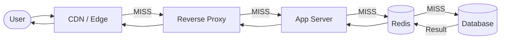
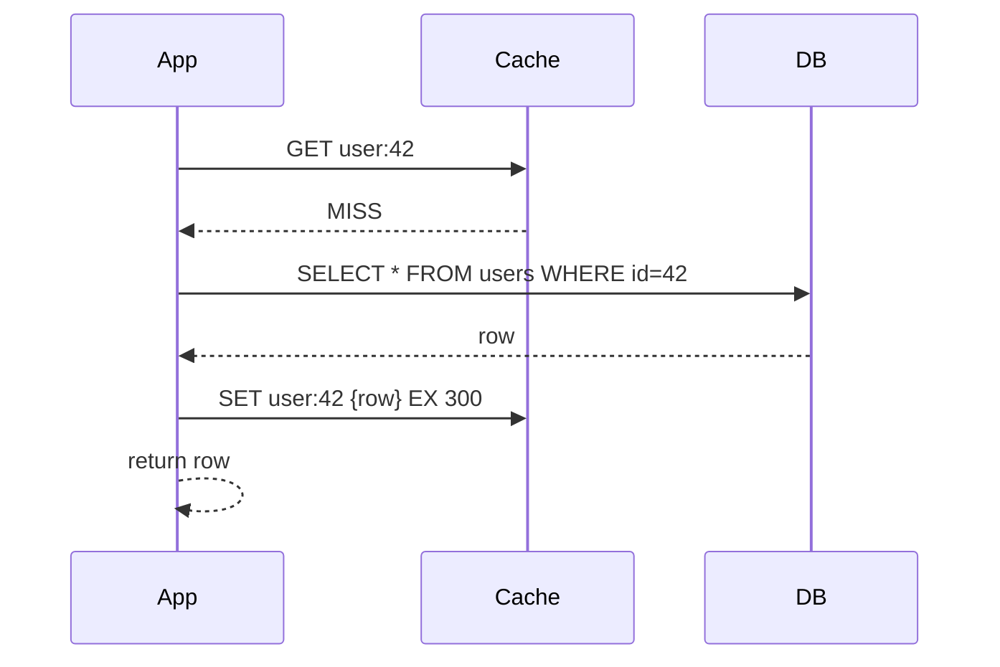

import { Badge } from '@astrojs/starlight/components';
import Figure from '../../../components/Figure.astro';
import TopicNav from '../../../components/TopicNav.astro';
import RunCode from '../../../components/RunCode.astro';
import CacheFlow from '../../../components/CacheFlow';
import SystemDiagram from '../../../components/SystemDiagram';

<Badge text="Beginner" variant="success" /> <Badge text="Has code" variant="note" /> <Badge text="Docker required" variant="note" />

Think of a cache like the pantry in your kitchen. Going to the grocery store for every single ingredient would make cooking unbearably slow, so you keep the things you use most within arm's reach. The store still holds everything — the pantry just saves you the trip for the common items.

**You'll learn:**
- What caching is and the latency problem it solves
- How cache-aside, write-through, and write-behind work step by step
- When to cache and the staleness trade-off you're accepting

## What is caching?

Caching stores the result of an expensive computation or I/O operation in fast storage. Subsequent requests are served without repeating that work. In distributed systems, the canonical slow operation is a database query. A cache — typically an in-memory store like Redis — sits in front of it and absorbs the majority of reads.

## Why it matters

- A RAM read costs ~1 ms; a database query costs ~10 ms or more — caching closes a 10× latency gap per request.
- A cache at 95% hit ratio reduces database load by 20×; at 50% it still halves it.
- Repeat reads of hot data (profiles, prices, sessions) dominate most web workloads — exactly what a cache absorbs.
- Database capacity is expensive to scale; cache capacity is cheap RAM.

## How it works

Every layer between the user and the origin database is an opportunity to cache. A request walks down the layers — browser, CDN, reverse proxy, application cache — and only the misses reach the database.

**See it run.** Requests hit the cache first; hits return fast, misses fall through to the database and back-fill the cache. Push **key skew** up (a few hot keys) and the hit ratio climbs while database load drops — the entire reason caches work.

<CacheFlow client:only="react" />

<Figure caption="Each layer absorbs the reads it can; only cache misses fall through to the next layer, and the database sees the fewest.">

</Figure>

| Layer | Examples | Latency saving |
|---|---|---|
| Client-side | Browser cache, mobile app cache | Eliminates network round-trip entirely |
| CDN | Cloudflare, CloudFront, Fastly | ~50–200 ms (edge PoP vs origin) |
| Reverse proxy / Edge | Nginx proxy_cache, Varnish | ~5–50 ms (avoids app tier) |
| Application layer | Redis, Memcached | ~1–10 ms (RAM vs disk) |
| Database query cache | pg_prewarm | ~5–50 ms (avoids parse + plan + I/O) |

### Cache-aside (lazy loading)

The application owns the cache interaction. On a read, it checks the cache first. On a miss it fetches from the database and populates the cache before returning. **Step through it** — first read misses and fills the cache, the second hits:

<SystemDiagram
  client:only="react"
  height={260}
  nodes={[
    { id: 'app', position: { x: 0, y: 100 }, data: { label: 'App' } },
    { id: 'cache', position: { x: 220, y: 100 }, data: { label: 'Cache (Redis)' } },
    { id: 'db', position: { x: 460, y: 100 }, data: { label: 'Database' } },
  ]}
  edges={[
    { id: 'get', source: 'app', target: 'cache', label: '1. GET user:42' },
    { id: 'miss', source: 'cache', target: 'app', label: '2. MISS' },
    { id: 'sel', source: 'app', target: 'db', label: '3. SELECT' },
    { id: 'row', source: 'db', target: 'app', label: '4. row' },
    { id: 'set', source: 'app', target: 'cache', label: '5. SET EX 300' },
    { id: 'hit', source: 'cache', target: 'app', label: '6. HIT (~1ms)' },
  ]}
  steps={[
    { caption: 'Read: the app asks the cache first.', activeNodes: ['app', 'cache'], activeEdges: ['get'] },
    { caption: 'Cache miss — the key isn’t there yet.', activeNodes: ['app', 'cache'], activeEdges: ['miss'] },
    { caption: 'Fall through to the database (~10ms).', activeNodes: ['app', 'db'], activeEdges: ['sel', 'row'] },
    { caption: 'Populate the cache so the next reader hits.', activeNodes: ['app', 'cache'], activeEdges: ['set'] },
    { caption: 'Next read is a hit — ~1ms, the database stays idle.', activeNodes: ['app', 'cache'], activeEdges: ['hit'] },
  ]}
/>

<Figure caption="Cache-aside read path: a miss falls through to the database, then back-fills the cache so the next read is a hit.">

</Figure>

### Write-through

Every write goes to the cache and the database synchronously before the request completes. Keeps the cache warm but adds write latency.

### Write-behind (write-back)

Writes land in the cache immediately; the cache asynchronously flushes to the database. Lowest write latency, but risks data loss if the cache crashes before flushing.

:::caution
Write-behind introduces a durability gap. If Redis goes down between the write acknowledgement and the DB flush, data is lost. Only use it when you can tolerate occasional loss (counters, analytics) or when Redis is configured with AOF persistence and you accept replay lag.
:::

| Strategy | Write Latency | Read Latency | Consistency | Best For |
|---|---|---|---|---|
| Cache-Aside | DB latency | Hit: fast, miss: DB | Eventual | General-purpose reads |
| Read-Through | DB latency | Same as cache-aside | Eventual | ORM / library-managed reads |
| Write-Through | Cache + DB | Fast (always warm) | Strong | Read-heavy, write-tolerant |
| Write-Behind | Cache only (fast) | Fast (always warm) | Eventual / lossy | High-write, loss-tolerant |

### Eviction policies

When memory is full, the cache must evict entries. The policy determines which ones go.

| Policy | Complexity | Best For |
|---|---|---|
| LRU | O(1) with linked hash map | General reads, temporal locality |
| LFU | O(log n) with min-heap | Skewed popularity distributions |
| TTL | O(1) | Freshness-critical data (tokens, prices) |
| Random | O(1) | Approximation, very low overhead |

Redis supports `allkeys-lru`, `allkeys-lfu`, `volatile-lru`, `volatile-lfu`, `volatile-ttl`, and `allkeys-random` as `maxmemory-policy` values.

## Key concepts

| Term | What it means |
|------|---------------|
| Cache-aside | Your code checks the cache first, and fills it from the DB on a miss |
| TTL | How long an entry lives before it expires automatically |
| Hit ratio | The fraction of reads answered by the cache — the #1 cache health metric |
| Eviction | Removing entries when memory is full, chosen by policy (LRU, LFU) |
| Cache stampede | Many requests recomputing the same expired key at once, hammering the DB |
| Write-through | Writing cache and DB together so the cache never goes stale |

## When to use it

| Use it when... | Avoid it when... |
|----------------|------------------|
| Reads heavily outnumber writes (10:1 or more) | Data changes on nearly every read — the cache would always be stale |
| The same keys are read repeatedly (hot keys exist) | Access is uniformly random across a huge keyspace — hit ratio will stay low |
| You can tolerate bounded staleness (seconds to minutes) | Every read must see the latest committed write — go to the DB |

## Trade-offs and failure modes

| Concern | Issue | Mitigation |
|---------|-------|------------|
| Cache stampede | Many requests hit DB simultaneously on cold cache | Probabilistic early expiry, Redis locks (`SET NX`), request coalescing |
| Stale data | Cache returns outdated rows after a write | TTL tuning, event-driven invalidation (publish on write) |
| Cold start | Fresh deployment, empty cache, full DB load | Pre-warm cache at startup, gradual traffic ramp |
| Memory pressure | Evictions spike, hit ratio drops | Monitor `evicted_keys`, right-size `maxmemory`, tune eviction policy |
| Network partition | App cannot reach Redis | Circuit breaker (fail open to DB), health checks, fallback logic |

**Cache stampede** occurs when a high-traffic key expires and hundreds of goroutines simultaneously recompute it. Fix with `SET key value NX EX ttl` (one writer wins) or probabilistic early expiry.

### Observability

Hit ratio is the single most important cache health metric:

```text
hit_ratio = keyspace_hits / (keyspace_hits + keyspace_misses)
```

| Metric | Redis INFO field | Alert threshold |
|---|---|---|
| Hit ratio | `keyspace_hits` / total | < 90% |
| Evictions per second | `evicted_keys` delta | > 0 sustained |
| Memory usage | `used_memory` / `maxmemory` | > 80% |
| Expired keys | `expired_keys` | Sudden spike = mass TTL expiry |

## This implementation

<RunCode path="scalability/3.1_caching" recipe="caching" />

The Go service implements cache-aside against Redis. The core read path is four steps — check cache, fall through to DB on miss, serialise, populate:

```go
// 1. Check cache
val, err := rdb.Get(ctx, cacheKey).Result()
if err == nil {
	w.Header().Set("X-Cache", "HIT")
	w.Write([]byte(val))
	return
}
// 2. Cache MISS — fetch from DB
user, err := mockDB(ctx, id)
// 3. Serialise, 4. populate cache (best-effort)
data, _ := json.Marshal(user)
if setErr := rdb.Set(ctx, cacheKey, data, cacheTTL).Err(); setErr != nil {
	log.Printf("redis SET error: %v", setErr)
}
w.Header().Set("X-Cache", "MISS")
w.Write(data)
```

- Redis errors on `GET` fall through to the DB rather than returning 500 — the cache is an optimisation, not a hard dependency.
- `X-Cache: HIT/MISS` headers make behaviour observable during testing.

## Further reading

- [Redis documentation](https://redis.io/docs/) — eviction policies, persistence, INFO reference
- [Designing Data-Intensive Applications](https://dataintensive.net/) — caching, replication, consistency trade-offs
- [AWS ElastiCache documentation](https://docs.aws.amazon.com/elasticache/) — managed Redis patterns
- [The System Design Primer](https://github.com/donnemartin/system-design-primer) — cache placement trade-offs

<TopicNav prev={{ label: 'Load Balancing', slug: 'hld/load-balancing' }} next={{ label: 'Rate Limiting', slug: 'hld/rate-limiting' }} />
