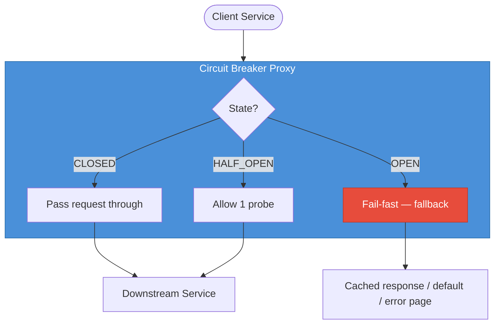
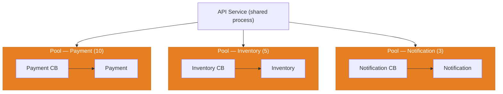
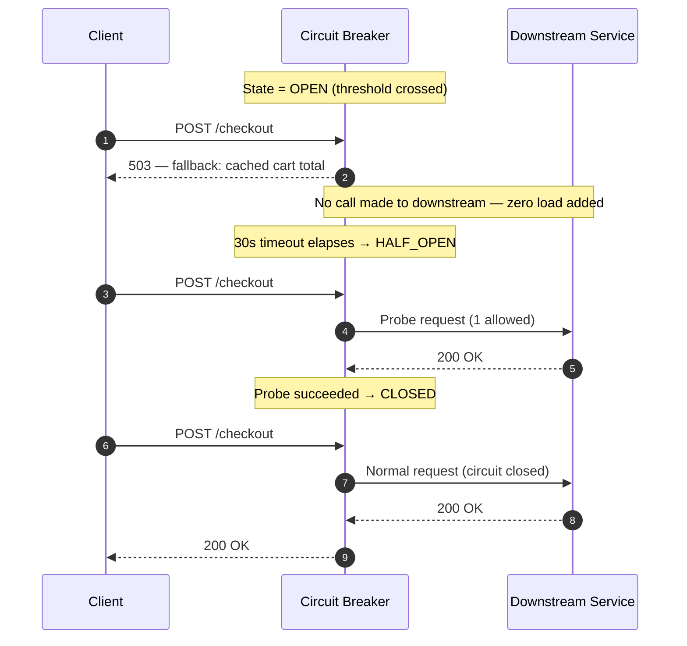

import { Badge } from '@astrojs/starlight/components';
import Figure from '../../../components/Figure.astro';
import TopicNav from '../../../components/TopicNav.astro';
import BreakIt from '../../../components/BreakIt.astro';
import CircuitBreakerFlow from '../../../components/CircuitBreakerFlow';

<Badge text="Intermediate" variant="caution" /> <Badge text="Docker required" variant="note" />

Think of a circuit breaker like the electrical panel in your house. When a faulty appliance starts drawing dangerous current, the breaker trips and cuts power to that circuit — the appliance stops making things worse, and the rest of the house keeps its lights on. Flip it back too early and it trips again; wait until the fault is fixed and power flows normally.

**You'll learn:**
- What a circuit breaker is and the cascade it prevents
- How the CLOSED → OPEN → HALF_OPEN state machine works
- When to use it versus a retry, and how to tune the thresholds

## What is a circuit breaker?

A circuit breaker is a stability pattern that prevents cascading failures. It monitors the failure rate of calls to a downstream service. Once a threshold is crossed, it trips open: all subsequent calls fail immediately without touching the downstream service. The struggling dependency gets room to recover, and upstream callers get a fast fallback instead of a timeout.

## Why it matters

- Without a breaker, every call to a slow service blocks a thread for the full timeout — thread pools exhaust in seconds.
- A full pool means even healthy endpoints in the same process stop responding — the failure climbs the call chain.
- Failing fast returns in ~1 ms instead of waiting out a 30-second timeout — callers stay responsive.
- The downstream service recovers faster when it isn't being hammered by doomed requests.

## How it works

The breaker sits between caller and dependency and tracks results in a sliding window. In CLOSED, requests pass through and failures are counted. Crossing the threshold (say, >50% errors in the last 10 calls) trips it OPEN — every call now fails instantly with a fallback. After a timeout it moves to HALF_OPEN and lets one probe through. Probe succeeds → CLOSED. Probe fails → back to OPEN.

**See it run.** Slide the downstream failure rate up and watch the breaker trip OPEN — the moment it does, downstream load drops to zero (the failing service gets a break) while callers fail fast instead of hanging.

<CircuitBreakerFlow client:only="react" />

The breaker is a proxy with three moving parts — a gate keyed on state, a failure counter, and a recovery timer:

<Figure caption="The breaker proxies calls by state: CLOSED passes through, OPEN fails fast to a fallback, HALF_OPEN allows one probe.">

</Figure>

## Break it

<BreakIt path="resilience/5.1_circuit_breaker" recipe="circuit-breaker" />

## Under the hood

### Sliding window implementations

Circuit breakers track failures using one of two window strategies — **count-based** (last N calls) or **time-based** (last T seconds). The interactive above uses a count-based window of 10.

Use these starting values, then tune against observed false trips and missed outages.

| Parameter | Description | Typical Starting Value |
|---|---|---|
| Failure rate threshold | % errors that trips the breaker | 50% |
| Minimum calls | Window must have N calls before evaluating | 10 requests |
| Slow call threshold | Calls over X ms count as failures | 2000 ms |
| Open timeout | How long to stay OPEN before probing | 30 s |
| Half-open probe count | Consecutive successes needed to close | 3 |

### Fallback strategies

When the breaker rejects a call, something must be returned — pick the fallback by how critical the data is.

| Strategy | When to Use | Trade-off |
|---|---|---|
| Cached last-known response | Read-heavy, slightly stale OK | Cache invalidation complexity |
| Default / empty value | Non-critical enrichment (recommendations) | Degraded UX, not broken |
| Error page / 503 | No meaningful fallback exists | Honest to user, worst UX |
| Fail silently | Fire-and-forget (analytics, logging) | Easiest — just swallow the error |
| Queue for async retry | Write operations that must eventually complete | Adds DLQ complexity |

### Bulkhead pattern

Bulkheads (named after ship hull compartments) isolate thread pools per downstream dependency. Combined with circuit breakers, one slow service cannot exhaust the shared thread pool and drag down unrelated features.

<Figure caption="Per-dependency breakers (bulkheads) isolate failures so one slow service cannot exhaust the threads another needs.">

</Figure>

Notification pool saturated? Payment threads are unaffected.

## Request flow

The fail-fast behaviour during OPEN, call by call:

<Figure caption="OPEN adds zero downstream load; after the cooldown a single probe decides whether the breaker closes again.">

</Figure>

Without the breaker, a slow dependency exhausts the caller's thread pool and the failure climbs the stack — the breaker cuts the chain at the first link.

## Key concepts

| Term | What it means |
|------|---------------|
| CLOSED | Normal state — calls flow, failures counted |
| OPEN | Tripped state — every call fails instantly with a fallback, downstream untouched |
| HALF_OPEN | Probe state — a few test calls decide whether to close or re-open |
| Sliding window | The recent-calls sample (count- or time-based) the failure rate is computed over |
| Bulkhead | Per-dependency thread pool isolation so one slow service can't starve the rest |

## When to use it

| Use it when... | Avoid it when... |
|----------------|------------------|
| You make synchronous calls to services that can fail persistently | The dependency is in-process or a local file — nothing to protect |
| One dependency's outage must not take down unrelated features | Calls are fully async fire-and-forget with no thread blocking |
| You can serve a meaningful fallback (cache, default, queue) | Failing fast with no fallback is worse than waiting (rare) |

Circuit breaker vs retry — they solve different failures, and most systems need both:

| Aspect | Circuit Breaker | Retry with Backoff |
|---|---|---|
| Purpose | Stop calling a broken service | Handle transient single-call failures |
| Scope | Tracks aggregate failure rate | Per-request attempt |
| Response | Immediate fail-fast (no downstream call) | Waits, then retries same call |
| When to use | Service is persistently failing | Service is transiently busy (503, timeout) |
| Used together | CB prevents retries during outage | Retry handles brief hiccups before CB trips |

## Trade-offs and failure modes

| Concern | Issue | Mitigation |
|---------|-------|------------|
| False trips | Threshold too low — breaker opens on normal error noise | Raise threshold; require a minimum call count before evaluating |
| Missed outages | Threshold too high — cascade happens before the breaker reacts | Add slow-call detection (latency > 2–3× p99 counts as failure) |
| Flip-flopping | Breaker closes on one lucky probe, re-opens immediately | Require N consecutive probe successes before closing |
| Stale fallbacks | Cached fallback served long after the data changed | Bound fallback cache age; surface staleness to the caller |

:::note
Monitor state-transition events as a first-class operational metric. A breaker that trips daily is telling you about a flaky dependency long before your users do.
:::

## This implementation

The Go service wraps a downstream call in a breaker with a count-based window, a trip threshold, and a cooldown timer — the same state machine the simulations above model.

## Further reading

- [Release It! (Michael Nygard)](https://pragprog.com/titles/mnee2/release-it-second-edition/) — the book that named the pattern
- [Resilience4j documentation](https://resilience4j.readme.io/docs/circuitbreaker) — windows, thresholds, probes
- [Martin Fowler — CircuitBreaker](https://martinfowler.com/bliki/CircuitBreaker.html) — concise canonical description

Interview questions

**Q1: What problem does a circuit breaker solve?**
It prevents cascading failures: when a downstream service is slow, synchronous callers pile up waiting for timeouts, exhausting thread and connection pools. The breaker detects degradation early and short-circuits calls, returning a fallback immediately so upstream services stay responsive while the downstream recovers.

**Q2: Circuit breaker vs retry?**
A retry re-attempts the same failing call after a delay — transient per-request failures. A breaker tracks aggregate failure rates and stops all calls for a period — persistent failures. Used together: retry handles momentary hiccups; the breaker opens if the service is truly down, preventing retries from amplifying load.

**Q3: How do you tune thresholds?**
Start from production baselines: 50% error rate, 10-request minimum window, 30 s open timeout, 3 successful probes to close. Slow-call threshold ≈ p99 normal latency × 2–3. Adjust on observed false trips (too low) or missed outages (too high).

**Q4: What happens in a microservices chain without breakers?**
A→B→C. C becomes slow. B's threads block on C — B's pool fills. A's threads block on B — A's pool fills. One slow downstream triggers a full thread-exhaustion cascade within seconds.

**Q5: How does HALF_OPEN prevent flip-flopping?**
It allows only limited probe requests. Only after N consecutive successes does the breaker fully close — the recovering service must demonstrate sustained stability before full traffic returns.

<TopicNav prev={{ label: 'Rate Limiting', slug: 'hld/rate-limiting' }} next={{ label: 'Database Replication', slug: 'hld/db-replication' }} />
