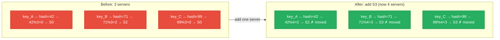
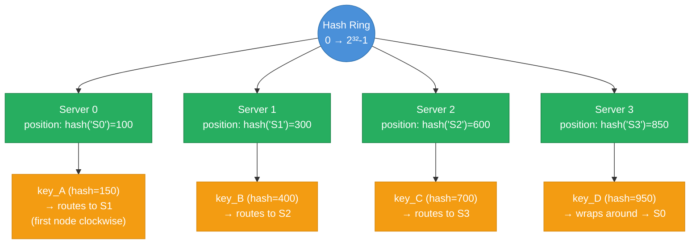
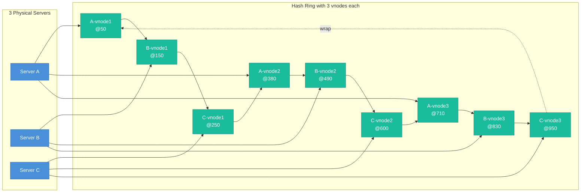
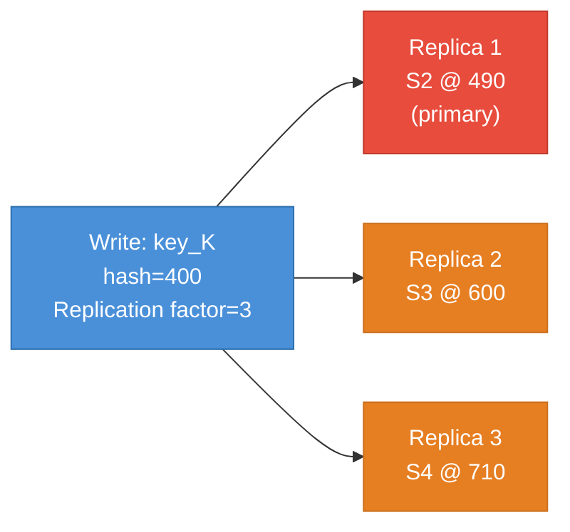

import { Badge } from '@astrojs/starlight/components';
import Figure from '../../../components/Figure.astro';
import TopicNav from '../../../components/TopicNav.astro';
import RunCode from '../../../components/RunCode.astro';
import ConsistentHashingRing from '../../../components/ConsistentHashingRing';
import SystemDiagram from '../../../components/SystemDiagram';

<Badge text="Intermediate" variant="caution" /> <Badge text="Has code" variant="note" /> <Badge text="Docker required" variant="note" />

Think of coat-check at a theater with numbered counters. The naive rule — "your ticket number divided by the number of counters" — means hiring one extra clerk reshuffles nearly every coat to a different counter. The smarter rule: arrange counters around a circle, and each coat goes to the next counter clockwise from its ticket's spot. Add a clerk and only the coats in one small arc move.

**You'll learn:**
- What breaks with mod-N hashing and how the ring fixes it
- How virtual nodes flatten load across uneven arcs
- When to use which hashing variant — ring, rendezvous, jump, slots

## What is consistent hashing?

Consistent hashing places both keys and servers on a circular hash ring: a key routes to the first server clockwise from its hash position. When a server is added or removed, only the keys between the affected node and its predecessor move — roughly `1/N` of all keys instead of nearly all of them.

**Try it** — click the ring to drop in keys, then add a node and watch how few keys actually move. Bump the vnode count to flatten the load bars.

<ConsistentHashingRing client:only="react" />

## Why it matters

- With naive `hash(key) % N`, adding one server remaps ~75%+ of keys — for a cache, that's an instant ~75% miss rate and a thundering herd on your database.
- Consistent hashing moves ~`1/N` keys per topology change — 10% for a 10-node cluster vs ~90% for mod-N.
- It is the scaling mechanism inside Cassandra, Amazon Dynamo, Memcached ketama, and Akamai's CDN.
- Every "sticky" routing problem (cache sharding, session affinity, partition assignment) reduces to it.

The mod-N failure, concretely:

<Figure caption="Plain hash % N: adding one server changes the modulus, so almost every key remaps — a cache-wiping event.">

</Figure>

:::caution
With 3 servers, adding a 4th causes (N-1)/N ≈ 75% of all keys to remap. For a cache, this means 75% cache miss rate immediately after a scale-out event — a thundering herd hitting your database.
:::

## How it works

The ring is a number line wrapped into a circle, spanning `0` to `2^32 − 1`. Both keys and nodes are mapped onto this space with the same hash function. A key belongs to the first node clockwise from its hash position. Adding a node at position P steals only the keys in `(predecessor(P), P]` from P's successor — everything else stays put.

<Figure caption="Consistent hashing: each key routes to the first server clockwise, and the last keys wrap around to the first server.">

</Figure>

### Adding and removing a node

A node dies, its arc remaps to the clockwise successor, then a replacement joins and reclaims an arc — step through it:

<SystemDiagram
  client:only="react"
  nodes={[
    { id: 'c', position: { x: 0, y: 150 }, data: { label: 'Client' } },
    { id: 'r', position: { x: 220, y: 150 }, data: { label: 'Ring Router' } },
    { id: 's1', position: { x: 480, y: 10 }, data: { label: 'S1 @300' } },
    { id: 's2', position: { x: 480, y: 150 }, data: { label: 'S2 @600' } },
    { id: 'snew', position: { x: 480, y: 290 }, data: { label: 'S-new @450' } },
  ]}
  edges={[
    { id: 'e_cr', source: 'c', target: 'r' },
    { id: 'e_rs2', source: 'r', target: 's2', label: 'key_X (500)' },
    { id: 'e_rs1', source: 'r', target: 's1' },
    { id: 'e_rsnew', source: 'r', target: 'snew', label: 'key_Y (400)' },
    { id: 'e_s2new', source: 's2', target: 'snew', label: 'migrate (300,450]' },
  ]}
  steps={[
    { caption: 'Normal: key_X (hash 500) routes to S2 — the first node clockwise.', activeNodes: ['c', 'r', 's2'], activeEdges: ['e_cr', 'e_rs2'] },
    { caption: 'Add S-new at position 450. Only keys in (300, 450] migrate from S2.', activeNodes: ['s2', 'snew'], activeEdges: ['e_s2new'] },
    { caption: 'key_X (500) is unchanged — 500 > 450, so its successor is still S2.', activeNodes: ['c', 'r', 's2'], activeEdges: ['e_cr', 'e_rs2'] },
    { caption: 'key_Y (400) now falls in S-new’s arc — the only keys that moved are ~1/N of the total.', activeNodes: ['c', 'r', 'snew'], activeEdges: ['e_cr', 'e_rsnew'] },
  ]}
/>

:::note
This one `<SystemDiagram>` step-through replaces what were four separate static D2 SVGs in the old site (overview, node_removed, request-flow, rebalance). Author a new one by writing the `nodes` / `edges` / `steps` data — no bespoke drawing.
:::

### Virtual nodes (vnodes)

Without virtual nodes, a ring with 3 physical servers has 3 positions, and the arcs between them are unequal — some servers handle far more keys than others. **Virtual nodes fix this:** each physical server gets V hash positions, distributing its keys across V small arcs. (Toggle vnodes `1 → 8` in the interactive ring above to see the load bars even out.)

<Figure caption="Virtual nodes: each physical server holds several ring positions, smoothing ownership so load stays even.">

</Figure>

With V=150 vnodes per server (Cassandra's default), load standard deviation drops to approximately `1/sqrt(V)` — under 10% variance.

| Metric | 3 physical nodes (no vnodes) | 3 nodes × 150 vnodes |
|---|---|---|
| Keys per node (expected) | ~33%, but arcs vary wildly | ~33%, uniform via 150 arcs |
| Load std deviation | Up to ±30% | Under ±5% |
| Adding 1 node | Keys from exactly 1 arc reassign | Keys from 150 arcs reassign (but 1/N total) |
| Weighted nodes | Not supported | Powerful node gets more vnodes |
| Failure impact | 1 node's entire key range bursts onto successor | 150 small bursts spread across all survivors |

:::note
Weighted vnodes: a server with 4x the RAM of others gets 4x the vnodes — it owns proportionally more arcs. Cassandra uses this to handle heterogeneous hardware without manual intervention.
:::

### Implementation: sorted array + binary search

The ring is not literally a circle in memory — it is a sorted array of `(position, node_id)` pairs. Lookup is a binary search for the first position `>= hash(key)`, wrapping to index 0 past the end.

```text
ring = sorted array of (position, node)
         [(100, S0), (300, S1), (450, S_new), (600, S2), (850, S3)]

lookup(key):
    h = hash(key)
    i = binary_search(ring, h)     # O(log N)
    if i == len(ring): i = 0       # wrap around
    return ring[i].node
```

With N=100 servers and V=150 vnodes, the array has 15,000 entries — lookup is `log(15000) ≈ 14` comparisons. Practically instantaneous.

### Replication on the ring

In Dynamo-style systems, data is replicated across the next N nodes clockwise (the "preference list"). With replication factor 3, writing key K places a copy on the first 3 healthy nodes clockwise from `hash(K)` — the quorum rules (R+W>N) then set the consistency/availability trade per operation.

<Figure caption="Replication: a key is also stored on the next servers clockwise from its primary (here, replication factor 3).">

</Figure>

## Key concepts

Five terms unlock every consistent-hashing implementation.

| Term | What it means |
|------|---------------|
| Hash ring | The 0 → 2³²−1 keyspace wrapped into a circle, holding both keys and nodes |
| Arc | The keyspace segment between two adjacent nodes — owned by the clockwise node |
| Virtual node | One of V ring positions per physical server, flattening arc-length variance |
| Preference list | The next N healthy nodes clockwise — where replicas live |
| Remap fraction | Keys that move on topology change: ~1/N for the ring, ~(N−1)/N for mod-N |

## When to use it

| Use it when... | Avoid it when... |
|----------------|------------------|
| Nodes are added/removed while serving traffic (caches, shards) | Topology is fixed forever — mod-N is simpler and balances perfectly |
| Keys must stick to the same node across requests | A central directory service already assigns partitions explicitly |
| Heterogeneous hardware needs weighted load | N is tiny and rendezvous hashing's O(N) lookup is cleaner |

| Approach | Keys remapped on node add | Keys remapped on node remove | Balance | Complexity |
|---|---|---|---|---|
| Mod-N hashing | ~(N-1)/N ≈ 75%+ | ~(N-1)/N | Perfect (if keys are uniform) | Trivial |
| Consistent hashing (no vnodes) | ~1/N | ~1/N | Poor (arc length variance) | Low |
| Consistent hashing (vnodes) | ~1/N | ~1/N | Excellent | Medium |
| Rendezvous hashing | ~1/N | ~1/N | Good | Low |
| Jump consistent hashing | ~1/N | ~1/N | Excellent | Low — no ring needed |

**Rendezvous hashing:** for each key, compute `score(key, node)` for all N nodes and pick the highest. Adding a node only steals keys where the new node scores highest — ~1/N. No ring needed, but O(N) per lookup (fine for small N).

**Jump consistent hashing (Google):** a formula that jumps directly to the assigned bucket in O(ln N) time with zero memory. Limitation: only supports removing the highest-numbered bucket.

These systems run it in production:

| System | How It Uses Consistent Hashing | Notes |
|---|---|---|
| Amazon Dynamo | Each item's key hashed onto ring; N replicas on next N nodes | Preference lists skip unhealthy nodes |
| Apache Cassandra | Vnodes (default 256/node in v4+) on Murmur3 ring | Token allocation automatic since v3 |
| Memcached (ketama) | Client-side consistent hashing across cache nodes | `libketama` library |
| Redis Cluster | 16384 hash slots (mod 16384); slots assigned to nodes | Simpler variant — not a ring but equivalent |
| Riak | Ring with configurable Q (ring size, power of 2) | Preference lists for replication |
| Akamai CDN | Consistent hashing for edge cache node selection | Original paper by Karger et al. (1997) |

## Trade-offs and failure modes

| Concern | Issue | Mitigation |
|---------|-------|------------|
| Arc variance | Few nodes → wildly uneven key ownership | Vnodes (≥100 per physical node) |
| Hot keys | One celebrity key overloads its node regardless of arcs | Key-level caching or request-level splitting — hashing can't fix per-key heat |
| Successor burst | Sudden node death dumps its entire range on one successor | Vnodes spread the burst across all survivors; replication serves reads meanwhile |
| Stale ring views | Clients with outdated topology route to wrong nodes | Versioned ring config; gossip or config service for propagation |

## This implementation

<RunCode path="data-and-consistency/4.3_consistent_hashing" recipe="consistent-hashing" />

The demo runs a Go ring router (port 8080) backed by 3 nodes (8081/8082/8083), with 150 vnodes per physical node. `test.sh` sends 1000 key lookups and shows the distribution, then adds a 4th node and measures how many keys remapped.

```bash
docker compose up --build -d && sleep 3 && bash test.sh
```

| Service | What it does |
|---------|--------------|
| `router` | Go ring router — binary search over the vnode array |
| `node1–3` | Storage nodes the router shards keys across |

## Further reading

- [Karger et al. — Consistent Hashing and Random Trees (1997)](https://dl.acm.org/doi/10.1145/258533.258660) — the original paper, born from CDN caching
- [Amazon Dynamo Paper (2007)](https://www.allthingsdistributed.com/files/amazon-dynamo-sosp2007.pdf) — the ring plus preference lists and quorums in production
- [Jump Consistent Hash — Lamping & Veach (2014)](https://arxiv.org/abs/1406.2294) — the zero-memory alternative and when it applies
- [Cassandra Virtual Nodes](https://cassandra.apache.org/doc/latest/cassandra/architecture/dynamo.html) — vnodes and token allocation in the largest deployment of the idea

<details>
<summary>Interview questions</summary>

**Q1: How many keys need reassignment when you add a node?**
With consistent hashing, only the keys whose hash falls between the new node's position and its predecessor's position need to move — approximately `1/N` of all keys, where N is the number of nodes after the addition. With mod-N hashing, approximately `(N-1)/N` keys must remap. For a 10-node cache cluster, consistent hashing moves ~10% of keys vs ~90% for mod-N.

**Q2: Why do virtual nodes help with load balance?**
Without vnodes, each physical server occupies one arc on the ring. The length of that arc (and thus the number of keys it owns) depends on where its hash lands relative to its neighbors — this is random and uneven. With V vnodes, each server owns V small arcs distributed across the ring. The law of large numbers kicks in: with 150 arcs, the expected deviation from a 1/N share is under 5%. Vnodes also allow weighted allocation — giving more vnodes to more powerful servers.

**Q3: How does Cassandra use consistent hashing?**
Cassandra uses a Murmur3 hash ring. Each node is assigned one or more tokens (positions on the ring), where a token defines the start of the range of keys that node is responsible for. Since Cassandra 3.0, virtual nodes (vnodes) are the default, with 256 tokens per node (configurable). When you add a node, Cassandra automatically calculates which tokens the new node should own to achieve balance and streams the relevant data from existing nodes.

**Q4: What happens to consistent hashing when a node fails suddenly (no graceful removal)?**
The failed node's arc is inherited by its clockwise successor. All keys that were on the failed node become unavailable until either the node recovers or the system has a replication factor > 1. With replication factor 3 (Dynamo/Cassandra), the next 2 nodes already have copies of the data, so reads can still be satisfied from replicas. The coordinator routes to the next healthy replica in the preference list. When the node recovers or is replaced, a repair process re-synchronizes the replicas.

**Q5: What is the difference between Redis Cluster's approach and a true hash ring?**
Redis Cluster uses 16,384 fixed hash slots (`CRC16(key) % 16384`) rather than a continuous ring. Slots are assigned to nodes explicitly (e.g., slots 0-5460 to node A, 5461-10922 to node B, etc.). When scaling, an administrator moves slots between nodes. This is conceptually equivalent to consistent hashing with 16,384 virtual nodes but simpler to reason about and operationally explicit. The tradeoff is that rebalancing requires manual slot reassignment rather than automatic token calculation.

</details>

<TopicNav prev={{ label: 'Database Replication', slug: 'hld/db-replication' }} />
