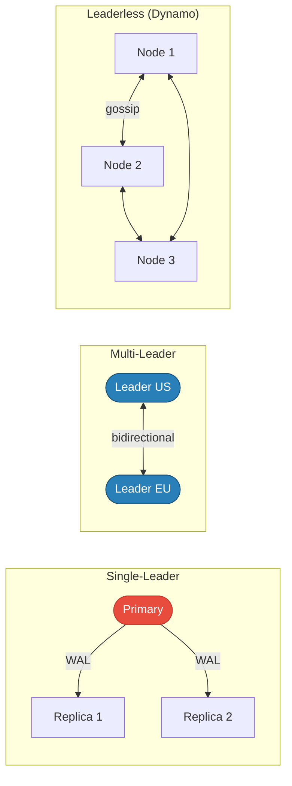
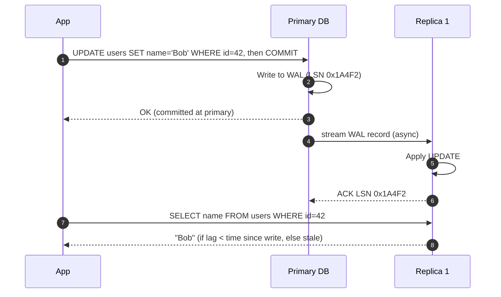
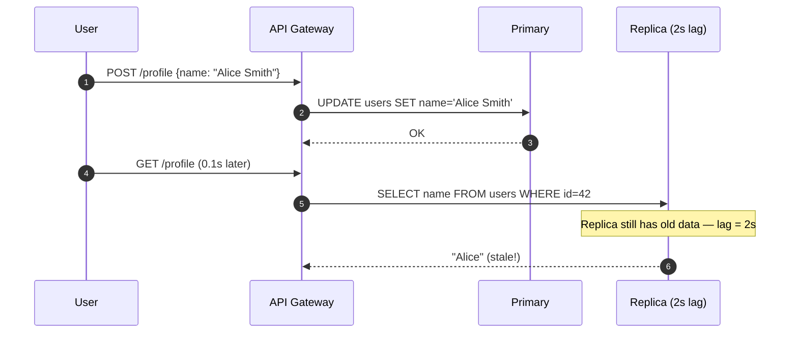
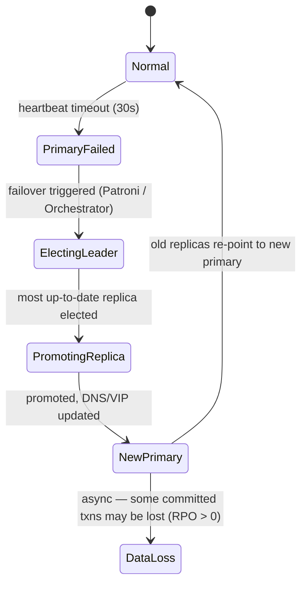

import { Badge } from '@astrojs/starlight/components';
import Figure from '../../../components/Figure.astro';
import TopicNav from '../../../components/TopicNav.astro';
import BreakIt from '../../../components/BreakIt.astro';
import ReplicationFlow from '../../../components/ReplicationFlow';
import SystemDiagram from '../../../components/SystemDiagram';

<Badge text="Intermediate" variant="caution" /> <Badge text="Has code" variant="note" /> <Badge text="Docker required" variant="note" />

Think of replication like a teacher with several teaching assistants. The teacher keeps the master gradebook and records every new grade. Each assistant keeps their own copy, updated by watching the teacher's changes. Students can ask any assistant for grades — but only the teacher writes new ones.

**You'll learn:**
- What replication is and the three problems it solves at once
- How writes stream from primary to replicas, and what happens when the primary dies
- When each topology fits and the consistency you're trading away

## What is replication?

Replication maintains multiple synchronized copies of data across different database nodes. One node (the primary) accepts writes and streams every change to replicas. A single-node database is a single point of failure: one hardware failure, one network partition, or one botched migration, and your service is down.

## Why it matters

- **Read scalability**: 10 read replicas multiply your read throughput by 10×.
- **Fault tolerance**: a primary failure triggers automatic failover to a replica in seconds, not hours.
- **Geographic proximity**: serve users from a replica on their continent — latency drops from 200 ms to 20 ms.

## How it works

The primary writes every change to an append-only log — the WAL (write-ahead log) in PostgreSQL, the binlog in MySQL. Replicas stream this log and replay each record. Reads go to any replica; writes go only to the primary. The delay between a commit on the primary and its visibility on a replica is the **replication lag**.

**See it run.** Writes bump the primary's version and stream to the replicas after the lag; reads flash green when fresh, amber when stale. Crank the lag (or write rate) up and stale reads climb — that's the read-your-writes hazard, live.

<ReplicationFlow client:only="react" />

**Step through a write, the stream, and a failover:**

<SystemDiagram
  client:only="react"
  height={300}
  nodes={[
    { id: 'app', position: { x: 0, y: 110 }, data: { label: 'Application' } },
    { id: 'primary', position: { x: 230, y: 110 }, data: { label: 'Primary' } },
    { id: 'r1', position: { x: 470, y: 30 }, data: { label: 'Replica 1' } },
    { id: 'r2', position: { x: 470, y: 190 }, data: { label: 'Replica 2' } },
  ]}
  edges={[
    { id: 'w', source: 'app', target: 'primary', label: 'write' },
    { id: 'wal1', source: 'primary', target: 'r1', label: 'WAL' },
    { id: 'wal2', source: 'primary', target: 'r2', label: 'WAL' },
    { id: 'rd1', source: 'app', target: 'r1', label: 'read' },
    { id: 'rd2', source: 'app', target: 'r2', label: 'read' },
    { id: 'promote', source: 'app', target: 'r1', label: 'writes now' },
  ]}
  steps={[
    { caption: 'All writes go to the single primary.', activeNodes: ['app', 'primary'], activeEdges: ['w'] },
    { caption: 'The primary streams its WAL to every replica (async).', activeNodes: ['primary', 'r1', 'r2'], activeEdges: ['wal1', 'wal2'] },
    { caption: 'Reads are served by replicas — possibly a few ms stale.', activeNodes: ['app', 'r1', 'r2'], activeEdges: ['rd1', 'rd2'] },
    { caption: 'Primary fails — heartbeat times out.', activeNodes: ['primary'], activeEdges: [] },
    { caption: 'Replica 1 (highest WAL position) is promoted; writes resume there.', activeNodes: ['app', 'r1'], activeEdges: ['promote'] },
  ]}
/>

Three topologies cover almost every production system:

<Figure caption="Three topologies: single-leader (one writer), multi-leader (a writer per region), and leaderless (quorum reads/writes).">

</Figure>

This page focuses on single-leader — the default for PostgreSQL and MySQL.

## Break it

<BreakIt path="scalability/3.4_db_replication" recipe="db-replication" />

## Under the hood

### Sync vs async replication

| Mode | Write Latency | Data Loss on Failure | Use Case |
|---|---|---|---|
| Fully async | Fast (~1 ms local) | Up to N seconds of WAL lag | Analytics replicas, reporting, BI |
| Semi-sync | Medium (wait for 1 replica ACK) | At most 1 transaction | Most production OLTP (MySQL semi-sync) |
| Fully sync | Slow (network RTT to each replica) | Zero | Financial ledgers, compliance-critical data |

:::note
PostgreSQL `synchronous_standby_names`: set `synchronous_commit = remote_apply` and name one replica as synchronous — the primary waits for that replica to apply the WAL before returning success. All other replicas remain async.
:::

The WAL stream in action, record by record:

<Figure caption="WAL streaming: the primary commits and acknowledges first, then ships the record to replicas asynchronously.">

</Figure>

### Replication lag

Replication lag is the time between a write committing on the primary and being visible on a replica. Causes: network latency, replica CPU/IO overload, long-running replica queries blocking the applier, or maintenance.

:::caution
Monitoring: alert at >10 seconds lag. At >30 seconds, exclude the replica from the read pool (traffic returns to primary). At >5 minutes, investigate applier thread stall.
:::

### Read-your-writes consistency

A user writes to the primary, then immediately reads from a stale replica — they don't see their own write.

<Figure caption="Read-after-write hazard: a read routed to a lagging replica can return stale data moments after the write.">

</Figure>

Three standard fixes: **(1)** route a user's reads to the primary for N seconds after a write; **(2)** monotonic-reads token — primary returns an LSN, client sends it with the next read, route to a replica with `LSN ≥ client's`; **(3)** sticky read routing — a user's reads always hit the same replica.

### Failover

When the primary stops responding, a failover tool elects the most caught-up replica (highest WAL LSN) and promotes it. Writes resume after election, not after manual intervention.

<Figure caption="Automated failover: a heartbeat timeout triggers election and promotion, with an async data-loss window (RPO > 0).">

</Figure>

| Failover Tool | Database | RTO | RPO |
|---|---|---|---|
| MySQL Orchestrator | MySQL | ~15–30s | Near-zero (semi-sync) |
| Patroni + etcd | PostgreSQL | ~10–30s | Near-zero |
| AWS RDS Multi-AZ | MySQL/PG | ~60–120s | Zero (sync standby) |
| AWS Aurora | Aurora | ~30s | Zero (shared storage) |

:::danger
Split-brain is the worst failure mode: two primaries accepting conflicting writes means diverged data with no ground truth. Prevention is mandatory — quorum-based election plus fencing (STONITH) of the demoted node.
:::

## Key concepts

| Term | What it means |
|------|---------------|
| WAL / binlog | The append-only change log the primary streams to replicas |
| LSN | Log sequence number — a position in the WAL; higher = more caught up |
| Replication lag | Delay between a commit on the primary and visibility on a replica |
| RPO | Recovery point objective — how much data you can lose on failover |
| RTO | Recovery time objective — how long failover may take |
| STONITH | "Shoot the other node in the head" — fencing the old primary |

## When to use it

| Use it when... | Avoid it when... |
|----------------|------------------|
| Reads outnumber writes and one node can't keep up | A single node meets your load and RTO tolerance |
| Downtime of minutes is unacceptable (need automated failover) | Every read must be strongly consistent and you can't route to the primary |
| Users are spread across continents | Your data fits one region and latency is already fine |

## Trade-offs and failure modes

| Concern | Issue | Mitigation |
|---------|-------|------------|
| Stale reads | Replicas lag; users may not see their own writes | Read-your-writes routing, LSN tokens, sticky sessions |
| Data loss on failover | Async replication loses un-streamed commits (RPO > 0) | Semi-sync (wait for 1 ACK) or sync replication |
| Split-brain | Two primaries accept conflicting writes after a partition | Quorum election + STONITH fencing |
| Operational complexity | More nodes, monitoring, failover tooling | Managed offerings (RDS, Aurora) or battle-tested stacks (Patroni) |

Advanced: multi-leader and leaderless replication

**Multi-leader** — both leaders accept writes simultaneously, for multi-region active-active. Conflicts resolved by Last-Write-Wins, CRDTs, or application logic. Conflict *avoidance* (route a user's writes to one leader, sticky by `user_id`) beats resolution. Used by CockroachDB, Google Docs (CRDTs), CouchDB.

**Leaderless (Dynamo-style)** — any node accepts reads and writes; consistency via quorums. With N replicas, a write needs W acks, a read needs R responses. When `R + W > N`, at least one node overlaps between the latest write and the current read — guaranteeing freshness.

| Configuration | R | W | N | Consistency | Availability |
|---|---|---|---|---|---|
| Strong | 2 | 2 | 3 | Strong (R+W > N) | Lower (need 2 up) |
| Eventual | 1 | 1 | 3 | Eventual | High (1 node) |

Used by DynamoDB, Cassandra, Riak.

## This implementation

The Go service runs a primary and two replicas behind Docker. Each replica polls the primary's change log (`/log?since=<version>`) every 500 ms — a simplified stand-in for WAL streaming — so you can write to the primary and watch reads served from a lagging replica: the read-your-writes hazard, for real.

## Further reading

- [Designing Data-Intensive Applications, Ch. 5](https://dataintensive.net/) — replication topologies and lag
- [PostgreSQL — Streaming Replication](https://www.postgresql.org/docs/current/warm-standby.html) — WAL streaming and synchronous standbys
- [Dynamo paper (SOSP 2007)](https://www.allthingsdistributed.com/files/amazon-dynamo-sosp2007.pdf) — leaderless replication and sloppy quorums
- [Patroni — High Availability PostgreSQL](https://github.com/patroni/patroni) — the most common PG failover stack

<TopicNav prev={{ label: 'Circuit Breaker', slug: 'hld/circuit-breaker' }} next={{ label: 'Consistent Hashing', slug: 'hld/consistent-hashing' }} />
