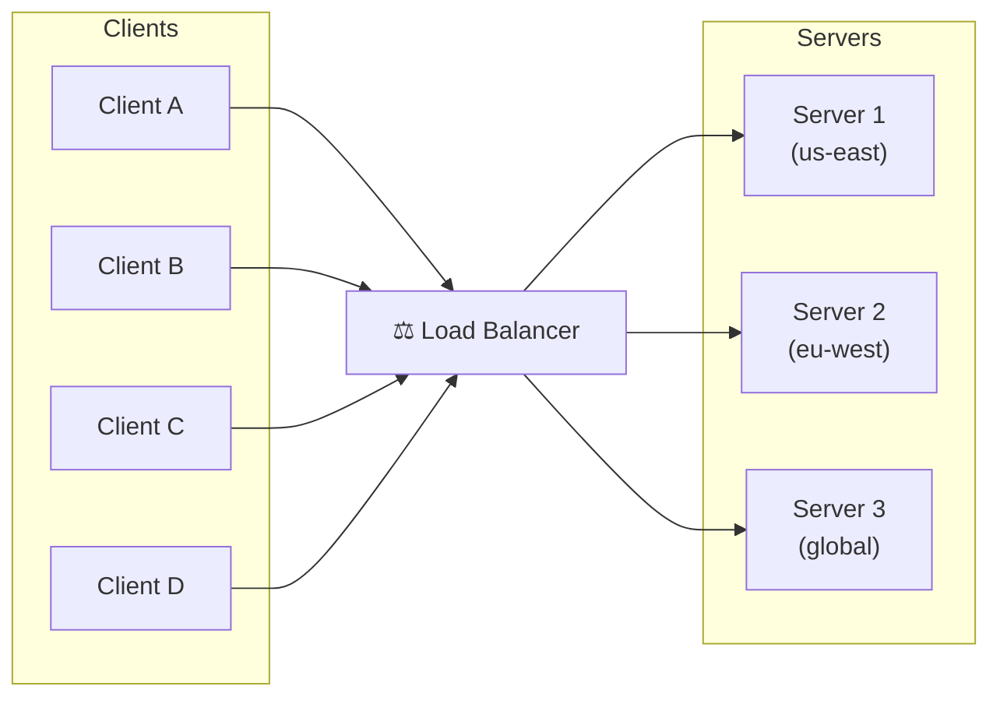
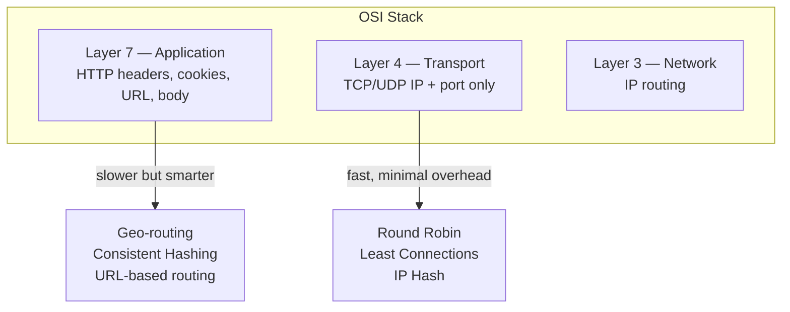
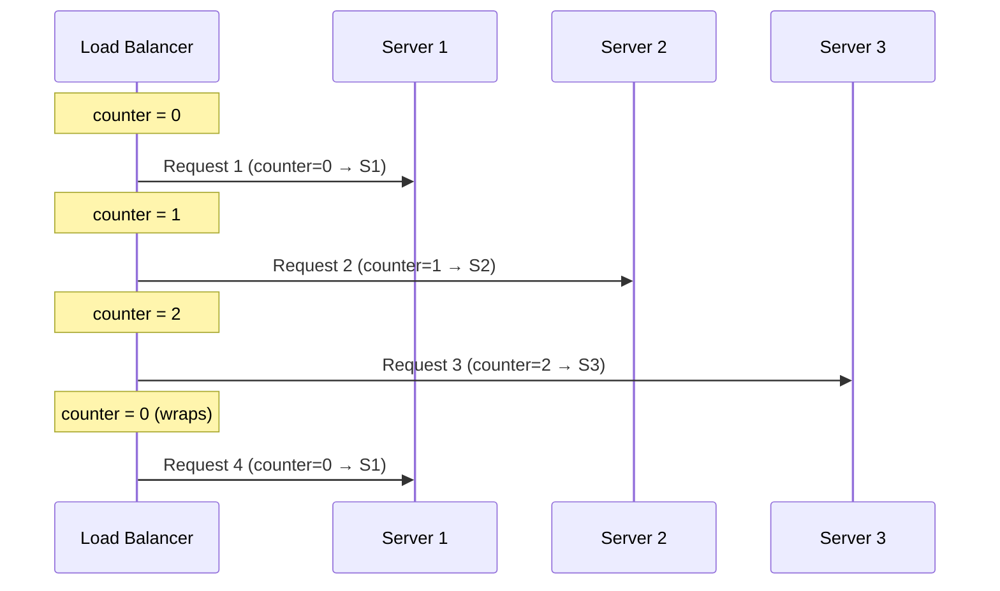
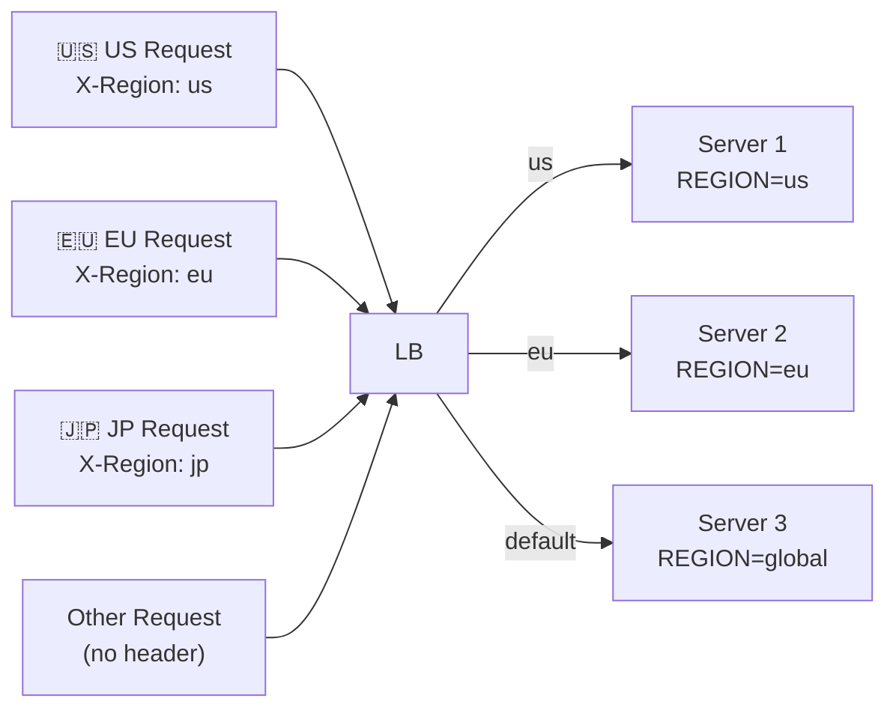
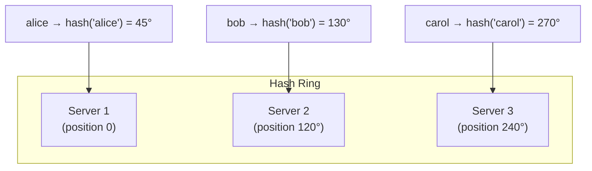
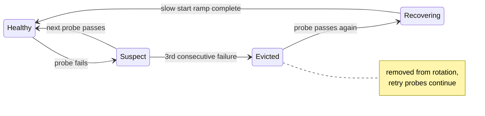
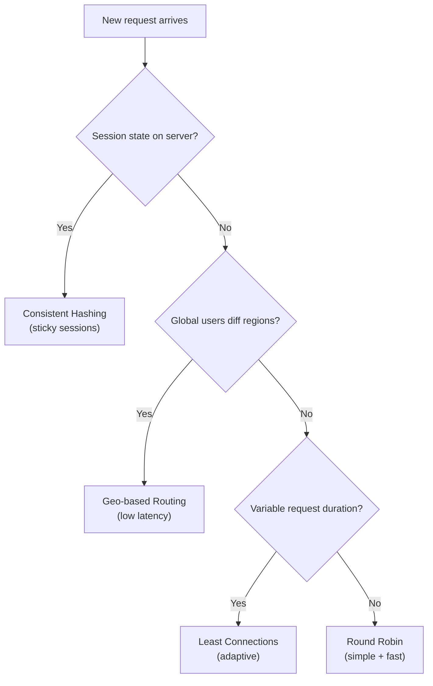

import { Badge } from '@astrojs/starlight/components';
import Figure from '../../../components/Figure.astro';
import TopicNav from '../../../components/TopicNav.astro';
import BreakIt from '../../../components/BreakIt.astro';
import LoadBalancerFlow from '../../../components/LoadBalancerFlow';

<Badge text="Beginner" variant="success" /> <Badge text="Docker required" variant="note" />

Think of a load balancer like the host at a busy restaurant. Guests don't pick their own table — the host seats each party where there's room, keeps any one waiter from being swamped, and quietly stops seating people in a section where the waiter just went home sick. Diners never know how the seating works; they just get served.

**You'll learn:**
- What load balancing is and the bottleneck it removes
- How four routing algorithms decide where each request goes
- When to pick each algorithm and what each one ignores

## What is load balancing?

Load balancing distributes incoming traffic across multiple servers. No single server becomes a bottleneck, a single point of failure, or a performance ceiling. The balancer is the one address clients see; the server pool behind it can grow, shrink, and fail without clients noticing.

<Figure caption="Clients never talk to servers directly — the load balancer is the single entry point that spreads requests across the pool.">

</Figure>

## Why it matters

- One server caps your throughput at one machine's capacity — a balancer turns N machines into one logical service.
- A failed server is removed from rotation by health checks — users see retries on healthy nodes, not errors.
- Traffic spikes are absorbed by adding servers behind the balancer, with zero client-side changes.
- Routing decisions (region, session, load) happen in one place instead of in every client.

## How it works

The balancer accepts each incoming connection, picks a backend by algorithm, and forwards the request. A health checker probes every server continuously and pulls failures out of rotation. Which signals the balancer can read depends on the layer it operates at.

**See it run.** Below, requests stream in as live traffic. Drive the rate past what the pool can serve and queues build, latency climbs, and requests start to drop — the exact failure mode a balancer exists to manage.

<LoadBalancerFlow client:only="react" />

## Break it

<BreakIt path="networking-and-edge/2.1_load_balancer" recipe="load-balancing" syslings="load-balancing" />

## Under the hood

### Operating levels

<Figure caption="Layer 4 routes on IP and port alone (fast); Layer 7 reads the HTTP request to make smarter, content-aware decisions.">

</Figure>

| Layer | Sees | Speed | Examples |
|-------|------|-------|---------|
| **L4 Transport** | IP + TCP port | Fast | Round Robin, Least Connections |
| **L7 Application** | HTTP headers, cookies, URL | Slower but smarter | Geo-routing, Consistent Hashing |

## The four algorithms

Each one is a tab in the simulator at the top of the page; switch between them as you read.

### Round Robin

Each request goes to the next server in a circular sequence: S1 → S2 → S3 → S1 → …

<Figure caption="Round robin walks a counter across the pool, wrapping back to the first server after the last.">

</Figure>

```nginx
upstream backend {
    zone backend_zone 64k;
    server server1:8080;
    server server2:8080;
    server server3:8080;
    # No directive = Round Robin by default
}

server {
    listen 80;
    location / {
        proxy_pass         http://backend;
        proxy_set_header   Host       $host;
        proxy_set_header   X-Real-IP  $remote_addr;
    }
}
```

:::caution
Limitation: Round Robin ignores server load. A slow request on Server 1 doesn't prevent new requests from also hitting Server 1. Works best when request duration is uniform.
:::

### Least Connections

Route each new request to the server with the fewest active connections at that moment. (In the simulator above, switch to *Least conn* and watch new traffic favor the idle servers.)

```nginx
upstream backend {
    least_conn;                # ← the only change
    zone backend_zone 64k;
    server server1:8080;
    server server2:8080;
    server server3:8080;
}
```

:::caution
Limitation: requires tracking active sessions per server. Doesn't account for processing capacity — a slow underpowered server with 1 connection is preferred over a fast server with 2.
:::

### Geo-based routing

Route requests to the geographically nearest server, reducing latency. In production: client IP → GeoIP database lookup → region → server pool. In local dev: simulate with a custom `X-Region` header.

<Figure caption="Header/geo-based routing sends each request to the server matching its region, with a default fallback.">

</Figure>

```nginx
map $http_x_region $backend_upstream {
    default  global_backend;
    us       us_backend;
    eu       eu_backend;
}

upstream us_backend     { zone us_zone 64k;     server server1:8080; }
upstream eu_backend     { zone eu_zone 64k;     server server2:8080; }
upstream global_backend { zone global_zone 64k; server server3:8080; }
```

### Consistent Hashing

Hash a stable client key (session cookie, user ID) to always route the same client to the same server — regardless of which server receives the request. (This is *Sticky* mode in the simulator; the dedicated [Consistent Hashing](/hld/consistent-hashing/) page has an interactive ring.)

<Figure caption="Consistent hashing places each server on a ring; a key is owned by the first server clockwise from its hash.">

</Figure>

:::note
Why consistent hashing beats simple modulo: with `server = hash(key) % N`, adding 1 server remaps almost all keys — cache misses everywhere. With consistent hashing, only the keys between the new server and its predecessor remap — roughly 1/N of keys move.
:::

```nginx
upstream backend {
    hash $cookie_session_id consistent;   # ← the key directive
    zone backend_zone 64k;
    server server1:8080;
    server server2:8080;
    server server3:8080;
}
```

:::caution
Limitation: uneven hash distribution is possible, especially with few servers. Virtual nodes (each physical server occupies multiple ring positions) solve this in production implementations.
:::

## Request flow and health checks

Follow one request through the balancer, then watch what health checks do when a server dies (drive both in the simulator above):

1. `GET /orders` hits the load balancer (TLS terminates here)
2. Routing table consulted — a server is excluded after failed probes
3. The algorithm picks a healthy server
4. That server returns 200 OK
5. Balancer relays the response to the client

The health-check lifecycle is a small state machine:

<Figure caption="The production health-check lifecycle. This lab's OSS Nginx uses simpler passive defaults — one failed request evicts a server (max_fails=1) for 10 seconds (fail_timeout), then full traffic returns at once: no Suspect tier, no slow-start ramp.">

</Figure>

:::caution[The recovery stampede]
The dangerous moment isn't the failure — it's the recovery. A server that rejoins
with a cold cache and zero connections looks maximally attractive to *least
connections*, so the balancer floods it, it slows down or dies again, and the
pool flaps. That's why production balancers ramp a recovered server's share
gradually (`slow_start` in Nginx Plus, "connection warmup" elsewhere) and why
you drain connections (stop sending new requests, let in-flight ones finish)
before taking a server down on purpose — a deploy is just a voluntary failure.
:::

:::caution
Sticky sessions trade statefulness for availability: if the pinned server dies, its in-memory sessions are lost. Externalize session state to Redis or Memcached if losing a session means losing a cart.
:::

## Key concepts

| Term | What it means |
|------|---------------|
| VIP | The virtual IP clients connect to — survives individual balancer failures |
| Health check | A periodic probe that pulls failing servers out of rotation automatically |
| Sticky session | Pinning a client to one server so in-memory session state keeps working |
| Hash ring | The circular keyspace consistent hashing places servers and keys on |
| Slow start | Ramping a recovered server's traffic share gradually to avoid a cold-cache spike |

## When to use it

<Figure caption="Choosing an algorithm: session state, geography, and request-duration variance each point to a different default.">

</Figure>

| Port | Algorithm | Use When |
|------|-----------|---------|
| 8081 | Round Robin | Stateless, uniform request times |
| 8082 | Least Connections | Variable request durations |
| 8083 | Geo-based Routing | Global app with regional servers |
| 8084 | Consistent Hashing | Stateful sessions, caching |

## Trade-offs and failure modes

| Algorithm | Blind spot | Bites you when |
|---|---|---|
| Round Robin | Ignores actual server load | Request durations vary widely — slow requests pile onto busy servers |
| Least Connections | Ignores server capacity | Heterogeneous fleet — the weakest server gets "rewarded" for being slow |
| Geo routing | Ignores load entirely | One region spikes while another idles |
| Consistent Hashing | Uneven distribution with few nodes | Hot keys or too few vnodes concentrate load on one server |

:::tip[Interview lens]
"How would you design the load-balancing tier?" is rarely about naming an
algorithm. Strong answers cover: **(1)** L4 vs L7 — what do you need to *see*
to route (cookies/URLs → L7)? **(2)** Who balances the balancers — DNS or
anycast VIP to survive LB failure? **(3)** Health-check tuning — aggressive
probes evict flaky-but-alive servers; lazy probes send traffic into a black
hole. **(4)** What happens during deploys — connection draining, and why the
recovery stampede you can trigger in this page's lab is exactly the failure
mode slow start exists to prevent.
:::

## This implementation

A Go HTTP server that identifies itself on every response, Dockerized, behind 4 Nginx instances — one per algorithm — on one Docker network. Each server prints its ID and region, making the distribution algorithm visible per request:

```go
http.HandleFunc("/", func(w http.ResponseWriter, r *http.Request) {
    sessionID := "anonymous"
    if cookie, err := r.Cookie("session_id"); err == nil {
        sessionID = cookie.Value
    }
    visits[sessionID]++
    fmt.Fprintf(w, "Server %s (%s) | Session: %s | Visit: %d\n",
        id, region, sessionID, visits[sessionID])
})
```

| Service | What it does |
|---------|--------------|
| `server1–3` | Go echo servers with `SERVER_ID` + `REGION` env vars |
| `nginx-round-robin` | Round robin pool on :8081 |
| `nginx-least-conn` | Least-connections pool on :8082 |
| `nginx-geo-env` | Header-mapped regional pools on :8083 |
| `nginx-consistent-hash` | Cookie-hashed sticky pool on :8084 |

## Further reading

- [Nginx HTTP Load Balancing Guide](https://docs.nginx.com/nginx/admin-guide/load-balancer/http-load-balancer/) — every directive used in this module, documented
- [Consistent Hashing Algorithm — High Scalability](https://highscalability.com/consistent-hashing-algorithm/) — the ring, vnodes, and remap math explained
- [What Is Load Balancing? — AWS](https://aws.amazon.com/what-is/load-balancing/) — L4 vs L7 in cloud-provider terms (NLB vs ALB)
- [Nginx GeoIP Access Control](https://docs.nginx.com/nginx/admin-guide/security-controls/controlling-access-by-geoip/) — production GeoIP lookup replacing the X-Region header simulation

<TopicNav next={{ label: 'Caching', slug: 'hld/caching' }} />
