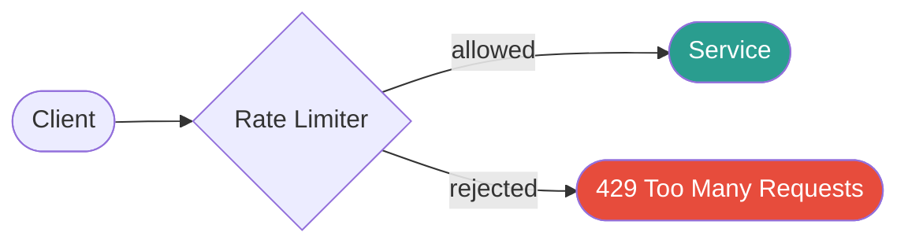
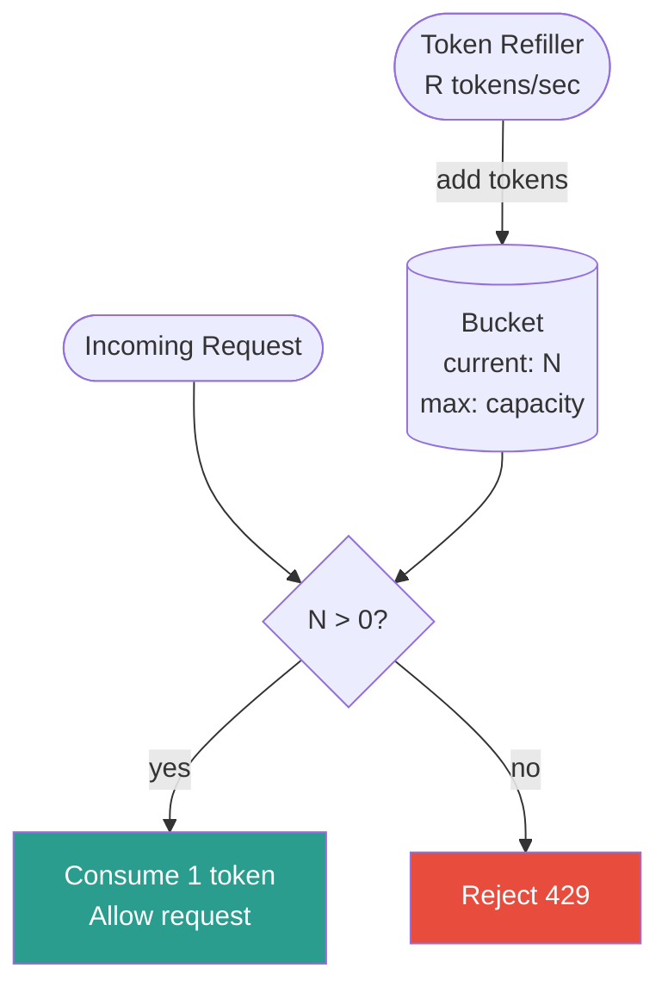
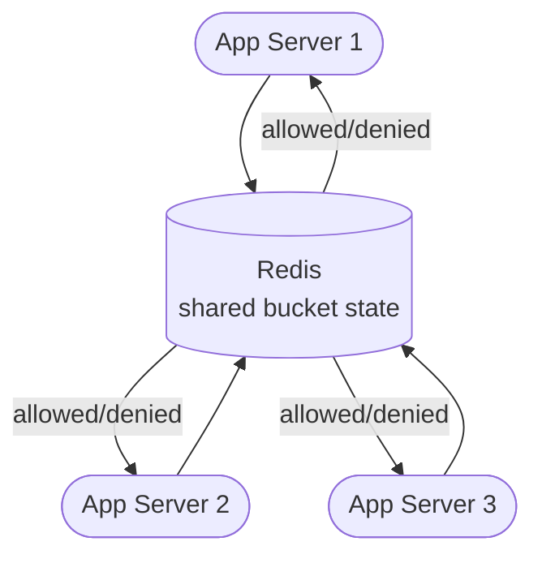

import { Badge } from '@astrojs/starlight/components';
import Figure from '../../../components/Figure.astro';
import TopicNav from '../../../components/TopicNav.astro';
import RunCode from '../../../components/RunCode.astro';
import RateLimiterFlow from '../../../components/RateLimiterFlow';
import TokenBucket from '../../../components/TokenBucket';

<Badge text="Intermediate" variant="caution" /> <Badge text="Has code" variant="note" /> <Badge text="Docker required" variant="note" />

Think of rate limiting like a nightclub bouncer with a clicker. The club holds 200 people safely; the bouncer counts everyone in and out and stops the line when it's full. Regulars don't get to rush the door all at once, and one rowdy group can't pack the club so tight that nobody else gets in.

**You'll learn:**
- What rate limiting is and the abuse it prevents
- How the four counting algorithms differ — and where fixed windows leak
- When in-memory counting breaks and how Redis makes limits hold fleet-wide

## What is rate limiting?

Rate limiting controls how many requests a client can make to a service within a given time window. Without it, a single misbehaving client — malicious or accidental — can exhaust resources for every other user.

<Figure caption="A rate limiter sits in front of the service, admitting requests under budget and rejecting the rest with 429.">

</Figure>

## Why it matters

- **DDoS protection** — cap the blast radius of volumetric attacks before they reach your application layer.
- **Fair use** — prevent one tenant from monopolising shared infrastructure in a multi-tenant system.
- **Cost control** — downstream API calls, LLM tokens, or database writes often cost money per unit; rate limits cap the bill.
- **SLA enforcement** — tiered plans (free / pro / enterprise) carry different throughput guarantees; rate limiting is the mechanism that upholds them.

## How it works

Every request hits a counter keyed by client (IP, API key, user ID). The algorithm decides what "counter" means — a window count, a timestamp log, or a token bucket — and that choice determines memory cost, accuracy, and burst behaviour. Over the limit means `429 Too Many Requests` with a `Retry-After` header.

**See it run.** Requests stream toward the gate; each spends a token or is rejected with a red `429`. Raise the rate above the refill and watch the bucket drain into denials — then drop it back and the bucket recovers its burst allowance.

<RateLimiterFlow client:only="react" />

**Play with the token bucket** — the same algorithm, broken down step by step. Let it idle to bank tokens, then burst:

<TokenBucket client:only="react" />

### Where to enforce limits

| Layer | Pros | Cons |
|---|---|---|
| **Client-side SDK** | Reduces network traffic; immediate feedback to caller | Trivially bypassed by a malicious client; no server-side protection |
| **API Gateway** (Kong, AWS APIGW) | Centralised policy; no code changes in services | Single point of configuration drift; adds latency on the hot path |
| **Reverse proxy** (Nginx, Envoy) | Works for all traffic regardless of language/framework | Per-request overhead in the proxy; limited to L7 signals |
| **Application middleware** | Fine-grained control (per-user, per-endpoint, per-plan) | Scattered logic across services; requires shared state store |
| **Service mesh** (Istio, Linkerd) | Transparent; policy-as-code via control plane | Operational complexity; Envoy filter configuration is verbose |

Combining layers is common: an API gateway applies a coarse global cap, while application middleware enforces per-user quotas.

### Fixed window counter

Divide time into fixed windows (e.g., 0–59 s, 60–119 s). Increment a counter per window; reject once the counter exceeds the limit. **Storage:** one counter + one expiry per (user, window). O(1) space.

**Problem — boundary burst.** A client can fire `limit` requests at `t=59 s` and another `limit` requests at `t=60 s`. In a one-second span the service sees `2 × limit` requests, yet no rule was violated.

```text
Window 1 [0–60s]:   ░░░░░░░░░░░░░░░░░░░░████  ← 100 req at t≈59
Window 2 [60–120s]: ████░░░░░░░░░░░░░░░░░░░░  ← 100 req at t≈60
                                            ↑ 200 req in ~2s
```

### Sliding window log

Store the exact timestamp of every accepted request. On each new request, evict all timestamps older than `now - window_size`, then count what remains. Reject if count ≥ limit.

**Accuracy:** exact — no boundary burst problem. **Cost:** O(limit) memory per user in the worst case; each check is O(log n) with a sorted set.

### Token bucket

A bucket holds up to `capacity` tokens. Tokens are added at a constant rate `R` (tokens/second). Each incoming request consumes one token. Empty bucket → rejected. (This is exactly the interactive above.)

<Figure caption="Token bucket: a refiller adds tokens at a steady rate; each request spends one, and an empty bucket returns 429.">

</Figure>

**Key parameters:** `capacity` — maximum burst size; `rate` — steady-state throughput (tokens/sec).

### Sliding window counter

A hybrid that avoids the memory cost of the log while being more accurate than fixed windows.

```text
count = prev_window_count × (1 - elapsed / window_size) + current_window_count
```

**Example:** window = 60 s, limit = 100, prev = 84 req, curr = 36 req, elapsed = 15 s.

```text
count = 84 × (1 - 15/60) + 36 = 84 × 0.75 + 36 = 63 + 36 = 99  → allowed
```

**Storage:** two counters per user. O(1) space, O(1) check.

| Algorithm | Memory | Accuracy | Burst Handling | Complexity | Best For |
|---|---|---|---|---|---|
| Fixed Window Counter | O(1) | Low (boundary burst) | None | Simple | Coarse global caps |
| Sliding Window Log | O(limit) | Exact | None (strict) | Medium | Low-volume, strict APIs |
| Token Bucket | O(1) | High | Controlled burst | Medium | Most production APIs |
| Sliding Window Counter | O(1) | Good approximation | Partial | Medium | High-scale, memory-sensitive |

## Request flow

A single in-memory counter breaks the moment you run more than one instance — each pod counts separately, so a client gets `n × limit`. Shared state in Redis makes the limit hold fleet-wide:

<Figure caption="Distributed rate limiting keeps the counter in shared Redis so every app server enforces one global budget.">

</Figure>

Two gateways that read-then-increment concurrently can both admit a request over the limit — the fix is an **atomic Lua script** so check-and-increment is one Redis operation.

:::caution
Every request now makes a round-trip to Redis. Keep Redis co-located (same data centre, low-latency link). For extremely high-throughput APIs, consider a local token bucket with periodic Redis sync (local rate ≈ global_rate / n_instances) to reduce Redis pressure.
:::

## Key concepts

| Term | What it means |
|------|---------------|
| Token bucket | A capacity of "permission tokens" refilled at a steady rate — spend one per request |
| Boundary burst | The fixed-window flaw allowing 2× the limit across a window edge |
| Burst headroom | Extra capacity above steady rate so legitimate spikes aren't rejected |
| Fail open / fail closed | Allow-all vs deny-all behaviour when the limiter's backing store dies |
| Hot key | One high-traffic client's counter overloading a single Redis shard |
| 429 + Retry-After | The standard rejection: status code plus seconds-to-wait |

## When to use it

| Use it when... | Avoid it when... |
|----------------|------------------|
| Any endpoint is reachable by untrusted or third-party clients | Traffic is fully internal and load-shedding is handled upstream |
| Plans/tiers promise different throughput guarantees | A queue already smooths the producer rate (limits would double-govern) |
| Downstream calls cost real money per request | The limit would be set so high it never fires — measure first |

## Trade-offs and failure modes

| Concern | Issue | Mitigation |
|---|---|---|
| Redis unavailable | Rate limiter is non-functional | Fail open (allow all) during outage; alert on Redis health; consider circuit breaker |
| Clock skew | Sliding window timestamps diverge across nodes | Use NTP; Redis `TIME` command for server-side timestamp |
| Hot keys | High-traffic users hammer a single Redis shard | Partition key: `rl:{user_id % 16}:{user_id}` to spread across slots |
| Race conditions | INCR + EXPIRE non-atomic | Atomic Lua scripts or Redis transactions (`MULTI`/`EXEC`) |
| Over-limiting | Legitimate traffic rejected at peak | Observe p99 request rates, add burst headroom, use sliding window counter not fixed |

:::caution
Fail open vs fail closed: if Redis is down and you fail closed (deny all), you have a self-inflicted outage. If you fail open (allow all), you are exposed to abuse for the duration. Neither is universally correct — choose based on your threat model and SLA obligations.
:::

### Response design

| Header | Meaning |
|---|---|
| `X-RateLimit-Limit` | Maximum requests allowed in the window |
| `X-RateLimit-Remaining` | Requests remaining in the current window |
| `X-RateLimit-Reset` | Unix timestamp when the window resets or the bucket refills to `capacity` |
| `Retry-After` | Seconds to wait before retrying (required on 429 by RFC 6585) |

```http
HTTP/1.1 429 Too Many Requests
Retry-After: 5
X-RateLimit-Limit: 100
X-RateLimit-Remaining: 0
X-RateLimit-Reset: 1717588265
```

## This implementation

<RunCode path="scalability/3.2_rate_limiting" recipe="rate-limiting" />

The runnable demo enforces limits at the edge with Nginx `limit_req`, in front of a Go backend that just echoes the request. Three Nginx instances show three policies:

| Port | Nginx config | Limit | Keyed by |
|------|--------------|-------|----------|
| 8081 | `per_ip.conf` | 5 req/s, no burst | client IP (`$binary_remote_addr`) |
| 8082 | `per_key.conf` | 10 req/s, no burst | `X-Api-Key` header |
| 8083 | `burst.conf` | 2 req/s, burst of 10 | client IP |

```nginx
limit_req_zone $binary_remote_addr zone=burst_zone:10m rate=2r/s;

location / {
    limit_req        zone=burst_zone burst=10 nodelay;
    limit_req_status 429;
    proxy_pass       http://backend;
}
```

`limit_req` is a leaky bucket, which behaves like the token bucket above with capacity `burst + 1`:

- **Without `burst`**, the rate is enforced per slot: `5r/s` means one request every 200 ms. Eight back-to-back requests give **1 × 200, then 429s** — not five.
- **With `burst=10 nodelay`**, ten extra requests are admitted immediately, so twelve back-to-back requests give **11 × 200, then 429**. The burst refills at 2 r/s.
- Per-key zones are independent: when `key-A` is throttled, `key-B` still gets through.
- Each Nginx instance keeps its own counters in shared memory. Run two instances behind a load balancer and a client gets twice the limit — the problem the Redis approach below solves.

<details>
<summary>Going fleet-wide: atomic token bucket in Redis (sketch, not part of the demo)</summary>

```lua
-- KEYS[1] = bucket key   ARGV: capacity, rate, now, cost
local key = KEYS[1]
local capacity, rate, now, cost = tonumber(ARGV[1]), tonumber(ARGV[2]), tonumber(ARGV[3]), tonumber(ARGV[4])
local data = redis.call("HMGET", key, "tokens", "last_refill")
local tokens, last_refill = tonumber(data[1]), tonumber(data[2])
if tokens == nil then tokens = capacity; last_refill = now end
local elapsed = math.max(0, now - last_refill)
tokens = math.min(capacity, tokens + elapsed * rate)
local allowed = 0
if tokens >= cost then tokens = tokens - cost; allowed = 1 end
redis.call("HMSET", key, "tokens", tokens, "last_refill", now)
redis.call("EXPIRE", key, math.ceil(capacity / rate) + 1)
return allowed
```

Because Redis executes Lua atomically, there is no race window between read, calculation, and write.
</details>

## Further reading

- [Stripe — Scaling your API with rate limiters](https://stripe.com/blog/rate-limiters) — production limiter design with load-shedding tiers
- [Redis — Rate Limiting](https://redis.io/glossary/rate-limiting/) — patterns and primitives
- [RFC 6585 — Additional HTTP Status Codes](https://tools.ietf.org/html/rfc6585) — the definition of 429
- [Designing Data-Intensive Applications, Ch. 8](https://dataintensive.net/) — distributed failure modes

<TopicNav prev={{ label: 'Caching', slug: 'hld/caching' }} next={{ label: 'Circuit Breaker', slug: 'hld/circuit-breaker' }} />
