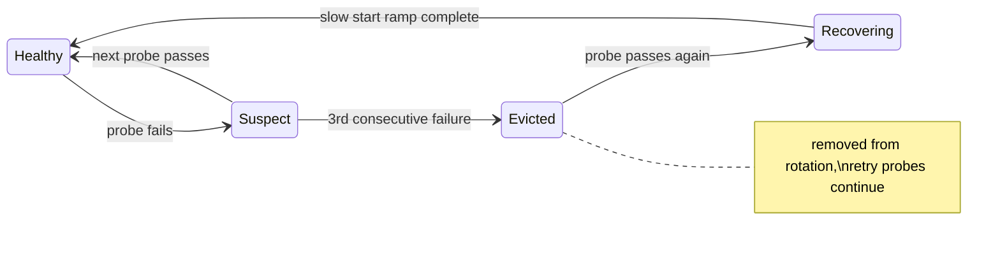

# Guided Labs Phase 1+2 (Framework + Load-Balancing Pilot) Implementation Plan

> **For agentic workers:** REQUIRED SUB-SKILL: Use superpowers:subagent-driven-development (recommended) or superpowers:executing-plans to implement this plan task-by-task. Steps use checkbox (`- [ ]`) syntax for tracking.

**Goal:** Add a rustlings-inspired guided-lab learning loop (Read → Simulate → Run → Lab) with scripted `just` checkpoints, piloted end-to-end on the load-balancing topic, plus landing-page overhaul and Zola site retirement.

**Architecture:** Shared bash check-helpers in `high-level-design/lab-lib/`; per-topic `lab/check.sh` dispatched by step number via justfile recipes; `LabSteps.astro` renders the same steps on the astro-site topic page. Pilot = load-balancing; Phase 3 (other 5 topics) is a separate follow-up plan once this template is proven.

**Tech Stack:** Bash, just, Docker Compose, Go (topic server), Astro/Starlight + MDX, Mermaid.

**Spec:** `docs/superpowers/specs/2026-07-08-guided-labs-and-site-polish-design.md`

**Deviations from spec (decided during planning, from reading the code):**
1. No `load-balancing-reload` recipe: the compose stack already runs all four algorithms simultaneously on ports 8081 (round-robin), 8082 (least-conn), 8083 (geo), 8084 (consistent-hash). Lab steps target ports instead of swapping configs.
2. Sim "kill backend" control already exists (`toggleHealth` buttons in `LoadBalancerFlow.tsx` / `LoadBalancerSim.tsx`). Sim tie-in becomes a cross-reference in the mdx, not new controls.
3. Site diagrams use Mermaid (build-time SVG), not D2 — follow the site's idiom for the new health-check state machine diagram.

**⚠ Repo state warning:** The worktree has a large uncommitted restructure (~390 files) staged/modified by the user. NEVER use `git add -A`, `git add .`, or bare `git commit -a`. Always `git add` the exact paths listed in each commit step, and commit with explicit paths only.

**Working directory:** All `just` commands run from `high-level-design/` unless noted. All paths below are repo-relative.

---

## Phase 1 — Lab framework

### Task 1: Shared check helpers (`lab-lib`)

**Files:**
- Create: `high-level-design/lab-lib/check-helpers.sh`
- Test: `high-level-design/lab-lib/test_helpers.sh`

- [ ] **Step 1: Write the failing test**

Create `high-level-design/lab-lib/test_helpers.sh`:

```bash
#!/usr/bin/env bash
# Self-test for check-helpers.sh. Run: bash lab-lib/test_helpers.sh
set -u
DIR="$(cd "$(dirname "$0")" && pwd)"
failures=0

expect() { # expect <desc> <want_exit> <cmd...>
  local desc="$1" want="$2"; shift 2
  local out; out="$("$@" 2>&1)"; local got=$?
  if [ "$got" -ne "$want" ]; then
    echo "FAIL: $desc (exit $got, want $want): $out"; failures=$((failures+1))
  else
    echo "ok:   $desc"
  fi
}

# subshell wrappers because fail/bad exit the shell
run_ok()   { bash -c "source '$DIR/check-helpers.sh'; ok 'looks good'"; }
run_bad()  { bash -c "source '$DIR/check-helpers.sh'; bad 'broke' 'try X'"; }
run_req_down() { bash -c "source '$DIR/check-helpers.sh'; require_url http://localhost:1 'start the stack'"; }
run_count() {
  bash -c "source '$DIR/check-helpers.sh'
out=\$(printf 'Server 1 (us)\nServer 2 (eu)\nServer 1 (us)\n' )
[ \"\$(count_server \"\$out\" 1)\" = 2 ] && [ \"\$(count_server \"\$out\" 2)\" = 1 ] && [ \"\$(count_server \"\$out\" 3)\" = 0 ]"
}

expect "ok prints and returns 0"          0 run_ok
expect "bad prints hint and exits 1"      1 run_bad
expect "require_url fails on dead port"   1 run_req_down
expect "count_server counts occurrences"  0 run_count

bash -c "source '$DIR/check-helpers.sh'; bad 'broke' 'try X'" 2>&1 | grep -q "hint: try X" \
  && echo "ok:   bad emits hint text" || { echo "FAIL: bad hint text"; failures=$((failures+1)); }

[ "$failures" -eq 0 ] && echo "ALL PASS" || { echo "$failures FAILURES"; exit 1; }
```

- [ ] **Step 2: Run test to verify it fails**

Run: `bash high-level-design/lab-lib/test_helpers.sh`
Expected: FAIL lines / `No such file or directory` for `check-helpers.sh`, exit non-zero.

- [ ] **Step 3: Write the helpers**

Create `high-level-design/lab-lib/check-helpers.sh`:

```bash
#!/usr/bin/env bash
# Shared assertions for topic lab check scripts.
# Source me, then use: ok, bad, require_url, get, hits, count_server, distinct_servers
# Conventions: ok/bad print ✓/✗; bad prints an optional hint and exits 1.

ok()  { printf '  ✓ %s\n' "$1"; }

bad() { # bad <message> [hint]
  printf '  ✗ %s\n' "$1"
  if [ -n "${2:-}" ]; then printf '\n  hint: %s\n' "$2"; fi
  exit 1
}

require_url() { # require_url <url> [hint] — stack-up guard, friendly when down
  curl -sf --max-time 2 "$1" >/dev/null 2>&1 \
    || bad "cannot reach $1 — is the stack up?" "${2:-run: just load-balancing-up}"
}

get() { # get <url> — one request body (empty on failure)
  curl -sf --max-time 5 "$1" 2>/dev/null
}

hits() { # hits <url> <n> — n sequential request bodies, one per line
  local i
  for i in $(seq 1 "$2"); do curl -sf --max-time 5 "$1" 2>/dev/null; done
}

count_server() { # count_server <output> <id> — lines mentioning "Server <id>"
  printf '%s\n' "$1" | grep -c "Server $2" || true
}

distinct_servers() { # distinct_servers <output> — number of distinct server ids seen
  printf '%s\n' "$1" | grep -o 'Server [0-9]*' | sort -u | wc -l | tr -d ' '
}
```

- [ ] **Step 4: Run test to verify it passes**

Run: `bash high-level-design/lab-lib/test_helpers.sh`
Expected: `ALL PASS`, exit 0.

- [ ] **Step 5: Commit**

```bash
git add high-level-design/lab-lib/check-helpers.sh high-level-design/lab-lib/test_helpers.sh
git commit -m "feat(labs): shared check-helpers for lab checkpoint scripts"
```

---

### Task 2: `?sleep=` support in the load-balancer Go server (needed for the least-conn checkpoint)

The lab's least-connections checkpoint holds slow requests open on some servers and verifies quick requests avoid them. The Go server has no delay support yet. Also fix the latent data race: `visits` map is written from concurrent handlers (the existing test.sh fires 20-way parallel curls).

**Files:**
- Modify: `high-level-design/networking-and-edge/2.1_load_balancer/server/main.go`
- Test: `high-level-design/networking-and-edge/2.1_load_balancer/server/main_test.go`

- [ ] **Step 1: Write the failing tests**

Create `high-level-design/networking-and-edge/2.1_load_balancer/server/main_test.go`:

```go
package main

import (
	"fmt"
	"net/http"
	"net/http/httptest"
	"strings"
	"sync"
	"testing"
	"time"
)

func do(h http.HandlerFunc, target string, cookie string) *httptest.ResponseRecorder {
	rec := httptest.NewRecorder()
	req := httptest.NewRequest("GET", target, nil)
	if cookie != "" {
		req.AddCookie(&http.Cookie{Name: "session_id", Value: cookie})
	}
	h(rec, req)
	return rec
}

func TestHandlerEchoesServerAndSession(t *testing.T) {
	h := newHandler("7", "us")
	body := do(h, "/", "alice").Body.String()
	want := "Server 7 (us) | Session: alice | Visit: 1"
	if !strings.Contains(body, want) {
		t.Fatalf("body = %q, want contains %q", body, want)
	}
}

func TestVisitCountIncrementsPerSession(t *testing.T) {
	h := newHandler("1", "eu")
	do(h, "/", "bob")
	body := do(h, "/", "bob").Body.String()
	if !strings.Contains(body, "Visit: 2") {
		t.Fatalf("second visit body = %q, want Visit: 2", body)
	}
}

func TestSleepParamDelaysResponse(t *testing.T) {
	h := newHandler("1", "us")
	start := time.Now()
	do(h, "/?sleep=60ms", "")
	if e := time.Since(start); e < 60*time.Millisecond {
		t.Fatalf("elapsed %v, want >= 60ms", e)
	}
}

func TestInvalidSleepIsIgnored(t *testing.T) {
	h := newHandler("1", "us")
	start := time.Now()
	do(h, "/?sleep=banana", "")
	if e := time.Since(start); e > 500*time.Millisecond {
		t.Fatalf("elapsed %v, want fast path", e)
	}
}

func TestConcurrentRequestsNoRace(t *testing.T) {
	h := newHandler("1", "us")
	var wg sync.WaitGroup
	for i := 0; i < 50; i++ {
		wg.Add(1)
		go func(i int) {
			defer wg.Done()
			do(h, "/", fmt.Sprintf("user%d", i%5))
		}(i)
	}
	wg.Wait()
}
```

- [ ] **Step 2: Run tests to verify they fail**

Run: `cd high-level-design/networking-and-edge/2.1_load_balancer/server && go test -race ./...`
Expected: compile error `undefined: newHandler` — the handler is currently an anonymous closure inside `main()`.

- [ ] **Step 3: Implement — extract handler, add sleep param, fix the race**

Rewrite `main.go`:

```go
package main

import (
	"fmt"
	"log"
	"net/http"
	"os"
	"sync"
	"time"
)

const maxSleep = 10 * time.Second

// newHandler returns the echo handler. sleep=<duration> query param delays the
// response (capped at maxSleep) so labs can simulate slow backends.
func newHandler(id, region string) http.HandlerFunc {
	var mu sync.Mutex
	visits := make(map[string]int)

	return func(w http.ResponseWriter, r *http.Request) {
		if d, err := time.ParseDuration(r.URL.Query().Get("sleep")); err == nil && d > 0 {
			if d > maxSleep {
				d = maxSleep
			}
			time.Sleep(d)
		}

		sessionID := "anonymous"
		if cookie, err := r.Cookie("session_id"); err == nil {
			sessionID = cookie.Value
		}

		mu.Lock()
		visits[sessionID]++
		count := visits[sessionID]
		mu.Unlock()

		fmt.Fprintf(w, "Server %s (%s) | Session: %s | Visit: %d\n",
			id, region, sessionID, count)
		log.Printf("[INFO] Session %s → Server %s (visit #%d)", sessionID, id, count)
	}
}

func main() {
	id := os.Getenv("SERVER_ID")
	region := os.Getenv("REGION")
	if region == "" {
		region = "global"
	}

	http.HandleFunc("/", newHandler(id, region))

	log.Printf("Server %s (%s) started on :8080", id, region)
	if err := http.ListenAndServe(":8080", nil); err != nil {
		log.Printf("[FATAL] Server %s failed: %v", id, err)
	}
}
```

- [ ] **Step 4: Run tests with the race detector to verify they pass**

Run: `cd high-level-design/networking-and-edge/2.1_load_balancer/server && go test -race -v ./...`
Expected: all 5 tests PASS, no race reports. (Without the mutex, `TestConcurrentRequestsNoRace` fails under `-race` — that's the safety net for the map-write race.)

- [ ] **Step 5: Sanity-build the container image**

Run: `cd high-level-design/networking-and-edge/2.1_load_balancer && docker compose build server1`
Expected: image builds.

- [ ] **Step 6: Commit**

```bash
git add high-level-design/networking-and-edge/2.1_load_balancer/server/main.go \
        high-level-design/networking-and-edge/2.1_load_balancer/server/main_test.go
git commit -m "feat(load-balancer): sleep query param for lab slow-backend demo; fix visits map race"
```

---

### Task 3: Load-balancing lab check script

**Files:**
- Create: `high-level-design/networking-and-edge/2.1_load_balancer/lab/check.sh`

Lab steps (mirrored on the site in Task 7):

| # | Learner action | Checkpoint |
|---|----------------|-----------|
| 1 | `just load-balancing-up` | all four LB ports respond |
| 2 | observe round-robin on :8081 | 30 requests → each server ≥ 8 |
| 3 | `docker compose stop server2` (from topic dir) | 20 requests: all succeed, 0 hit Server 2 (passive health check + retry) |
| 4 | `docker compose start server2`, then least-conn on :8082 | with 2 slow requests held, ≥ 6 of 9 quick requests land on one idle server |
| 5 | consistent hashing on :8084 | 5 requests with cookie `alice` → exactly 1 distinct server |
| 6 | `just load-balancing-down` | :8081 unreachable |

- [ ] **Step 1: Write the check script**

Create `high-level-design/networking-and-edge/2.1_load_balancer/lab/check.sh`:

```bash
#!/usr/bin/env bash
# Lab checkpoints for 2.1 Load Balancing. Usage: check.sh <step 1-6|steps>
set -uo pipefail
source "$(cd "$(dirname "$0")/../../.." && pwd)/lab-lib/check-helpers.sh"

RR=http://localhost:8081
LC=http://localhost:8082
GEO=http://localhost:8083
CH=http://localhost:8084

steps() {
  cat <<'EOF'
Lab: Load Balancing — check any step with: just load-balancing-lab-check <n>
  1  Start the stack            just load-balancing-up
  2  Round robin spreads load   watch :8081 rotate across servers
  3  Kill server2, no errors    docker compose stop server2  (health check evicts it)
  4  Least-conn avoids the busy docker compose start server2, hold slow reqs on :8082
  5  Consistent hashing sticks  same cookie → same server on :8084
  6  Tear down                  just load-balancing-down
EOF
}

step1() {
  require_url "$RR"
  ok "round-robin LB answering on :8081"
  require_url "$LC" "least-conn LB missing — rebuild: just load-balancing-up"
  require_url "$GEO" "geo LB missing — rebuild: just load-balancing-up"
  require_url "$CH" "consistent-hash LB missing — rebuild: just load-balancing-up"
  ok "all four load balancers up (:8081–:8084)"
}

step2() {
  require_url "$RR"
  local out; out="$(hits "$RR/" 30)"
  local c1 c2 c3
  c1=$(count_server "$out" 1); c2=$(count_server "$out" 2); c3=$(count_server "$out" 3)
  echo "  distribution over 30 requests: S1=$c1 S2=$c2 S3=$c3"
  [ "$c1" -ge 8 ] && [ "$c2" -ge 8 ] && [ "$c3" -ge 8 ] \
    || bad "round robin should spread ~evenly (each ≥ 8 of 30)" \
           "is another lab step still active? restart clean: just load-balancing-down && just load-balancing-up"
  ok "each server took its turn — that's the rotating counter"
}

step3() {
  require_url "$RR"
  local out; out="$(hits "$RR/" 20)"
  local total; total=$(printf '%s\n' "$out" | grep -c 'Server' || true)
  local c2; c2=$(count_server "$out" 2)
  [ "$total" -eq 20 ] || bad "only $total/20 requests succeeded — nginx should retry a dead upstream on the next server" \
      "did you stop server2? from the topic dir: docker compose stop server2"
  [ "$c2" -eq 0 ] || bad "$c2/20 requests still hit Server 2 — it should be out of rotation" \
      "stop it: docker compose stop server2 (then wait ~2s and re-check)"
  ok "server2 stopped, 20/20 requests still succeeded"
  ok "nginx evicted it (0/20 requests hit Server 2)"
}

step4() {
  require_url "$LC"
  local out2; out2="$(get "$RR/")"
  printf '%s' "$out2" | grep -q 'Server' || bad "stack unhealthy" "restart: just load-balancing-up"
  # server2 must be back for a 3-server pool
  local probe; probe="$(hits "$RR/" 6)"
  [ "$(count_server "$probe" 2)" -ge 1 ] \
    || bad "Server 2 still down — this step needs all three servers" \
           "bring it back: docker compose start server2 (wait ~3s)"
  ok "all three servers back in rotation"

  # occupy two servers with slow requests, then fire quick ones
  curl -sf --max-time 15 "$LC/?sleep=6s" >/dev/null 2>&1 &
  curl -sf --max-time 15 "$LC/?sleep=6s" >/dev/null 2>&1 &
  sleep 1
  local out; out="$(hits "$LC/" 9)"
  wait
  local best=0 i c
  for i in 1 2 3; do
    c=$(count_server "$out" "$i"); [ "$c" -gt "$best" ] && best=$c
  done
  echo "  quick-request distribution: S1=$(count_server "$out" 1) S2=$(count_server "$out" 2) S3=$(count_server "$out" 3)"
  [ "$best" -ge 6 ] || bad "least_conn should funnel quick requests to the idle server (max on one server ≥ 6 of 9, got $best)" \
      "make sure you're hitting :8082 (least_conn), not :8081 (round robin)"
  ok "quick requests avoided the two busy servers — that's least connections"
}

step5() {
  require_url "$CH"
  local alice bob
  alice="$(for i in 1 2 3 4 5; do curl -sf --max-time 5 --cookie session_id=alice "$CH/"; done)"
  [ "$(distinct_servers "$alice")" -eq 1 ] \
    || bad "alice's 5 requests hit multiple servers — hashing isn't sticking" \
           "hit :8084 with a session_id cookie: curl --cookie session_id=alice localhost:8084"
  ok "alice pinned to one server across 5 requests"
  bob="$(for i in 1 2 3; do curl -sf --max-time 5 --cookie session_id=bob "$CH/"; done)"
  [ "$(distinct_servers "$bob")" -eq 1 ] || bad "bob's requests bounced between servers"
  ok "bob pinned too (possibly a different server — that's the hash)"
}

step6() {
  if curl -sf --max-time 2 "$RR" >/dev/null 2>&1; then
    bad "stack still up on :8081" "tear it down: just load-balancing-down"
  fi
  ok "stack is down — lab complete 🎉"
}

case "${1:?usage: check.sh <step 1-6|steps>}" in
  steps) steps ;;
  1|2|3|4|5|6) "step$1" ;;
  *) echo "unknown step: $1"; steps; exit 2 ;;
esac
```

- [ ] **Step 2: Verify the "not done" states (script must fail correctly)**

With the stack down:

Run: `bash high-level-design/networking-and-edge/2.1_load_balancer/lab/check.sh 1`
Expected: `✗ cannot reach http://localhost:8081 — is the stack up?` + hint, exit 1.

Run: `bash high-level-design/networking-and-edge/2.1_load_balancer/lab/check.sh 6`
Expected: `✓ stack is down — lab complete 🎉`, exit 0. (Step 6 passing while down is correct.)

- [ ] **Step 3: Verify the happy path end-to-end**

```bash
cd high-level-design/networking-and-edge/2.1_load_balancer
docker compose up --build -d && sleep 3
bash lab/check.sh 1 && bash lab/check.sh 2
docker compose stop server2 && sleep 2
bash lab/check.sh 3
docker compose start server2 && sleep 3
bash lab/check.sh 4 && bash lab/check.sh 5
docker compose down
bash lab/check.sh 6
```

Expected: every check prints ✓ lines, exit 0. Also verify a deliberate failure: run `bash lab/check.sh 3` while all servers are up → expect ✗ with the "did you stop server2?" hint.

- [ ] **Step 4: Commit**

```bash
git add high-level-design/networking-and-edge/2.1_load_balancer/lab/check.sh
git commit -m "feat(labs): load-balancing lab checkpoints (6 steps, pass/fail with hints)"
```

---

### Task 4: Justfile recipes + smoke verify script

**Files:**
- Modify: `high-level-design/justfile` (shared helpers section, ~line 27 after `run-test`; and the 2.1 section, ~line 91)
- Create: `high-level-design/networking-and-edge/2.1_load_balancer/lab/verify.sh`

- [ ] **Step 1: Add the shared `lab-check` helper**

In `high-level-design/justfile`, after the `run-test` recipe add:

```just
lab-check dir step:
    @bash {{dir}}/lab/check.sh {{step}}

# Smoke-run every topic lab happy-path end-to-end (Docker required)
lab-verify-all:
    @bash networking-and-edge/2.1_load_balancer/lab/verify.sh
```

- [ ] **Step 2: Add per-topic recipes**

In the `── 2.1 Load Balancing ──` section, after `load-balancing-down` add:

```just
load-balancing-lab:
    @bash networking-and-edge/2.1_load_balancer/lab/check.sh steps

load-balancing-lab-check step:
    @just lab-check networking-and-edge/2.1_load_balancer {{step}}
```

- [ ] **Step 3: Write the smoke verify script**

Create `high-level-design/networking-and-edge/2.1_load_balancer/lab/verify.sh`:

```bash
#!/usr/bin/env bash
# CI-friendly happy-path run of the whole lab. Exits non-zero on first failure.
set -euo pipefail
DIR="$(cd "$(dirname "$0")/.." && pwd)"
CHECK="$DIR/lab/check.sh"

cleanup() { (cd "$DIR" && docker compose down --remove-orphans >/dev/null 2>&1) || true; }
trap cleanup EXIT

echo "── lab verify: load-balancing ──"
(cd "$DIR" && docker compose up --build -d)
sleep 3
bash "$CHECK" 1
bash "$CHECK" 2
(cd "$DIR" && docker compose stop server2)
sleep 2
bash "$CHECK" 3
(cd "$DIR" && docker compose start server2)
sleep 3
bash "$CHECK" 4
bash "$CHECK" 5
(cd "$DIR" && docker compose down)
bash "$CHECK" 6
echo "── load-balancing lab: ALL STEPS PASS ──"
```

- [ ] **Step 4: Run the recipes**

Run: `cd high-level-design && just load-balancing-lab`
Expected: the 6-step listing.

Run: `cd high-level-design && just lab-verify-all`
Expected: `── load-balancing lab: ALL STEPS PASS ──`, exit 0.

- [ ] **Step 5: Commit**

```bash
git add high-level-design/justfile high-level-design/networking-and-edge/2.1_load_balancer/lab/verify.sh
git commit -m "feat(labs): just recipes for lab checkpoints + lab-verify-all smoke"
```

---

### Task 5: `LabSteps.astro` component + styles

**Files:**
- Create: `astro-site/src/components/LabSteps.astro`
- Modify: `astro-site/src/styles/custom.css` (append after the `.lsd-runcode` block, ~line 227)

- [ ] **Step 1: Write the component**

Create `astro-site/src/components/LabSteps.astro`:

```astro
---
/**
 * Guided-lab steps for a topic: do something to the running stack, observe,
 * then verify with a scripted checkpoint (`just <topic>-lab-check <n>`).
 * Zero client JS. Steps mirror high-level-design/<topic>/lab/check.sh.
 */
interface Step {
  title: string;
  run?: string;      // command(s) the learner executes
  observe?: string;  // what to look for
  check?: string;    // checkpoint command
  expect?: string;   // the ✓ line(s) the checkpoint prints
}
interface Props {
  steps: Step[];
}
const { steps } = Astro.props;
---

<ol class="lsd-lab not-content">
  {
    steps.map((s) => (
      <li class="lsd-lab-step">
        <p class="lsd-lab-title">{s.title}</p>
        {s.run && (
          <pre class="lsd-lab-cmd"><code>{s.run}</code></pre>
        )}
        {s.observe && <p class="lsd-lab-observe">{s.observe}</p>}
        {s.check && (
          <div class="lsd-lab-check">
            <pre><code>{s.check}</code></pre>
            {s.expect && (
              <p class="lsd-lab-expect">
                <span aria-hidden="true">✓</span> {s.expect}
              </p>
            )}
          </div>
        )}
      </li>
    ))
  }
</ol>
```

- [ ] **Step 2: Add styles**

Append to `astro-site/src/styles/custom.css` (match the existing `--sl-color-*` variable usage of the `.lsd-runcode` block so light/dark themes both work):

```css
/* ── Guided lab steps ─────────────────────────────────────── */
.lsd-lab {
  list-style: none;
  counter-reset: lab-step;
  margin: 1rem 0;
  padding: 0;
}
.lsd-lab-step {
  counter-increment: lab-step;
  position: relative;
  padding: 0.75rem 0.9rem 0.75rem 2.9rem;
  margin: 0.6rem 0;
  border: 1px solid var(--sl-color-gray-5);
  border-radius: 0.5rem;
  background: var(--sl-color-gray-7, var(--sl-color-gray-6));
}
.lsd-lab-step::before {
  content: counter(lab-step);
  position: absolute;
  left: 0.9rem;
  top: 0.85rem;
  width: 1.5rem;
  height: 1.5rem;
  border-radius: 50%;
  background: var(--sl-color-accent-low);
  color: var(--sl-color-accent-high);
  font-weight: 700;
  font-size: 0.85rem;
  display: flex;
  align-items: center;
  justify-content: center;
}
.lsd-lab-title { font-weight: 600; margin: 0 0 0.35rem; }
.lsd-lab-cmd, .lsd-lab-check pre {
  margin: 0.35rem 0;
  padding: 0.5rem 0.7rem;
  border-radius: 0.4rem;
  background: var(--sl-color-black);
  overflow-x: auto;
  font-size: 0.85rem;
}
.lsd-lab-observe { margin: 0.35rem 0; color: var(--sl-color-gray-2); font-size: 0.92rem; }
.lsd-lab-check { border-left: 3px solid var(--sl-color-green, #2ecc71); padding-left: 0.6rem; margin-top: 0.5rem; }
.lsd-lab-expect { margin: 0.25rem 0 0; font-size: 0.88rem; color: var(--sl-color-green-high, var(--sl-color-gray-2)); }
```

- [ ] **Step 3: Build to verify it compiles**

Run: `cd astro-site && npm run build`
Expected: build succeeds (component unused so far — compile check only).

- [ ] **Step 4: Commit**

```bash
git add astro-site/src/components/LabSteps.astro astro-site/src/styles/custom.css
git commit -m "feat(site): LabSteps component for guided-lab sections"
```

---

## Phase 2 — Load-balancing pilot (content + lab section + landing page)

### Task 6: Lab section in `load-balancing.mdx`

**Files:**
- Modify: `astro-site/src/content/docs/hld/load-balancing.mdx` (imports ~line 6-11; insert lab section between "## This implementation" content and "## Further reading", ~line 306)

- [ ] **Step 1: Add the import**

After the `RunCode` import line add:

```mdx
import LabSteps from '../../../components/LabSteps.astro';
```

- [ ] **Step 2: Insert the lab section before `## Further reading`**

```mdx
## Lab: break it and watch it heal

You just watched the simulator evict a dead server — now do it to a real Nginx.
Run every command from `high-level-design/`; each checkpoint tells you exactly
what passed or what to fix. (You already killed servers in the simulator above
with the ⏻ buttons — this is the same experiment against real containers.)

<LabSteps steps={[
  {
    title: 'Start the stack',
    run: 'just load-balancing-up',
    observe: 'Four Nginx load balancers come up — one per algorithm — on ports 8081–8084, sharing the same three Go servers.',
    check: 'just load-balancing-lab-check 1',
    expect: 'all four load balancers up (:8081–:8084)',
  },
  {
    title: 'Watch round robin take turns',
    run: 'for i in {1..6}; do curl -s localhost:8081; done',
    observe: 'Responses rotate 1 → 2 → 3 → 1 → 2 → 3. No server is favored; none is spared.',
    check: 'just load-balancing-lab-check 2',
    expect: 'each server took its turn — that\'s the rotating counter',
  },
  {
    title: 'Kill a server mid-traffic',
    run: 'cd networking-and-edge/2.1_load_balancer && docker compose stop server2 && cd ../..',
    observe: 'Curl :8081 again — every request still succeeds. Nginx marks server2 failed on first error and retries the next server; clients never see it.',
    check: 'just load-balancing-lab-check 3',
    expect: 'server2 stopped, 20/20 requests still succeeded · nginx evicted it (0/20 hit Server 2)',
  },
  {
    title: 'Make least-connections earn its name',
    run: 'cd networking-and-edge/2.1_load_balancer && docker compose start server2 && cd ../..\ncurl -s "localhost:8082/?sleep=6s" &\ncurl -s "localhost:8082/?sleep=6s" &\nsleep 1; for i in {1..9}; do curl -s localhost:8082; done',
    observe: 'Two servers are stuck serving 6-second requests. Least-conn funnels the quick requests to the idle one. Try the same on :8081 — round robin keeps feeding the busy servers.',
    check: 'just load-balancing-lab-check 4',
    expect: 'quick requests avoided the two busy servers — that\'s least connections',
  },
  {
    title: 'Pin a session with consistent hashing',
    run: 'for i in {1..5}; do curl -s --cookie "session_id=alice" localhost:8084; done',
    observe: 'Alice lands on the same server every time; a different cookie may land elsewhere. Same input, same hash, same server.',
    check: 'just load-balancing-lab-check 5',
    expect: 'alice pinned to one server across 5 requests',
  },
  {
    title: 'Tear down',
    run: 'just load-balancing-down',
    check: 'just load-balancing-lab-check 6',
    expect: 'stack is down — lab complete 🎉',
  },
]} />
```

- [ ] **Step 3: Build and eyeball**

Run: `cd astro-site && npm run build`
Expected: build green. Then `npm run preview` and load `/hld/load-balancing/` — numbered steps render with commands and green checkpoint blocks, no horizontal page scroll at 375 px width (code blocks scroll internally).

- [ ] **Step 4: Commit**

```bash
git add astro-site/src/content/docs/hld/load-balancing.mdx
git commit -m "feat(site): guided lab section on load-balancing page"
```

---

### Task 7: Content-depth additions to `load-balancing.mdx`

**Files:**
- Modify: `astro-site/src/content/docs/hld/load-balancing.mdx` ("Request flow and health checks" section ~line 219-238, and end of "Trade-offs and failure modes" ~line 279)

- [ ] **Step 1: Replace the prose probe cycle with a state-machine diagram + recovery-stampede caution**

Replace the block from "The probe cycle, one transition per phase:" through its 4-item list (lines ~229-234) with:

````mdx
The health-check lifecycle is a small state machine:

<Figure caption="A server is evicted after consecutive probe failures and readmitted after passing probes — ideally ramped back gradually (slow start).">

</Figure>

:::caution[The recovery stampede]
The dangerous moment isn't the failure — it's the recovery. A server that rejoins
with a cold cache and zero connections looks maximally attractive to *least
connections*, so the balancer floods it, it slows down or dies again, and the
pool flaps. That's why production balancers ramp a recovered server's share
gradually (`slow_start` in Nginx Plus, "connection warmup" elsewhere) and why
you drain connections (stop sending new requests, let in-flight ones finish)
before taking a server down on purpose — a deploy is just a voluntary failure.
:::
````

(Keep the existing sticky-sessions `:::caution` that follows.)

- [ ] **Step 2: Add an interview-lens sidebar after the trade-offs table**

After the "Trade-offs and failure modes" table (~line 279) add:

```mdx
:::tip[Interview lens]
"How would you design the load-balancing tier?" is rarely about naming an
algorithm. Strong answers cover: **(1)** L4 vs L7 — what do you need to *see*
to route (cookies/URLs → L7)? **(2)** Who balances the balancers — DNS or
anycast VIP to survive LB failure? **(3)** Health-check tuning — aggressive
probes evict flaky-but-alive servers; lazy probes send traffic into a black
hole. **(4)** What happens during deploys — draining and slow start, the two
things this page's lab lets you watch for real.
:::
```

- [ ] **Step 3: Build**

Run: `cd astro-site && npm run build`
Expected: green; verify the mermaid state diagram rendered on the page (build-time SVG — view the built HTML or preview).

- [ ] **Step 4: Commit**

```bash
git add astro-site/src/content/docs/hld/load-balancing.mdx
git commit -m "docs(load-balancing): health-check state machine, recovery stampede, interview lens"
```

---

### Task 8: Landing-page overhaul (guided learning path)

**Files:**
- Modify: `astro-site/src/content/docs/index.mdx` (full rewrite — currently a stale "Migration Proof Slice" stub)

- [ ] **Step 1: Rewrite `index.mdx`**

```mdx
---
title: Learn System Design
description: System design concepts you can read, simulate in the browser, run in Docker, and break in a guided lab.
template: splash
hero:
  title: Learn System Design by Breaking Things
  tagline: Every topic is a four-step loop — read the concept, play the interactive simulation, run the real stack in Docker, then follow a guided lab that makes you break it and watch it heal.
  actions:
    - text: Start with Load Balancing
      link: /hld/load-balancing/
      icon: right-arrow
      variant: primary
    - text: Browse the code on GitHub
      link: https://github.com/madhank93/learn-system-design
      icon: github
---

import { Card, CardGrid } from '@astrojs/starlight/components';

## The learning loop

**📖 Read** the concept → **🎛 Simulate** it live in your browser → **🐳 Run** the real Go + Nginx + Docker stack → **🧪 Lab**: kill servers, flood caches, trip breakers — with scripted checkpoints (`just <topic>-lab-check <n>`) telling you exactly what passed.

## The path

<CardGrid>
  <Card title="1 · Load Balancing" icon="setting">
    Round robin, least connections, consistent hashing — then stop a container
    and watch Nginx evict it with zero failed requests.
    [Read → Sim → Run → Lab](/hld/load-balancing/)
  </Card>
  <Card title="2 · Caching" icon="seti:db">
    Hit ratios, TTLs, and the stampede that takes down your database.
    [Read → Sim → Run](/hld/caching/)
  </Card>
  <Card title="3 · Rate Limiting" icon="warning">
    Token buckets and sliding windows — what actually happens at request 101.
    [Read → Sim → Run](/hld/rate-limiting/)
  </Card>
  <Card title="4 · Circuit Breaker" icon="error">
    Closed, open, half-open: failing fast so one dead dependency doesn't
    cascade. [Read → Sim → Run](/hld/circuit-breaker/)
  </Card>
  <Card title="5 · DB Replication" icon="seti:db">
    Primary/replica, replication lag, and what your users see during failover.
    [Read → Sim → Run](/hld/db-replication/)
  </Card>
  <Card title="6 · Consistent Hashing" icon="puzzle">
    The ring, virtual nodes, and why adding a server doesn't remap the world.
    [Read → Sim → Run](/hld/consistent-hashing/)
  </Card>
</CardGrid>

## Beyond the six

The [GitHub repo](https://github.com/madhank93/learn-system-design) has 25+ more
runnable topics — sharding, CQRS, leader election, gossip protocols, real-world
designs — all migrating to this site with sims and labs. Star it to follow along.
```

(As labs land on more topics in Phase 3, their card links gain "→ Lab".)

- [ ] **Step 2: Build and eyeball**

Run: `cd astro-site && npm run build && npm run preview`
Expected: landing page shows hero + 6 cards; card links resolve (no 404s); check both light and dark theme toggles.

- [ ] **Step 3: Commit**

```bash
git add astro-site/src/content/docs/index.mdx
git commit -m "feat(site): landing page as guided learning path with topic cards"
```

---

### Task 9: Retire the old Zola site (`website/`)

**Files:**
- Delete: `website/` (entire directory)
- Modify: `README.md` (add a "Website" line to the top structure block)

- [ ] **Step 1: Check nothing references `website/`**

Run: `grep -rn "website/" README.md justfile .gitignore astro-site/AUTHORING.md scripts/ 2>/dev/null | grep -v "astro-site"`
Expected: review hits. `AUTHORING.md` references `website/content/hld/**` as the *migration source* — that's historical documentation, leave it. If the root `justfile` or `scripts/` have website recipes (serve/build), delete those recipes too in this task.

- [ ] **Step 2: Confirm migration coverage one last time**

Run: `ls website/content` and compare topic list against `astro-site/src/content/docs/hld/` + `high-level-design/` READMEs.
Expected: nothing exists only in `website/`. (Verified once on Jun 24 — this is a cheap re-confirmation before deletion. If something IS unique, stop and surface it instead of deleting.)

- [ ] **Step 3: Delete and note**

```bash
git rm -r website/
```

In `README.md`, add to the structure block near the top:

```
astro-site/            ← docs site (interactive sims + guided labs)
```

- [ ] **Step 4: Commit**

```bash
git add README.md
git commit -m "chore: retire legacy Zola website in favor of astro-site"
```

(`git rm` already staged the deletions; committing them together with the README line is fine — but do NOT sweep in the user's unrelated staged files: run `git status --short` first and commit with explicit paths if anything else is staged: `git commit README.md website -m ...`.)

---

### Task 10: AUTHORING.md lab template + checklist

**Files:**
- Modify: `astro-site/AUTHORING.md` (component catalog section ~line 43; migration checklist ~line 91)

- [ ] **Step 1: Add LabSteps to the component catalog**

In the component catalog section add:

```markdown
- **`<LabSteps steps={[...]} />`** — guided-lab section (Read → Sim → Run → **Lab**).
  Each step: `{ title, run?, observe?, check?, expect? }`. Steps MUST mirror the
  topic's `high-level-design/<dir>/lab/check.sh` cases 1:1 — the `check` field is
  `just <topic>-lab-check <n>` and `expect` quotes the ✓ line the script prints.
```

- [ ] **Step 2: Add lab authoring recipe**

Add a new section after "Migration checklist":

```markdown
## Adding a lab to a topic

1. Design 4–6 steps: each one is *do something real* (kill a container, flood
   an endpoint) → *observe* → *scripted checkpoint*. First step is always
   `just <topic>-up`, last is `just <topic>-down`.
2. Write `high-level-design/<dir>/lab/check.sh` — source
   `lab-lib/check-helpers.sh`, one `stepN()` function per step, plus a `steps`
   listing. Every failure path calls `bad "<what>" "<hint>"`.
3. Verify BOTH states of every step: run the check before doing the step
   (must ✗ with a useful hint) and after (must ✓). No checkpoint ships
   verified in only one direction.
4. Write `high-level-design/<dir>/lab/verify.sh` — happy-path smoke driving
   up → all checks → down. Wire it into `lab-verify-all` in the justfile.
5. Add justfile recipes `<topic>-lab` and `<topic>-lab-check`.
6. Add the `<LabSteps>` section to the mdx page (import from
   `../../../components/LabSteps.astro`), cross-referencing the sim where the
   lab repeats an experiment the sim previews.
```

- [ ] **Step 3: Add checklist item**

In the migration checklist, add:

```markdown
- [ ] Lab: `lab/check.sh` + `lab/verify.sh` + justfile recipes + `<LabSteps>` section (see "Adding a lab to a topic")
```

- [ ] **Step 4: Commit**

```bash
git add astro-site/AUTHORING.md
git commit -m "docs(authoring): lab-authoring template and checklist"
```

---

### Task 11: Final verification sweep

- [ ] **Step 1: Full lab smoke**

Run: `cd high-level-design && just lab-verify-all`
Expected: `── load-balancing lab: ALL STEPS PASS ──`.

- [ ] **Step 2: Go tests still green**

Run: `cd high-level-design/networking-and-edge/2.1_load_balancer/server && go test -race ./...`
Expected: PASS.

- [ ] **Step 3: Site build + visual check**

Run: `cd astro-site && npm run build`
Expected: green. Preview `/`, `/hld/load-balancing/` in light + dark theme and at mobile width (375 px): no horizontal page scroll, lab steps and cards readable.

- [ ] **Step 4: Existing test.sh unaffected**

Run: `cd high-level-design && just load-balancing-up && just load-balancing-test && just load-balancing-down`
Expected: interactive test walk still works (server response format unchanged).

---

## Phase 3 (separate follow-up plan)

Replicating labs + content audit to caching, rate-limiting, circuit-breaker, db-replication, consistent-hashing is a **separate plan**, written after this pilot merges — it will reuse `lab-lib`, `LabSteps`, the justfile pattern, and the AUTHORING.md recipe from Task 10, and update each landing card link with "→ Lab".
