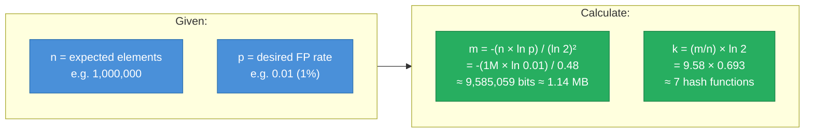
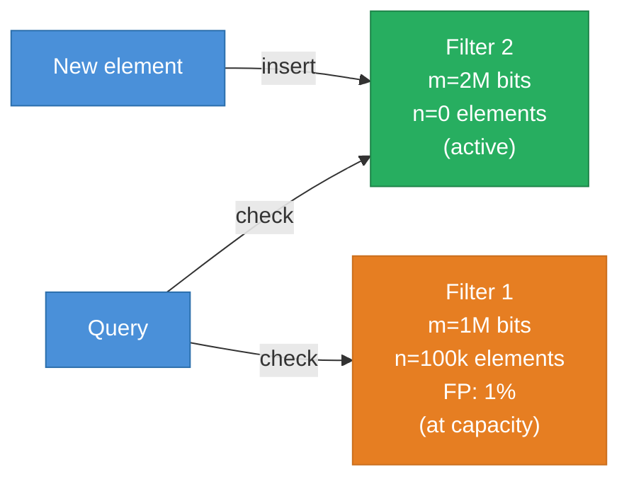
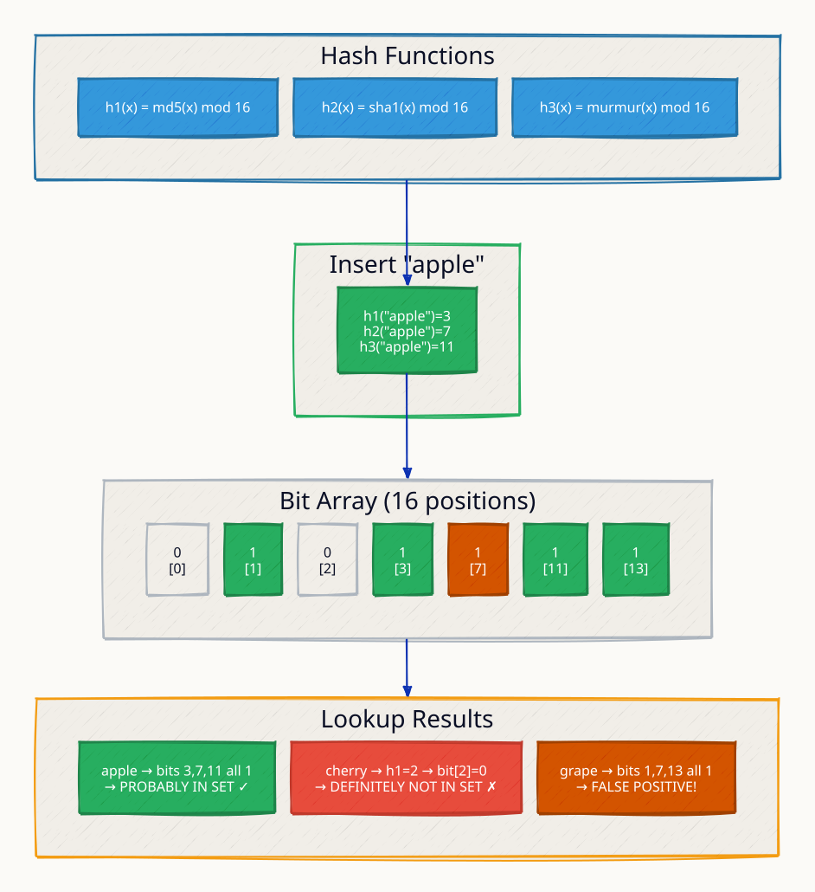
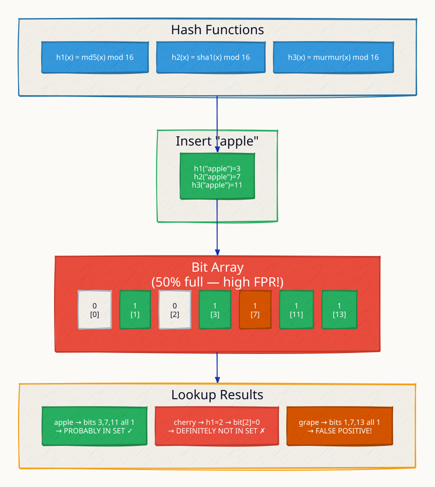
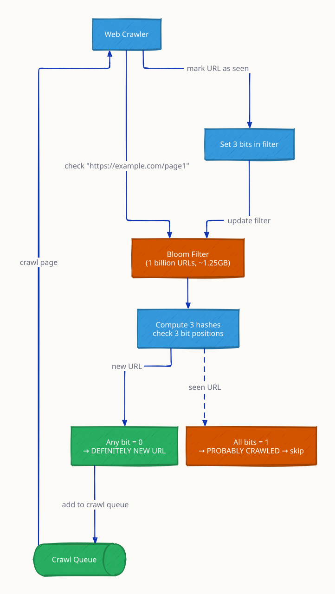
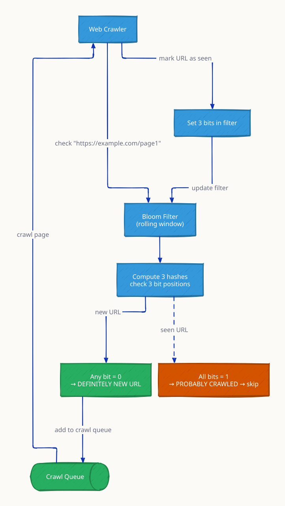

# Bloom Filter

A Bloom filter is a space-efficient probabilistic data structure that answers membership queries: "Is element X in this set?" It can answer "definitely no" (guaranteed correct) or "probably yes" (may be a false positive). False negatives are impossible — if an element was inserted, the Bloom filter will always say "probably yes."

The key insight: instead of storing elements themselves, a Bloom filter stores a compact bit array. Multiple hash functions map each element to several positions in the array. This is orders of magnitude more compact than a hash set, at the cost of a tunable false positive rate.

---

## How It Works

```mermaid
flowchart TD
    subgraph Insert["INSERT: 'apple'"]
        direction TB
        A1["hash1('apple') = 3"] --> B1["Set bit[3] = 1"]
        A2["hash2('apple') = 7"] --> B2["Set bit[7] = 1"]
        A3["hash3('apple') = 11"] --> B3["Set bit[11] = 1"]
    end

    subgraph QueryYes["QUERY: 'apple' (inserted)"]
        direction TB
        QA1["hash1('apple') = 3 → bit[3] = 1 ✓"]
        QA2["hash2('apple') = 7 → bit[7] = 1 ✓"]
        QA3["hash3('apple') = 11 → bit[11] = 1 ✓"]
        Result1["All bits set → PROBABLY YES"]
        QA1 & QA2 & QA3 --> Result1
    end

    subgraph QueryNo["QUERY: 'banana' (not inserted)"]
        direction TB
        QB1["hash1('banana') = 3 → bit[3] = 1 ✓"]
        QB2["hash2('banana') = 9 → bit[9] = 0 ✗"]
        QB3["hash3('banana') = 14 → bit[14] = 0 ✗"]
        Result2["One bit not set → DEFINITELY NO"]
        QB1 & QB2 & QB3 --> Result2
    end

    subgraph FalsePos["QUERY: 'cherry' (not inserted — false positive)"]
        direction TB
        QC1["hash1('cherry') = 3 → bit[3] = 1 ✓ (shared with apple)"]
        QC2["hash2('cherry') = 7 → bit[7] = 1 ✓ (shared with apple)"]
        QC3["hash3('cherry') = 11 → bit[11] = 1 ✓ (shared with apple)"]
        Result3["All bits set → PROBABLY YES (FALSE POSITIVE)"]
        QC1 & QC2 & QC3 --> Result3
    end

    classDef insert fill:#27AE60,stroke:#1E8449,color:#fff
    classDef queryyes fill:#4A90D9,stroke:#2C6FAC,color:#fff
    classDef queryno fill:#E74C3C,stroke:#C0392B,color:#fff
    classDef falsepos fill:#E67E22,stroke:#CA6F1E,color:#fff

    class A1,A2,A3,B1,B2,B3 insert
    class QA1,QA2,QA3,Result1 queryyes
    class QB1,QB2,QB3,Result2 queryno
    class QC1,QC2,QC3,Result3 falsepos
```



**Bit array state after inserting "apple":**
```
Position:  0  1  2  3  4  5  6  7  8  9 10 11 12 13 14 15
Bit:       0  0  0  1  0  0  0  1  0  0  0  1  0  0  0  0
```

---

## False Positive Rate Formula

The probability of a false positive depends on three parameters:

- **m** = number of bits in the array
- **n** = number of elements inserted
- **k** = number of hash functions

```
p ≈ (1 - e^(-kn/m))^k
```

**Optimal k** (minimizes false positive rate for given m and n):
```
k = (m/n) × ln(2)  ≈  (m/n) × 0.693
```

### False Positive Rate Table

| m/n (bits per element) | k (optimal) | False Positive Rate |
|---|---|---|
| 4 | 3 | 14.7% |
| 6 | 4 | 5.7% |
| 8 | 6 | 2.1% |
| 10 | 7 | 0.82% |
| 13 | 9 | 0.27% |
| 16 | 11 | 0.09% |
| 20 | 14 | 0.02% |

**Space savings example:** 1,000,000 URLs, 1% false positive rate:
- Hash set: ~50 MB (storing full URLs)
- Bloom filter: ~9.6 MB (10 bits/element × 1M / 8 bits/byte)
- **Savings: ~80%**

---

## Memory Sizing



---

## Variants

### Counting Bloom Filter

Replaces each bit with a small counter (3-4 bits). Supports deletion: increment on insert, decrement on delete. Trade-off: uses 3-4× more space than a standard Bloom filter.

### Scalable Bloom Filter

When the filter approaches its capacity (FP rate would exceed threshold), a new, larger filter is added. Queries check all filters in the chain. Used when the total number of elements is unknown upfront.



---

## Real-World Applications

| System | Use Case | Benefit |
|---|---|---|
| Apache Cassandra | SSTable membership check | Avoids disk read for missing keys |
| HBase | Skip disk reads for absent rows | Reduces I/O by 2-5× |
| Google Chrome | Safe Browsing URL check | Local filter before network call to Google |
| Akamai CDN | Negative cache (URL not cached) | Avoid cache lookup for one-hit wonders |
| PostgreSQL | Bloom filter index | Skip irrelevant table pages in queries |
| Bitcoin | SPV wallet — transaction filter | Nodes send only relevant transactions |
| Ethereum | Log bloom in block header | Quickly check if block contains relevant events |

---

## Bloom Filter in a System Design

```mermaid
flowchart TD
    Request["Query: Is user 'john@example.com' registered?"] --> BF

    BF{Bloom\nFilter} -->|DEFINITELY NO| Skip["Skip DB query\nReturn: not registered\n(zero I/O, ~1μs)"]

    BF -->|PROBABLY YES| DB["Query User DB\n(actual I/O, ~10ms)"]

    DB -->|Found| Return1["Return: exists"]
    DB -->|Not found\n(false positive)| Return2["Return: not registered"]

    Note1["99% of queries for\nnon-existing users\nnever hit the DB"]

    classDef bf fill:#8E44AD,stroke:#6C3483,color:#fff
    classDef skip fill:#27AE60,stroke:#1E8449,color:#fff
    classDef db fill:#4A90D9,stroke:#2C6FAC,color:#fff
    classDef note fill:#ECF0F1,stroke:#BDC3C7,color:#2C3E50

    class BF bf
    class Skip skip
    class DB db
    class Note1 note
```

---

## This Module

```
high-level-design/algorithms/7.1_bloom_filter/
├── server/
│   └── main.go    # Bloom filter with HTTP API: /insert, /query, /stats
├── docker-compose.yml
└── test.sh
```

A Bloom filter answers "is X in the set?" with:
- `definitely_no` — guaranteed correct, zero false negatives
- `probably_yes` — may be a false positive

Space-efficient: 1000 items at 1% FP rate needs ~9.6 KB vs ~50 KB for a hash set.

```sh
docker compose up --build -d && sleep 1 && bash test.sh
go test -v ./server/
```

**References**

- Burton H. Bloom, "Space/Time Trade-offs in Hash Coding with Allowable Errors" (1970)
- [Cassandra Bloom Filters](https://cassandra.apache.org/doc/latest/cassandra/operating/bloom_filters.html)
- [Network Applications of Bloom Filters — Survey (Broder & Mitzenmacher)](https://www.eecs.harvard.edu/~michaelm/postscripts/im2005b.pdf)

---

## Interview Angles

**Q1: Can a Bloom filter give false negatives?**

No — false negatives are impossible. When an element is inserted, all k bit positions are set to 1. A subsequent query checks those exact same positions. Since bits are never cleared (in a standard Bloom filter), they will always be 1. If any bit is 0, the element was definitely not inserted. This is the fundamental guarantee: "definitely no" is always correct; "probably yes" may be wrong.

**Q2: How do you choose k and m for a Bloom filter?**

Start from two inputs: expected number of elements n and acceptable false positive rate p. Calculate bit array size: `m = -(n × ln p) / (ln 2)²`. Calculate optimal hash functions: `k = (m/n) × ln(2)`. For 1 million elements at 1% FP rate: m ≈ 9.6 MB, k ≈ 7. Fewer hash functions means faster insert/query but higher FP rate; more bits means lower FP rate but more memory.

**Q3: When would you use a Bloom filter in a system design?**

Use a Bloom filter as a fast pre-filter before an expensive operation. Classic cases: (1) cache negative results — before querying a database for a key, check the Bloom filter; if "definitely no," skip the query entirely; (2) deduplication — "has this URL been crawled?" in a web crawler without storing all URLs; (3) CDN one-hit wonders — Akamai uses Bloom filters to avoid caching content that is only ever requested once, saving cache space for popular content.

**Q4: How do you handle deletions in a Bloom filter?**

Standard Bloom filters cannot support deletions — clearing a bit might affect other inserted elements that hash to the same position. Use a Counting Bloom Filter instead: replace each bit with a small counter (typically 3-4 bits). Increment on insert, decrement on delete; a position is "set" if its counter > 0. The trade-off is 3-4× more memory. Alternatively, use a Cuckoo filter, which supports deletion with comparable FP rates and better cache performance.

**Q5: What happens when a Bloom filter fills up (exceeds its designed capacity)?**

The false positive rate grows beyond the designed threshold as more bits collide. Mitigate with: (1) a Scalable Bloom Filter — when the current filter reaches capacity (FP rate would exceed target), add a new, larger filter to a chain; queries check all filters; (2) periodic rebuilds — if the working set changes, rebuild the filter from current data; (3) size generously upfront using the expected element count × 2-3× safety margin.

---

## Architecture Diagrams

> Generated from D2 sources in [`docs/diagrams/src/7.1_bloom_filter/`](../../../docs/diagrams/src/7.1_bloom_filter/).
> Regenerate: `just diagrams-topic 7.1_bloom_filter`.

### Overview

A 16-bit array with three hash functions: inserting sets k bits, lookup checks them — any zero means definitely absent, all ones means probably present (the false positive shown is set entirely by other keys' bits).



**`false_positive_rate` scenario:** at 50% bit saturation the false-positive rate climbs steeply — size the array for the expected element count or accuracy degrades.



### Request Flow

The classic use: a crawler asks the filter before fetching — 1 billion URLs deduplicated in ~1.25 GB of RAM instead of hundreds of GB of exact storage.



**`reset` scenario:** bits cannot be individually unset (they're shared), so clearing means rebuilding the whole filter — or using a counting variant.


