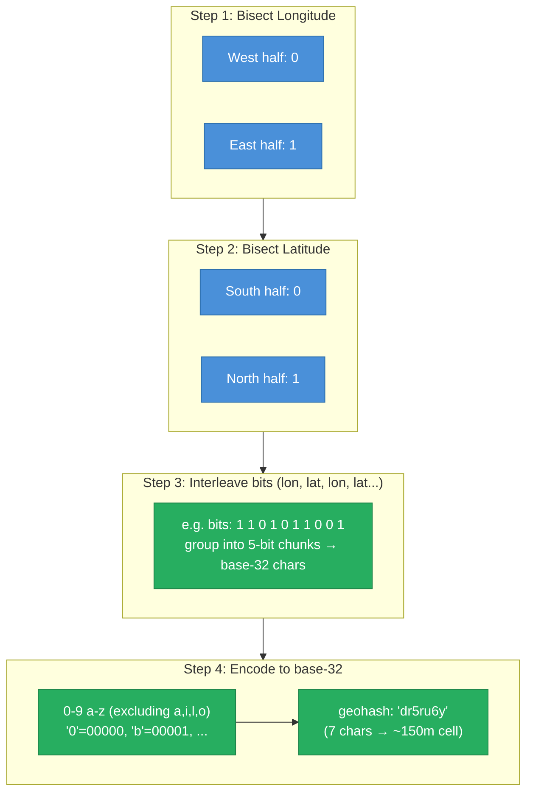
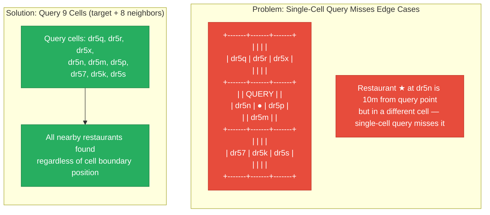
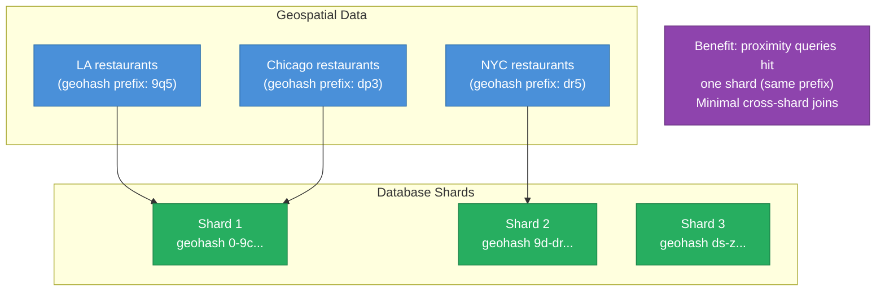
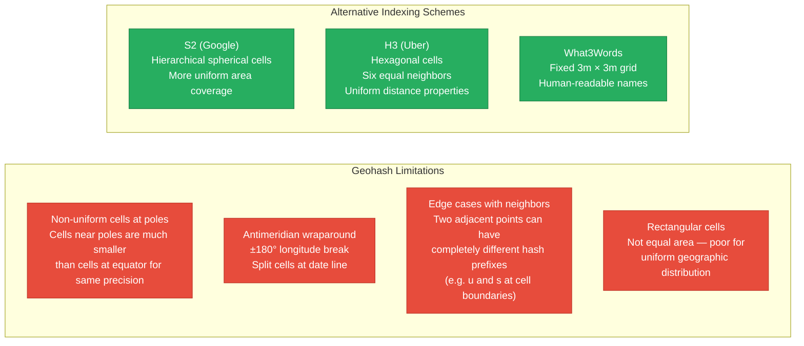
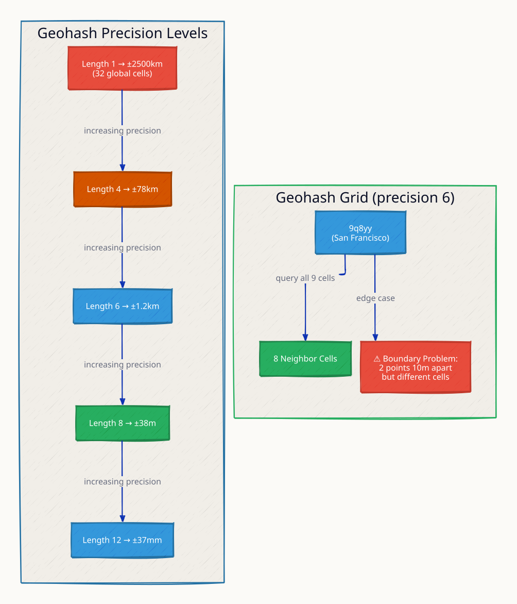
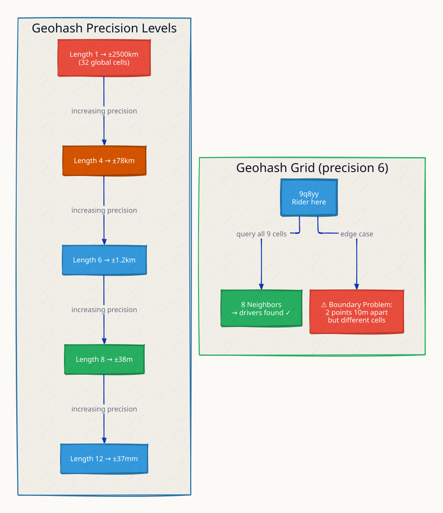
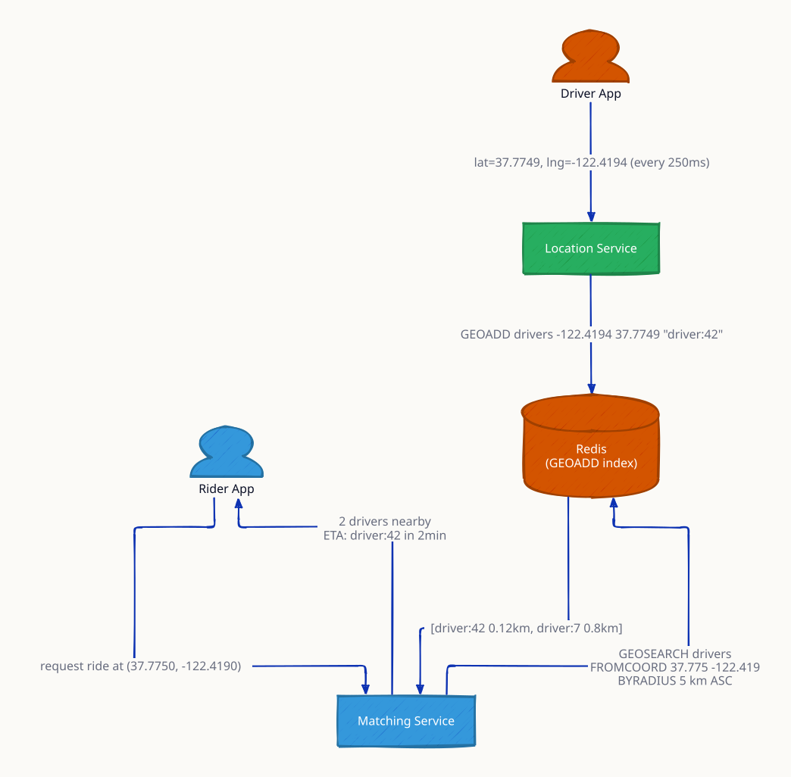
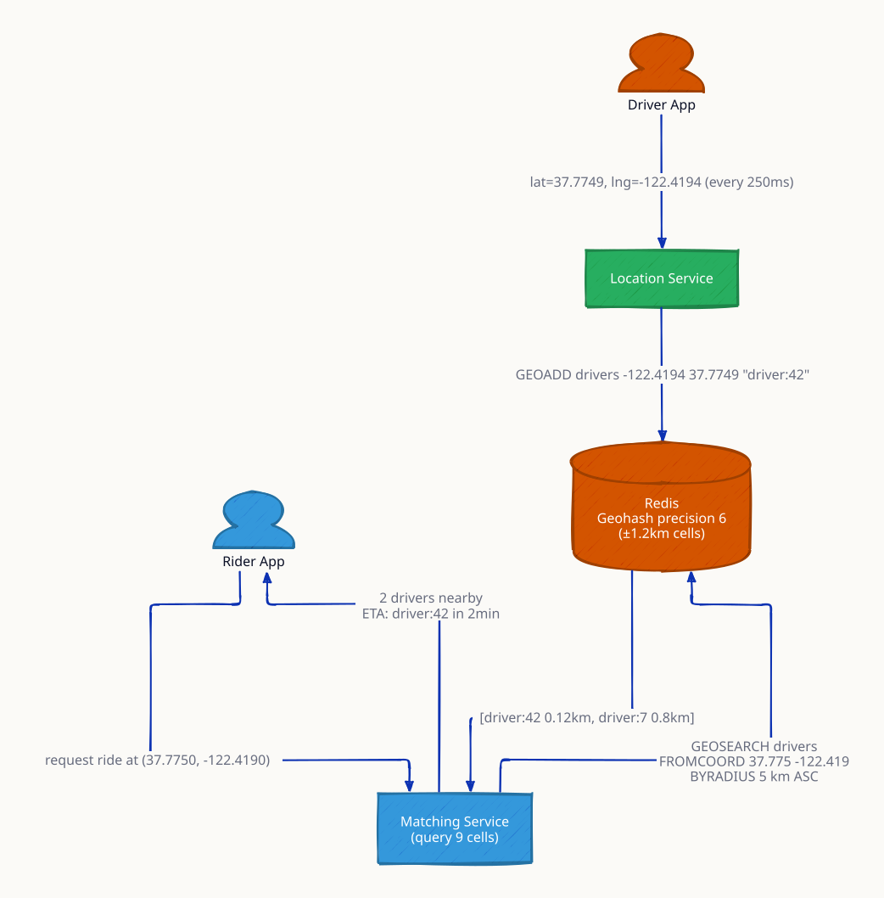

# Geohashing

Geohashing encodes a (latitude, longitude) coordinate into a short alphanumeric string. The critical property: nearby locations share a common prefix. "dr5ru" and "dr5rv" are neighboring cells; "dr5r" is the parent cell containing both. This prefix property enables proximity queries — "find all restaurants near me" — to become simple string prefix comparisons, and allows geographically nearby data to be co-located on the same database shard.

Invented by Gustavo Niemeyer in 2008 and published at geohash.org, geohashing is used by Uber (driver matching), Yelp (nearby search), Redis GEO commands, and PostGIS.

---

## How It Works

Geohashing recursively bisects the globe into rectangular cells and encodes each split as a base-32 character:



**Base-32 alphabet (Niemeyer):** `0123456789bcdefghjkmnpqrstuvwxyz` (32 characters — letters a, i, l, o excluded to avoid confusion with digits)

---

## Precision Table

| Geohash Length | Cell Width | Cell Height | Area | Example Use |
|---|---|---|---|---|
| 1 | 5,000 km | 5,000 km | 25,000,000 km² | Continental region |
| 2 | 1,250 km | 625 km | 781,250 km² | Large country |
| 3 | 156 km | 156 km | 24,336 km² | State / province |
| 4 | 39 km | 19.5 km | 760 km² | City |
| 5 | 4.9 km | 4.9 km | 24 km² | District |
| 6 | 1.2 km | 0.61 km | 0.73 km² | Neighborhood |
| 7 | 153 m | 153 m | 23,409 m² | City block |
| 8 | 38 m | 19 m | 722 m² | Building |
| 9 | 4.8 m | 4.8 m | 23 m² | Room |
| 12 | 3.7 cm | 1.9 cm | ~7 cm² | Sub-centimeter |

**Rule of thumb:** for ride-sharing (match drivers within 500m), use precision 6-7. For city-level geofencing, use precision 4-5.

---

## Proximity Search — The 9-Cell Problem

Naively querying only the cell containing the query point misses nearby points that fall in adjacent cells:



**Why 8 neighbors?** A query point near the edge of its cell could be 1 meter from a restaurant in the adjacent cell, but a pure prefix query only returns results within the same cell. Querying all 8 neighboring cells + the target cell ensures you capture all nearby points regardless of where in the cell the query point sits.

---

## Geohash as a Shard Key



---

## Redis GEO — Geohash Under the Hood

Redis GEO commands use geohash internally. Coordinates are stored as scored members in a sorted set, with the score being the 52-bit geohash integer.

```
# Add drivers (lon, lat, name)
GEOADD drivers-nyc -74.006 40.7128 "driver:101"
GEOADD drivers-nyc -74.009 40.7135 "driver:102"

# Find drivers within 500m of a point
GEORADIUS drivers-nyc -74.006 40.713 500 m ASC COUNT 10

# Get driver's geohash (precision 7)
GEOPOS drivers-nyc "driver:101"
GEOHASH drivers-nyc "driver:101"    → "dr5regw3pp0"
```

This is the core of a ride-sharing driver-matching system: drivers update their location every few seconds with `GEOADD`, the matching service queries nearby drivers with `GEORADIUS` or `GEOSEARCH`.

---

## Limitations of Geohashing



| Scheme | Cell Shape | Uniform Area? | Neighbors | Best For |
|---|---|---|---|---|
| Geohash | Rectangle | No | 8 (some edge issues) | Simple proximity, key-value stores |
| S2 | Spherical quadrilateral | Near-uniform | 4 | Google Maps, routing |
| H3 (Uber) | Hexagon | Yes | 6 (all equal distance) | Aggregation, analytics, ride-sharing |
| QuadTree | Rectangle (adaptive) | No | Varies | Dynamic density, non-uniform data |

---

## Real-World System Design: Find Drivers Within 500m

```mermaid
flowchart TD
    Driver["Driver App\n(updates location every 5s)"] -->|GEOADD drivers lon lat driver:id| Redis["Redis Sorted Set\n(geohash score)"]

    Rider["Rider App\n(requests ride)"] -->|POST /match {lat, lon}| API["Matching Service"]
    API -->|GEOSEARCH drivers FROMMEMBER lon lat 500 m| Redis
    Redis -->|driver:101, driver:102, driver:103| API
    API -->|pick closest available driver| Result["Match: driver:101"]

    Driver2["Driver goes offline"] -->|ZREM drivers driver:id| Redis

    classDef driver fill:#4A90D9,stroke:#2C6FAC,color:#fff
    classDef rider fill:#F39C12,stroke:#D68910,color:#fff
    classDef api fill:#27AE60,stroke:#1E8449,color:#fff
    classDef redis fill:#E74C3C,stroke:#C0392B,color:#fff

    class Driver,Driver2 driver
    class Rider rider
    class API api
    class Redis redis
```

---

## This Module

```
high-level-design/algorithms/7.2_geohashing/
├── server/
│   └── main.go    # Geohash encode/decode + Redis GEO proximity queries
├── docker-compose.yml
└── test.sh
```

```sh
docker compose up --build -d && sleep 2 && bash test.sh
go test -v ./server/
```

**References**

- [Gustavo Niemeyer — geohash.org](http://geohash.org/)
- [Redis GEO commands](https://redis.io/docs/latest/commands/geoadd/)
- [H3: Uber's Hexagonal Hierarchical Spatial Index](https://eng.uber.com/h3/)
- [Google S2 Geometry Library](http://s2geometry.io/)

---

## Interview Angles

**Q1: Why do you query 9 cells instead of 1 in a proximity search?**

A query point near the edge of its geohash cell could be just meters from a point in the adjacent cell, but that adjacent cell has a completely different hash prefix. Querying only the target cell's prefix misses all such nearby points. Querying the target cell plus its 8 neighbors ensures you capture all points within the desired radius regardless of where in the cell the query point sits. After the 9-cell lookup, apply a final Haversine distance filter to remove results outside the exact radius.

**Q2: What are the limitations of geohashing?**

Three main limitations: (1) non-uniform cell sizes — cells near the poles are much smaller than equatorial cells at the same precision, so the same hash length represents different physical areas depending on latitude; (2) edge discontinuities — two adjacent points can have completely different prefixes if they sit on a cell boundary, requiring the 9-cell neighbor query to compensate; (3) the antimeridian (±180° longitude) breaks the prefix-ordering property for points straddling the date line. For applications needing truly uniform geographic distribution (aggregation, analytics), Uber's H3 hexagonal scheme is superior.

**Q3: How would you find all drivers within 500m using Redis?**

Use Redis GEO: drivers update location with `GEOADD drivers-<city> lon lat driver:id` every few seconds. The matching service calls `GEOSEARCH drivers-nyc FROMLONLAT lon lat BYRADIUS 500 m ASC COUNT 20`. Redis stores coordinates as geohash scores in a sorted set and uses the 9-cell neighbor algorithm internally. For very high driver density, shard by geohash prefix (one Redis key per city or geohash-4 cell) to prevent hot keys.

**Q4: How does geohashing enable database sharding for location data?**

Using geohash as a shard key co-locates geographically nearby data on the same shard. A proximity query (find restaurants within 1km) resolves to a small set of geohash prefixes that map to at most 1-2 shards, avoiding cross-shard fan-out. The trade-off: hotspot risk for dense areas (Manhattan has far more data than rural Montana at the same geohash prefix length) — mitigate by using adaptive precision (shorter prefix for dense areas, longer for sparse).

**Q5: Compare geohash precision 6 vs precision 7 for a ride-sharing app.**

Precision 6 cells are ~1.2km × 0.6km — good for grouping nearby drivers in a neighborhood but too coarse for exact matching. Precision 7 cells are ~153m × 153m — appropriate for matching (a driver 150m away is reachable in under 2 minutes). For ride-sharing, use precision 7 for the cell lookup and Haversine distance for the final ranking. Update the driver's geohash in Redis only when the position changes by more than 50m to avoid constant writes from GPS jitter.

---

## Architecture Diagrams

> Generated from D2 sources in [`docs/diagrams/src/7.2_geohashing/`](../../../docs/diagrams/src/7.2_geohashing/).
> Regenerate: `just diagrams-topic 7.2_geohashing`.

### Overview

Geohash precision levels 1–12 mapping to cell sizes, and the 8-neighbor query that fixes boundary misses.



**`proximity_search` scenario:** two nearby points share a geohash prefix, turning 'within X km' into a prefix match — but only with neighbor cells included, since adjacent points can straddle a cell edge.



### Request Flow

Uber-style matching: drivers GEOADD positions every 250ms; a ride request GEOSEARCHes a 5km radius and returns distance-sorted candidates.



**`precision_tradeoff` scenario:** precision 4 = coarse 78km cells (fast, inaccurate); precision 8 = 38m cells (accurate, more cells to scan); precision 6 with 9-cell queries is the working compromise.


