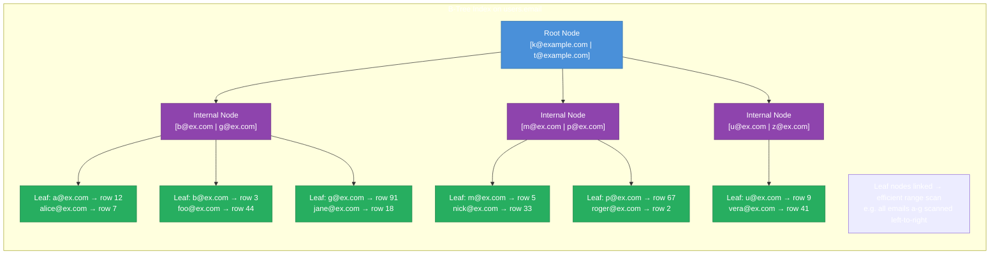
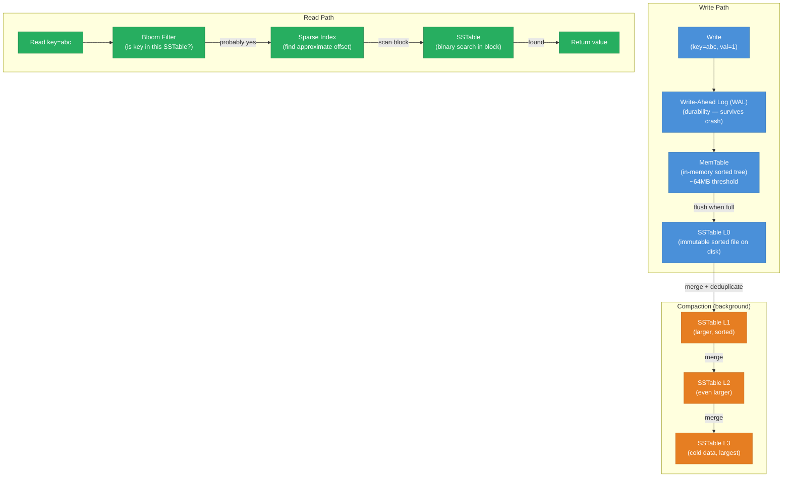
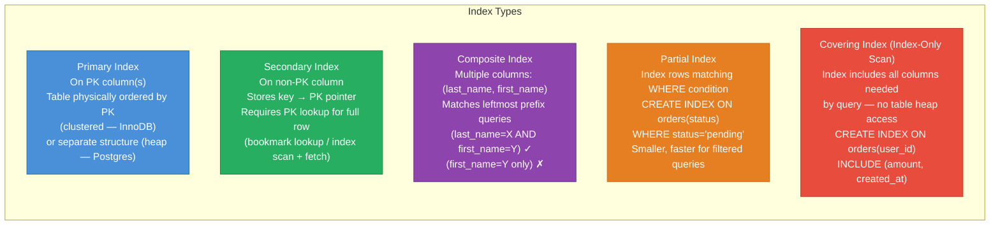
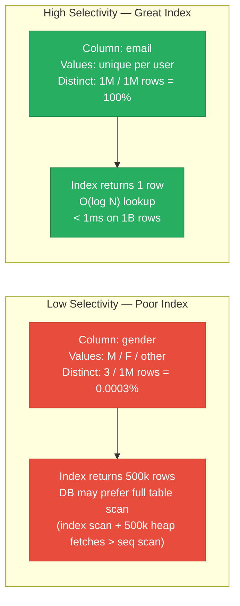
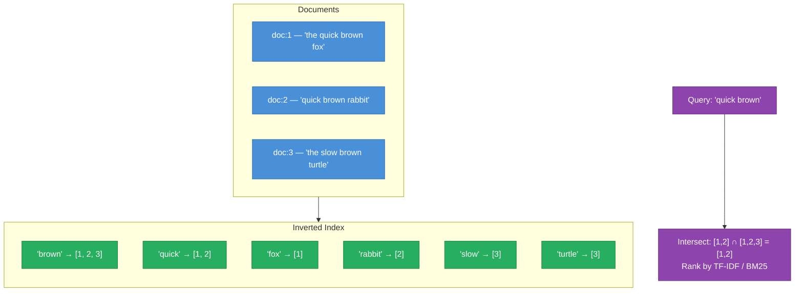
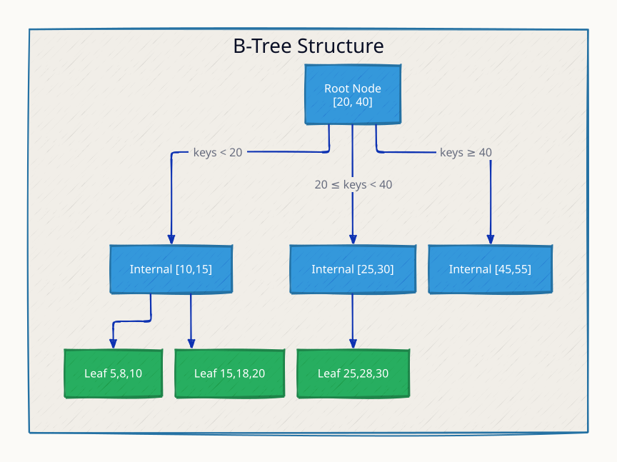
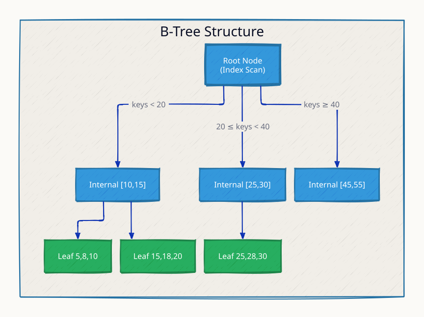
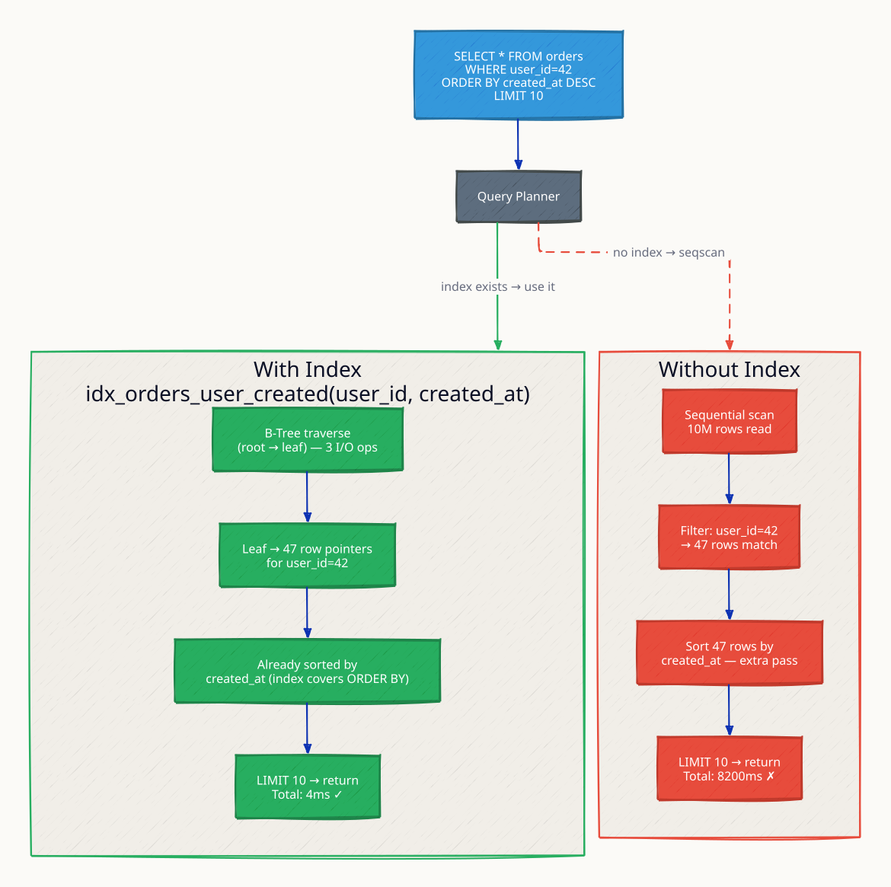
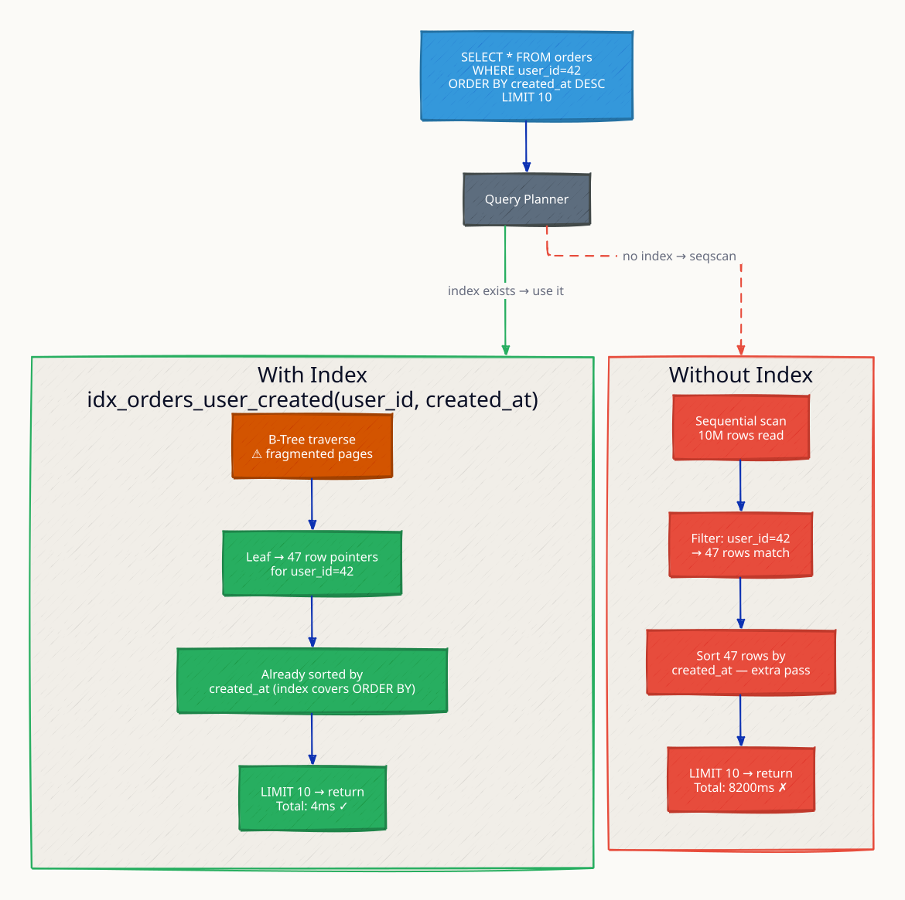

# Indexing

Without an index, every query requires scanning the entire table — O(N) for N rows. An index is a separate data structure that maps column values to row locations, turning lookups into O(log N) and making range queries efficient. The cost: every write (INSERT, UPDATE, DELETE) must update all indexes on the table, and each index consumes additional storage. Choosing which columns to index — and which index structure to use — is one of the most impactful performance decisions in database design.

---

## B-Tree Index

The B-tree (balanced tree) is the dominant index structure in relational databases (PostgreSQL, MySQL InnoDB, SQLite, Oracle). It maintains sorted order, supports both point lookups and range queries, and self-balances to guarantee O(log N) performance.



**B-tree properties:**
- Leaf nodes store the actual key → row pointer mappings
- Leaf nodes are linked in sorted order for range scans
- Tree rebalances on every insert/delete to maintain O(log N) height
- Typical branching factor: 100-500 (tree stays shallow even for billions of rows)

---

## LSM-Tree (Log-Structured Merge-Tree)

LSM-trees are optimized for write-heavy workloads. Instead of updating a sorted structure in-place (which requires random I/O), all writes go to an in-memory buffer (MemTable) and are flushed sequentially to disk. Used by: RocksDB, LevelDB, Cassandra, HBase, ScyllaDB, ClickHouse.



---

## B-Tree vs LSM-Tree

| Dimension | B-Tree | LSM-Tree |
|---|---|---|
| Write path | Random I/O (update in-place) | Sequential I/O (append to log) |
| Write amplification | Low (1 write per page) | High (data written multiple times during compaction) |
| Read amplification | Low (O(log N) — single path) | Higher (check MemTable + multiple SSTables) |
| Space amplification | Low | Medium (obsolete data until compaction) |
| Range queries | Excellent (leaf link traversal) | Good (within SSTable; cross-SSTable merge) |
| Point lookups | Excellent | Good with Bloom filters |
| Compaction overhead | None (in-place) | Background CPU/I/O during compaction |
| Best for | Read-heavy, mixed workloads | Write-heavy (time-series, logs, events) |
| Examples | PostgreSQL, MySQL, SQLite | Cassandra, RocksDB, LevelDB, HBase |

---

## Index Types



---

## Index Selectivity

**Selectivity** = number of distinct values / total rows. High selectivity = better index.



| Column | Selectivity | Index useful? |
|---|---|---|
| email | Very high (unique) | Yes — perfect |
| user_id | Very high (unique) | Yes — primary key |
| status | Low (active/inactive) | Sometimes — partial index |
| created_at | High (many distinct dates) | Yes — for range queries |
| gender | Very low | Rarely — composite with high-selectivity column |
| country | Medium | Depends — useful for country-specific queries |

---

## Full-Text Search — Inverted Index

A B-tree index on a text column supports only prefix matching (`LIKE 'foo%'`), not keyword search (`LIKE '%foo%'`). Full-text search uses an **inverted index**: a mapping from each term to the list of document IDs containing it.



Used by: Elasticsearch (Lucene), PostgreSQL (`tsvector` + `tsquery`), Solr, Typesense, Meilisearch.

---

## Reading EXPLAIN Output (PostgreSQL)

```sql
-- Without index on email:
EXPLAIN SELECT * FROM users WHERE email = 'alice@example.com';
-- Seq Scan on users  (cost=0.00..18834.00 rows=1 width=64)
--   Filter: (email = 'alice@example.com')

-- After: CREATE INDEX ON users(email);
EXPLAIN SELECT * FROM users WHERE email = 'alice@example.com';
-- Index Scan using users_email_idx on users  (cost=0.43..8.45 rows=1 width=64)
--   Index Cond: (email = 'alice@example.com')
```

| Plan Node | Meaning |
|---|---|
| Seq Scan | Full table scan — O(N) |
| Index Scan | B-tree traversal + heap fetch — O(log N) |
| Index Only Scan | B-tree traversal only (covering index) — O(log N), no heap |
| Bitmap Index Scan | Multiple index entries batch-fetched, then heap accessed in physical order |
| Hash Join / Merge Join | How two tables are joined — prefer over Nested Loop at scale |

---

## Index Overhead and When Not to Index

Every index adds write overhead — each INSERT, UPDATE, DELETE must maintain all indexes on that table. A table with 8 indexes on a write-heavy workload can have 8× write amplification.

**When NOT to index:**
- Small tables (< 1000 rows) — seq scan is often faster
- Columns that are never queried in WHERE, JOIN, or ORDER BY
- Very low-selectivity columns (unless used in composite indexes)
- Write-heavy tables where index maintenance cost outweighs read savings

**Index maintenance strategy:** run `EXPLAIN ANALYZE` on slow queries, identify seq scans on large tables, add targeted indexes. Periodically audit unused indexes (`pg_stat_user_indexes.idx_scan = 0`).

---

## This Module

```
high-level-design/algorithms/7.3_indexing/
├── server/
│   └── main.go    # B-Tree implementation + HTTP API: /insert, /search, /range
├── docker-compose.yml
└── test.sh
```

A B-Tree of order 3 maintains sorted keys across balanced nodes. Point search: O(log n). Range scan: O(log n + k). Used in PostgreSQL, MySQL InnoDB.

```sh
docker compose up --build -d && sleep 1 && bash test.sh
go test -v ./server/
```

**References**

- Martin Kleppmann, "Designing Data-Intensive Applications" — Chapter 3: Storage and Retrieval
- [PostgreSQL Index Types](https://www.postgresql.org/docs/current/indexes-types.html)
- [RocksDB Architecture Guide](https://github.com/facebook/rocksdb/wiki/RocksDB-Architecture-Guide)
- [Elasticsearch: The Definitive Guide — Inverted Index](https://www.elastic.co/guide/en/elasticsearch/guide/current/inverted-index.html)

---

## Interview Angles

**Q1: When would you choose an LSM-tree over a B-tree?**

Choose an LSM-tree for write-heavy workloads: time-series data (IoT sensor readings, metrics), event logs, activity feeds, and message queues. LSM-trees convert random writes into sequential disk I/O (append to log), which is 10-100× faster on HDDs and even significant on SSDs. The trade-off is higher read amplification — reads must check MemTable and potentially multiple SSTable levels, mitigated by Bloom filters. Use B-trees for read-heavy or mixed workloads with frequent point lookups and range queries.

**Q2: What is a covering index and when does it matter?**

A covering index (index-only scan) includes all columns needed by a query within the index itself, so the database never needs to fetch the actual table row. Example: `CREATE INDEX ON orders(user_id) INCLUDE (amount, created_at)` — a query `SELECT amount, created_at FROM orders WHERE user_id = 123` can be answered entirely from the index without touching the table heap. This eliminates random I/O for heap fetches, making reads significantly faster at the cost of larger index size and more write overhead per row.

**Q3: Why does a low-cardinality column make a bad index?**

Low-cardinality columns (gender, status, boolean flags) have few distinct values. An index on `gender = 'M'` returns 50% of the table — the database must then do 500,000 random heap fetches to retrieve the actual rows. The planner often decides a full sequential scan is cheaper (sequential I/O over the whole table beats 500k random I/Os). Exception: use a partial index on a low-cardinality column where one value is rare (`WHERE status='pending'` — most orders are completed, only a small fraction are pending).

**Q4: How does a composite index work and what is the leftmost prefix rule?**

A composite index `(last_name, first_name, email)` is sorted first by `last_name`, then `first_name`, then `email`. It can accelerate queries that use the leftmost prefix of the index: `WHERE last_name = 'Smith'` (uses index), `WHERE last_name = 'Smith' AND first_name = 'John'` (uses index), `WHERE first_name = 'John'` (cannot use index — `last_name` is not specified). Design composite indexes with the most selective column first, and in the order of most common query patterns.

**Q5: How do you find and fix a slow query in production?**

Step 1: identify slow queries from the database slow query log (`pg_stat_statements`, MySQL slow log) — look for high total time or high calls × avg_time. Step 2: run `EXPLAIN ANALYZE` on the query — look for Seq Scan on large tables, high rows estimates vs actual, Nested Loop with large outer results. Step 3: add a targeted index on the filtered/joined column, or rewrite the query to use a more selective predicate. Step 4: verify with `EXPLAIN ANALYZE` post-index that the planner uses Index Scan. Step 5: monitor `pg_stat_user_indexes` to confirm the index is used and measure the latency improvement.

---

## Architecture Diagrams

> Generated from D2 sources in [`docs/diagrams/src/7.3_indexing/`](../../../docs/diagrams/src/7.3_indexing/).
> Regenerate: `just diagrams-topic 7.3_indexing`.

### Overview

B-tree internals — root to internal to leaf in 3–4 levels even for millions of rows — plus when to reach for hash, full-text, or composite indexes.



**`index_hit` scenario:** the planner walks root → internal → leaf in 3 I/Os — O(log N) with a branching factor of hundreds.



**`index_miss` scenario:** a composite index on (user_id, created_at) is useless for WHERE created_at alone — the leftmost-prefix rule sends the query to a full scan.


### Request Flow

The same query with and without an index: 4ms and 3 page reads vs 8.2s scanning 10M rows.



**`index_bloat` scenario:** every index slows every write and dead entries accumulate — indexes are paid for at write time, so unused ones are pure cost.


