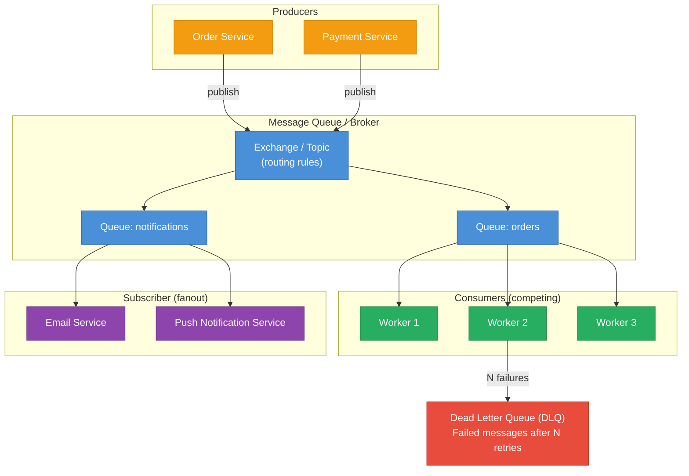
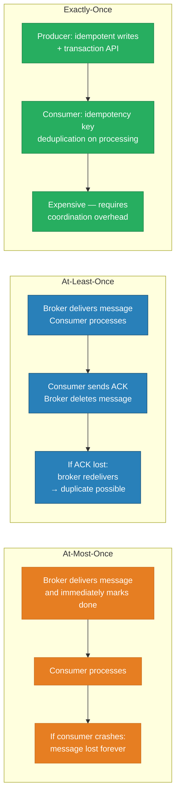
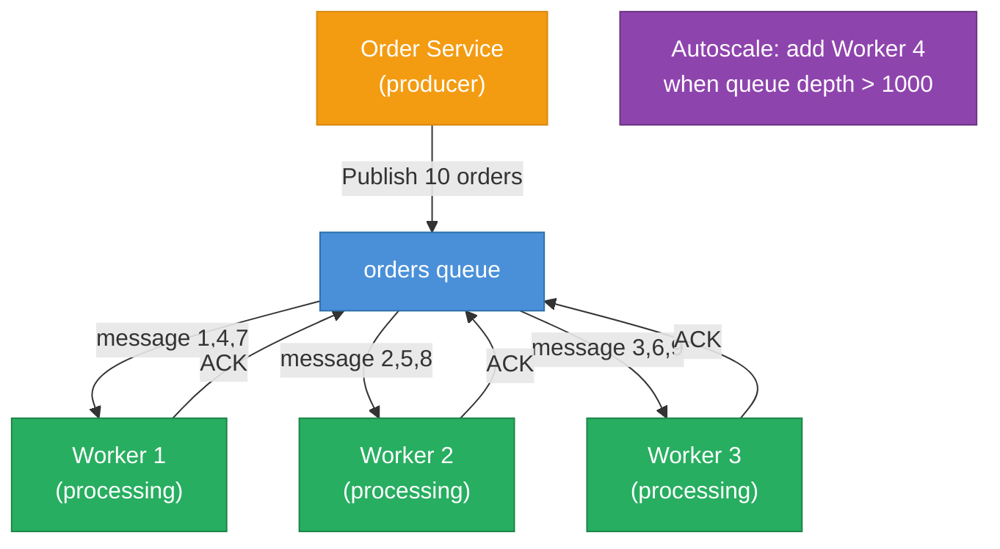
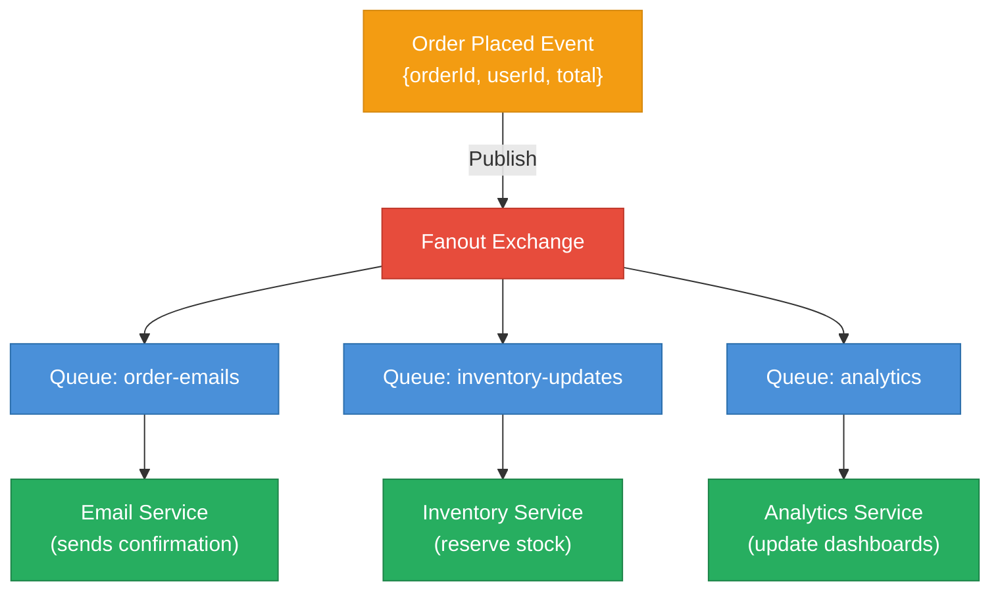
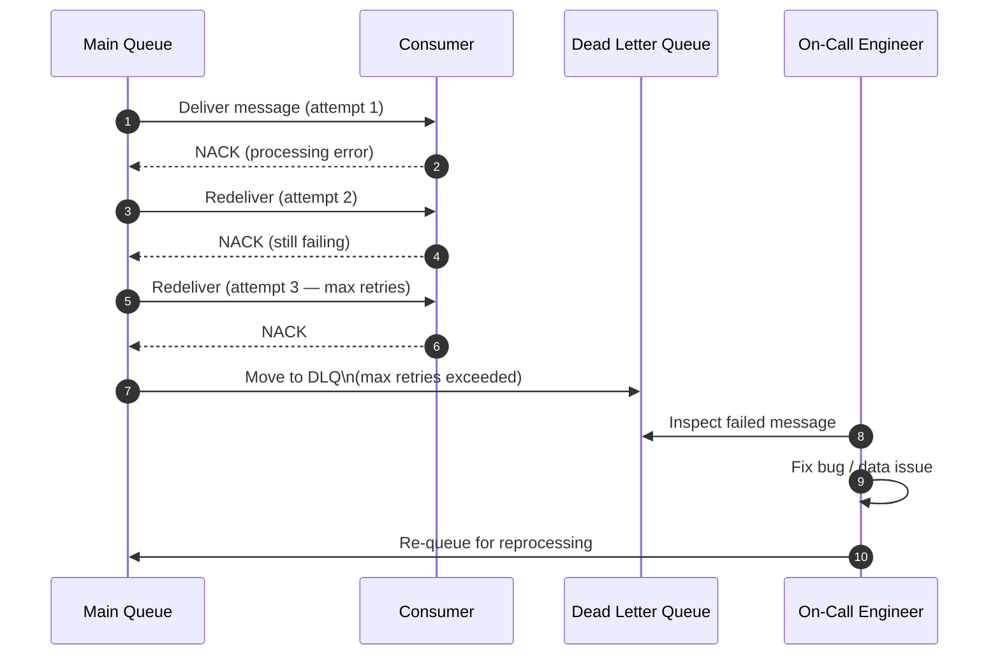
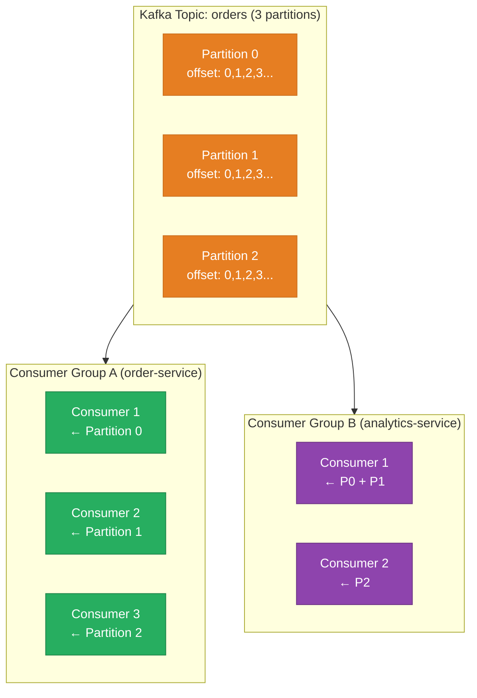
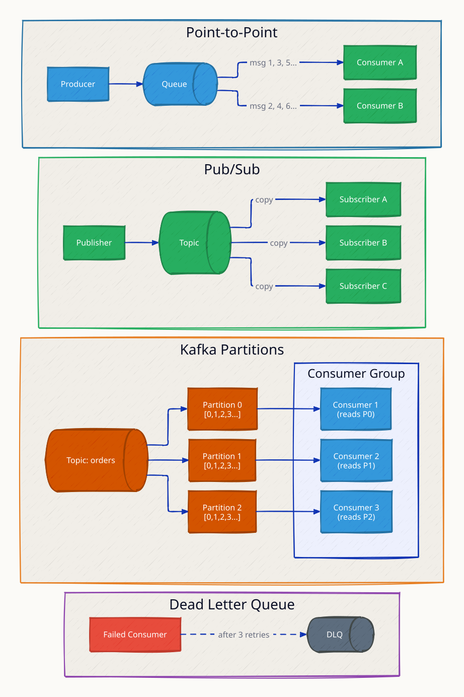
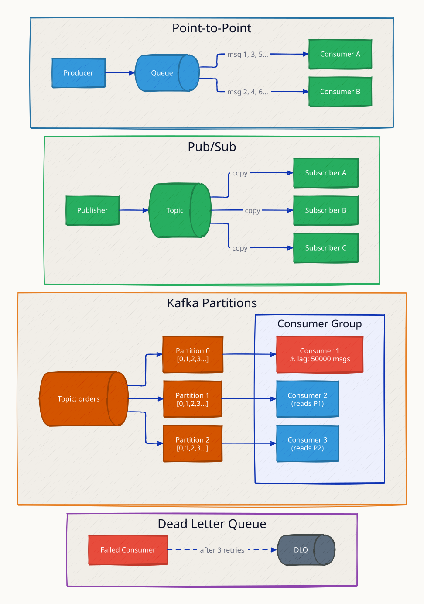
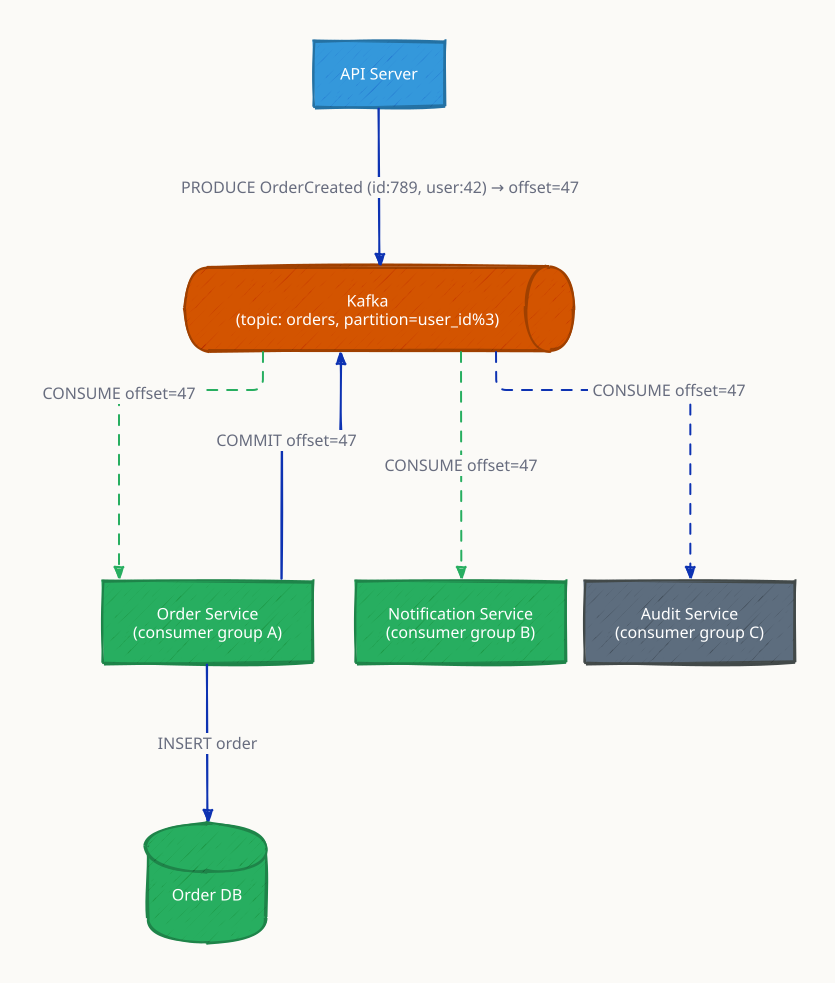
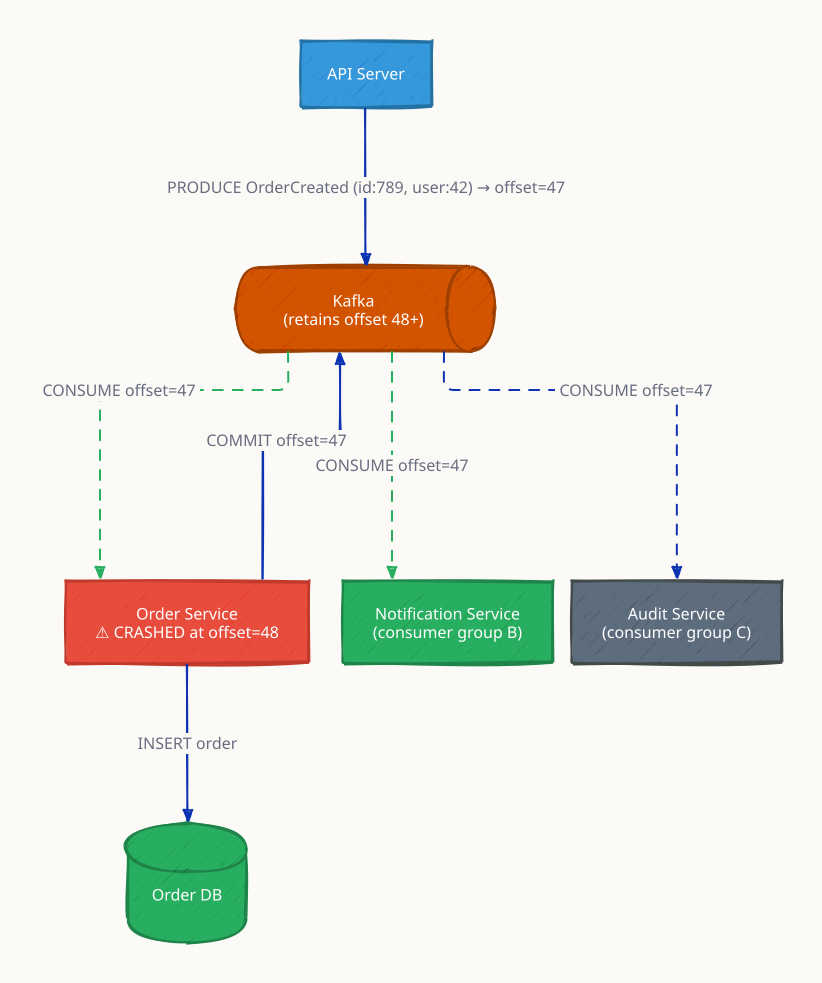

# Message Queues

A message queue decouples the producer of work from the consumer of work. Instead of the producer waiting for the consumer to finish processing — a synchronous, tightly-coupled model — the producer drops a message into the queue and immediately moves on. The consumer processes messages at its own pace. This decoupling absorbs traffic spikes (the queue buffers load), enables async processing (email dispatch, video transcoding, report generation), and allows independent scaling of producers and consumers.

At scale — think order processing at Amazon or activity feeds at LinkedIn — message queues are the connective tissue that lets microservices evolve, scale, and fail independently.

---

## Core Concepts



---

## Delivery Guarantees



| Guarantee | Risk | Use Case |
|---|---|---|
| At-most-once | Message loss | Metrics, low-value events |
| At-least-once | Duplicate processing | Most systems — handle with idempotent consumers |
| Exactly-once | Performance overhead | Financial transactions, inventory updates |

**Practical advice:** design for at-least-once and write idempotent consumers. True exactly-once is complex and rarely worth the overhead outside financial systems.

---

## Work Queue (Competing Consumers)



Each message is delivered to exactly one worker. Workers compete for messages — naturally load-balanced. Scale horizontally by adding workers when queue depth grows.

---

## Pub/Sub (Fanout)



Each subscriber gets its own copy of every message. Adding a new subscriber (e.g., fraud detection) requires no change to the producer.

---

## Dead Letter Queue (DLQ)



DLQs prevent poison pill messages (malformed or permanently unprocessable) from blocking the queue. They provide an audit trail of all failures and allow manual replay after fixing the root cause.

---

## Kafka Deep-Dive

Kafka is a distributed log, not a traditional message queue. Key differences:



- Messages are retained on disk (default 7 days) — consumers can replay from any offset
- Within a partition, ordering is guaranteed; across partitions, it is not
- Consumer groups track their own offsets independently — same messages consumed by multiple groups
- Log compaction: keep only the latest value per key (event sourcing, CDC)

---

## Backpressure Strategies

When consumers are slower than producers, the queue fills up:

| Strategy | Behavior | Use Case |
|---|---|---|
| Block producer | Producer waits when queue is full | Strong durability, batch jobs |
| Drop messages | Producer discards new messages | Metrics, low-value events |
| Expand consumer pool | Autoscale consumers | Elastic workloads |
| Rate-limit producer | Slow down producers via feedback | Prevent OOM on broker |
| Prioritize queue | High-priority messages jump ahead | Mixed-priority workloads |

---

## RabbitMQ vs Kafka vs SQS

| Dimension | RabbitMQ | Apache Kafka | AWS SQS |
|---|---|---|---|
| Model | Push (broker → consumer) | Pull (consumer polls) | Pull (consumer polls) |
| Ordering | Per-queue FIFO | Per-partition | No / FIFO queue type |
| Throughput | ~20k–100k msg/s | Millions msg/s | Thousands msg/s |
| Retention | Until consumed (or TTL) | Configurable log (7d default) | Up to 14 days |
| Replay | No (once consumed = gone) | Yes — rewind offset | No |
| Consumer model | Competing consumers | Consumer groups | Competing consumers |
| Routing | Flexible (exchanges, bindings) | Topic + partition key | Queue per destination |
| Exactly-once | No (at-least-once) | Yes (idempotent producer + transactions) | No (at-least-once) |
| Operational complexity | Moderate | High | Low (managed) |
| Best for | Complex routing, RPC, tasks | Event streaming, log pipelines | Simple async tasks, AWS-native |

---

## This Module

```
high-level-design/async-and-communication/6.1_message_queues/
├── producer/
│   └── main.go    # Publishes to work queue and fanout exchange
├── consumer/
│   └── main.go    # Competing consumers + fanout subscribers
├── docker-compose.yml
└── test.sh
```

```sh
docker compose up --build -d
sleep 5
bash test.sh
docker compose logs --tail=20 consumer-work-1 consumer-work-2
docker compose logs --tail=20 consumer-fanout-1 consumer-fanout-2
```

Management UI: http://localhost:15672 — guest / guest

**References**

- [RabbitMQ Tutorials](https://www.rabbitmq.com/tutorials)
- [Kafka: The Definitive Guide — Confluent](https://www.confluent.io/resources/kafka-the-definitive-guide/)
- [AWS SQS FIFO Queues](https://docs.aws.amazon.com/AWSSimpleQueueService/latest/SQSDeveloperGuide/FIFO-queues.html)

---

## Interview Angles

**Q1: How do you guarantee at-least-once delivery?**

The consumer sends an explicit ACK to the broker only after successfully processing the message. The broker holds the message and sets a visibility timeout; if no ACK arrives within the timeout, it redelivers. This means the consumer must be idempotent — processing the same message twice must be safe (use an idempotency key or a deduplication store to detect and skip duplicates).

**Q2: When would you use Kafka over RabbitMQ?**

Use Kafka when you need message replay (analytics, event sourcing, audit logs), very high throughput (millions/sec), or multiple independent consumer groups reading the same stream at different offsets. Use RabbitMQ when you need complex routing (topic/direct/fanout exchanges), lower-latency push delivery, priority queues, or request-reply RPC patterns. For simple async task queues on AWS, SQS is often sufficient with no operational overhead.

**Q3: How do you handle duplicate messages in an at-least-once system?**

Design idempotent consumers: before processing, check if a deduplication key (message ID or business key) has already been processed. Store processed IDs in Redis or a DB table with a short TTL (longer than your redelivery window). For database operations, use upsert (INSERT ON CONFLICT DO NOTHING) or conditional updates (UPDATE ... WHERE version = N).

**Q4: What is a Dead Letter Queue and when do you need one?**

A DLQ receives messages that have failed processing N times (max retries exceeded) or expired before consumption. It prevents "poison pill" messages from blocking the main queue indefinitely. Always provision a DLQ in production — it is your audit trail for processing failures. Set up alerts on DLQ depth and a replay mechanism to reprocess messages after fixing the root cause.

**Q5: How does Kafka ordering work and when does it break?**

Within a single partition, Kafka guarantees strict message order. Across partitions, there is no ordering guarantee. Messages are routed to partitions by a partition key (e.g., order ID) — all events for the same key land in the same partition in order. Ordering breaks if you increase partition count (key → partition mapping changes) or if a consumer group rebalance assigns a partition to a new consumer mid-stream. To preserve global ordering, use a single partition — but that limits throughput to one consumer.

---

## Architecture Diagrams

> Generated from D2 sources in [`docs/diagrams/src/6.1_message_queues/`](../../../docs/diagrams/src/6.1_message_queues/).
> Regenerate: `just diagrams-topic 6.1_message_queues`.

### Overview

Point-to-point (competing consumers, each message processed once) vs pub/sub (every subscriber gets a copy) vs Kafka's partitioned log with consumer groups, plus the DLQ.



**`consumer_lag` scenario:** one consumer falls 50,000 messages behind its partition — the signal to add partitions and consumers before latency SLOs break.



### Request Flow

An order event through Kafka: produced at offset 47, independently consumed by the order, notification, and audit groups, each committing its own offset.



**`consumer_failure` scenario:** a consumer crashes mid-batch; on restart it resumes from the last committed offset and reprocesses — at-least-once delivery, made safe by idempotent handlers.


