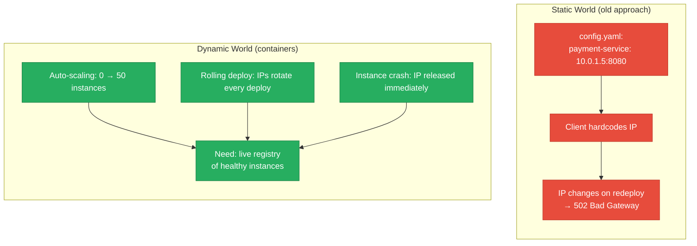
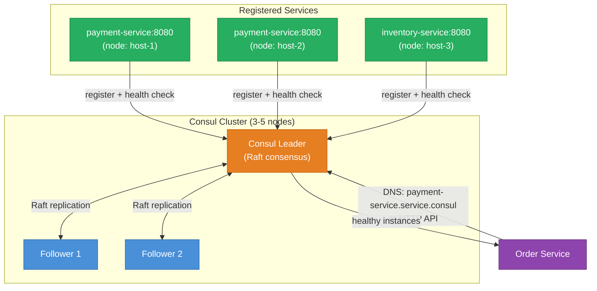
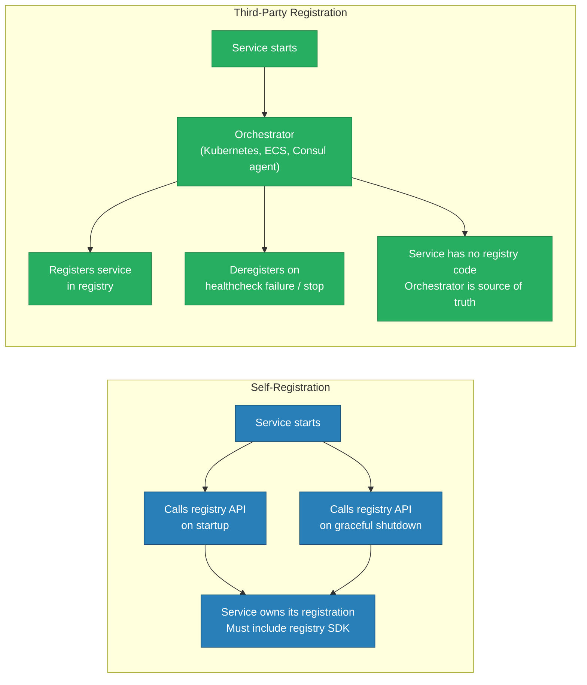
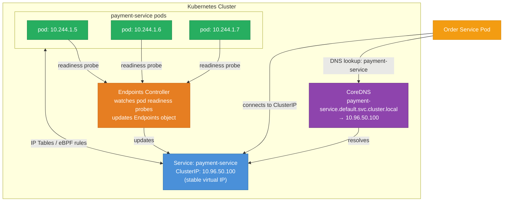
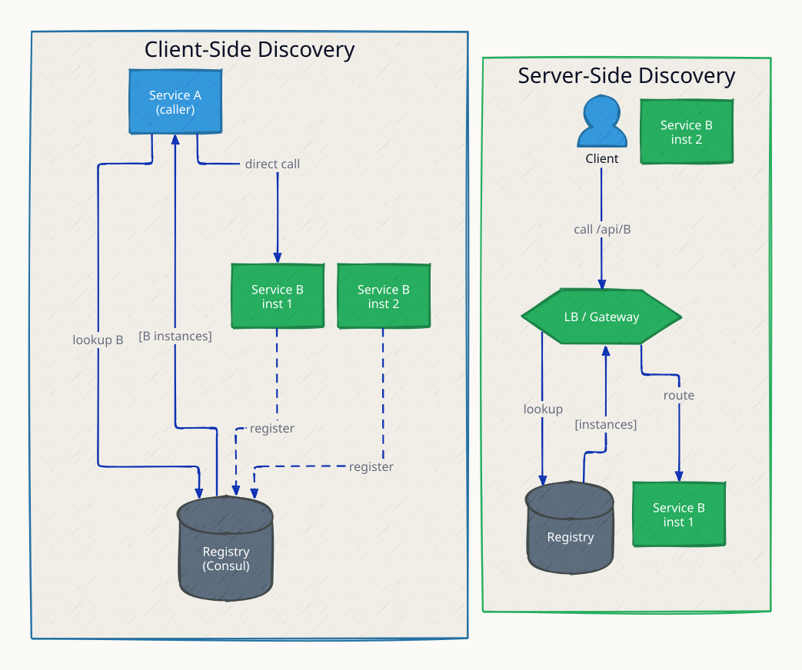
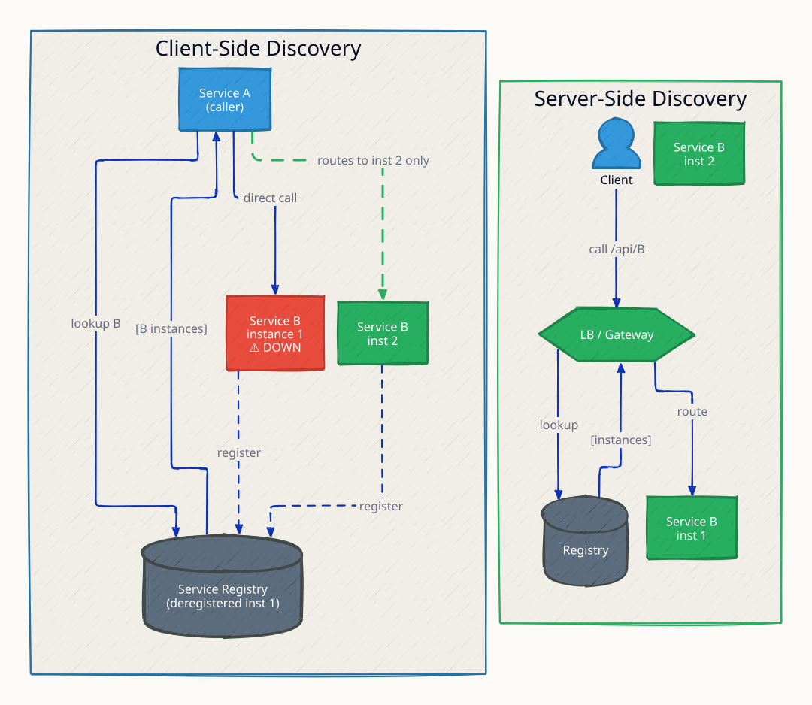
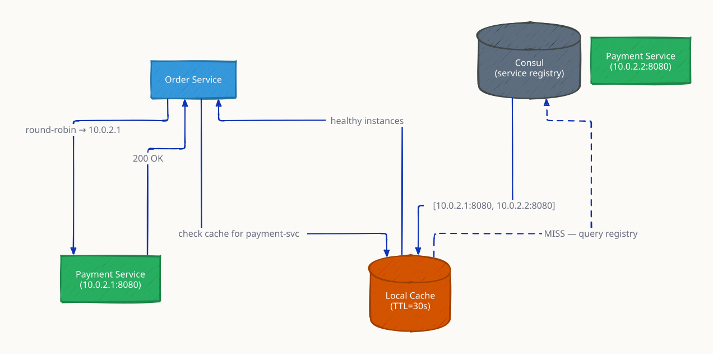
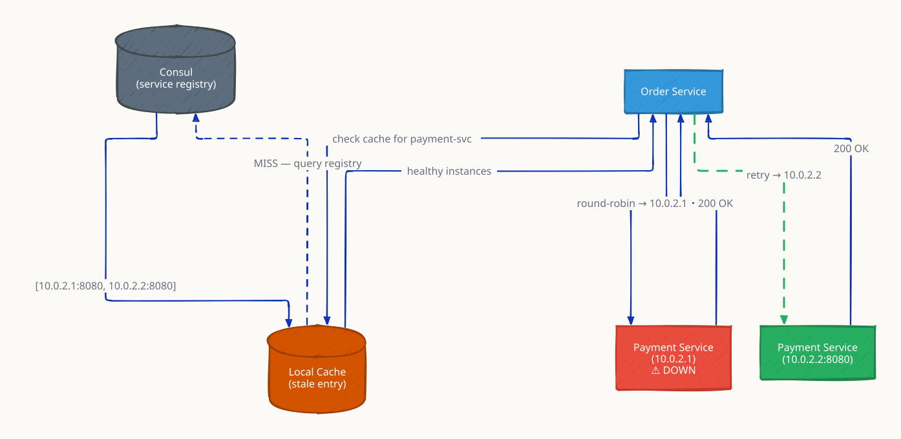

# Service Discovery

In a static data center, services have fixed IP addresses hardcoded in config files. In a dynamic environment — Kubernetes pods, auto-scaling EC2 groups, containerized microservices — instances start and stop constantly, and their IP addresses change with every deployment. Service discovery solves this: it provides a live registry of available instances so callers can find the current addresses of their dependencies without hardcoded IPs or manual config updates.

---

## The Problem



---

## Client-Side Discovery

The client queries the service registry directly, receives a list of healthy instances, and load-balances the call itself.

```mermaid
flowchart TD
    Client["Order Service\n(client)"] -->|1. Query registry| Registry["Service Registry\n(Consul / Eureka)"]
    Registry -->|2. Return instance list\n10.0.1.5:8080, 10.0.1.6:8080| Client
    Client -->|3. Pick instance\n(round-robin, random, LB)| I1["Payment Service\n10.0.1.5:8080"]
    Client -.->|alternate pick| I2["Payment Service\n10.0.1.6:8080"]

    subgraph Registration["Service Registration"]
        direction LR
        I1 -->|self-register on startup| Registry
        I2 -->|self-register on startup| Registry
        I1 -->|heartbeat / health check| Registry
        I2 -->|heartbeat / health check| Registry
    end

    classDef client fill:#4A90D9,stroke:#2C6FAC,color:#fff
    classDef registry fill:#8E44AD,stroke:#6C3483,color:#fff
    classDef instance fill:#27AE60,stroke:#1E8449,color:#fff

    class Client client
    class Registry registry
    class I1,I2 instance
```

**Used by:** Netflix Eureka + Ribbon, Spring Cloud, gRPC name resolver

**Trade-offs:**
- Client has direct control over load-balancing strategy
- Client code must include registry SDK — language coupling
- Registry outage awareness is per-client (can cache instance list)

---

## Server-Side Discovery

The client calls a load balancer or API gateway. The gateway queries the registry and routes the request — the client knows nothing about instances.

```mermaid
flowchart TD
    Client["Mobile App\n(client)"] -->|1. POST /charge| GW["API Gateway / Load Balancer\n(AWS ALB + ECS)"]
    GW -->|2. Query registry| Registry["Service Registry\n(ECS Service Discovery\n/ Consul / k8s DNS)"]
    Registry -->|3. Return healthy instances| GW
    GW -->|4. Route to instance\n(LB algorithm)| I1["Payment Instance A"]
    GW -.->|or route to| I2["Payment Instance B"]

    classDef client fill:#F39C12,stroke:#D68910,color:#fff
    classDef gateway fill:#4A90D9,stroke:#2C6FAC,color:#fff
    classDef registry fill:#8E44AD,stroke:#6C3483,color:#fff
    classDef instance fill:#27AE60,stroke:#1E8449,color:#fff

    class Client client
    class GW gateway
    class Registry registry
    class I1,I2 instance
```

**Used by:** AWS ALB + ECS, Kubernetes ClusterIP, Nginx upstream with Consul template

**Trade-offs:**
- Client is simple — just calls a stable endpoint
- Gateway is a single point of failure (must be HA)
- Extra network hop through the gateway

---

## Client-Side vs Server-Side Discovery

| Dimension | Client-Side | Server-Side |
|---|---|---|
| Who queries registry? | Client directly | Gateway / LB on behalf of client |
| Client complexity | Higher — needs registry SDK | Low — just a fixed endpoint |
| LB flexibility | Client controls algorithm | Gateway controls |
| Registry coupling | Per language/framework | Centralized |
| Network hops | Client → instance (direct) | Client → gateway → instance |
| Example | Eureka + Ribbon, gRPC | AWS ALB, Kubernetes ClusterIP |

---

## Consul — Architecture and Health Checks



**Consul health check types:**

| Type | How it works | Best for |
|---|---|---|
| HTTP | Consul GET `/health` every N seconds | HTTP services |
| TCP | Consul opens TCP connection | Non-HTTP (databases, gRPC) |
| Script | Custom script on agent node | Complex health logic |
| gRPC | Uses `grpc.health.v1` protocol | gRPC services |
| TTL | Service pings Consul before TTL expires | Async/batch workers |

---

## Self-Registration vs Third-Party Registration



---

## Kubernetes Service Discovery



**Kubernetes headless service** (ClusterIP: None): DNS returns individual pod IPs instead of the virtual IP — used for stateful sets where clients need to address specific pods (Kafka, Cassandra, Elasticsearch).

---

## DNS-Based Discovery

```mermaid
flowchart LR
    Client["Client"] -->|DNS query: _payment._tcp.example.com| DNS["DNS Server\n(with SRV records)"]
    DNS -->|SRV record: 10 1 8080 host-a.example.com\nSRV record: 20 1 8080 host-b.example.com| Client
    Client -->|connect, weight 10 (preferred)| HostA["host-a.example.com:8080"]
    Client -.->|fallback, weight 20| HostB["host-b.example.com:8080"]

    classDef client fill:#4A90D9,stroke:#2C6FAC,color:#fff
    classDef dns fill:#8E44AD,stroke:#6C3483,color:#fff
    classDef host fill:#27AE60,stroke:#1E8449,color:#fff

    class Client client
    class DNS dns
    class HostA,HostB host
```

**DNS SRV records** encode service name, protocol, host, port, priority, and weight. Every language has a DNS resolver — no SDK needed. **Limitation:** DNS TTL caching means stale records are served for TTL seconds after an instance goes down. Use short TTLs (5-30s) but be aware of DNS server load at scale.

---

## Registry Comparison

| Dimension | Consul | Eureka (Netflix) | Kubernetes DNS | ZooKeeper |
|---|---|---|---|---|
| Health checks | HTTP, TCP, script, TTL, gRPC | Client heartbeat | Readiness/liveness probes | Ephemeral znode (session) |
| DNS interface | Yes (SRV records) | No | Yes (native) | No |
| KV store | Yes | No | ConfigMap (limited) | Yes (znodes) |
| Multi-datacenter | Yes (native) | No | No (separate clusters) | Complex |
| Consistency | CP (Raft) | AP (eventual — peers) | CP (etcd) | CP (ZAB) |
| Operational complexity | Moderate | Low | Low (built-in) | High |
| Best for | Mixed workloads, multi-DC | JVM microservices | Kubernetes workloads | Strong consistency, locks |

---

## This Module

```
high-level-design/async-and-communication/6.2_service_discovery/
├── service/
│   └── main.go    # Self-registers with Consul, exposes /health
├── client/
│   └── main.go    # Queries Consul health API, round-robin load balances
├── docker-compose.yml
└── test.sh
```

```sh
docker compose up --build -d
sleep 10
bash test.sh
```

Consul UI: http://localhost:8500

**References**

- [Consul Service Discovery Documentation](https://developer.hashicorp.com/consul/docs/discovery/services)
- [Netflix Eureka — GitHub](https://github.com/Netflix/eureka)
- [Kubernetes Services and DNS](https://kubernetes.io/docs/concepts/services-networking/dns-pod-service/)

---

## Interview Angles

**Q1: What happens when a service crashes and the registry doesn't know yet?**

During the gap between crash and registry deregistration (health check interval + timeout), clients receive stale instance IPs and get connection refused errors. Mitigations: short health check intervals (5-10s), circuit breakers on the client to stop routing to failing instances, and retry with instance exclusion. Kubernetes mitigates this with readiness probes — traffic stops before the pod is fully terminated.

**Q2: Compare client-side and server-side discovery.**

Client-side: the client queries the registry and load-balances itself — more control, more coupling (SDK per language). Server-side: the client calls a gateway, the gateway queries the registry — simpler client, gateway is a chokepoint. Client-side is common in JVM microservices (Eureka/Ribbon). Server-side is standard in Kubernetes (ClusterIP service) and AWS (ALB + ECS Service Discovery).

**Q3: How does Kubernetes service discovery work?**

A Kubernetes Service creates a stable ClusterIP virtual IP. CoreDNS resolves `service-name.namespace.svc.cluster.local` to that ClusterIP. kube-proxy (or eBPF with Cilium) maintains iptables/eBPF rules that NAT connections from the ClusterIP to actual pod IPs. The Endpoints controller watches pod readiness probes and removes unhealthy pods from the Endpoints list — stopping traffic to unready pods before they're even deleted.

**Q4: Why use a service mesh (Istio/Envoy) instead of a service registry?**

A service mesh deploys a sidecar proxy (Envoy) next to every service instance. Discovery, load balancing, circuit breaking, retries, mTLS, and observability are all handled by the sidecar — with no changes to application code. The control plane (Istio istiod) pushes discovery data directly to sidecars. This is richer than a standalone registry but adds operational complexity and latency (two extra hops per call through sidecars).

**Q5: What is a TTL health check in Consul and when would you use it?**

A TTL health check inverts the normal model: instead of Consul polling the service, the service must periodically ping Consul before a deadline (TTL) expires. If the service misses its deadline, Consul marks it unhealthy. Use it for batch workers or async consumers that cannot expose an HTTP endpoint — they call `consul.agent.check.pass("service-id")` after each successful processing cycle.

---

## Architecture Diagrams

> Generated from D2 sources in [`docs/diagrams/src/6.2_service_discovery/`](../../../docs/diagrams/src/6.2_service_discovery/).
> Regenerate: `just diagrams-topic 6.2_service_discovery`.

### Overview

Client-side discovery (services query Consul and load-balance themselves) vs server-side (the LB queries the registry, clients stay dumb).



**`instance_down` scenario:** an instance misses heartbeats for 30s and Consul deregisters it; callers route around it on their next lookup.



### Request Flow

A service-to-service call with a 30s local cache over Consul — registry queried only on cache miss.



**`stale_cache` scenario:** the cache still lists a dead instance; the first call fails, triggering re-query and retry against a healthy one — TTL caching trades freshness for registry load.


