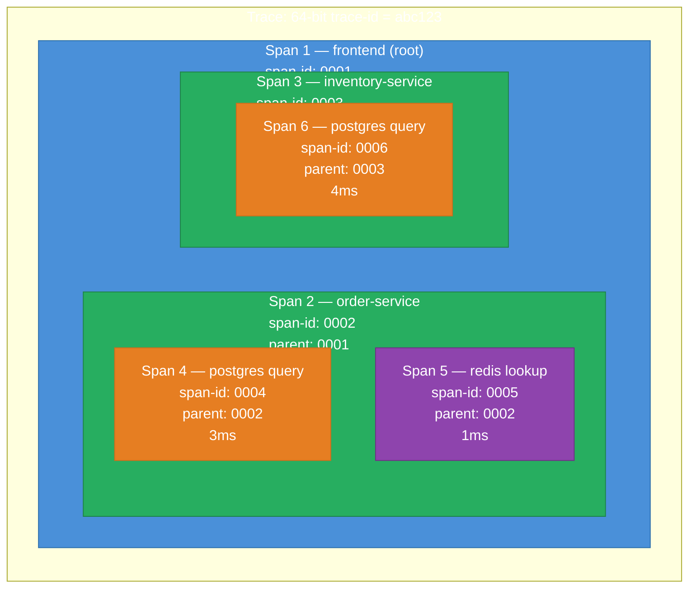
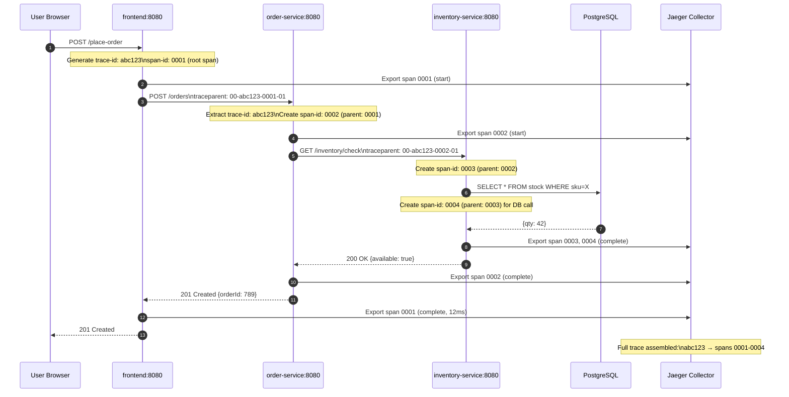
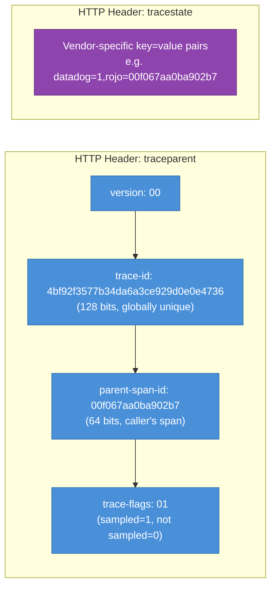
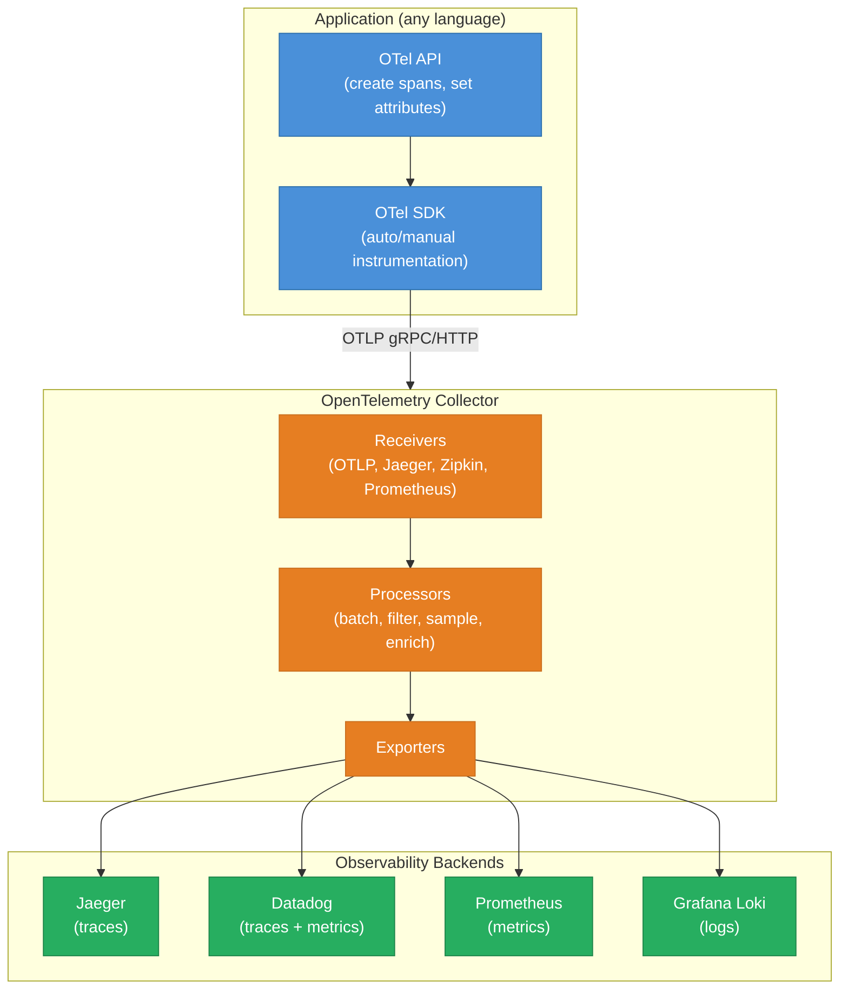
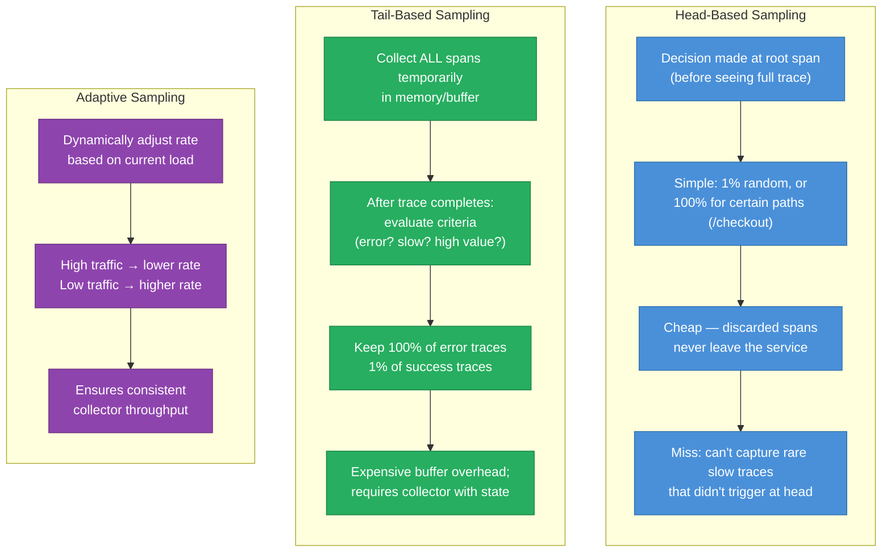
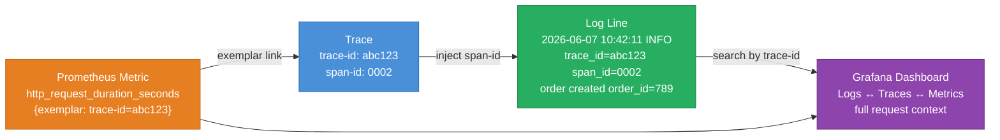
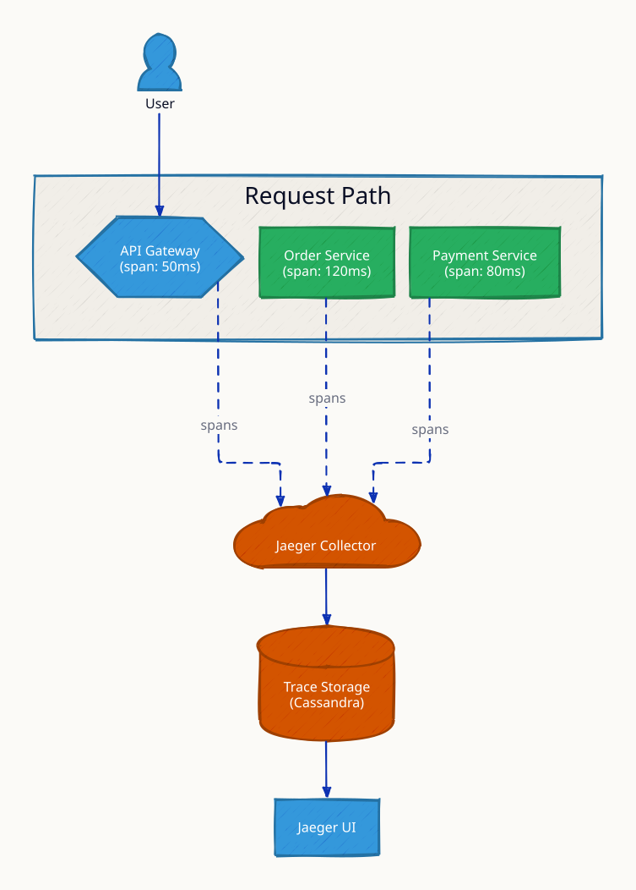
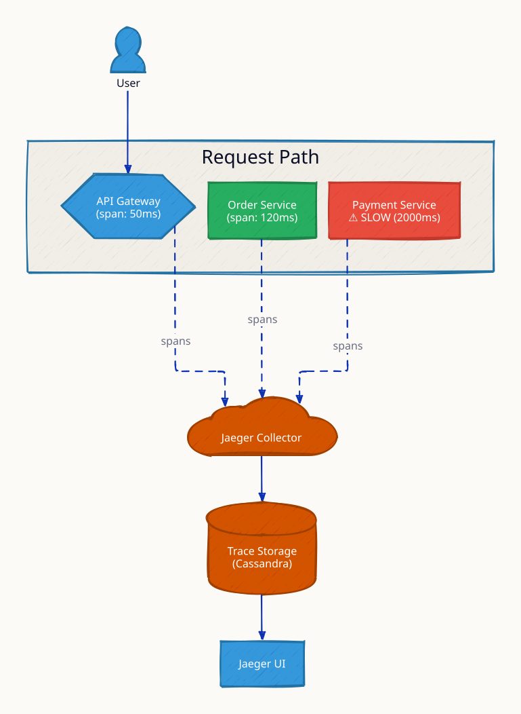
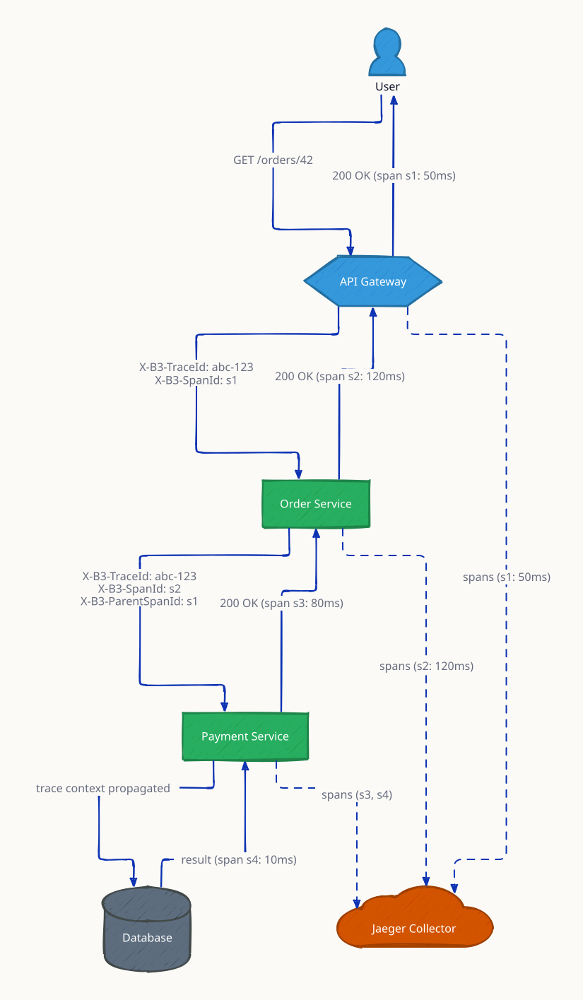
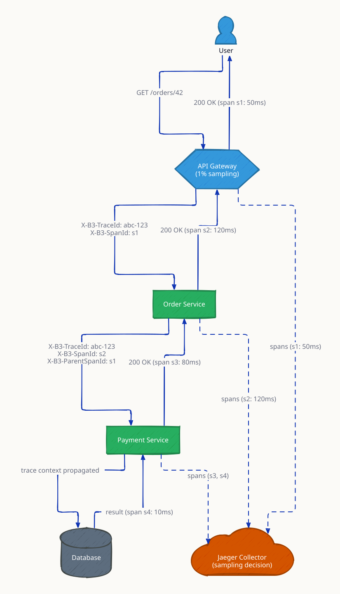

# Distributed Tracing

In a monolith, a slow request is easy to diagnose: look at the stack trace, add a log line, check the database query. In microservices, a single user-facing request fans out across 5, 10, or 20 services — each making its own database calls, cache lookups, and downstream service calls. When that request takes 3 seconds, you cannot tell from logs alone which service caused the delay, which database query timed out, or which downstream call added latency.

Distributed tracing reconstructs the causal chain of a request across service boundaries. It gives you a timeline — a flame graph of every service that touched the request, how long each took, and how they relate to each other.

---

## Trace, Span, and Context



**Span attributes:** operation name, start/end timestamp, service name, HTTP method/URL, status code, error flag, custom tags (user-id, order-id).

---

## Trace Context Propagation



---

## W3C Trace Context Header



`traceparent: 00-4bf92f3577b34da6a3ce929d0e0e4736-00f067aa0ba902b7-01`

The receiving service extracts `trace-id` and `parent-span-id`, creates a new child span with a fresh `span-id`, and propagates the same `trace-id` in all downstream calls. This creates the causal chain that Jaeger/Zipkin/Datadog can reconstruct into a flame graph.

---

## OpenTelemetry Architecture



OpenTelemetry is the CNCF standard for vendor-neutral observability instrumentation. A single SDK instruments your service; the collector pipeline routes telemetry to any backend. This means you can swap from Jaeger to Datadog without changing application code.

---

## Sampling Strategies

At scale, tracing every request is prohibitively expensive. Sampling controls what fraction of traces are recorded:



| Strategy | Decision point | Captures errors? | Cost |
|---|---|---|---|
| Head-based (random 1%) | Root span | Only 1% of error traces | Low |
| Head-based (error flag) | Root span | All errors (100%) | Medium |
| Tail-based | After trace complete | All errors + slow traces | High (buffer) |
| Adaptive | Dynamic | Configurable | Medium-High |

**Practical recommendation:** use head-based sampling at 1-5% for normal traces, plus 100% sampling for requests with errors or latency above p99. This captures all actionable signal at a fraction of the cost.

---

## Correlation with Logs and Metrics



Inject `trace-id` and `span-id` into every log line produced within a request's context. With Grafana's unified observability stack: a slow metric alert → click exemplar → jump to trace → click span → jump to log lines — root cause in under 60 seconds.

---

## Cardinality Trap

High-cardinality values (user IDs, order IDs, IP addresses) as **span attribute keys** will explode tag indexes in your tracing backend and cause memory/storage blowups.

| Wrong (high cardinality key) | Right (high cardinality value) |
|---|---|
| `tag: user_12345678 = true` | `tag: user.id = "12345678"` |
| `tag: order_abc-def = true` | `tag: order.id = "abc-def"` |
| `tag: 192.168.1.50 = true` | `tag: client.ip = "192.168.1.50"` |

**Keys** should be low-cardinality (service name, HTTP method, status code, environment). **Values** can be arbitrarily high-cardinality — they are stored as strings, not indexed as dimensions.

---

## This Module

```
high-level-design/async-and-communication/6.3_distributed_tracing/
├── frontend/
│   └── main.go         # Root span, propagates traceparent to order-service
├── order-service/
│   └── main.go         # Child span, calls inventory-service
├── inventory-service/
│   └── main.go         # Grandchild span, queries PostgreSQL
├── docker-compose.yml  # All services + Jaeger all-in-one
└── test.sh
```

Architecture:
```
Client → frontend:8080 → order-service:8080 → inventory-service:8080
              ↓                  ↓                      ↓
         Jaeger OTLP (4318) — unified trace view at localhost:16686
```

```sh
docker compose up --build -d && sleep 5 && bash test.sh
```

Open http://localhost:16686 → search service "frontend" → see full trace with all spans.

**References**

- [OpenTelemetry Go SDK](https://opentelemetry.io/docs/languages/go/)
- [W3C Trace Context Specification](https://www.w3.org/TR/trace-context/)
- [Jaeger Distributed Tracing](https://www.jaegertracing.io/)
- [Honeycomb: Observability Engineering](https://www.oreilly.com/library/view/observability-engineering/9781492076438/)

---

## Interview Angles

**Q1: What is the difference between a trace and a span?**

A trace represents the entire end-to-end journey of one request through the system — it is identified by a globally unique `trace-id` and contains a tree of spans. A span represents one service's processing of that request — it has a `span-id`, a `parent-span-id` (linking it to the calling service's span), start/end timestamps, operation name, and attributes. The tree of spans, assembled by a tracing backend using parent-span-id links, forms the trace's flame graph.

**Q2: How does trace context propagate across services?**

The root service generates a `trace-id` (128-bit) and a `span-id` (64-bit) and encodes them in the W3C `traceparent` HTTP header. Every downstream service extracts the `trace-id` and the caller's `span-id` (becomes the `parent-span-id`), creates a new `span-id` for itself, records its span with that parent link, and propagates the header in all its own downstream calls. The tracing backend assembles all spans by `trace-id` to reconstruct the tree.

**Q3: How do you sample traces without losing important failures?**

Use a layered strategy: 1-5% head-based random sampling for normal traffic (statistical baseline), plus 100% sampling for any request that results in an error (5xx, exception) or exceeds a latency threshold (e.g., p99 × 2). This captures all actionable signal at a small fraction of full-trace cost. For very high-value paths (checkout, payment), consider 100% sampling regardless of outcome.

**Q4: What is the OpenTelemetry Collector and why use it?**

The OTel Collector is a vendor-agnostic agent/gateway that receives telemetry (traces, metrics, logs) from instrumented services and routes it to one or more backends. Benefits: you decouple your application from the backend — swap Jaeger for Datadog without changing app code; add sampling, filtering, and enrichment in the collector pipeline; and avoid each service needing direct network access to the tracing backend.

**Q5: How do you correlate a slow trace with the specific log lines that caused it?**

Inject `trace-id` and `span-id` into the logging context at request ingress (middleware/interceptor). Every `log.Info/Error` call within that request's goroutine/thread automatically includes those IDs. In your observability platform (Grafana), click a span in the trace view and deep-link to logs filtered by `trace_id=abc123` + `span_id=0002`. This gives you the full structured log context for exactly the code path that was slow.

---

## Architecture Diagrams

> Generated from D2 sources in [`docs/diagrams/src/6.3_distributed_tracing/`](../../../docs/diagrams/src/6.3_distributed_tracing/).
> Regenerate: `just diagrams-topic 6.3_distributed_tracing`.

### Overview

OpenTelemetry spans flowing from every service to Jaeger, composing into a waterfall that shows where the request's time actually went.



**`slow_span` scenario:** the waterfall pinpoints one span eating 80% of the request — tracing turns 'the system is slow' into 'this query in this service is slow'.



### Request Flow

Context propagation: X-B3-TraceId and parent span IDs carried hop to hop so disconnected services produce one connected trace.



**`sampling` scenario:** 1% of normal traffic is traced but 100% of errors — bounded overhead with full visibility where it matters.


