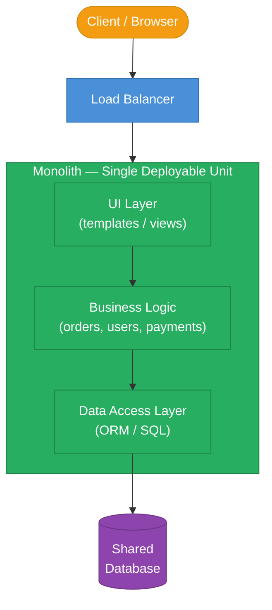
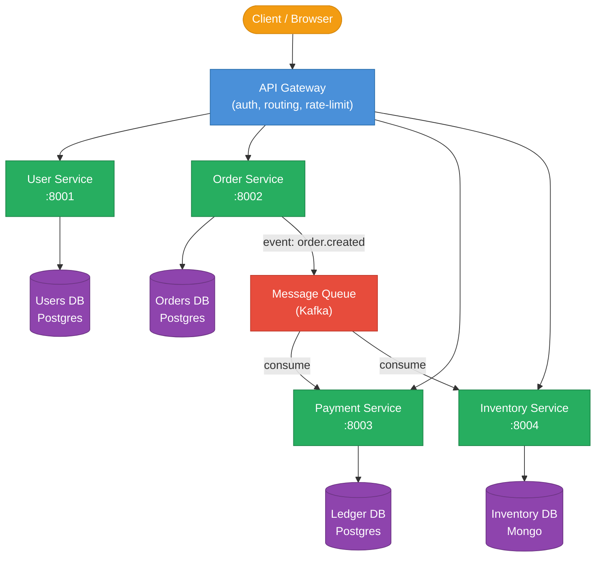
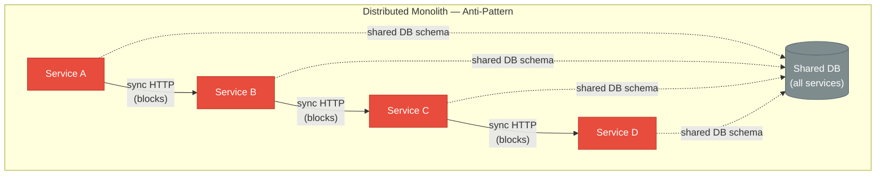
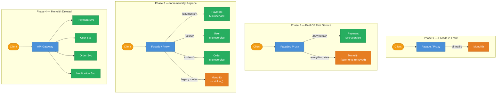
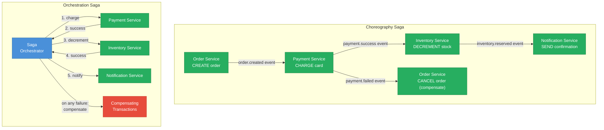
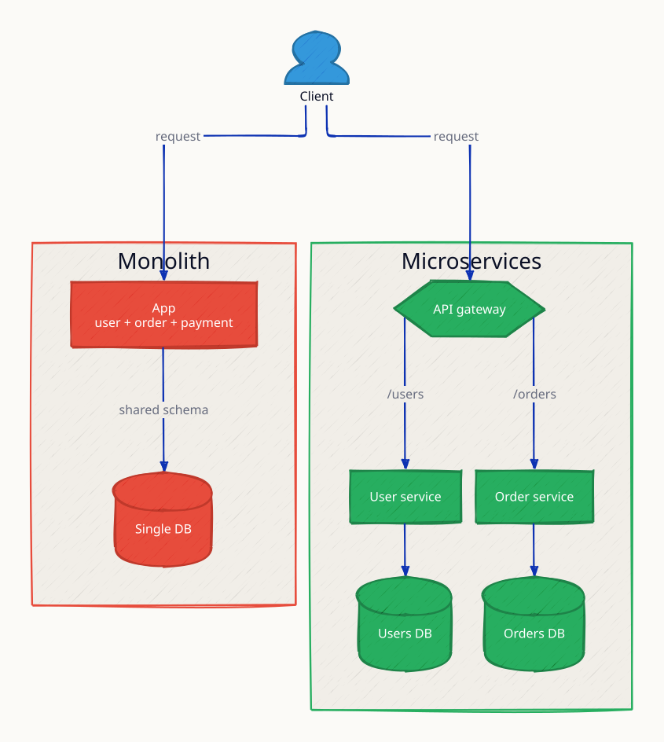
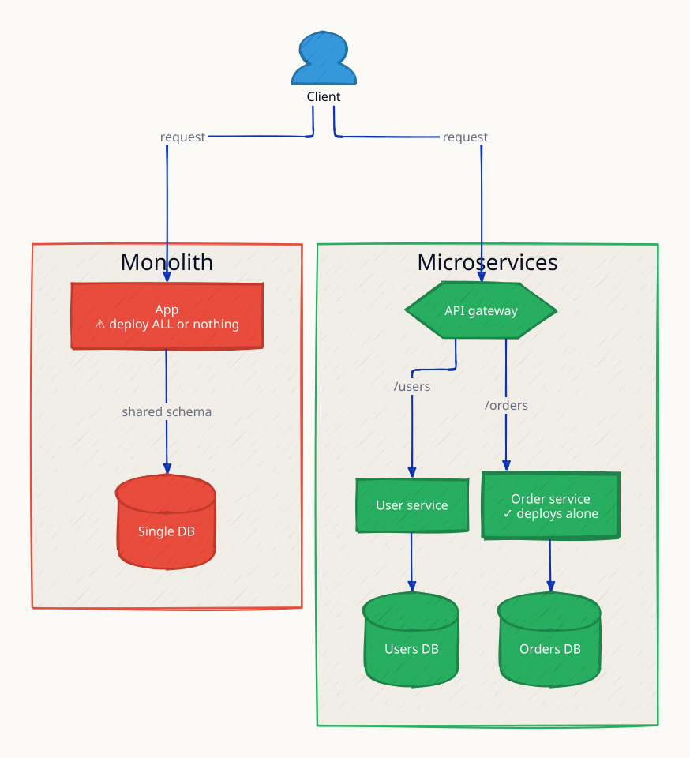
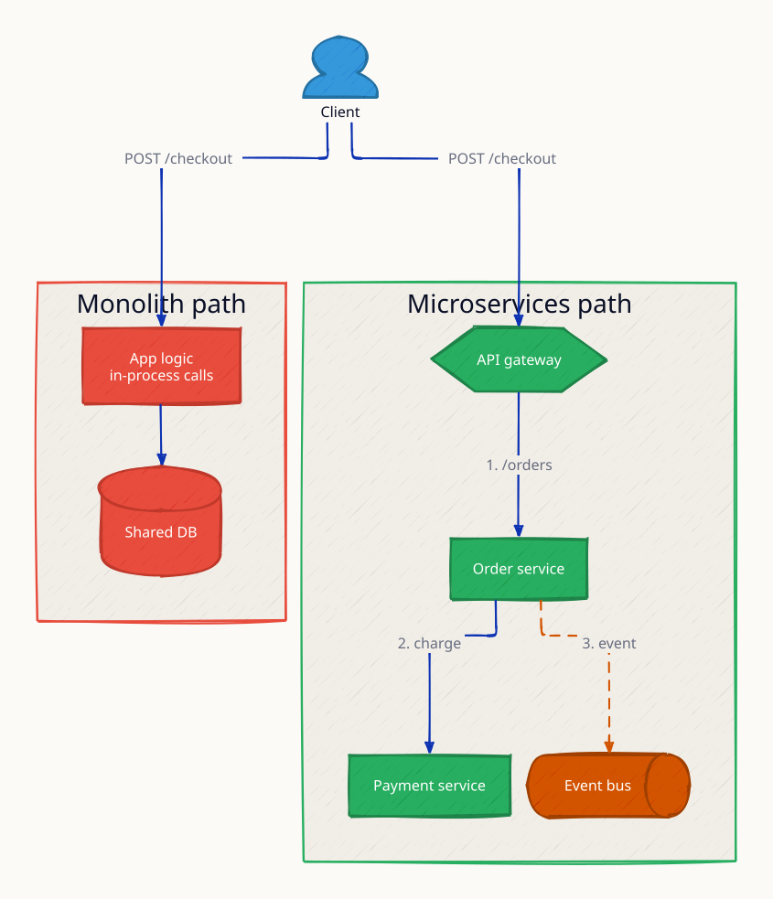
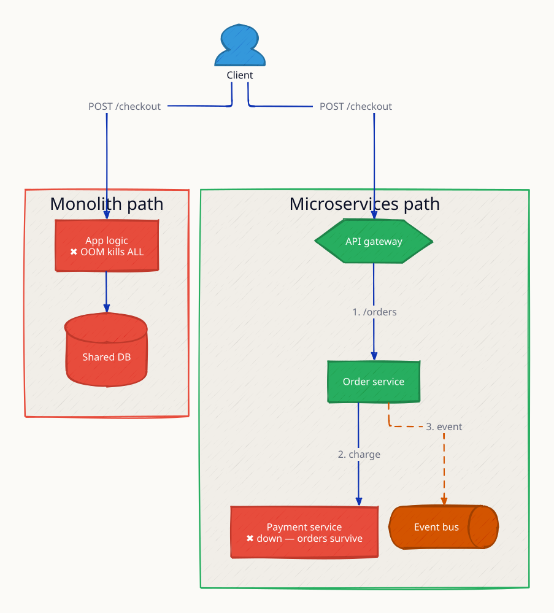

# Monoliths vs Microservices

**Understanding the architectural spectrum between monoliths and microservices is foundational to every system design conversation.** The choice is not merely technical — it shapes team structure, deployment velocity, operational complexity, and failure blast radius. Monoliths excel early: one codebase, one database, no network hops, simple transactions. Microservices unlock independent scaling, polyglot persistence, and organizational autonomy — but at the cost of distributed systems complexity. Getting this tradeoff wrong in either direction has real consequences: Netflix spent years carefully decomposing their monolith; Segment famously went the opposite direction and re-merged microservices back into a monolith when the overhead outweighed the benefits.

---

## Monolith Architecture

In a monolith, all modules share an in-process call stack. A `PaymentService` calling an `InventoryService` is a function call — zero network latency, no serialization, and atomic transactions are trivial. The single deployment artifact means a one-step build and deploy.

---

## Microservices Architecture

Each service owns its data store and exposes a versioned API contract. Services communicate over HTTP/gRPC or asynchronously via a message bus. A deploy of `Payment Service` has zero risk to `User Service`.

---

## Monolith vs Microservices — Comparison

| Dimension | Monolith | Microservices |
|---|---|---|
| **Deployment unit** | Single artifact (JAR / binary) | One artifact per service |
| **Transaction model** | Local ACID transactions trivial | Distributed transactions (Saga / 2PC) |
| **Network hops** | Zero (in-process calls) | One or more per cross-service call |
| **Scaling granularity** | Scale the whole app | Scale individual services independently |
| **Team structure** | Single team can own everything | Conway's Law: one team per service |
| **Technology stack** | Uniform (one language/framework) | Polyglot (each team picks best tool) |
| **Operational complexity** | Low (one service to monitor/debug) | High (distributed tracing, many dashboards) |
| **Blast radius of failure** | Large (one bug can take down app) | Contained (circuit breakers isolate failures) |
| **Startup cost** | Low — ship fast on day one | High — infra overhead before first feature |
| **Refactoring** | Easy — compiler enforces contracts | Hard — API versioning, backward compat |
| **Testing** | Integration tests are simpler | E2E tests across services are brittle |
| **Data consistency** | Enforced by DB constraints | Eventual consistency is the norm |

---

## The Distributed Monolith Anti-Pattern

The worst outcome: services that look like microservices but behave like a monolith. You pay all the distributed systems costs with none of the benefits.

**Signs you have a distributed monolith:**
- Services share a database schema or call each other's internal tables
- Deploying Service A requires coordinated deploys of B, C, and D
- A failure in Service D cascades synchronously to A (no circuit breaker)
- You cannot run any single service in isolation for testing

---

## The Strangler Fig Migration Pattern

Safely migrating a monolith to microservices without a risky "big bang" rewrite:

**Key principle:** The facade (a reverse proxy or API gateway) routes requests. You never route the same path to both the monolith and the microservice simultaneously. Extract one bounded context at a time. Data migration is the hardest part — use the dual-write pattern (write to both old and new data stores, then cut over reads).

---

## Decision Framework

| Signal | Choose Monolith | Choose Microservices |
|---|---|---|
| **Team size** | < 8 engineers | > 15 engineers, multiple teams |
| **Domain complexity** | Well-understood, stable domain | Complex domain with clear bounded contexts |
| **Deployment frequency** | Weekly or less | Multiple times per day per service |
| **Scaling needs** | Uniform load across features | Different features have wildly different load |
| **Org structure** | Single team | Multiple autonomous product teams |
| **Stage** | Startup / MVP / new product | Mature product with proven product-market fit |
| **Operational maturity** | No dedicated platform/infra team | Strong SRE / DevOps culture, Kubernetes |
| **Compliance/isolation** | Not required | PCI, HIPAA require strict data isolation |

**Martin Fowler's rule:** Don't start with microservices. Start with a modular monolith, draw clear module boundaries, then extract services when you have real reasons to do so.

---

## Handling Distributed Transactions

When an operation spans multiple services (e.g., place order → charge payment → decrement inventory), there is no single database to give you ACID. The two main patterns:

| Approach | Pros | Cons |
|---|---|---|
| **Choreography** | Decoupled, no single point of failure | Hard to track overall saga state, event storms |
| **Orchestration** | Explicit flow, easy to visualize and debug | Orchestrator is a choke point, coupling |

---

## Real-World Examples

| Company | Journey | Key Insight |
|---|---|---|
| **Netflix** | Monolith → microservices (2008–2012) | Needed to scale streaming independently of DVD business; ~700 services today |
| **Amazon** | Monolith → service-oriented (2001–2006) | Bezos' "API mandate" forced every team to expose data via APIs |
| **Shopify** | Modular monolith (Ruby on Rails) | Deliberately resisted microservices; uses "pods" and feature flags instead |
| **Segment** | Microservices → monolith (2020) | 130 microservices became too complex; merged back into one Go service (Centrifuge) |
| **Uber** | Monolith → microservices → domain-oriented | Microservices sprawl → DOMA architecture to regroup services into domains |
| **Stack Overflow** | Monolith (still!) | 11M+ pageviews/day on a well-tuned .NET monolith; simplicity is underrated |

---

## Interview Angles

**Q1: How would you design a migration from a monolith to microservices?**
Use the Strangler Fig pattern — place a facade in front, extract one bounded context at a time (start with the highest-value or most independently-scalable domain), migrate data with dual-write, never do a big-bang rewrite.

**Q2: How do you handle distributed transactions across microservices?**
Use the Saga pattern — either choreography (event-driven, each service reacts) or orchestration (central coordinator directs steps). Compensating transactions handle rollback. For critical paths, consider the Outbox pattern to ensure at-least-once delivery.

**Q3: What is a distributed monolith and why is it worse than either extreme?**
A distributed monolith has microservice deployment units but tight runtime coupling — shared databases, synchronous call chains with no circuit breakers, coordinated deployments. You pay distributed systems overhead (network, serialization, partial failures) without gaining independent deployability or scaling.

**Q4: When should you NOT break a monolith into microservices?**
When the team is small (< 8 engineers), the domain is not yet understood (premature decomposition creates wrong service boundaries), or when there is no platform team to own container orchestration, distributed tracing, and service mesh. Operational overhead of microservices is non-trivial.

**Q5: How does Conway's Law relate to microservice boundaries?**
Conway's Law states that system architecture mirrors the communication structure of the organization. Microservice boundaries should match team boundaries — each team owns one or a few services end-to-end. If your org chart does not match your service graph, you get constant cross-team coordination (the distributed monolith anti-pattern).

---

**References**

- [Martin Fowler: Microservices](https://martinfowler.com/articles/microservices.html)
- [Martin Fowler: Strangler Fig Application](https://martinfowler.com/bliki/StranglerFigApplication.html)
- [Sam Newman: Building Microservices (O'Reilly)](https://samnewman.io/books/building_microservices/)
- [Segment: Goodbye Microservices](https://segment.com/blog/goodbye-microservices/)
- [Shopify: Deconstructing the Monolith](https://shopify.engineering/deconstructing-monolith-designing-software-maximizes-developer-productivity)

---

## Architecture Diagrams

> Generated from D2 sources in [`docs/diagrams/src/1.1_monoliths_vs_microservices/`](../../../docs/diagrams/src/1.1_monoliths_vs_microservices/).
> Regenerate: `just diagrams-topic 1.1_monoliths_vs_microservices`.

### Overview

Side-by-side: the monolith routes everything through one process sharing one database, while microservices give each domain its own service and datastore behind an API gateway.

**`deploy_risk` scenario:** a bug in the Payment code forces a redeploy of the entire monolith (User and Order restart too), while the microservices side redeploys only the Payment service — User and Order keep serving traffic.

### Request Flow

The same user request traced through both architectures — one in-process call chain vs three network hops through the gateway.

**`microservice_failure` scenario:** an OOM in payment logic kills the whole monolith process, taking every feature down; in the microservices column only the Payment service dies — browsing and ordering still work.

