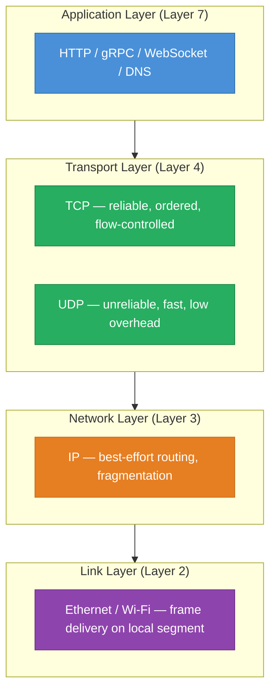
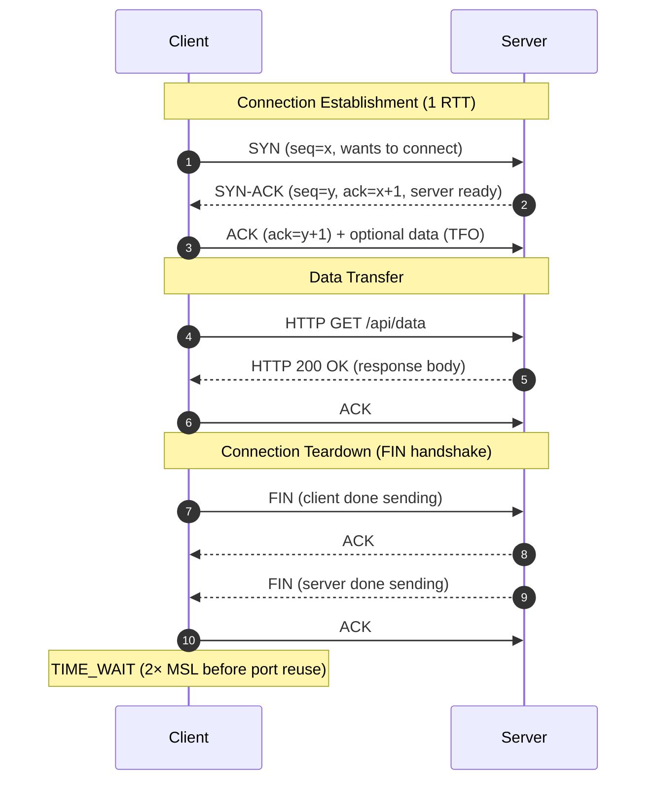
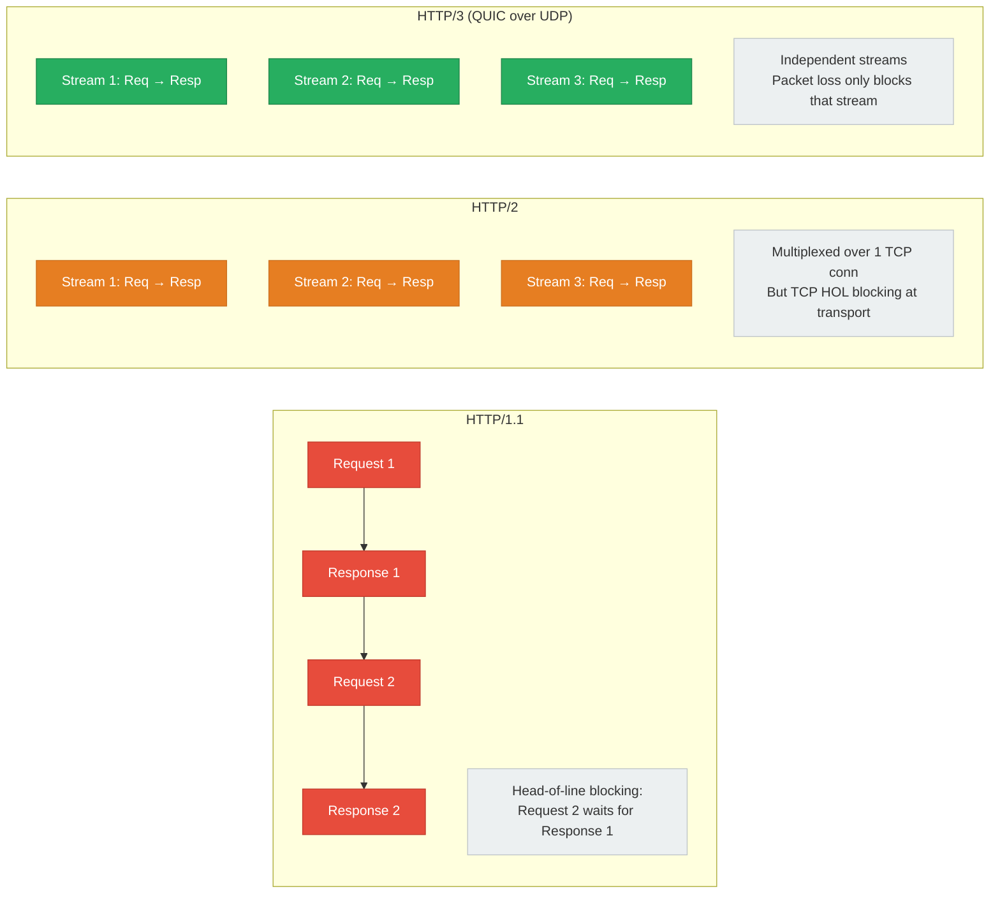
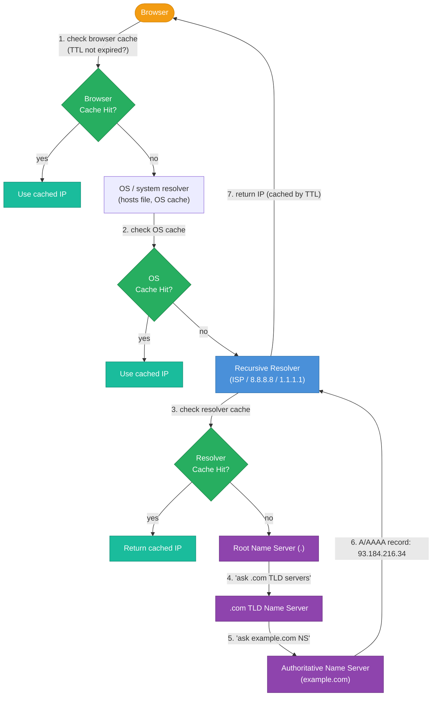
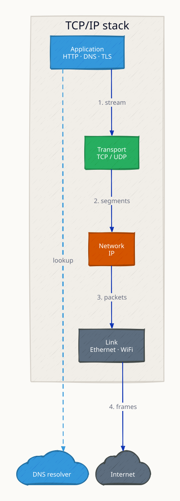
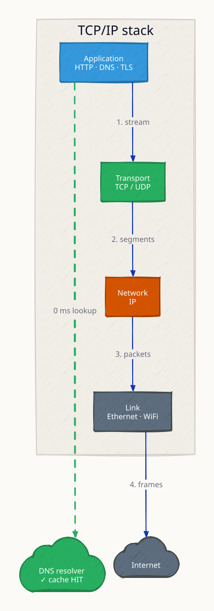
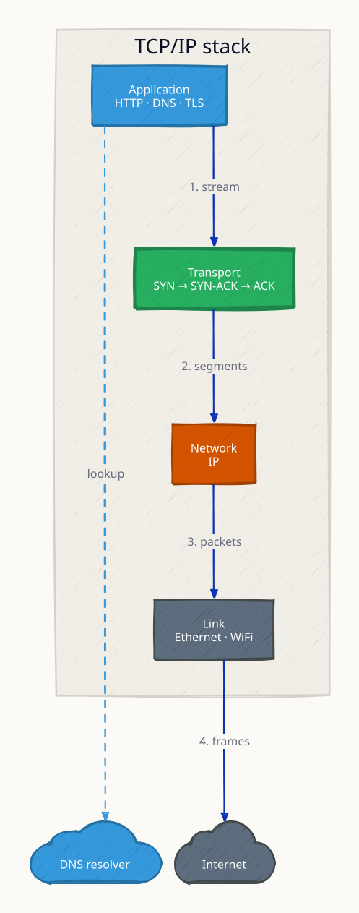
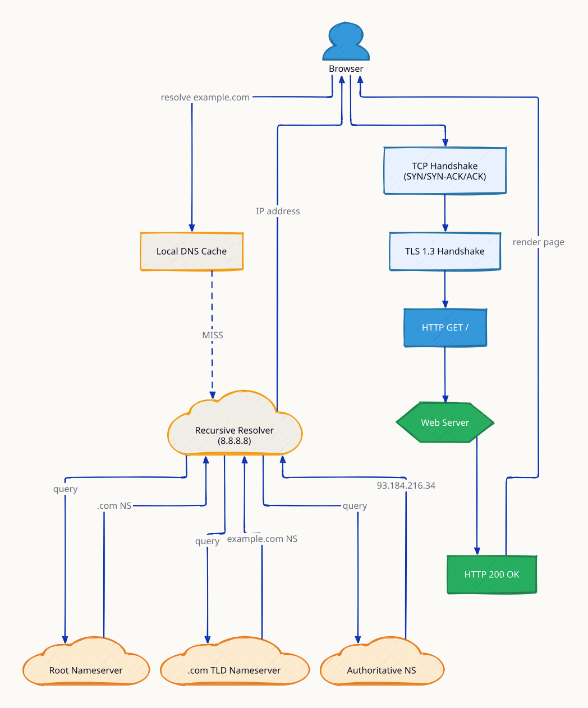
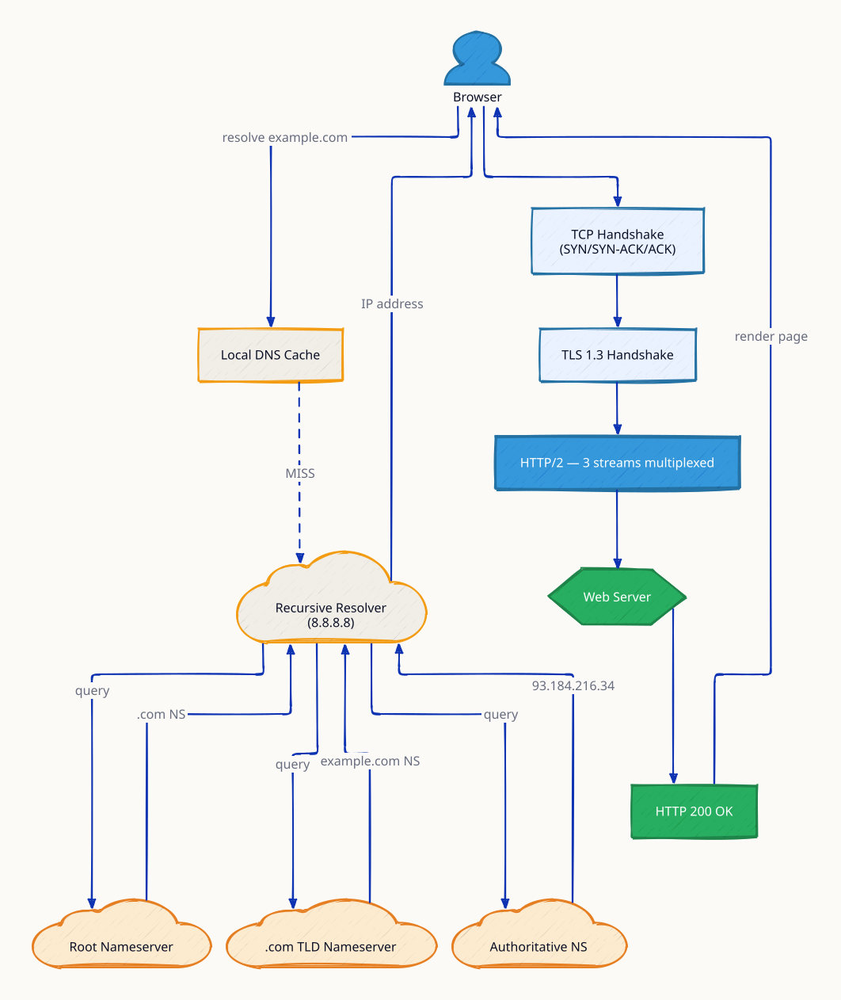

# Networking Fundamentals

**Every system design decision — caching strategy, database placement, CDN usage, protocol choice — is ultimately a bet about network latency.** Engineers who internalize the order-of-magnitude gaps between L1 cache, RAM, SSD, same-datacenter RTT, and cross-continent RTT can immediately spot when a design will be bottlenecked by the wire. Understanding TCP's connection cost explains why connection pooling matters. Understanding HTTP/2 multiplexing explains why gRPC outperforms REST for internal services. This topic is the lens through which all distributed system performance questions should be answered.

---

## Latency Numbers Every Engineer Should Know

Jeff Dean's reference numbers (approximate order of magnitude — commit these to memory):

| Operation | Latency | Relative to RAM | Notes |
|---|---|---|---|
| L1 cache hit | 0.5 ns | 200× faster | CPU register-level |
| Branch mispredict | 5 ns | 20× faster | Pipeline flush |
| L2 cache hit | 4 ns | 25× faster | |
| L3 cache hit | 10–40 ns | 2.5–10× faster | Shared across cores |
| **RAM read** | **100 ns** | **1× (baseline)** | Main memory reference |
| Mutex lock/unlock | 25 ns | 4× faster | Uncontended |
| Compress 1K w/ Snappy | 3 µs | 30× slower | |
| Send 1K bytes over 1 Gbps | 10 µs | 100× slower | |
| SSD random read (NVMe) | 100 µs | 1,000× slower | |
| SSD sequential read (1 MB) | 1 ms | 10,000× slower | |
| **Same-datacenter RTT** | **500 µs** | **5,000× slower** | LAN / rack switch |
| HDD seek + read | 10 ms | 100,000× slower | Avoid in hot path |
| **Cross-region RTT** | **150 ms** | **1,500,000× slower** | US-East → US-West |
| **Cross-continent RTT** | **300 ms** | **3,000,000× slower** | US → Europe |

**Key insight:** Each major tier is roughly 100–1,000× slower than the previous. Data in RAM is 1,000× faster than an SSD. Same-datacenter is 300× faster than cross-continent. Every time you add a network call to a hot path, ask: "Am I paying 150ms when I could pay 100ns?"

---

## TCP/IP Stack

**TCP** provides reliable, ordered delivery via sequence numbers and acknowledgements. It pays a handshake tax before any data flows. **UDP** skips the handshake — useful for DNS, video streaming, gaming, and QUIC (which implements reliability in userspace where it can be optimized per-use-case).

---

## TCP Three-Way Handshake

**Cost of cold connection:** 1 RTT for TCP + 1–2 RTTs for TLS before the first byte of HTTP data. At 150ms cross-region latency, a fresh HTTPS connection to a distant server costs 450ms just in handshakes. **Connection pooling and keep-alive** amortize this across many requests.

---

## HTTP/1.1 vs HTTP/2 vs HTTP/3 (QUIC)

| Feature | HTTP/1.1 | HTTP/2 | HTTP/3 / QUIC |
|---|---|---|---|
| **Transport** | TCP | TCP | UDP |
| **Encoding** | Text headers | Binary framing | Binary framing |
| **Multiplexing** | No (pipelining, rarely used) | Yes (streams over 1 TCP conn) | Yes (fully independent UDP streams) |
| **Head-of-line blocking** | HTTP layer: yes | HTTP layer: no; TCP layer: yes | Neither layer: no |
| **Header compression** | None | HPACK | QPACK |
| **Connection setup** | 1 RTT TCP + TLS | 1 RTT TCP + TLS | 1 RTT (0-RTT resume) |
| **Mobile / lossy networks** | Poor (retransmit stalls all) | Moderate | Excellent (loss isolated per stream) |
| **Server push** | No | Yes (rarely used) | Yes |
| **Adoption** | Universal legacy | ~60% of web | ~30% and growing |

**Head-of-line blocking explained:** In HTTP/1.1, if Request 1's response is slow, Requests 2 and 3 wait. HTTP/2 multiplexes streams over one TCP connection — HTTP-level HOL is solved, but if a TCP segment is lost, all streams pause until retransmit. QUIC runs streams over independent UDP datagrams, so a lost packet only blocks the one stream that needed that packet.

---

## TLS Handshake and RTT Costs

| Protocol | Handshake RTTs | Total RTTs to first byte | 150ms RTT cost |
|---|---|---|---|
| TCP only (no TLS) | 1 (TCP) | 1 | 150ms |
| TCP + TLS 1.2 | 1 (TCP) + 2 (TLS) | 3 | 450ms |
| TCP + TLS 1.3 | 1 (TCP) + 1 (TLS) | 2 | 300ms |
| QUIC / HTTP/3 | 1 (combined) | 1 | 150ms |
| QUIC / HTTP/3 (0-RTT resume) | 0 (session ticket) | 0.5 | ~75ms |

TLS 1.3 reduced handshake from 2 RTTs to 1 by combining key exchange into the first flight. QUIC combines TCP+TLS into a single UDP handshake, and 0-RTT session resumption allows sending application data in the very first packet (with replay-attack mitigations).

---

## DNS Resolution Chain

**Full cold-path DNS lookup:** Browser cache miss → OS cache miss → recursive resolver cache miss → root NS → TLD NS → authoritative NS → answer. This chain takes 20–120ms. Once resolved, the IP is cached at every layer for the TTL duration.

**TTL strategy:**
- Low TTL (60s): fast failover during incidents, but higher DNS query volume
- High TTL (3600s+): low query volume, cached broadly, but slow failover
- **Best practice:** use 300s normally; lower to 60s before a planned migration, raise back after

---

## Practical Networking Implications

| Problem | Root Cause | Solution |
|---|---|---|
| Chatty microservices | 10 serial calls × 150ms = 1.5s | Batch / fan-out parallel calls; use async |
| Slow HTTPS cold start | 3 RTTs before first byte | Connection pooling, keep-alive, TLS 1.3 |
| Mobile users getting 300ms+ | Cross-continent RTT | CDN edge PoPs close to users |
| Packet loss killing video | TCP retransmit stalls stream | UDP / QUIC / WebRTC for real-time media |
| DNS failover too slow | High TTL (3600s) | Lower TTL before planned failover |
| DB calls in hot path slow | 500µs × N sequential calls | Connection pool, read replicas, caching |

---

## Interview Angles

**Q1: What happens when you type a URL in a browser and press Enter?**
DNS lookup (browser → OS → recursive → root → TLD → authoritative NS) resolves hostname to IP. TCP three-way handshake (1 RTT). TLS handshake (1–2 RTTs). HTTP GET sent. Server processes, responds. Browser renders HTML; parallel fetches for CSS/JS/images (HTTP/2 multiplexes these). Full cold load: 500ms+ cross-region, ~50ms from CDN edge.

**Q2: Why is QUIC better than TCP for mobile users?**
Mobile networks have higher packet loss and frequent IP changes (Wi-Fi to 4G handoff). TCP treats any packet loss as full stream stall. QUIC runs over UDP with independent streams — packet loss only blocks the one stream needing retransmit. QUIC also has connection migration (maintains session across IP change via connection ID), making handoffs seamless.

**Q3: Why does connection pooling matter so much?**
A fresh TLS 1.2 connection costs 3 RTTs = 450ms at cross-region latency. Connection pooling keeps connections warm and reuses them across requests. Without pooling, a service making 100 requests/second to a remote DB would spend ~45 seconds/second just on handshakes — impossible. Pools amortize the 3-RTT cost across thousands of requests.

**Q4: How do you design a system to minimize latency for global users?**
Multi-layer approach: CDN for static assets (5ms vs 300ms), edge compute for personalization, regional database replicas for reads, anycast DNS for routing to nearest PoP, HTTP/3 for mobile users on lossy networks, and pre-warming DNS TTLs before traffic shifts.

**Q5: What is head-of-line blocking and how does HTTP/2 address it?**
HOL blocking: a slow response blocks all subsequent requests on the same connection (HTTP/1.1). HTTP/2 multiplexes multiple streams over one TCP connection, so slow Stream 1 does not block Stream 2 at the HTTP layer. However, TCP-level HOL blocking remains — a lost TCP segment stalls all streams. QUIC/HTTP/3 eliminates this by running independent streams over UDP.

---

**References**

- [Jeff Dean: Numbers Every Engineer Should Know](https://static.googleusercontent.com/media/research.google.com/en//people/jeff/stanford-295-talk.pdf)
- [High Performance Browser Networking — Ilya Grigorik](https://hpbn.co/)
- [HTTP/3 Explained — Daniel Stenberg](https://http3-explained.haxx.se/)
- [Cloudflare: How QUIC Works](https://blog.cloudflare.com/the-quic-transport-protocol/)
- [The Tail at Scale — Dean & Barroso](https://dl.acm.org/doi/10.1145/2408776.2408794)

---

## Architecture Diagrams

> Generated from D2 sources in [`docs/diagrams/src/1.2_networking_fundamentals/`](../../../docs/diagrams/src/1.2_networking_fundamentals/).
> Regenerate: `just diagrams-topic 1.2_networking_fundamentals`.

### Overview

The TCP/IP 4-layer stack on both client and server, with the DNS resolver path that turns a hostname into a routable IP before any data flows.

**`dns_cache_hit` scenario:** the OS resolver cache answers instantly and the entire root/TLD/authoritative chain is skipped — the common case after first lookup.

**`tcp_handshake` scenario:** highlights SYN → SYN-ACK → ACK — no application data moves until this round trip completes, which is why connection reuse (keep-alive) matters.

### Request Flow

Every step between typing a URL and receiving HTML: DNS resolution, TCP 3-way handshake, TLS negotiation, then the HTTP exchange.

**`http2_multiplexing` scenario:** multiple requests share one TCP connection as interleaved streams, removing the head-of-line queueing of HTTP/1.1's one-request-per-connection model.

