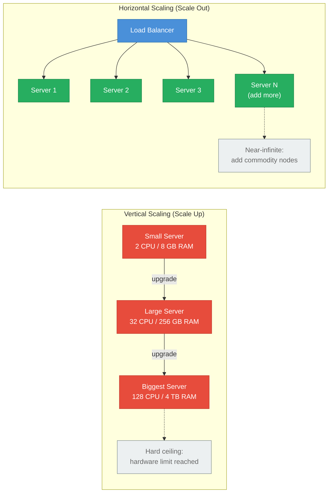
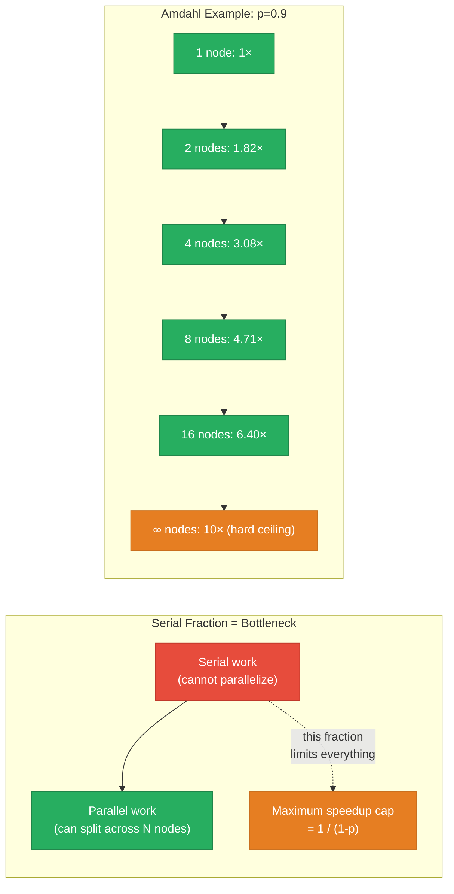
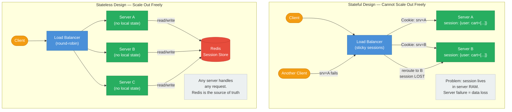
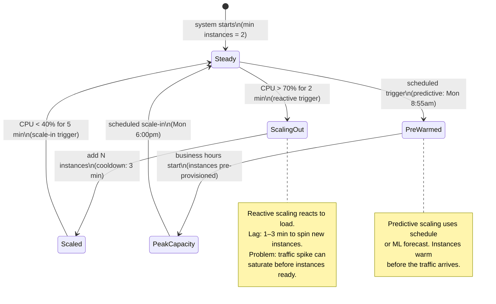
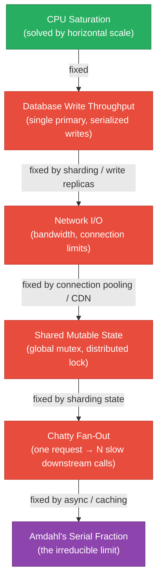
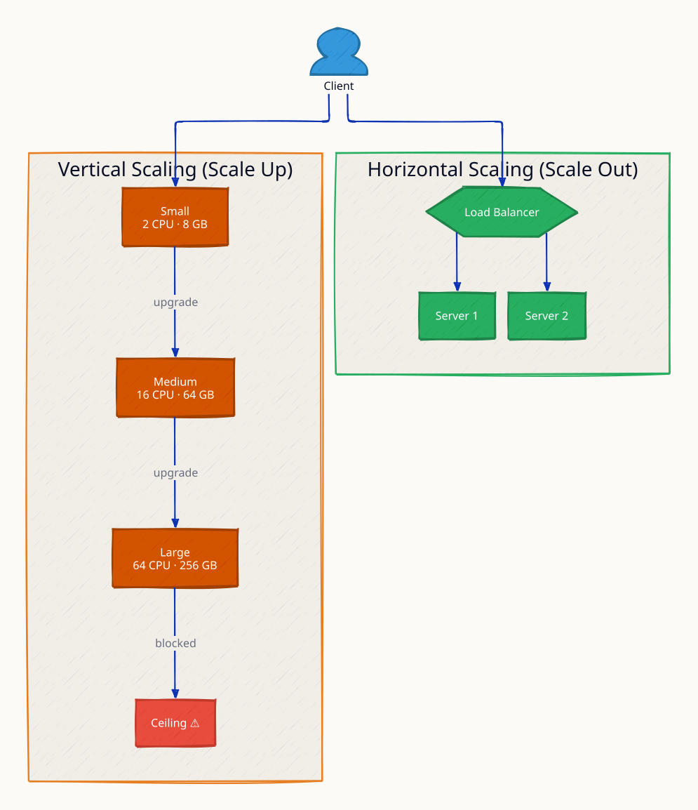
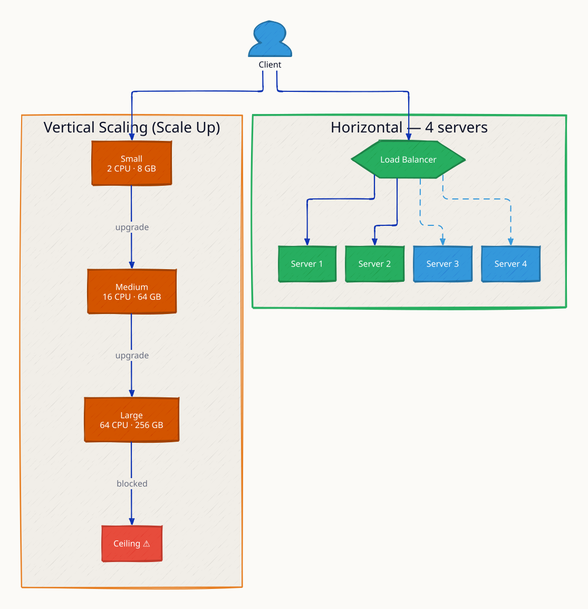
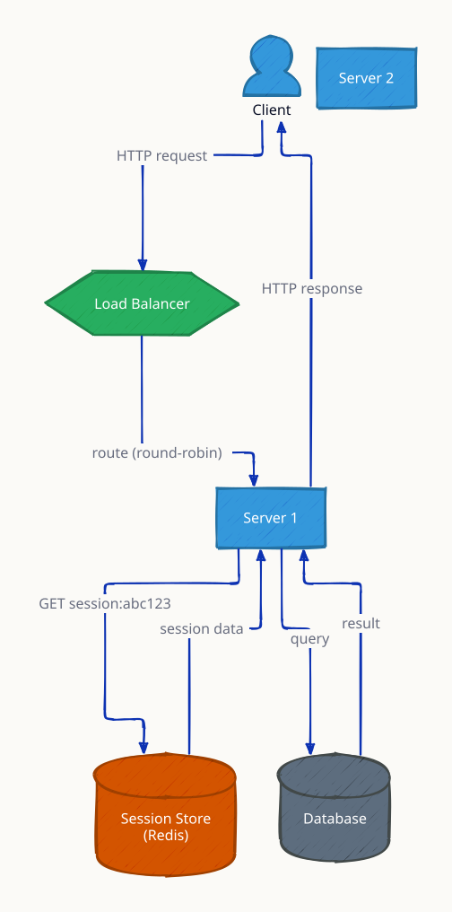
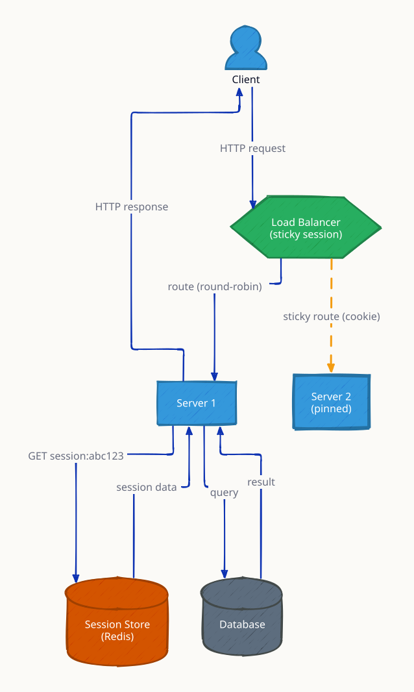

# Scaling Fundamentals

**Scaling is not just "add more servers" — it is the disciplined elimination of bottlenecks, and Amdahl's Law tells you the uncomfortable truth: no matter how many machines you add, the serial fraction of your workload sets a hard ceiling on speedup.** Understanding the spectrum from vertical to horizontal scaling, why stateless design is a prerequisite for horizontal scale, how auto-scaling reacts to load, and where the real bottlenecks lurk (hint: it's usually the database) gives engineers the mental models to reason about capacity at any scale. These fundamentals appear in every system design interview because they underlie every architectural decision.

---

## Vertical vs Horizontal Scaling



| Dimension | Vertical (Scale Up) | Horizontal (Scale Out) |
|---|---|---|
| **Mechanism** | Bigger CPU, more RAM, faster disk on one machine | More machines, load balanced |
| **Ceiling** | Hard hardware limit (single node) | Near-infinite with stateless design |
| **Cost curve** | Super-linear past ~16 cores (server-grade pricing) | Linear — commodity hardware |
| **Single point of failure** | Yes — one machine fails, all goes down | No — lose nodes without total outage |
| **State management** | Easy — shared memory/disk on one OS | Hard — sessions must be externalized |
| **Deployment** | Requires downtime for hardware upgrade | Rolling deploys, zero downtime |
| **Database** | Scales until the biggest instance limit | Requires sharding or read replicas |
| **Best for** | Stateful legacy apps, databases (initially) | Stateless web/API services |

**When to use each:** Vertical scaling is fast to execute and appropriate when you have a single database that cannot easily be sharded. Horizontal scaling is the long-term answer for any workload that must grow beyond a single machine's limits.

---

## Amdahl's Law

Not everything parallelizes. Amdahl's Law gives the theoretical maximum speedup when you add more processors:

```
Speedup(n) = 1 / ( (1 - p) + p/n )
```

Where `p` = the fraction of the program that can be parallelized (0.0–1.0), and `n` = number of processors/nodes.



### Speedup Table

| Parallel fraction (p) | 2 nodes | 4 nodes | 8 nodes | 16 nodes | 64 nodes | ∞ nodes (ceiling) |
|---|---|---|---|---|---|---|
| 50% parallel | 1.33× | 1.60× | 1.78× | 1.88× | 1.97× | **2×** |
| 75% parallel | 1.60× | 2.29× | 2.91× | 3.37× | 3.81× | **4×** |
| 90% parallel | 1.82× | 3.08× | 4.71× | 6.40× | 8.77× | **10×** |
| 95% parallel | 1.90× | 3.48× | 5.93× | 8.83× | 16.8× | **20×** |
| 99% parallel | 1.99× | 3.88× | 7.47× | 13.9× | 39.5× | **100×** |

**The uncomfortable truth:** 90% parallel code never exceeds **10× speedup** no matter how many machines you throw at it. If your service has even a 10% serial bottleneck (a single-writer database, a global mutex, a sync checkpoint), that fraction becomes the entire system's limit. Finding and eliminating the serial fraction is more valuable than adding nodes.

**In distributed systems, common serial bottlenecks:**
- Single primary database node (all writes serialize)
- Global rate-limiter backed by one Redis instance
- Leader election / coordination service (ZooKeeper, etcd)
- Sequential log processing (Kafka partition = one consumer at a time)

---

## Stateless vs Stateful Design

Stateful services tie a user to a specific server instance — they cannot be horizontally scaled without sticky sessions or distributed state.



**The stateless rule:** Push all mutable state to an external store (Redis, database, distributed cache, JWT tokens). Stateless servers are fungible — the load balancer can send any request to any instance, enable zero-downtime rolling deploys, and absorb node failures transparently.

**JWT as stateless sessions:** A signed JWT carries the session data in the token itself. The server verifies the signature but stores nothing. Scalable, but tokens cannot be invalidated before expiry without a blocklist (which re-introduces state).

---

## Auto-Scaling: Reactive vs Predictive



| Auto-Scaling Type | Trigger | Lag | Best For |
|---|---|---|---|
| **Reactive (CPU)** | CPU > threshold for N minutes | 1–5 min (instance startup) | Unpredictable bursts |
| **Reactive (custom metric)** | Queue depth, RPS, p99 latency | 1–5 min | Service-specific capacity signals |
| **Scheduled** | Cron (Mon 8am, Fri 5pm) | Zero (pre-provisioned) | Known recurring patterns (business hours) |
| **Predictive (ML)** | Forecast based on historical traffic | Zero (proactive) | Complex, cyclical traffic (AWS Predictive Scaling) |

**Scaling lag is the killer:** If a traffic spike hits and it takes 3 minutes to boot new EC2 instances, those 3 minutes are served by undersized capacity. Mitigation strategies: keep a warm pool of pre-started instances, use container-based scaling (faster than VMs), set aggressive scale-out thresholds (scale at 60% CPU, not 80%).

---

## What Actually Limits Scale After CPU

Once you have horizontal scaling working, the bottlenecks shift:



1. **Database writes** — single primary serializes all writes. Sharding, CQRS, or write-optimized storage (Cassandra, DynamoDB) break this.
2. **Network I/O** — bandwidth saturation, too many open sockets. Fix with connection pooling, keep-alive, CDN offload.
3. **Shared mutable state** — a global rate-limiter, a distributed lock, a single Kafka partition. Shard or partition the state.
4. **Chatty dependencies** — one user request fans out to 10 synchronous downstream calls. Fix with parallelization, caching, async processing.
5. **Amdahl's serial fraction** — the irreducible bottleneck. Profile to find it, then architect around it.

---

## Vertical Cost Super-Linearity

Doubling CPU count on a single machine does not double performance and almost always more than doubles cost:

| Instance tier | vCPUs | RAM | Approximate cost/hr (AWS, rough) | Cost per vCPU |
|---|---|---|---|---|
| Baseline | 4 | 16 GB | $0.20 | $0.05 |
| 2× CPUs | 8 | 32 GB | $0.38 | $0.048 |
| 4× CPUs | 16 | 64 GB | $0.77 | $0.048 |
| 8× CPUs | 32 | 128 GB | $1.84 | $0.058 |
| 16× CPUs | 64 | 256 GB | $4.80 | $0.075 |
| 32× CPUs | 128 | 512 GB | $15.00+ | $0.117 |

Past 64 vCPUs, you are in bare-metal / high-memory territory where cost per unit of compute grows super-linearly. Eight 16-vCPU instances often outperform one 128-vCPU server at lower total cost, with better fault isolation.

---

## Interview Angles

**Q1: What is the bottleneck in scaling a stateful service?**
Stateful services require routing the same user to the same server (sticky sessions) or sharing state via an external store. Sticky sessions break load balancing uniformity and cause problems when the pinned server fails. The fix is to externalize all state to Redis/a database, making servers stateless and fungible — any node handles any request.

**Q2: Explain Amdahl's Law and why it matters for distributed systems.**
Amdahl's Law states that the maximum speedup from parallelism is bounded by `1/(1-p)` where `p` is the parallel fraction. A workload that is 90% parallel has a hard ceiling of 10× speedup regardless of how many nodes you add. In distributed systems, the serial fraction is often the database (single primary), a global lock, or a sequential processing step. Fixing the serial bottleneck is more valuable than adding nodes.

**Q3: Why does horizontal scaling require stateless design?**
Horizontal scaling sends requests to any of N servers via a load balancer. If server state (sessions, caches, in-memory data) is local to one server, routing to a different server loses that state. Stateless servers push all session state to an external store (Redis, JWT), making every server equivalent — the load balancer can route freely, and losing a server is non-disruptive.

**Q4: When would you choose vertical over horizontal scaling?**
For single-node databases during early growth (no application changes needed), for stateful legacy applications that cannot be refactored, and as a quick short-term fix while architecting proper horizontal scale. Vertical scaling runs out of headroom at the largest instance tier and creates a single point of failure — it is a tactical not strategic choice.

**Q5: How do you prevent auto-scaling lag from causing an outage during a traffic spike?**
Use predictive/scheduled scaling for known patterns (pre-warm before business hours), set reactive thresholds early (scale at 60% CPU, not 80%), maintain a warm pool of pre-started instances, and use circuit breakers / graceful degradation so the service degrades under overload rather than failing hard while new instances boot.

---

**References**

- [Amdahl's Law — Wikipedia](https://en.wikipedia.org/wiki/Amdahl%27s_law)
- [The Art of Scalability — Abbott & Fisher](https://theartofscalability.com/)
- [Designing Data-Intensive Applications — Kleppmann, Ch. 1](https://dataintensive.net/)
- [AWS: Auto Scaling Concepts](https://docs.aws.amazon.com/autoscaling/ec2/userguide/what-is-amazon-ec2-auto-scaling.html)
- [Google SRE Book: Handling Overload](https://sre.google/sre-book/handling-overload/)

---

## Architecture Diagrams

> Generated from D2 sources in [`docs/diagrams/src/1.3_scaling_fundamentals/`](../../../docs/diagrams/src/1.3_scaling_fundamentals/).
> Regenerate: `just diagrams-topic 1.3_scaling_fundamentals`.

### Overview

Vertical scaling upgrades one machine until it hits a price/physics ceiling; horizontal scaling adds commodity machines behind a load balancer with no ceiling.



**`horizontal_growth` scenario:** traffic doubles and the fleet grows from 3 to 6 servers — capacity scales linearly with no downtime, the payoff of statelessness.



### Request Flow

Why horizontal scaling requires stateless servers: any instance can answer any request because session state lives in Redis, not server memory.



**`session_sticky` scenario:** the alternative — cookie-pinned sessions — shown failing: when the pinned server dies, its sessions are lost unless externalized to a shared store.


