# Latency and Throughput

**Latency and throughput are the two axes on which every system's performance is measured, and conflating them is one of the most common mistakes in system design.** Optimizing for average latency while ignoring p99 tail latency leaves 1% of users with a miserable experience — at 10,000 RPS that is 100 broken users every second. Little's Law reveals the surprising truth that concurrency, arrival rate, and latency are locked together in a single equation, which directly determines how large your thread pools, connection pools, and worker queues must be. Back-of-envelope estimation turns abstract scale numbers ("1 million users") into concrete capacity figures that reveal whether a design will work before a single line of code is written.

---

## Core Definitions

| Term | Definition | Unit | Example |
|---|---|---|---|
| **Latency** | Time for a single request to complete end-to-end | ms, µs, ns | API call takes 45ms |
| **Throughput** | Requests (or bytes) completed per unit time | RPS, QPS, MB/s | 5,000 requests/second |
| **Concurrency** | Requests in-flight simultaneously at any moment | count | 200 concurrent HTTP requests |
| **Bandwidth** | Maximum data transfer rate of a link | Mbps, GB/s | 1 Gbps NIC |
| **Utilization** | Fraction of capacity being used | 0.0–1.0 (0–100%) | CPU at 72% |

**Latency and throughput are not inverses.** A batch pipeline can have high throughput (millions of records/hour) and high latency (each record takes 30 seconds). A single-threaded serial handler can have low throughput (50 RPS) and low latency (2ms per request). You optimize them with different levers.

---

## Little's Law

The most important formula in queueing theory — it holds for any stable system in steady state:

```
L = λ × W
```

| Symbol | Meaning | Example |
|---|---|---|
| **L** | Average number of requests in the system (concurrency) | 200 in-flight requests |
| **λ** (lambda) | Arrival rate (throughput) | 1,000 RPS |
| **W** | Average time spent in system (latency) | 200ms |

**L = λ × W** → `200 = 1,000 × 0.2` ✓

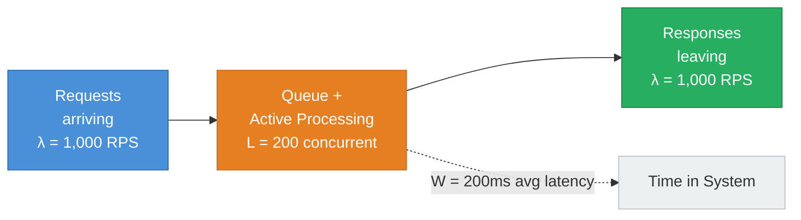

### Worked Examples

**Example 1: Size a connection pool**
- Service receives 500 RPS
- Average DB query latency = 20ms
- Required pool size: L = 500 × 0.020 = **10 connections minimum**
- Add 50% headroom for bursts: **15–20 connections**

**Example 2: Find max sustainable throughput**
- Service can hold max 100 concurrent goroutines
- Average request latency = 50ms
- Max QPS = L/W = 100 / 0.050 = **2,000 RPS**

**Example 3: Diagnose a latency spike**
- Previously: 1,000 RPS, 50ms latency → 50 concurrent
- After deploy: 1,000 RPS, 500ms latency → 500 concurrent (10× more)
- Little's Law says concurrency grew 10×. Something is holding connections open: connection leak? slow dependency? timeout misconfiguration?

**Rearranged forms:**
- Max throughput: `λ_max = L_max / W`
- Expected latency: `W = L / λ`
- Required concurrency: `L = λ × W`

---

## Back-of-Envelope Estimation

A structured methodology for capacity planning:

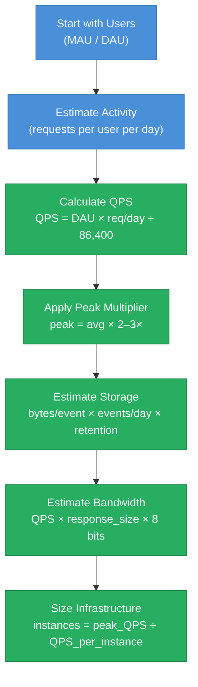

### Key Multipliers

| Scenario | Formula | Example |
|---|---|---|
| **QPS from DAU** | `DAU × req/day ÷ 86,400` | 10M DAU × 30 req/day ÷ 86,400 = **3,472 QPS** |
| **Peak QPS** | `avg_QPS × 2–3×` | 3,472 × 3 = **~10K QPS peak** |
| **Storage/day** | `events/sec × bytes/event × 86,400` | 1K/s × 500B × 86,400 = **43 GB/day** |
| **Storage/year** | `GB/day × 365` | 43 × 365 = **~15 TB/year** |
| **Bandwidth** | `QPS × response_bytes × 8 ÷ 1e6` Mbps | 3,472 × 2,000B × 8 ÷ 1e6 = **55 Mbps** |
| **Instances needed** | `peak_QPS ÷ QPS_per_instance` | 10K ÷ 500 = **20 instances** |

**Twitter-scale example:** 300M MAU, 20% DAU = 60M DAU. 8 tweets read per user per day → 60M × 8 ÷ 86,400 ≈ **5,556 avg RPS** (~17K peak). Write ratio ~1:100 (reads >> writes) → ~55 writes/sec. Storage: 55 writes/sec × 500 bytes × 86,400 = **2.4 GB/day** of raw tweet text.

---

## Latency Percentiles

Average latency is a lie. Use percentiles:

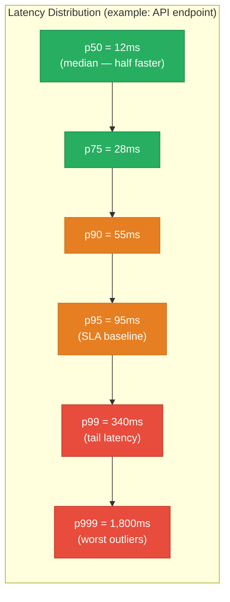

| Percentile | Meaning | At 10K RPS this affects | Use case |
|---|---|---|---|
| **p50** | Half of requests faster than this | 5,000 users/second | Typical user experience baseline |
| **p95** | 95% of requests at or below | 500 users/second | SLA definition, capacity planning |
| **p99** | 1% of requests slower | 100 users/second | "Tail latency" — real users, real pain |
| **p999** | 0.1% of requests slower | 10 users/second | Timeout/retry budget configuration |

**Why p99, not p50?** At 10K RPS, a p99 of 340ms means 100 users per second experience 340ms+ responses. Over one minute, that is 6,000 users with a degraded experience. Mean latency of 20ms masks this completely.

**Tail latency amplification:** A request that fans out to 100 backend calls completes when the *slowest* returns. If each backend has 1% chance of being slow (p99), the probability that *at least one* of 100 is slow = `1 - 0.99^100 = 63%`. The fan-out p99 becomes the single-backend p99.99. This is why Google's "hedged requests" pattern (send a duplicate request to a second server if the first doesn't respond within p95) is valuable at scale.

---

## Latency Reduction Levers

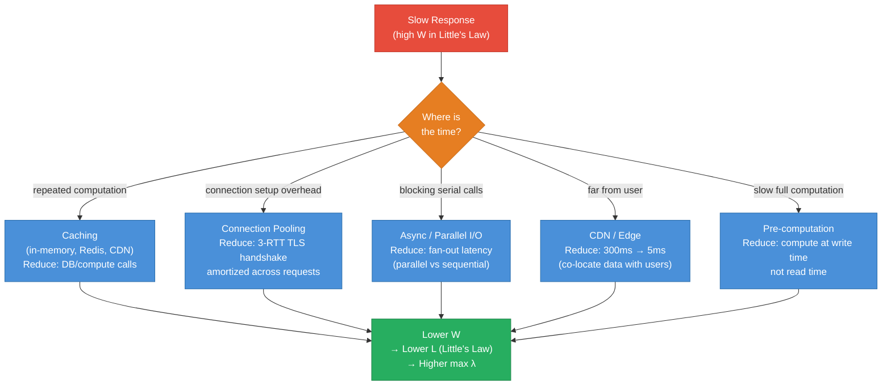

---

## Throughput vs Latency Tradeoff

Batching is the classic lever that increases throughput at the cost of latency:

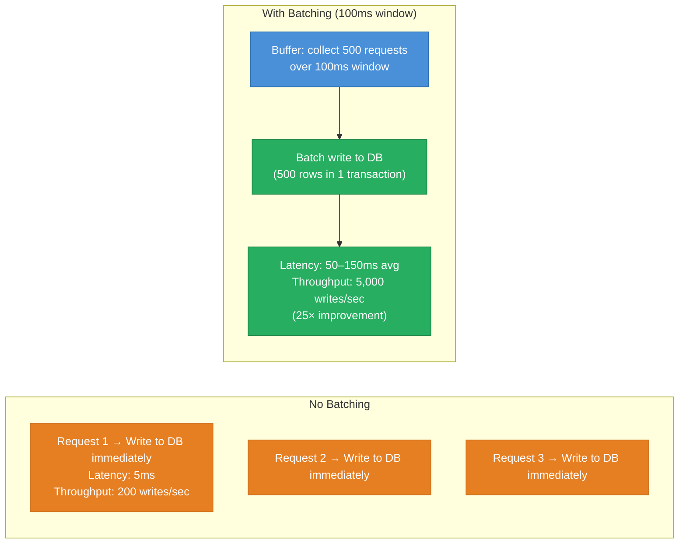

| Strategy | Effect on Latency | Effect on Throughput | Example |
|---|---|---|---|
| **Batching** | Increases (buffer wait) | Large increase | Kafka producer batch, DB bulk insert |
| **Async processing** | Appears lower (instant ack) | Increases | Message queue, fire-and-forget |
| **Caching** | Decreases (cache hit) | Increases | Redis, CDN, in-process LRU |
| **Connection pooling** | Decreases (no handshake) | Increases | DB pool, HTTP keep-alive |
| **Serializable isolation** | Increases (lock contention) | Decreases | Strong ACID transactions |
| **Hedged requests** | Decreases p99 | Slight decrease (extra load) | Duplicate request to backup server |

---

## Utilization and the Queue Cliff

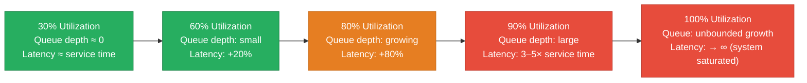

From queueing theory (M/M/1 queue): latency grows non-linearly as utilization approaches 100%. **Design target: 50–70% utilization headroom.** A system running at 80% CPU has very little burst capacity before queues explode.

`Max sustainable QPS (U=0.7) = 0.7 / service_time_seconds`

Example: 5ms service time → max 140 QPS per thread at 70% utilization. For 10K QPS, need `10,000 / 140 ≈ 72 threads/workers`.

---

## Interview Angles

**Q1: Estimate QPS for Twitter's home timeline.**
300M MAU, ~60M DAU (20%). Each user reads ~15 timeline refreshes/day × 20 tweets per refresh = 300 requests/day/user. QPS = 60M × 300 ÷ 86,400 ≈ **208K avg RPS**, ~600K peak. Write side: ~500M tweets/day = ~5,800 writes/sec. Fanout (precompute timelines) is the architectural challenge at this scale.

**Q2: Why optimize p99 latency rather than p50?**
At high QPS, p99 affects many real users per second. p50 (median) hides the tail — a p50 of 10ms with p99 of 2 seconds means 1% of users wait 2 seconds. Tail latency amplifies in fan-out architectures (see tail latency amplification). SLAs are typically defined on p99, not mean, because that is what users actually experience at the extremes.

**Q3: How does Little's Law help you size infrastructure?**
L = λ × W. If you know your target QPS (λ) and your expected latency (W), you can calculate required concurrency (L) — and therefore thread pool size, connection pool size, and number of worker processes. It is also a diagnostic tool: if L jumps unexpectedly, either λ increased or W increased (latency regression).

**Q4: What is tail latency amplification and how do you mitigate it?**
In a fan-out to N services, overall latency = max(all N). With N=100 and 1% chance of slowness per service, 63% of requests will be slow. Mitigations: hedged requests (duplicate request if no response within p75), aggressive timeouts per service, reducing fan-out width, and circuit breakers to fast-fail known-slow services.

**Q5: How does batching improve throughput at the cost of latency?**
Batching collects multiple requests into a single operation (one DB transaction for 500 rows instead of 500 individual writes). The per-item overhead (connection setup, transaction overhead, network round trips) is amortized across the batch — throughput goes up dramatically. But each item must wait for the batch window to fill before processing — adding buffer wait time to latency.

---

**References**

- [Little's Law — Wikipedia](https://en.wikipedia.org/wiki/Little%27s_law)
- [Latency Numbers Every Programmer Should Know](https://gist.github.com/jboner/2841832)
- [The Tail at Scale — Dean & Barroso, Google](https://dl.acm.org/doi/10.1145/2408776.2408794)
- [Systems Performance — Brendan Gregg](https://www.brendangregg.com/systems-performance-2nd-edition-book.html)
- [Queueing Theory for Dummies](https://www.johndcook.com/blog/2009/01/30/queueing-theory-basics/)

---

## Architecture Diagrams

> Generated from D2 sources in [`docs/diagrams/src/1.4_latency_and_throughput/`](../../../docs/diagrams/src/1.4_latency_and_throughput/).
> Regenerate: `just diagrams-topic 1.4_latency_and_throughput`.

### Overview

A request's latency budget itemized hop by hop: ISP 20ms, CDN 5ms, LB 1ms, app 50ms, DB 10ms — 86ms total, and where to attack it.

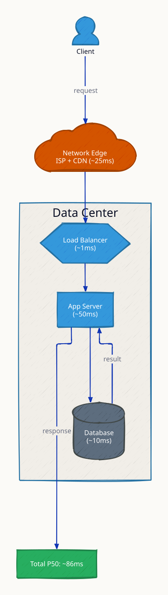

**`cache_hit` scenario:** the CDN answers directly and the app/DB hops disappear — total latency collapses from 86ms to ~25ms, the single biggest lever in the pipeline.

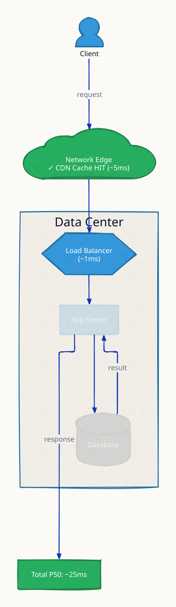

**`db_slow` scenario:** the 10ms DB hop degrades to 800ms (missing index, lock contention) and dominates everything — latency budgets are only as good as the worst hop.

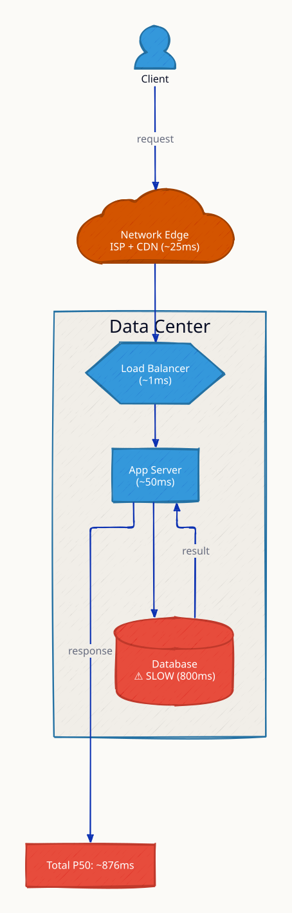

### Request Flow

Throughput scaling: how many requests per second the same pipeline sustains, and what saturates first.

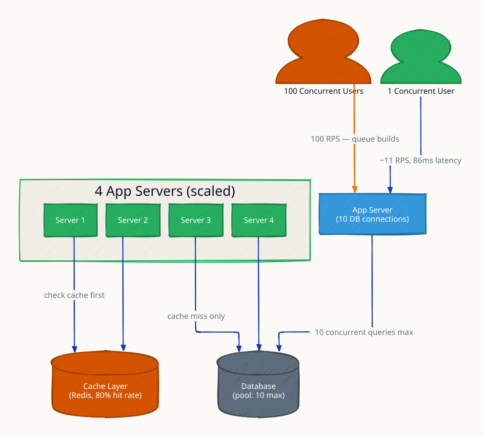

**`thundering_herd` scenario:** a cache entry expires under load and all 4 app servers stampede the database simultaneously — the motivation for request coalescing and staggered TTLs.

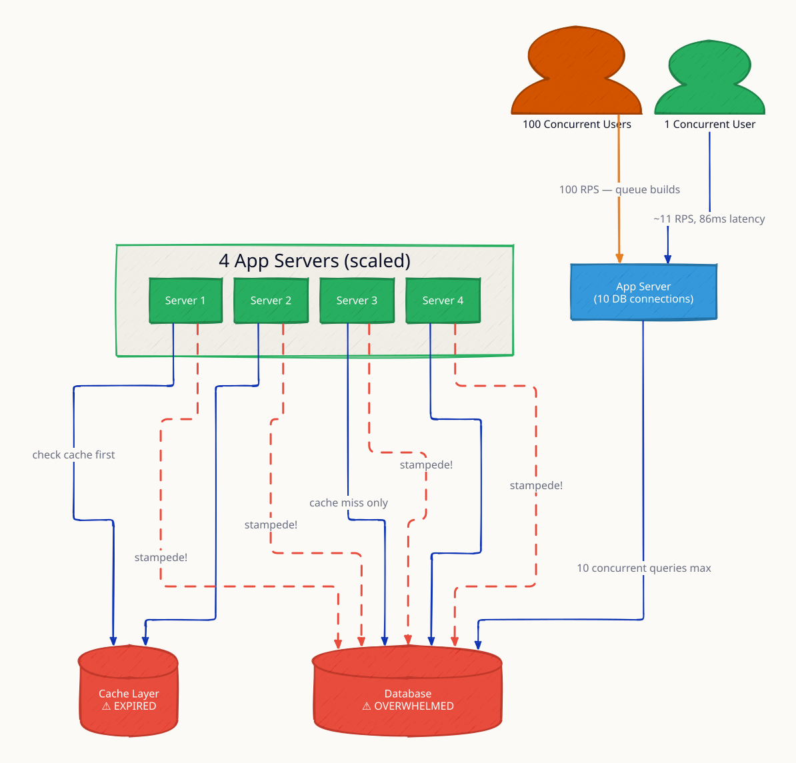
