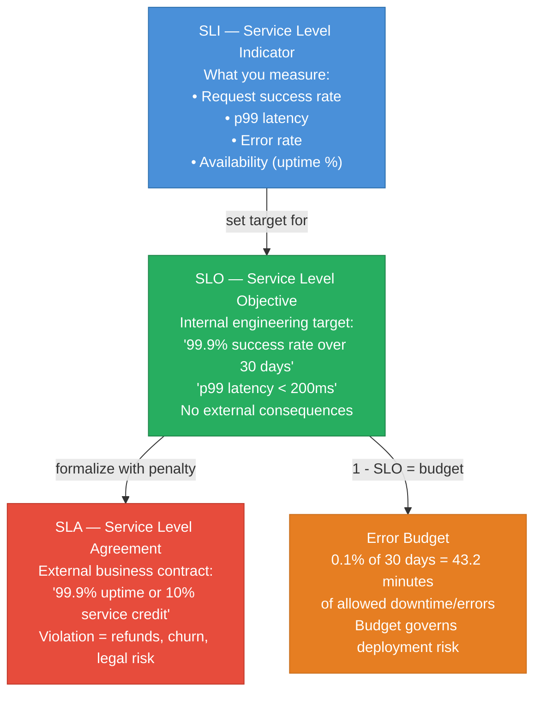
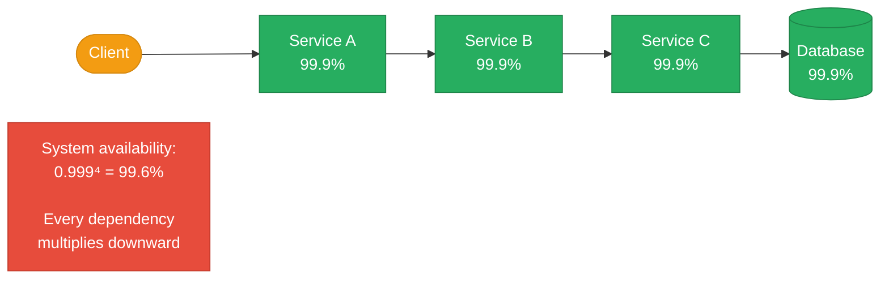
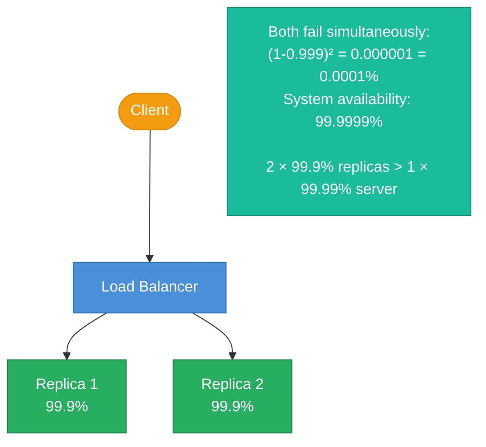
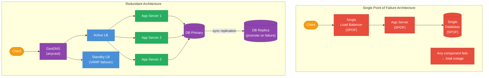
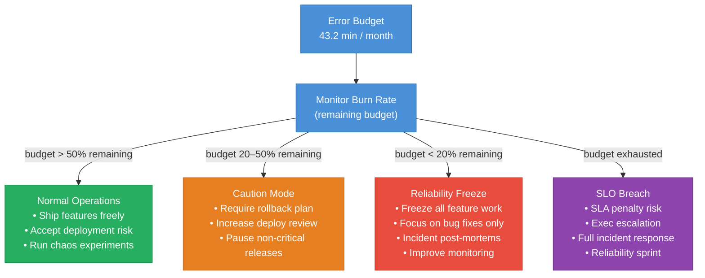
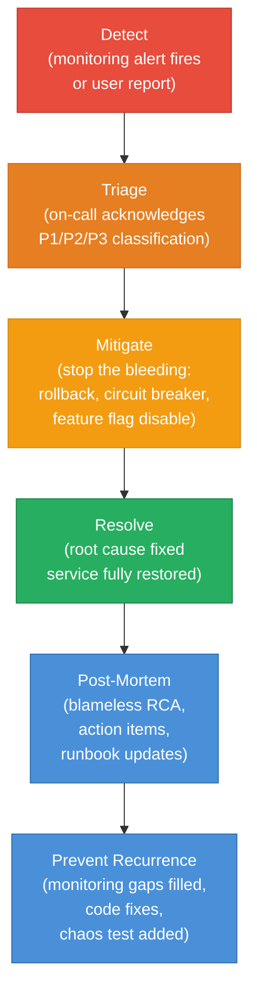
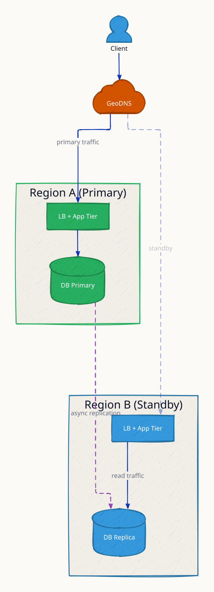
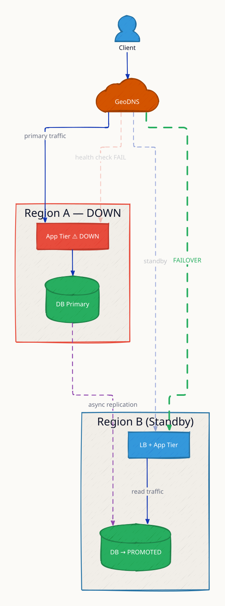
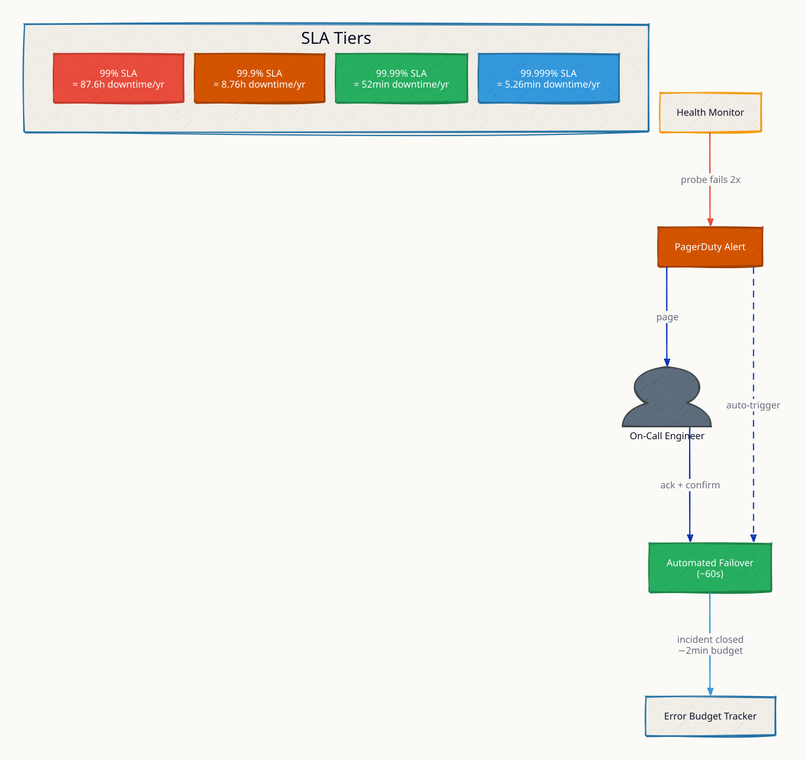
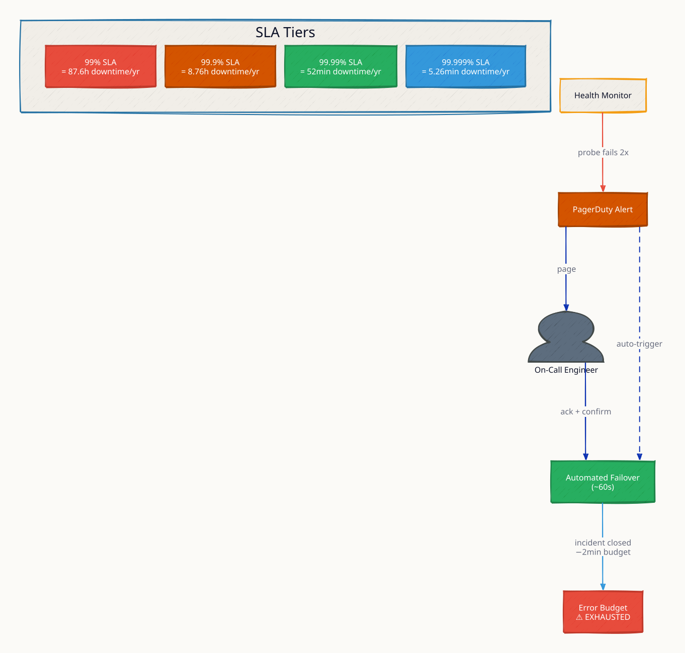

# Availability and SLAs

**Availability is the most visible quality attribute of any production system, and the difference between 99% and 99.99% is the difference between 87 hours of downtime per year and 52 minutes.** Understanding how availability compounds in serial dependency chains — every service you add multiplies the overall availability down — is essential for designing systems that meet their SLOs. The SLI/SLO/SLA/error budget framework, pioneered by Google's SRE team, gives engineering and product teams a shared, quantified language for making tradeoff decisions: when to ship features, when to freeze deployments, and when to invest in reliability engineering.

---

## The Availability Nines Table

| Nines | Availability | Downtime / Year | Downtime / Month | Downtime / Week |
|---|---|---|---|---|
| 1 nine | 90% | 36.5 days | 72 hours | 16.8 hours |
| 2 nines | 99% | 3.65 days | 7.2 hours | 1.68 hours |
| 3 nines | 99.9% | 8.76 hours | 43.8 minutes | 10.1 minutes |
| 4 nines | 99.99% | 52.6 minutes | 4.4 minutes | 1.01 minutes |
| 5 nines | 99.999% | 5.26 minutes | 26.3 seconds | 6.05 seconds |
| 6 nines | 99.9999% | 31.5 seconds | 2.6 seconds | 0.6 seconds |

**Context matters:** 99.9% (three nines) allows 8.76 hours of downtime per year. For a consumer app that feels acceptable. For a payment processing system handling $1M/hour in transactions, 8.76 hours offline = $8.76M in lost revenue — completely unacceptable. Know your business context before setting an SLO.

---

## SLI / SLO / SLA / Error Budget



| Term | Owner | Consequence of violation | Example |
|---|---|---|---|
| **SLI** | Engineering (measured) | None — it is just a metric | Error rate = 0.05% |
| **SLO** | Engineering (target) | Internal: reliability review, error budget depletion | Error rate < 0.1% |
| **SLA** | Business (contract) | Financial: credits, penalties, churn | 99.9% uptime SLA |
| **Error Budget** | Engineering + Product | Governs deployment velocity | 43.2 min/month burn allowed |

**SLOs must be below your actual capability.** If you can realistically achieve 99.95%, set SLO at 99.9% — leave buffer for unplanned incidents. Setting SLO at 99.95% means any incident immediately burns budget.

---

## Serial Availability: Dependencies Multiply Downward

When a request must pass through services A → B → C, the system is only available when **all** components are:

```
A_system = A₁ × A₂ × A₃ × ... × Aₙ
```



**Chain examples:**
- 3 services × 99.9% = `0.999³ = 99.7%` (down from 99.9%)
- 5 services × 99.9% = `0.999⁵ = 99.5%` (3.65 days downtime/year!)
- 10 services × 99.9% = `0.999¹⁰ = 99.0%`

**Lesson:** Every service you add to a synchronous call chain reduces overall availability. Use async/queues to break dependency chains. Design for graceful degradation — if Service B is down, return a cached/degraded response rather than a 500.

---

## Parallel Availability: Redundancy Multiplies Upward

If any one of N replicas can serve the request, availability improves dramatically:

```
A_parallel = 1 − (1 − A)ⁿ
```



| Replicas | Individual availability | Combined availability | Improvement |
|---|---|---|---|
| 1 | 99.9% | 99.9% | baseline |
| 2 | 99.9% | 99.9999% | +2 nines |
| 3 | 99.9% | 99.9999999% | +5 nines |
| 2 | 99% | 99.99% | +2 nines |
| 3 | 99% | 99.9999% | +4 nines |

**Two 99.9% replicas (99.9999% combined) beat one 99.99% server.** Redundancy with cheap, imperfect nodes often outperforms single expensive nodes on availability.

---

## MTBF and MTTR

```
Availability = MTBF / (MTBF + MTTR)
```

| Metric | Meaning | Lever to pull |
|---|---|---|
| **MTBF** | Mean Time Between Failures — how long until next failure | Better testing, chaos engineering, more durable hardware |
| **MTTR** | Mean Time To Repair — how fast you restore service | Monitoring, alerting, runbooks, auto-remediation |

**Numerical example:**
- MTBF = 720 hours (fails once a month), MTTR = 1 hour
- Availability = 720 / (720 + 1) = **99.86%** (about 3 nines)
- To reach 4 nines (99.99%): need MTTR = 0.072 hours = **4.3 minutes**
- OR need MTBF = 9,999 hours = ~14 months between failures

**MTTR reduction is usually the faster path.** Doubling MTBF requires fundamentally better code/hardware. Cutting MTTR 10× is achievable with: faster alerting, better runbooks, automated rollback, on-call practices, and chaos engineering to pre-discover failure modes.

---

## Single Point of Failure vs Redundant Architecture



**Design rule:** Identify every single point of failure in the critical path. For each SPOF, apply redundancy (active-active or active-passive). Common SPOFs: single load balancer, single database primary, single DNS resolver, single Kafka broker, single availability zone.

---

## Error Budget Management

```
Error Budget = (1 - SLO) × period
```

**Example (99.9% SLO, 30-day window):**
`Budget = 0.001 × 30 × 24 × 60 = 43.2 minutes of allowed downtime`



**The error budget contract between Engineering and Product:**
- When budget is healthy: Product wins — ship features, take deployment risk
- When budget is exhausted: Engineering wins — freeze features, invest in reliability
- This removes the subjective "should we ship?" debate and replaces it with data

---

## Incident Response Lifecycle



**MTTR breakdown:**
- **Detection time:** How long from failure to alert? (Goal: < 1 min with synthetic monitors)
- **Response time:** How long from alert to on-call acknowledging? (Goal: < 5 min with PagerDuty)
- **Diagnosis time:** How long to find root cause? (Goal: < 15 min with distributed tracing)
- **Mitigation time:** How long to restore service? (Goal: < 5 min with automated rollback)
- Total MTTR target: **< 30 minutes** for 4-nines availability

---

## Cascade Failure Risk

Serial availability math applies to runtime dependencies too:

```
A_effective = A_upstream × A_dependency^(calls_per_request)
```

If Service A calls Service B **3 times per request** and B is at 99%:
`A = 0.999 × 0.99³ = 0.999 × 0.970 ≈ 97%`

At 97% availability: `3% downtime × 8,760 hrs/year = 263 hours of downtime/year`. Two nines, not three.

**Mitigation:** Circuit breakers (stop calling a failing service), timeouts (don't wait forever), bulkheads (isolate failure domains), and async queues (decouple availability boundaries).

---

## Interview Angles

**Q1: How do you achieve 5 nines (99.999%) availability?**
Multi-AZ and multi-region active-active deployment. Automated failover (< 30 seconds). Connection pooling and circuit breakers for all dependencies. Chaos engineering to pre-discover failure modes. Sub-1-minute monitoring with automated rollback. The hardest part: MTTR must be under 4.3 minutes — requires aggressive automation, not human-in-the-loop.

**Q2: What is an error budget and how does it govern engineering decisions?**
Error budget = 1 - SLO. A 99.9% SLO gives 43.2 minutes/month of allowed downtime. When budget is healthy, ship features freely. When budget is near exhaustion, freeze feature work and focus on reliability. This replaces subjective "is it safe to deploy?" debates with objective data, aligning engineering and product teams.

**Q3: Why does adding more microservices reduce overall availability?**
Serial availability: system availability = product of all component availabilities. Ten services at 99.9% each = 99.0% combined = 87 hours downtime/year. The fix: use async messaging (queues decouple failure domains), graceful degradation (return stale/partial data when a dependency is down), and circuit breakers (fail fast instead of waiting for timeouts to cascade).

**Q4: What is the difference between MTBF and MTTR, and which is easier to improve?**
MTBF (mean time between failures) measures reliability — how often things break. MTTR (mean time to repair) measures recoverability — how fast you fix them. Availability = MTBF / (MTBF + MTTR). Reducing MTTR is usually 10× faster to achieve: better alerting, runbooks, automated rollback, on-call training. Improving MTBF requires better code, more testing, chaos engineering — a longer investment.

**Q5: What is the difference between SLO and SLA, and should your SLA equal your SLO?**
SLO is the internal engineering target (no external consequences). SLA is the external contract with penalties. SLA should always be *lower* than SLO — if you promise customers 99.9% uptime, your internal SLO should be 99.95% or higher. The gap between SLO and SLA is a buffer: you can burn some error budget in incidents without breaching the customer contract.

---

**References**

- [Google SRE Book: Service Level Objectives](https://sre.google/sre-book/service-level-objectives/)
- [Google SRE Book: Embracing Risk](https://sre.google/sre-book/embracing-risk/)
- [The Availability Bias — Cindy Sridharan](https://medium.com/@copyconstruct/testing-in-production-the-safe-way-18ca102d0ef1)
- [AWS Well-Architected: Reliability Pillar](https://docs.aws.amazon.com/wellarchitected/latest/reliability-pillar/welcome.html)
- [Implementing SLOs — Alex Hidalgo (O'Reilly)](https://www.oreilly.com/library/view/implementing-service-level/9781492076803/)

---

## Architecture Diagrams

> Generated from D2 sources in [`docs/diagrams/src/1.5_availability_and_slas/`](../../../docs/diagrams/src/1.5_availability_and_slas/).
> Regenerate: `just diagrams-topic 1.5_availability_and_slas`.

### Overview

Multi-region high availability: Region A serves traffic, Region B runs warm standby, and GeoDNS fails clients over when health checks go red.



**`region_a_down` scenario:** Region A fails health checks and GeoDNS shifts traffic to Region B — recovery without human intervention, bounded by DNS TTL.



### Request Flow

What each nine costs: 99% allows 87.6 h of downtime per year, 99.999% allows 5.26 min — plus the error-budget model SREs use to spend the difference.



**`budget_exhausted` scenario:** the error budget hits zero, so feature releases freeze and engineering shifts to reliability work — the budget converts an SLA from a promise into an operating policy.


