# ACID vs BASE

**The ACID vs BASE spectrum is one of the most consequential tradeoffs in database and distributed systems design.** ACID — the guarantee that bank transfers either fully succeed or fully fail, that balances never go negative, that two concurrent withdrawals cannot both see the pre-debit balance — is what makes relational databases trustworthy for financial and inventory systems. BASE — the philosophy that underpins Cassandra, DynamoDB, and most large-scale NoSQL systems — trades those guarantees for availability, partition tolerance, and horizontal scalability. Knowing when a system can tolerate eventual consistency (social media likes, shopping carts) versus when it cannot (payment ledgers, seat reservations) determines which storage engine and consistency model to reach for — and which patterns like Sagas and Outbox bridge the gap in distributed architectures.

---

## ACID Properties

| Property | What it Guarantees | Concrete Example |
|---|---|---|
| **Atomicity** | Transaction is all-or-nothing. Partial completion is impossible. | Bank transfer: debit $100 from Alice AND credit $100 to Bob. If the credit fails, the debit is rolled back. No money lost or created. |
| **Consistency** | Transaction brings the database from one valid state to another. All constraints hold before and after. | Account balance constraint: `balance >= 0`. A transfer that would make Alice go negative is rejected in full. |
| **Isolation** | Concurrent transactions execute as if they were serial. Intermediate states are invisible to others. | Two simultaneous $100 withdrawals from a $150 account: only one succeeds, not both. |
| **Durability** | Once committed, the transaction survives crashes. Data is flushed to durable storage before the ACK. | Power failure immediately after `COMMIT`: the row is still there when the database restarts (WAL/fsync). |

---

## Atomic Bank Transfer — Sequence Diagram

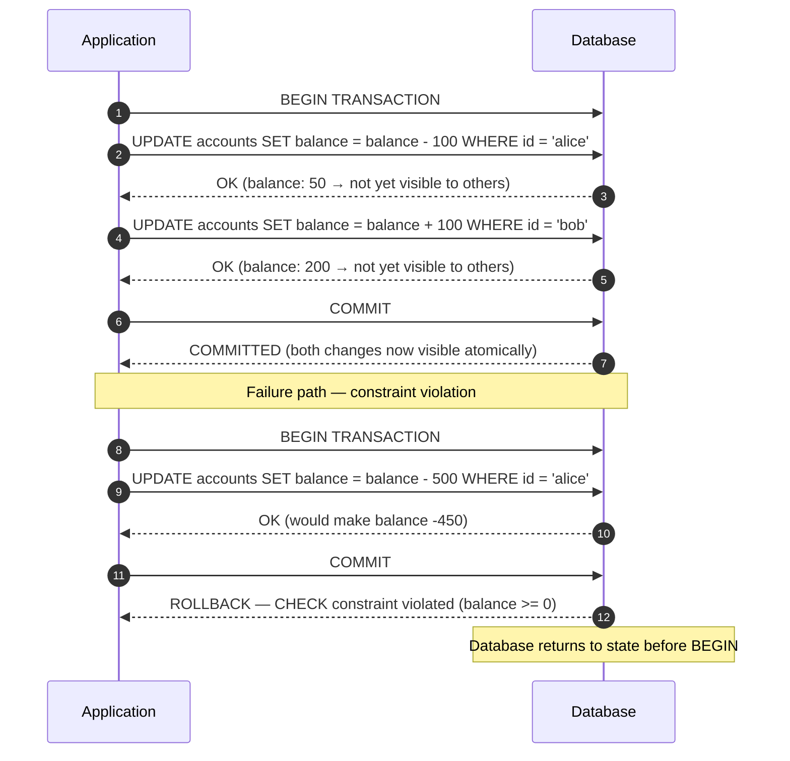

The key property: between `BEGIN` and `COMMIT`, no other transaction sees Alice's reduced balance or Bob's increased balance. Either both updates become visible simultaneously on `COMMIT`, or neither does on `ROLLBACK`.

---

## Isolation Levels

Isolation is a spectrum. Stronger isolation = more serialization = lower concurrency = higher latency. Choose the minimum isolation level that prevents the anomalies your application cannot tolerate.

| Isolation Level | Dirty Read | Non-Repeatable Read | Phantom Read | Performance | Default in |
|---|---|---|---|---|---|
| **READ UNCOMMITTED** | Possible | Possible | Possible | Highest | Rarely used |
| **READ COMMITTED** | Safe | Possible | Possible | High | PostgreSQL, Oracle |
| **REPEATABLE READ** | Safe | Safe | Possible | Medium | MySQL InnoDB |
| **SERIALIZABLE** | Safe | Safe | Safe | Lowest | Explicit opt-in |

**Anomaly definitions:**
- **Dirty Read:** Transaction A reads data written by Transaction B that has not yet committed. If B rolls back, A read phantom data.
- **Non-Repeatable Read:** Transaction A reads row X, Transaction B updates and commits row X, Transaction A reads row X again — gets different value.
- **Phantom Read:** Transaction A queries "all accounts with balance > $1000" (returns 3 rows), Transaction B inserts a new account with $5000, Transaction A runs same query — now returns 4 rows.

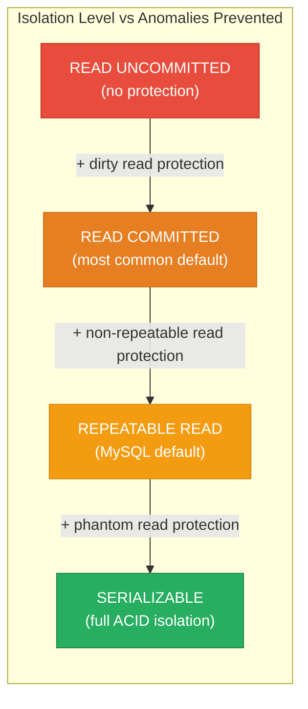

**Practical guidance:** Use READ COMMITTED for most OLTP. Use REPEATABLE READ or SERIALIZABLE for financial transactions where double-read consistency matters. SERIALIZABLE is expensive — PostgreSQL implements it with SSI (Serializable Snapshot Isolation) which reduces but does not eliminate overhead.

---

## BASE Properties

NoSQL and distributed systems trade ACID's strict guarantees for scalability:

| Property | Meaning | What It Allows |
|---|---|---|
| **Basically Available** | System always responds, even if data is stale or incomplete | During a partition, reads return stale data rather than erroring |
| **Soft State** | State can change over time without input (replication propagation) | Different replicas may have different values at the same moment |
| **Eventually Consistent** | All replicas converge to the same value *given enough time and no new writes* | A like count might show 1,000 on one replica and 999 on another for a few milliseconds |

BASE systems favor the **A** and **P** in CAP theorem (Availability + Partition tolerance) over **C** (Consistency).

---

## Eventual Consistency — Social Media Like Count

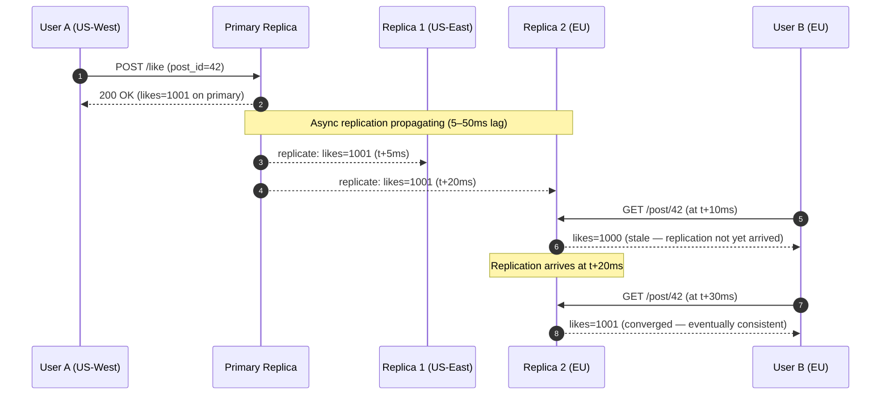

**This is acceptable** for a like count. A user seeing 1,000 vs 1,001 likes for 20ms is imperceptible. The system is massively more scalable because writes go to one node and replicate asynchronously — no distributed locking.

**This is NOT acceptable** for a bank balance. If two ATMs both read $200 and both approve $200 withdrawals based on stale replicas, the account goes to -$200.

---

## When to Choose ACID vs BASE

| Use Case | Model | Why |
|---|---|---|
| **Bank transfers / ledgers** | ACID | Double-spending, negative balances are catastrophic |
| **Seat / ticket reservation** | ACID | Overbooking requires serializable reads + writes |
| **Inventory (e-commerce)** | ACID (or strong consistency) | Overselling erodes trust and requires costly compensation |
| **Auth / permissions** | ACID | Stale permissions = security vulnerability |
| **Social media timeline** | BASE | Slightly stale feed is invisible to users |
| **Shopping cart** | BASE (or session-level) | Lost cart item is annoying but not catastrophic |
| **Product catalog reads** | BASE | Stale product description for 100ms is fine |
| **Analytics / reporting** | BASE | Approximate counts are acceptable |
| **Append-only event log** | BASE | Events don't need strong ordering across regions |
| **Session data** | BASE | Can tolerate brief inconsistency; session TTL self-heals |

---

## Saga Pattern for Distributed Transactions

When an operation spans multiple microservices, there is no shared ACID database. The Saga pattern breaks the transaction into local sub-transactions with compensating (rollback) steps:

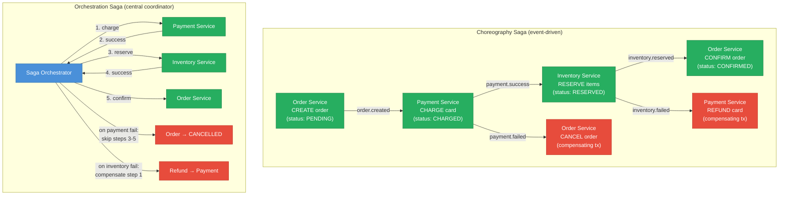

| Approach | Pros | Cons | Best For |
|---|---|---|---|
| **Choreography** | Fully decoupled, no SPOF orchestrator | Hard to see overall flow, event storm risk | Simple 2–3 step flows |
| **Orchestration** | Explicit flow, easy to monitor/debug, centralized retry logic | Orchestrator is coupling point, single point of failure risk | Complex multi-step business flows |

---

## The Outbox Pattern

The most practical pattern for reliable microservice event publishing:

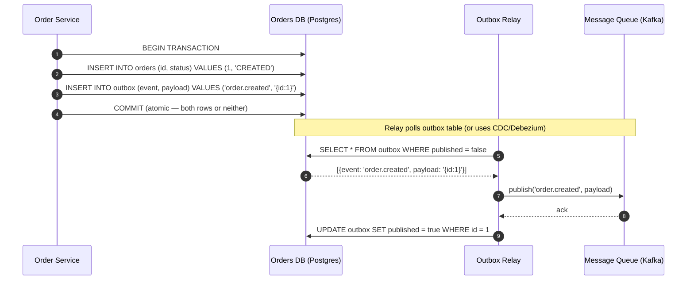

**Why it works:** The order creation and the event publication are in the same local database transaction — guaranteed atomic. The relay publishes to Kafka independently, with at-least-once delivery. This avoids the "dual write" problem (write to DB succeeds but Kafka publish fails → inconsistent state).

---

## Two-Phase Commit (2PC) — Why It's Rarely Used

2PC provides distributed ACID across multiple databases but has significant drawbacks:

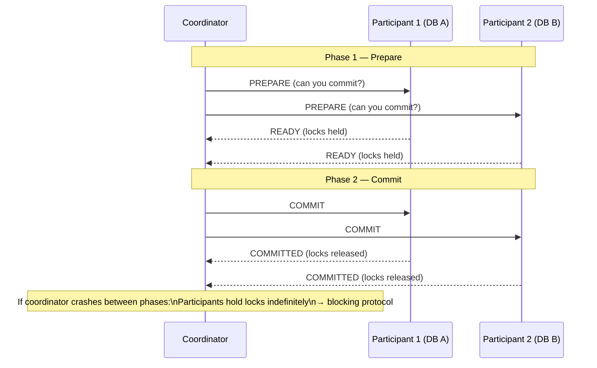

**Problems with 2PC:** Coordinator is a single point of failure. If coordinator crashes after PREPARE but before COMMIT, participants hold locks indefinitely (blocking). High latency (2 round trips). Does not handle network partitions well. Use Saga + Outbox instead for most microservice architectures.

---

## Interview Angles

**Q1: How do you maintain consistency across microservices without a distributed transaction?**
Use the Saga pattern (choreography or orchestration) for multi-step business flows. Each service executes a local ACID transaction and publishes an event. Compensating transactions handle rollback. For reliable event publishing, use the Outbox pattern — write the event to an outbox table in the same local transaction, then a relay publishes it to Kafka. This gives you at-least-once delivery without 2PC's blocking problems.

**Q2: Explain the Saga pattern and when to use choreography vs orchestration.**
A Saga breaks a distributed transaction into local sub-transactions with compensating transactions for rollback. Choreography: services react to events — decoupled but hard to visualize. Orchestration: a central coordinator directs each step — explicit flow but the orchestrator is a coupling point. Use choreography for simple 2–3 step flows; orchestration for complex flows where visibility and retry logic matter.

**Q3: What isolation level would you use for a banking application and why?**
REPEATABLE READ or SERIALIZABLE. READ COMMITTED allows non-repeatable reads — in a banking context, a transaction that reads balance twice and gets different values (because another committed between reads) can cause incorrect decisions. SERIALIZABLE prevents phantom reads too. In PostgreSQL, use SERIALIZABLE with retry logic for optimistic concurrency; Postgres's SSI (Serializable Snapshot Isolation) makes it practical.

**Q4: What is eventual consistency and when is it acceptable?**
Eventually consistent systems guarantee that, in the absence of new writes, all replicas will converge to the same value — but they may diverge briefly. Acceptable: social media feeds, like counts, product catalog reads, session data, DNS records. Not acceptable: account balances, inventory counts, seat reservations, access control decisions. The key question: what is the worst-case business impact of a user seeing stale data for 100ms–1 second?

**Q5: Why is two-phase commit (2PC) rarely used in modern microservice architectures?**
2PC requires all participants to hold locks between Phase 1 (Prepare) and Phase 2 (Commit). If the coordinator crashes in this window, all participants are blocked indefinitely — a liveness failure. It also introduces high latency (2 round trips across services) and does not handle network partitions gracefully. Modern architectures prefer Saga + Outbox: local ACID transactions per service, compensating transactions for rollback, and reliable message delivery via an outbox relay.

---

**References**

- [Designing Data-Intensive Applications — Kleppmann, Ch. 7 (Transactions)](https://dataintensive.net/)
- [ACID vs BASE — Bailis & Kingsbury (ACM Queue)](https://queue.acm.org/detail.cfm?id=2462076)
- [Saga Pattern — Chris Richardson (microservices.io)](https://microservices.io/patterns/data/saga.html)
- [Outbox Pattern — microservices.io](https://microservices.io/patterns/data/transactional-outbox.html)
- [PostgreSQL: Transaction Isolation](https://www.postgresql.org/docs/current/transaction-iso.html)

---

## Architecture Diagrams

> Generated from D2 sources in [`docs/diagrams/src/1.6_acid_vs_base/`](../../../docs/diagrams/src/1.6_acid_vs_base/).
> Regenerate: `just diagrams-topic 1.6_acid_vs_base`.

### Overview

ACID (PostgreSQL with a transaction manager guaranteeing all-or-nothing commits) vs BASE (three replicas converging asynchronously, serving possibly-stale reads meanwhile).

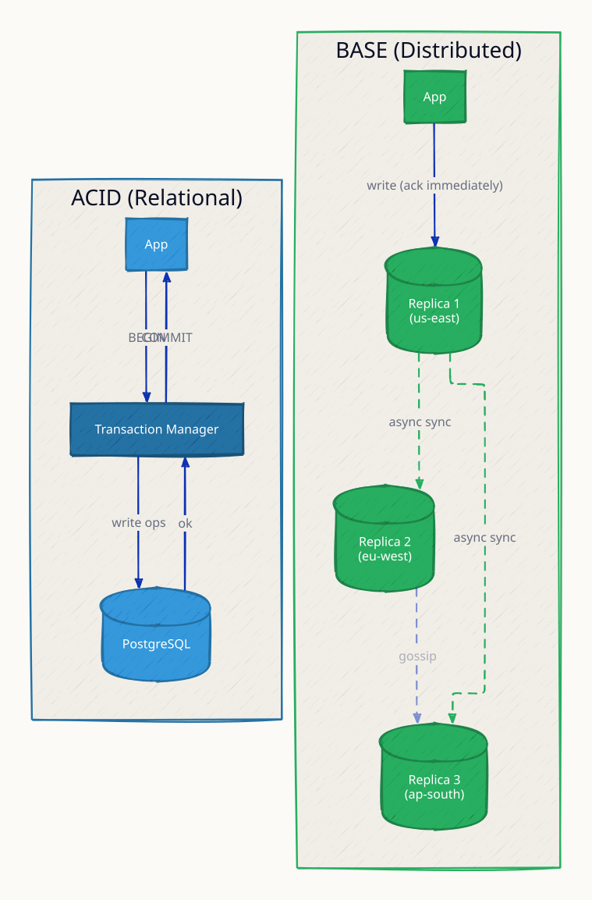

**`acid_rollback` scenario:** the credit step fails mid-transfer and the transaction manager rolls back the debit too — money never disappears, the core ACID guarantee.

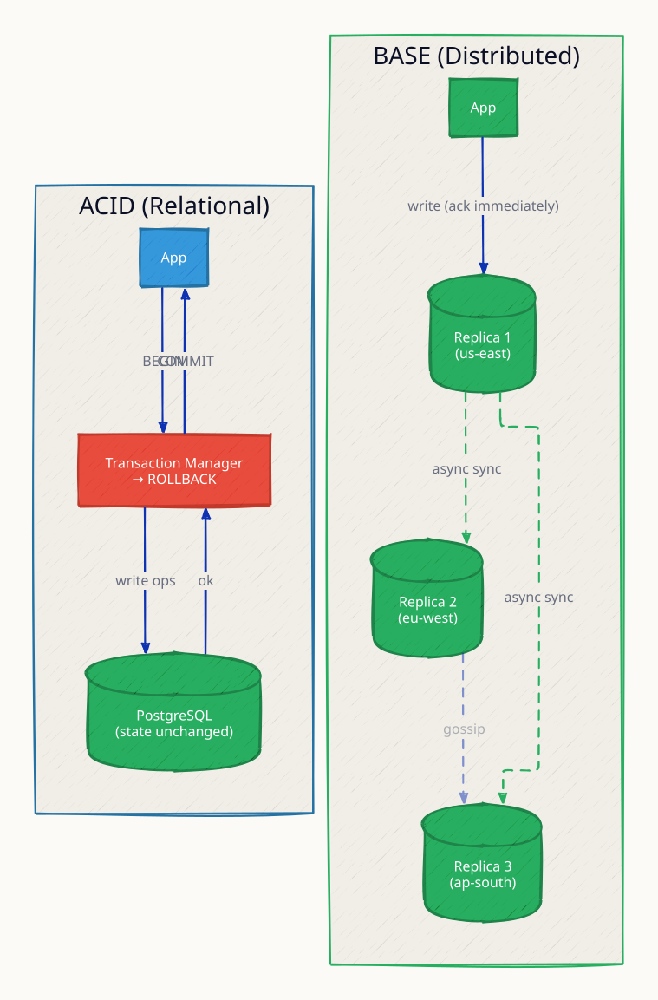

**`base_conflict` scenario:** two replicas accept conflicting writes during async replication; the system resolves via last-write-wins or merge — acceptable for carts, catastrophic for ledgers.

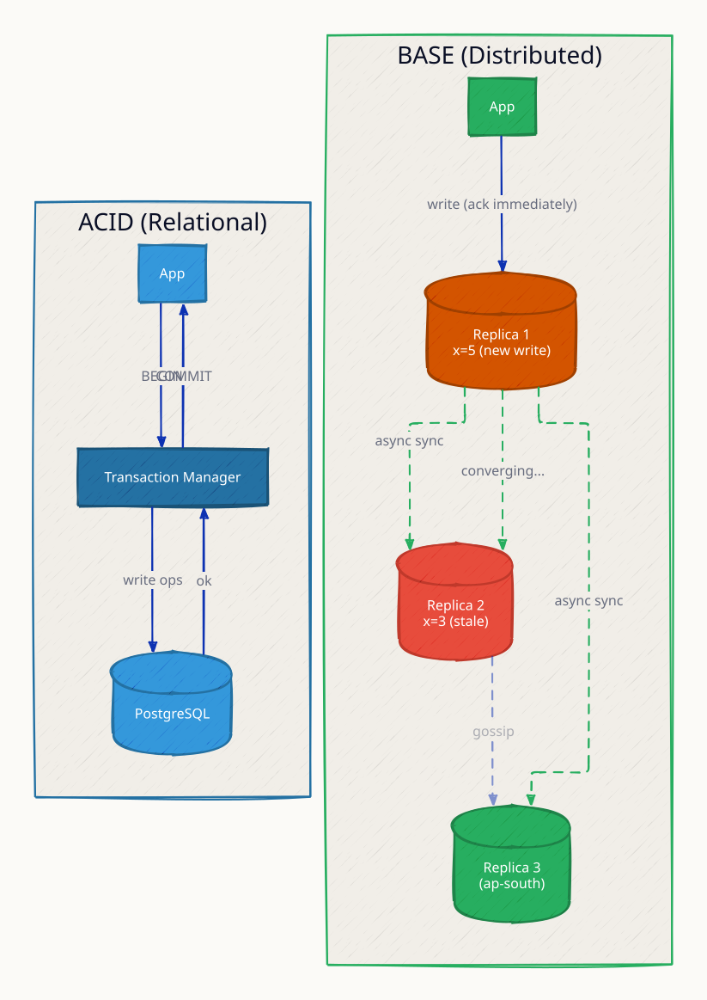

### Request Flow

Two workloads, two models: a bank transfer that must be atomic vs a shopping cart that tolerates eventual convergence.

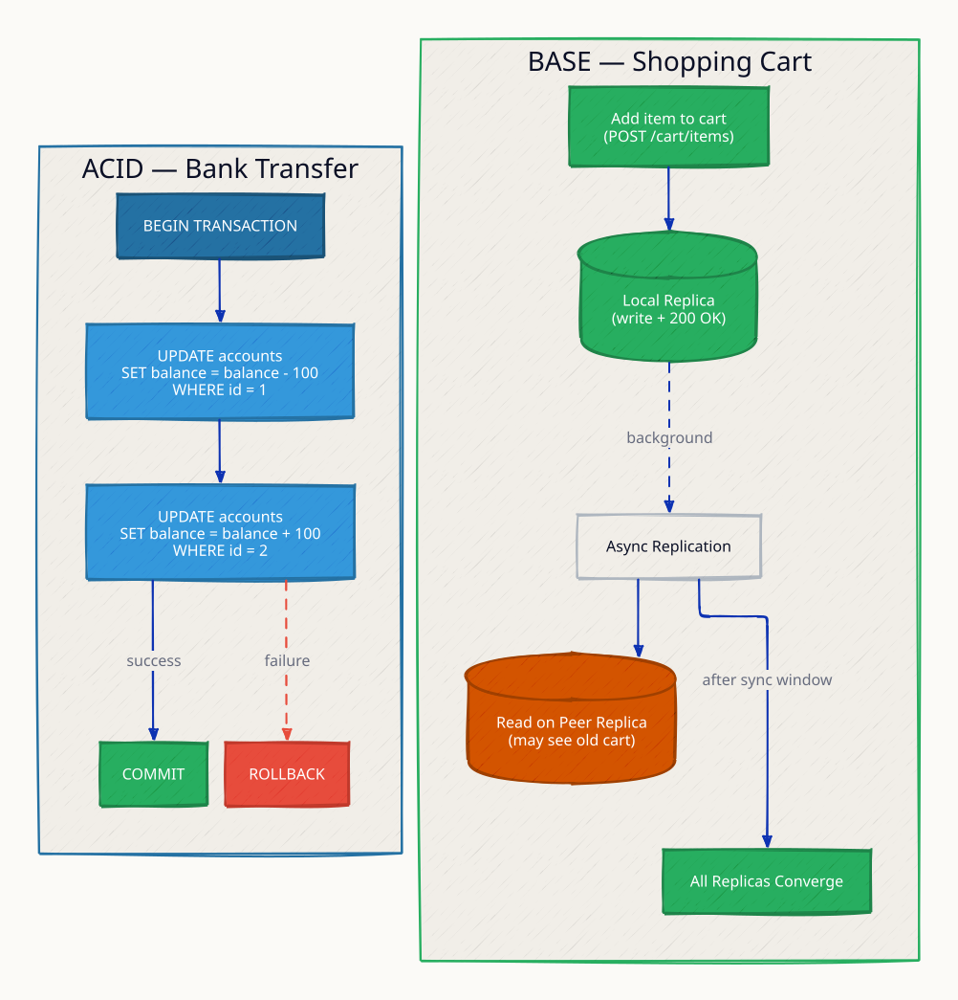

**`network_partition` scenario:** under partition the ACID system refuses writes (consistency over availability) while the BASE system keeps accepting them and reconciles later.

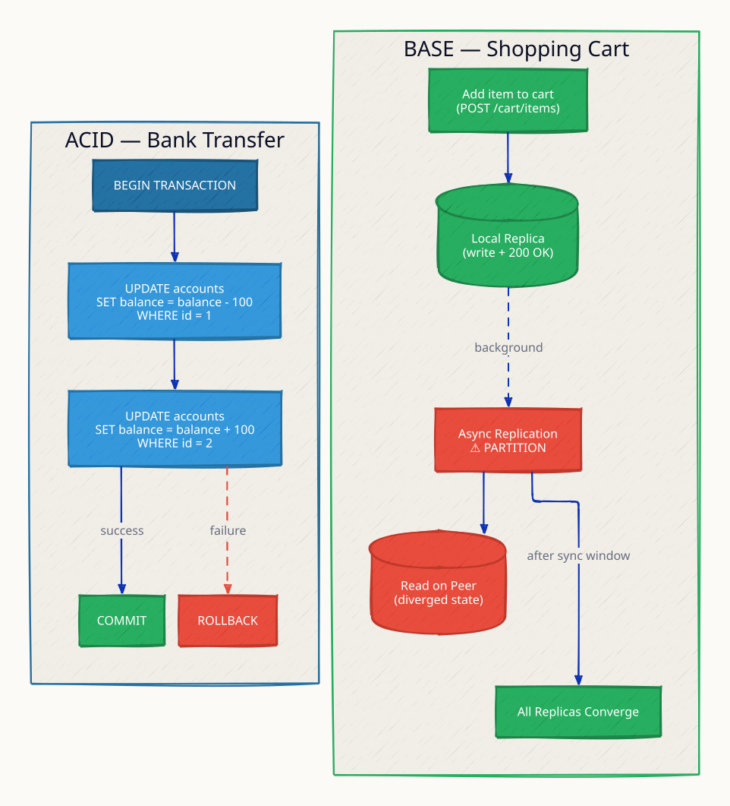
