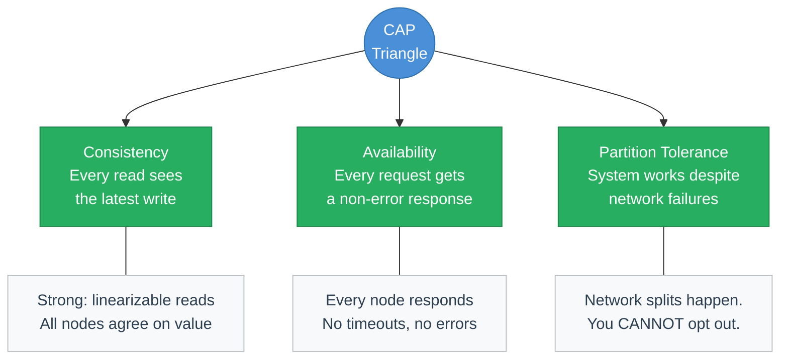
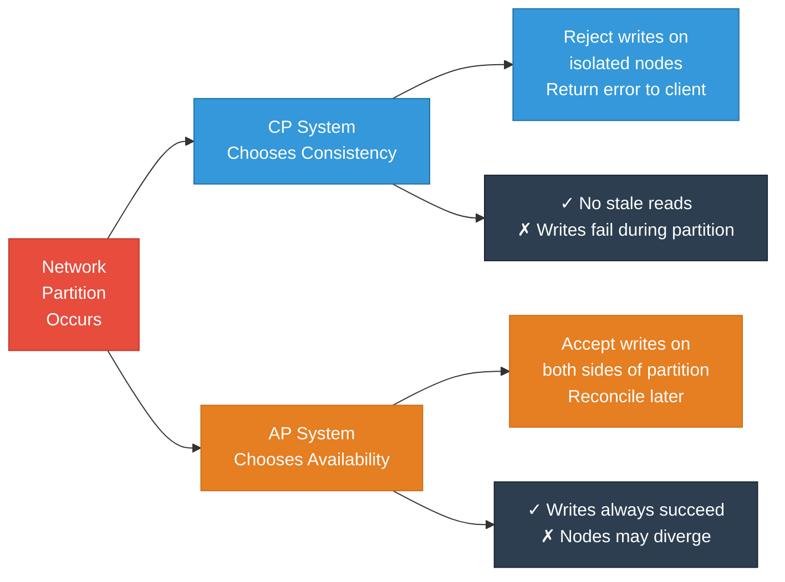
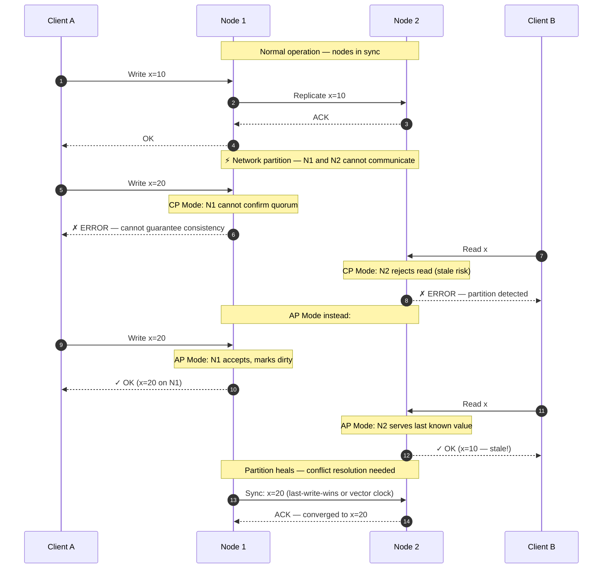
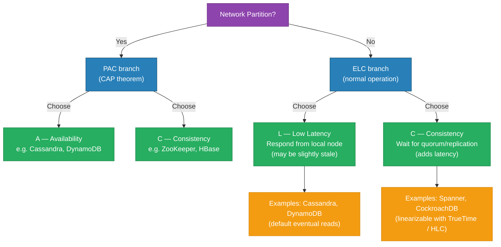
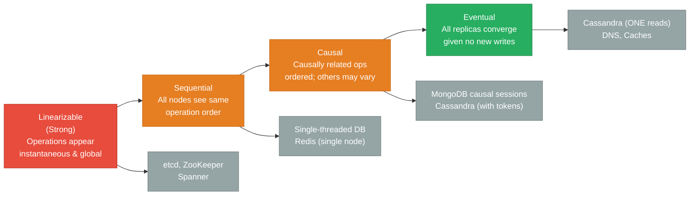
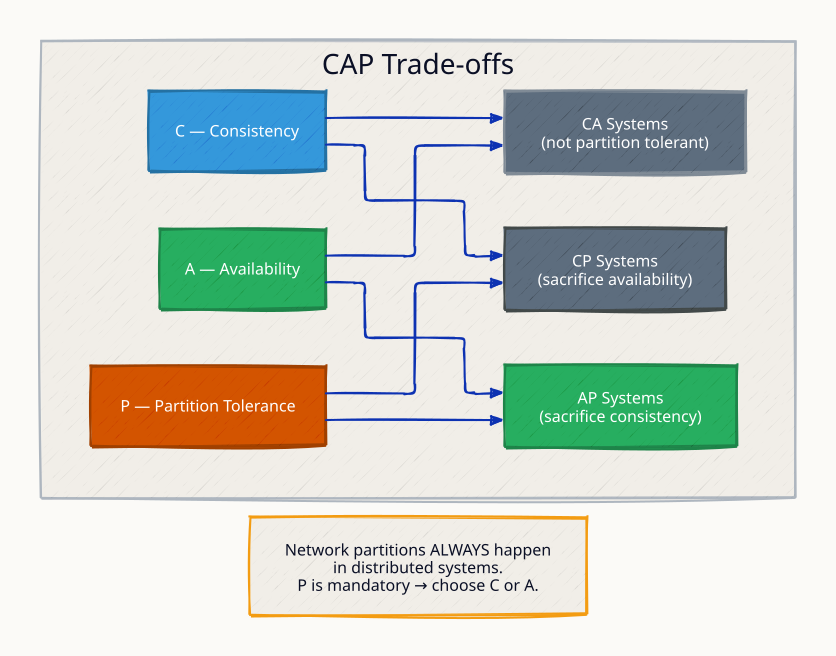
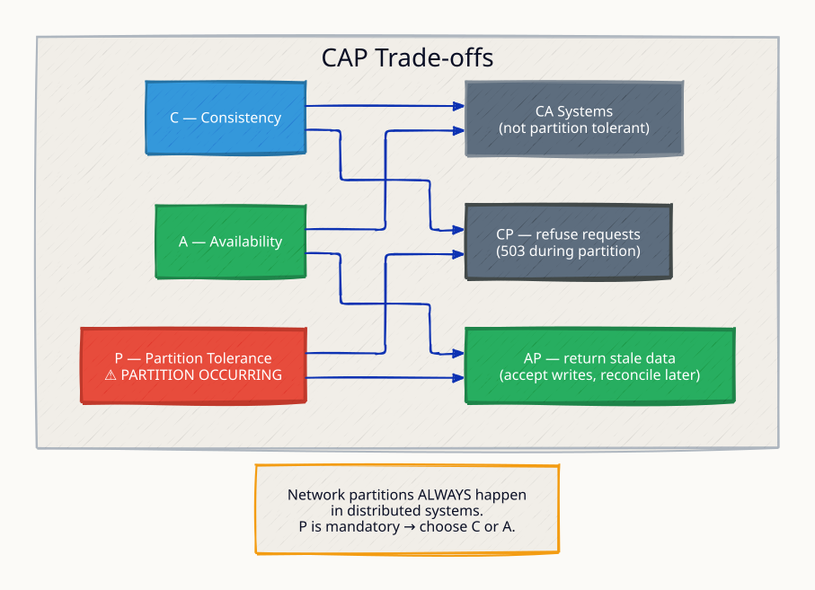
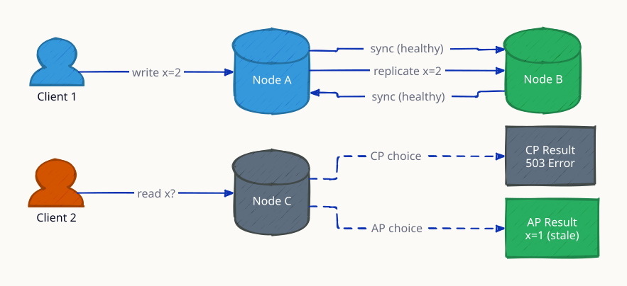
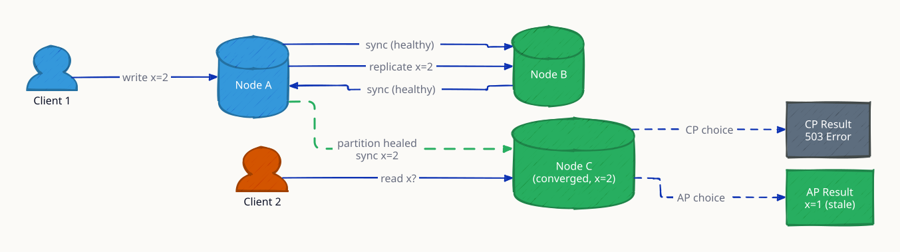

# CAP Theorem

**In any distributed system that stores data across multiple nodes, you can guarantee at most two of three properties: Consistency (every read sees the most recent write), Availability (every request receives a response), and Partition Tolerance (the system keeps working when network links between nodes fail). The critical insight — and the one most engineers miss — is that network partitions are not optional. They happen on every production system at some point: a cable fails, a switch reboots, a cloud availability zone loses connectivity. Because you cannot opt out of partitions, the real design choice is always between CP (sacrifice availability to stay consistent) and AP (sacrifice consistency to stay available). Getting this wrong means choosing a database that will either silently serve stale data or reject writes at the worst possible moment.**

---

## The Three Properties



---

## Why Partition Tolerance Is Non-Negotiable

A network partition means two or more groups of nodes cannot communicate with each other. In a production environment running across multiple machines (let alone data centers), partitions are inevitable:

- A switch or NIC fails
- A cloud availability zone loses external connectivity
- A misconfigured firewall drops packets between subnets
- High packet loss degrades a link to effectively down

If you build a system that does not tolerate partitions, you have built a single-node system — which has its own availability problem. Every real distributed database must handle partitions; the question is what it sacrifices during one.

---

## The Real Choice: CP vs AP



---

## Split-Brain: How CP and AP Respond Differently



---

## CP Systems Deep Dive

CP systems refuse to serve reads or accept writes on a minority partition. They guarantee that what you read is always correct, at the cost of availability during failures.

| System | How CP is Enforced | Failure Behavior |
|---|---|---|
| HBase | Writes only proceed if ZooKeeper quorum confirms region server | Region server isolated → writes blocked |
| ZooKeeper | Paxos-based; leader must have majority quorum | Minority nodes stop serving |
| MongoDB (majority writes) | `writeConcern: majority` blocks until majority ack | Isolated primary steps down |
| etcd | Raft consensus; leader needs quorum to commit | Isolated leader stops accepting writes |
| PostgreSQL (sync replica) | Synchronous replication; write waits for standby | Standby down → primary blocks |

**When to choose CP:** Financial ledgers, inventory counts, booking systems, distributed locks — anywhere where serving stale data is worse than serving an error.

---

## AP Systems Deep Dive

AP systems accept writes on any reachable node and reconcile conflicts when the partition heals. They guarantee that clients always get a response, at the cost of potentially reading stale data.

| System | How AP is Achieved | Conflict Resolution |
|---|---|---|
| Cassandra | Any node can accept writes; tunable consistency (ONE, QUORUM) | Last-write-wins (LWW) by default; vector clocks optional |
| DynamoDB | Multi-AZ writes always succeed | Eventually consistent reads; conditional writes for CAS |
| CouchDB | Master-master replication | Application-level conflict resolution |
| DNS | Hierarchical caching; TTL-based staleness | Last update propagates within TTL window |
| Riak | Vector clocks + siblings | Application resolves siblings |
| Couchbase | Async replication across DCs | LWW or application-level |

**When to choose AP:** Shopping carts, social feeds, analytics counters, user preferences — anywhere where a response (even slightly stale) is better than an error.

---

## CP vs AP Comparison Table

| Dimension | CP Systems | AP Systems |
|---|---|---|
| Guarantee | Strong consistency | High availability |
| During partition | Reject writes / reads on minority | Accept writes, serve possibly stale reads |
| After partition heals | No reconciliation needed (always consistent) | Must reconcile diverged state |
| Latency | Higher (must wait for quorum) | Lower (local node responds immediately) |
| Examples | ZooKeeper, etcd, HBase, MongoDB (majority) | Cassandra, DynamoDB, CouchDB, DNS |
| Use cases | Distributed locks, coordination, financial data | Shopping carts, social graphs, caches |
| Client experience during failure | Gets errors | Gets stale data silently |
| Harder problem | Quorum management, leader election | Conflict detection and resolution |

---

## The PACELC Extension

CAP only describes behavior *during* a partition. PACELC extends the model to also capture the tradeoff *even when the system is running normally*:



| System | P → A or C? | E → L or C? | Summary |
|---|---|---|---|
| Cassandra | A | L | PA/EL — fast always, stale sometimes |
| DynamoDB | A | L | PA/EL — high availability, eventual default |
| ZooKeeper | C | C | PC/EC — consistent always, slower |
| Spanner | C | C | PC/EC — linearizable, global |
| MongoDB (default) | A | L | PA/EL — fast, eventual unless tuned |
| MongoDB (majority) | C | C | PC/EC — slow, consistent |
| MySQL (async replica) | A | L | PA/EL — replica may lag |
| MySQL (sync replica) | C | C | PC/EC — replica blocks writes |

---

## Consistency Models Spectrum

Not all consistency is equal. From strongest to weakest:



| Model | Description | Systems | Cost |
|---|---|---|---|
| Linearizable | Read always sees latest write; ops appear instantaneous | etcd, ZooKeeper, Spanner | Highest latency; requires quorum |
| Sequential | All nodes see same order; may not be real-time | Single-node Redis | Global ordering overhead |
| Causal | If A causes B, all nodes see A before B | MongoDB causal sessions | Track causality vectors |
| Read-your-writes | You always see your own writes | Sticky reads, session tokens | Route reads to primary |
| Eventual | Replicas converge if no new writes arrive | Cassandra ONE, DNS, S3 | Cheapest; may serve stale |

---

## Real-World Decision Guide

| Use Case | Recommended | Reason |
|---|---|---|
| Distributed lock / leader election | CP (etcd, ZooKeeper) | Split-brain is catastrophic |
| Financial transaction ledger | CP (PostgreSQL sync, Spanner) | Cannot serve stale balances |
| E-commerce shopping cart | AP (DynamoDB, Cassandra) | Occasional stale cart is fine |
| DNS records | AP (DNS) | Propagation delay acceptable |
| Social media feed | AP (Cassandra) | Slightly old posts are fine |
| Seat reservation (tickets) | CP (strong consistency) | Double-booking is unacceptable |
| Analytics counters | AP (eventual) | Approximate counts are fine |
| Configuration management | CP (etcd) | All nodes must see same config |

---

## Interview Angles

**Q1: Why can't we have all three of CAP simultaneously?**
During a network partition, nodes on each side cannot communicate. If we require consistency, both sides must agree before responding — but they can't communicate, so we must reject requests (sacrificing availability). If we require availability, both sides respond independently — but they may give different answers (sacrificing consistency). You cannot have nodes that are both disconnected and in agreement simultaneously.

**Q2: Is Cassandra CP or AP?**
Cassandra is AP by default. With `ConsistencyLevel.ONE`, writes and reads succeed on a single local replica even during a partition, giving availability but potentially stale reads. You can tune it toward CP by using `ConsistencyLevel.QUORUM` or `ALL`, but at the cost of availability — if enough nodes are unreachable, writes fail. Cassandra is best described as a tunable AP system.

**Q3: What happens to a CP system during a partition?**
The minority partition (nodes that cannot reach a quorum) stops accepting writes and may stop serving reads entirely. For example, if a 3-node etcd cluster loses one node, the remaining two still form a quorum and keep running. But if two nodes are lost, the single survivor cannot form quorum and becomes read-only (or refuses all requests). Clients on the minority side receive errors until the partition heals.

**Q4: What is PACELC and why does it matter?**
CAP only describes behavior during a partition, which is rare. PACELC adds: even when there is no partition (Else), there is still a tradeoff between Latency and Consistency. A strongly consistent database must wait for quorum acknowledgment on every write, adding latency. An eventually consistent database responds from the local node immediately, sacrificing freshness. PACELC is more useful for everyday database selection because it covers the common (non-partition) case.

**Q5: How does vector clock help AP systems reconcile conflicts?**
A vector clock is a list of `{node: counter}` pairs that tracks causality. When Node A writes `x=10` it stamps `{A:1}`. When Node B writes `x=20` concurrently it stamps `{B:1}`. On reconciliation, neither clock dominates the other — this signals a conflict. The system can then apply a resolution strategy: last-write-wins (compare wall clock), merge (set union), or surface the conflict to the application. Amazon Dynamo pioneered this approach; Riak uses it by default.

---

## Run the Demo

```sh
docker compose up --build -d && sleep 3 && bash test.sh
```

The demo runs 4 nodes: `cp-1/cp-2` (ports 8081/8082) that reject writes during partition, and `ap-1/ap-2` (ports 8083/8084) that accept writes and diverge. `test.sh` simulates a partition using `iptables` drop rules and shows the difference in behavior.

**References**

- [Eric Brewer — CAP Twelve Years Later (IEEE Computer 2012)](https://www.infoq.com/articles/cap-twelve-years-later-how-the-rules-have-changed/)
- [Martin Kleppmann — DDIA Chapter 9: Consistency and Consensus](https://dataintensive.net/)
- [Daniel Abadi — PACELC](https://dl.acm.org/doi/10.1145/2360996.2361012)
- [Amazon Dynamo Paper](https://www.allthingsdistributed.com/files/amazon-dynamo-sosp2007.pdf)

---

## Architecture Diagrams

> Generated from D2 sources in [`docs/diagrams/src/4.1_cap_theorem/`](../../../docs/diagrams/src/4.1_cap_theorem/).
> Regenerate: `just diagrams-topic 4.1_cap_theorem`.

### Overview

The CAP triangle with real systems placed on it: CP (etcd, ZooKeeper), AP (Cassandra, DynamoDB), and why CA is a fiction on real networks.



**`network_partition` scenario:** the partition makes the choice concrete: refuse writes on the minority side (CP) or accept divergence (AP). Not choosing is choosing.



### Request Flow

Three nodes with a partition isolating Node C — and the forced choice between answering (A) and being right (C).



**`partition_healed` scenario:** connectivity returns and the AP system reconciles divergent writes via vector clocks or LWW — the deferred cost of availability.


