# SQL vs NoSQL

**Choosing between SQL and NoSQL is not about which technology is "better" — it is about matching the data model, access patterns, and consistency requirements of your workload to the right storage engine. SQL databases enforce a schema, guarantee ACID transactions, and let you express arbitrary queries with JOINs across normalized tables. NoSQL databases trade some of those guarantees for horizontal scalability, flexible schemas, and purpose-built data models that are orders of magnitude faster for specific access patterns. At the scale of millions of writes per second or petabytes of data spread across hundreds of nodes, the choice has direct consequences for query latency, operational cost, and the correctness of your data. Understanding when to use each — and when to use both — is one of the most common and highest-signal system design interview topics.**

---

## Architecture Overview

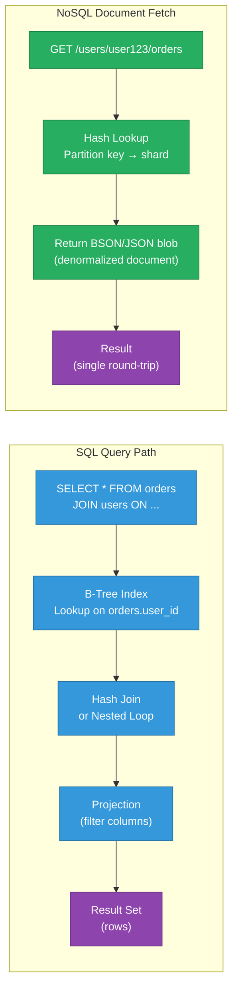

The SQL path is powerful and flexible but involves multiple I/O operations: index scan, join, projection. The NoSQL path avoids joins entirely by storing pre-aggregated data shaped for the query — one key, one fetch.

---

## SQL — Relational Model

SQL databases store data in tables with rows and columns. Relationships between entities are expressed through foreign keys and resolved at query time with JOINs. The schema is defined upfront, changes require migrations, and the query planner optimizes execution automatically.

**Core guarantees (ACID):**

| Property | Meaning | Example |
|---|---|---|
| Atomicity | All operations in a transaction succeed or all roll back | Transfer money: debit + credit both succeed or neither does |
| Consistency | Every transaction moves the database from one valid state to another | Foreign key constraints never violated |
| Isolation | Concurrent transactions do not see each other's intermediate state | Two users booking last seat — one wins, one fails |
| Durability | Committed data survives crashes | WAL written to disk before commit ACK |

**Strengths:**

- Arbitrary query flexibility — the schema is normalized, any query is possible
- Strong consistency and transaction semantics for free
- Battle-hardened query optimizers (PostgreSQL, MySQL, Oracle)
- Rich tooling: ORMs, migration frameworks, GUI tools

**Weaknesses:**

- Vertical scaling only in the simple case (add more CPU/RAM to one machine)
- Schema migrations on large tables can be slow and require careful coordination
- JOINs across billions of rows become expensive without careful denormalization or sharding
- Object-relational impedance mismatch: application objects don't map cleanly to flat rows

---

## NoSQL Categories

### Document Stores

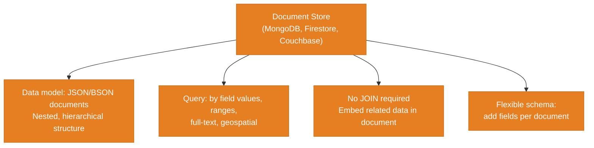

Best for: user profiles, product catalogs, content management — data with hierarchical shape and read-heavy access.

### Key-Value Stores

Data is a flat map: `key → value`. Maximum simplicity, maximum speed. The value is opaque to the database — it could be a string, a blob, or a serialized object.

Best for: sessions, caches, feature flags, rate-limit counters. Examples: Redis, DynamoDB (simple), Memcached.

### Wide-Column (Columnar) Stores

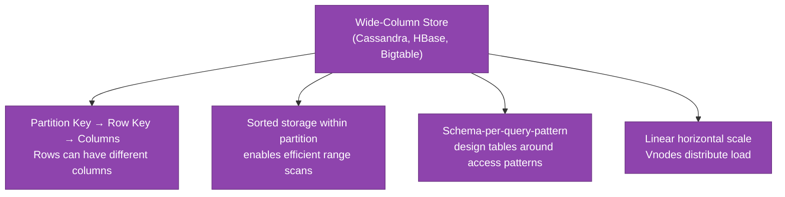

Best for: time-series data, IoT, write-heavy workloads, Netflix viewing history, Uber location events.

### Graph Stores

Store entities as nodes and relationships as edges. Traversal across many hops is fast because the structure reflects the relationship natively — no JOIN explosion.

Best for: social networks, fraud detection, recommendation engines, knowledge graphs. Examples: Neo4j, Amazon Neptune.

---

## Decision Flowchart

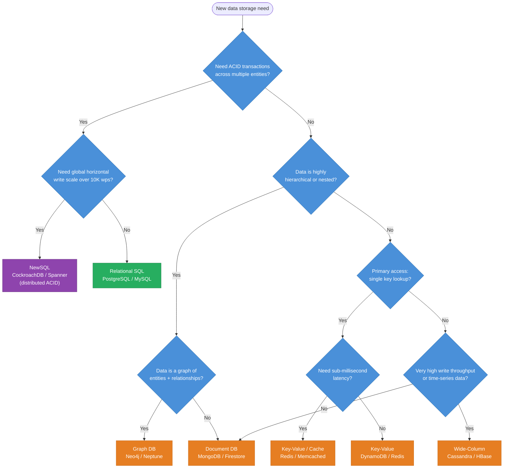

---

## Impedance Mismatch

Impedance mismatch is the friction between how application code represents data (objects, graphs) and how relational databases store it (flat rows, normalized tables).

**Example:** An `Order` object in code has an embedded list of `OrderLines`, which reference `Products`, which have `Categories`. In SQL you need 4-5 tables and a multi-way JOIN to reconstruct one order. An ORM does this automatically but generates N+1 queries if not configured carefully, leading to hundreds of queries per page load.

**NoSQL trades mismatch for write amplification:** A document store lets you embed `OrderLines` inside `Order`, eliminating the JOIN — but if a `Product` name changes, you must update every `Order` document that embeds it.

---

## SQL vs NoSQL Full Comparison Table

| Dimension | SQL (Relational) | Document | Key-Value | Wide-Column | Graph |
|---|---|---|---|---|---|
| Schema | Strict, predefined | Flexible per document | None (opaque value) | Flexible columns per row | Nodes + edge types |
| Consistency | ACID | Varies (document-level) | Varies | Tunable (eventual to quorum) | ACID (Neo4j) |
| Horizontal scale | Hard (sharding is manual) | Built-in (MongoDB Atlas) | Excellent | Excellent (linear) | Limited |
| Query model | SQL — arbitrary JOINs | Query by field, aggregation pipeline | Key lookup only | Partition+row key, range | Graph traversal (Cypher, Gremlin) |
| Read latency | Moderate (index scan + join) | Low (single doc fetch) | Very low (O(1) hash) | Low (sorted partition) | Low for local graph, high for deep traversal |
| Write throughput | Moderate | High | Very high | Very high | Moderate |
| Best for | Transactions, reporting | Nested/hierarchical data | Caches, sessions | Time-series, IoT | Social graphs, fraud detection |
| Examples | PostgreSQL, MySQL, Oracle | MongoDB, Firestore, Couchbase | Redis, DynamoDB, Memcached | Cassandra, HBase, Bigtable | Neo4j, Amazon Neptune |

---

## NewSQL: The Best of Both Worlds?

NewSQL systems attempt to provide SQL semantics with horizontal scalability by replacing the single-node storage engine with a distributed consensus layer (typically Paxos or Raft).

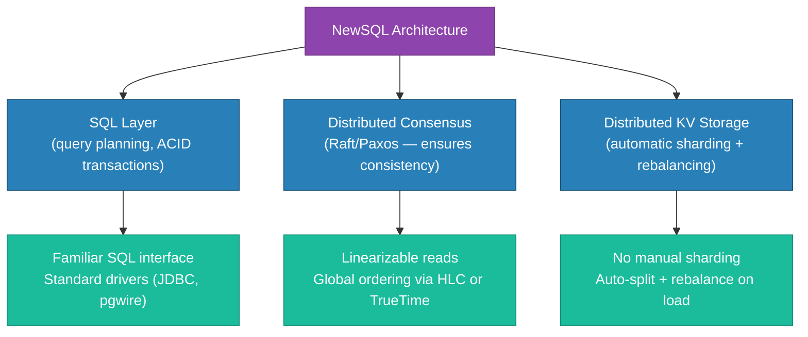

| System | Consensus | Clock | SQL Compatible | Notes |
|---|---|---|---|---|
| CockroachDB | Raft (per range) | Hybrid Logical Clock | PostgreSQL wire protocol | Strong consistency, multi-region |
| Google Spanner | Paxos | TrueTime (GPS/atomic clocks) | Standard SQL | Sub-10ms external consistency |
| YugabyteDB | Raft | Hybrid Logical Clock | PostgreSQL + Cassandra | Open source, multi-model |
| TiDB | Raft (TiKV) | Timestamp Oracle (TSO) | MySQL wire protocol | HTAP — OLTP + OLAP |

**Limitation:** NewSQL is not free. Distributed transactions add latency proportional to cross-shard round-trips. Spanner's 5ms minimum latency per transaction makes it unsuitable for sub-millisecond use cases. Use NewSQL when you need both SQL and scale — but budget for the latency cost.

---

## Real-World Example: Airbnb

Airbnb uses both SQL and NoSQL in their stack, choosing the right tool per concern:

- **MySQL** — payments, bookings, user accounts (ACID required; financial correctness matters more than scale)
- **DynamoDB** — listing search metadata, session state, high-read-throughput data (availability and scale matter; eventual consistency is fine)
- **Elasticsearch** — full-text search over listings (NoSQL, specialized for search)
- **Redis** — rate limiting, caching, real-time availability checks

The lesson: most large systems use *both* SQL and NoSQL for different services. The choice is per-use-case — not a single architectural religion applied to the whole company.

---

## Schema Migrations in Production

SQL schema migrations on large tables are one of the most operationally painful problems in production engineering:

- `ALTER TABLE` on a 500M-row table can lock the table for hours (MySQL)
- Solutions: `pt-online-schema-change` (Percona), `gh-ost` (GitHub), `pg_repack` (PostgreSQL)
- Pattern: add nullable column → backfill in batches → add application logic → add NOT NULL constraint → drop old column
- NoSQL avoids hard migrations but requires application-level schema versioning (read old format + write new format simultaneously during rollout)

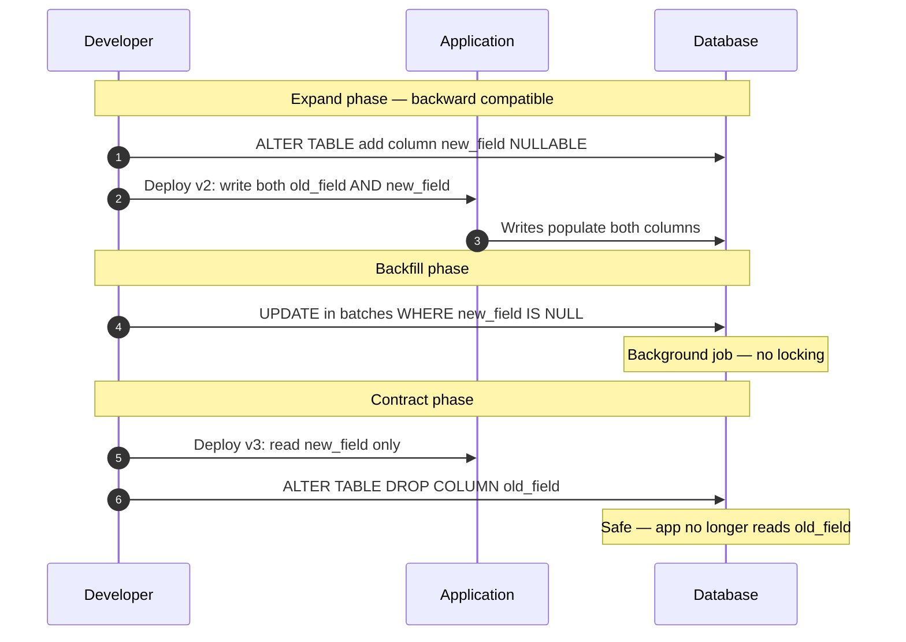

---

## When SQL Wins vs When NoSQL Wins

| Scenario | Winner | Why |
|---|---|---|
| Bank transfer between accounts | SQL | ACID transaction: debit + credit atomically |
| Social media feed (10M posts/day) | NoSQL (wide-column) | Write throughput + denormalized reads |
| E-commerce product catalog | NoSQL (document) | Flexible schema per product type |
| Airline seat reservation | SQL / NewSQL | Prevents double-booking via serializable isolation |
| IoT sensor data (10K events/sec) | NoSQL (wide-column) | Append-heavy, time-ordered, massive volume |
| Fraud detection across transactions | Graph DB | Multi-hop relationship traversal |
| User session storage | NoSQL (key-value) | Simple K/V, TTL, sub-ms latency needed |
| HR reporting with ad-hoc queries | SQL | Unknown query shapes need normalized schema |

---

## Interview Angles

**Q1: Would you use SQL or NoSQL for a social network?**
Both — use a graph database (Neo4j, Neptune) or adjacency-list in Cassandra for the social graph (who follows whom), a wide-column store for posts and feeds (high write throughput, denormalized reads), and SQL for user accounts and payments (ACID required). Twitter uses Manhattan (wide-column) for tweets, MySQL for accounts, Lucene for search.

**Q2: What is impedance mismatch and how do you handle it?**
Impedance mismatch is the disconnect between how objects look in code (nested, graph-shaped) and how they are stored in tables (flat, normalized). Solutions: accept the mismatch and use an ORM carefully (avoid N+1 with eager loading), denormalize into document stores, or design schema around access patterns rather than data relationships. The real answer is that normalized schemas optimize for write correctness while denormalized schemas optimize for read speed — choose based on your read/write ratio.

**Q3: How do you handle schema migrations in production without downtime?**
Use the expand/contract pattern: first expand (add new column nullable, deploy code that writes both old and new column), then backfill old rows in background batches, then contract (drop old column after verification). Tools like `gh-ost` apply MySQL migrations via binlog replication against a shadow table to avoid locking. Always test migrations on a prod-sized dataset — a 10ms schema change on 10K rows takes hours on 100M rows.

**Q4: When would Cassandra be the wrong choice even for high-throughput writes?**
When you need: (a) multi-row atomic transactions — Cassandra has lightweight transactions (LWT) but they are slow and limited; (b) ad-hoc queries with multiple secondary filters — Cassandra requires data to be modeled around query patterns; a query not matching the partition key does a full cluster scan; (c) strong consistency with low latency — using QUORUM adds round-trip latency proportional to network topology.

**Q5: What is the difference between a document store and a wide-column store?**
A document store (MongoDB) stores entire JSON documents addressable by an ID — best for hierarchical, self-contained records. A wide-column store (Cassandra) stores rows with a partition key and clustering key — rows within a partition are physically sorted, enabling efficient range scans. Wide-column stores excel at time-series data (partition=device, clustering=timestamp) where document stores struggle with large embedded arrays that must be updated frequently.

---

## Run the Demo

```sh
docker compose up --build -d && sleep 3 && bash test.sh
```

The demo runs a SQL service (SQLite) on port 8081 and a document service (in-memory store) on port 8082. `test.sh` benchmarks write throughput and query latency for normalized JOIN queries vs denormalized document fetches under identical workload.

**References**

- [Martin Kleppmann — Designing Data-Intensive Applications](https://dataintensive.net/)
- [MongoDB vs PostgreSQL — MongoDB Docs](https://www.mongodb.com/compare/mongodb-postgresql)
- [Cassandra Data Modeling — Apache Docs](https://cassandra.apache.org/doc/latest/cassandra/data_modeling/)
- [CockroachDB Architecture](https://www.cockroachlabs.com/docs/stable/architecture/overview.html)
- [Google Spanner Paper](https://research.google/pubs/pub39966/)

---

## Architecture Diagrams

> Generated from D2 sources in [`docs/diagrams/src/4.2_sql_vs_nosql/`](../../../docs/diagrams/src/4.2_sql_vs_nosql/).
> Regenerate: `just diagrams-topic 4.2_sql_vs_nosql`.

### Overview

Relational tables with foreign keys vs the four NoSQL families — document, key-value, column-family, graph — each with its sweet spot.

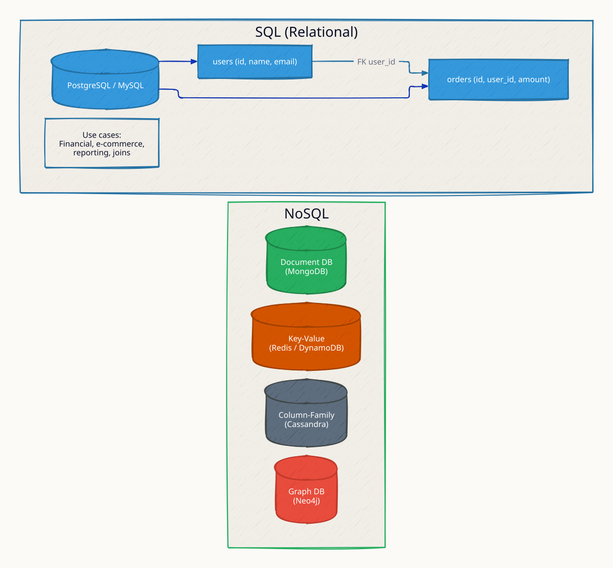

**`join_heavy` scenario:** a multi-table JOIN runs in 10ms on PostgreSQL with indexes while MongoDB's $lookup equivalent crawls — relational wins when relations are the workload.

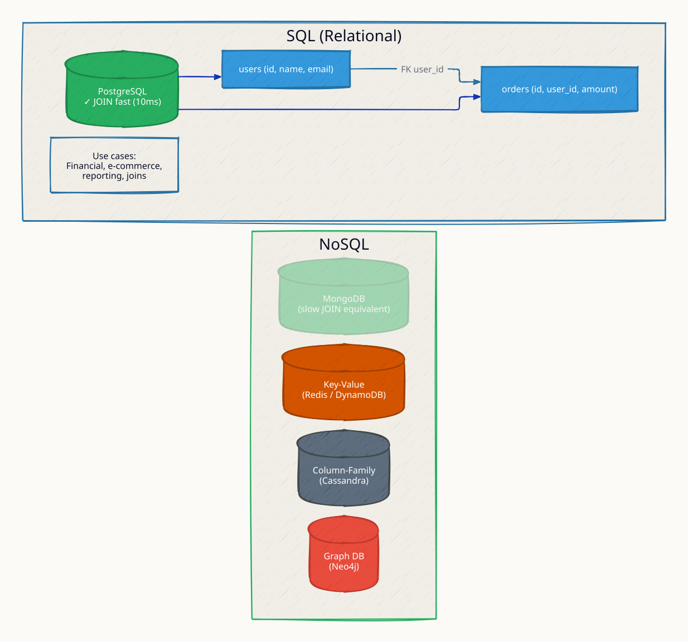

**`schema_flexible` scenario:** MongoDB adds a field with no migration while PostgreSQL faces an ALTER TABLE that can lock 50M rows for minutes.

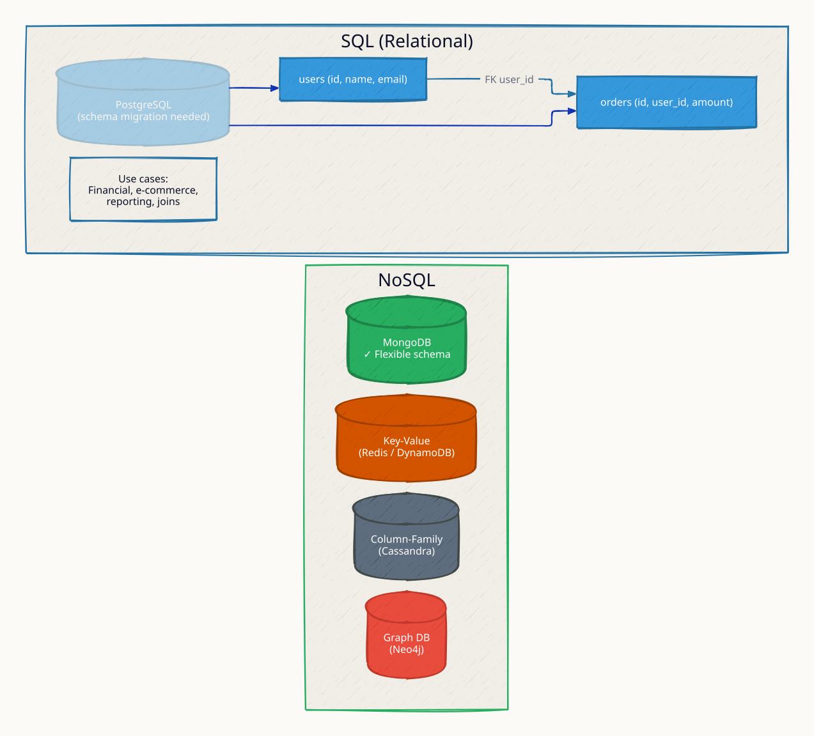

### Request Flow

A decision tree: need ACID? complex JOINs? fixed schema? time-series? Each answer prunes the field.

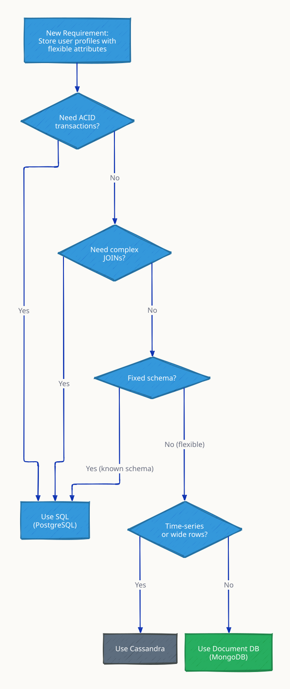

**`acid_payment` scenario:** the bank-transfer case lands on SQL: BEGIN → debit → credit → COMMIT, all-or-nothing.

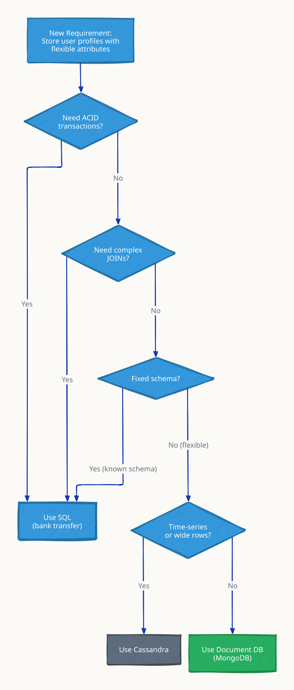
