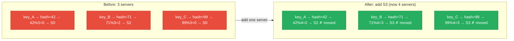
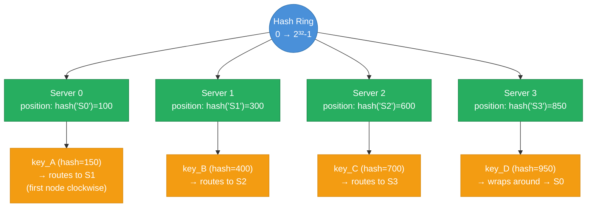
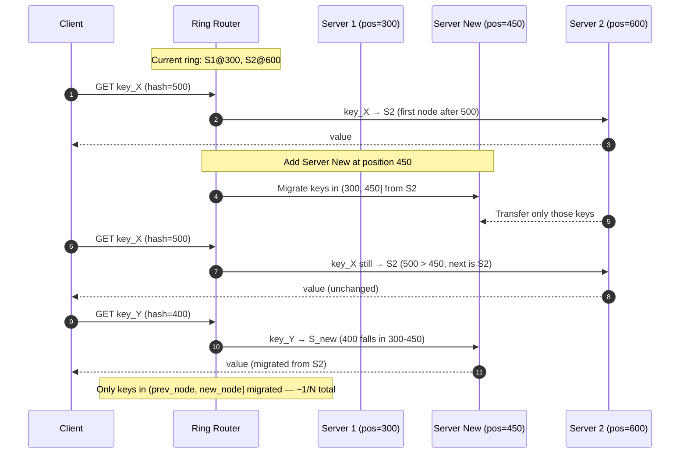
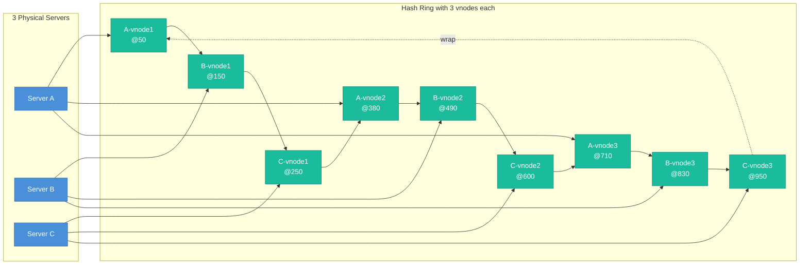
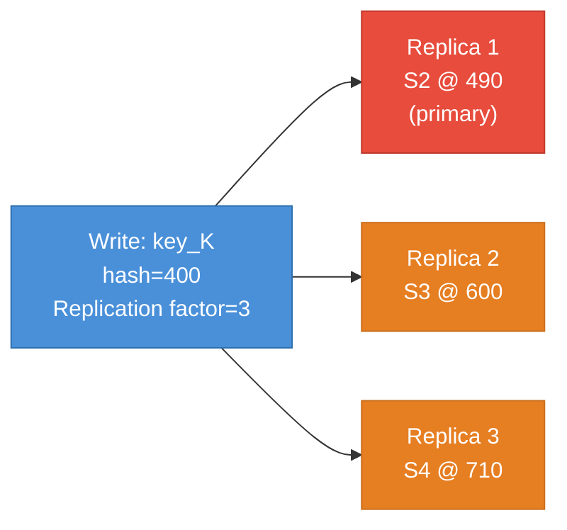
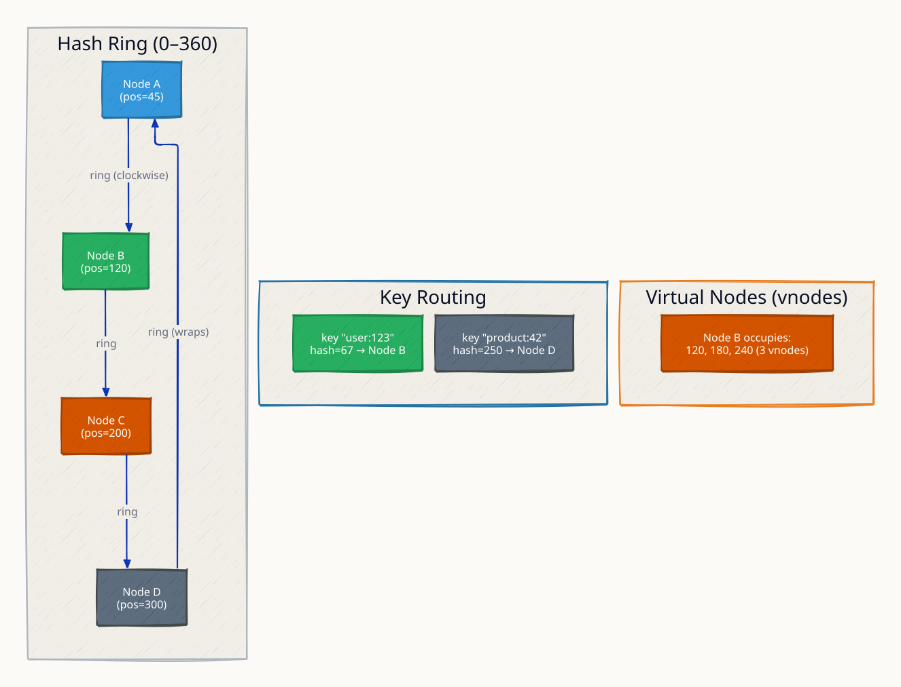
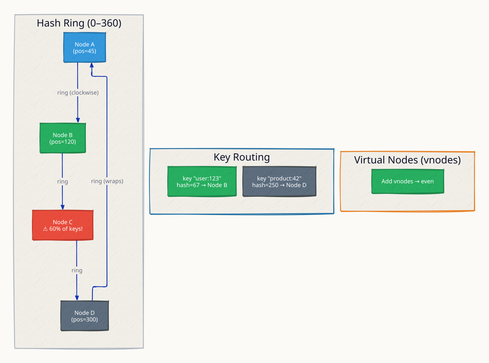
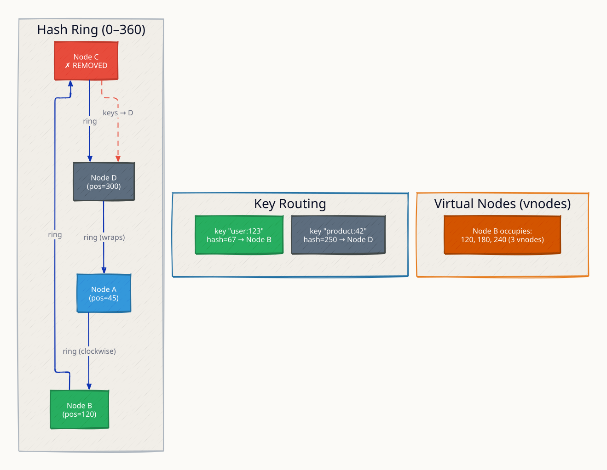
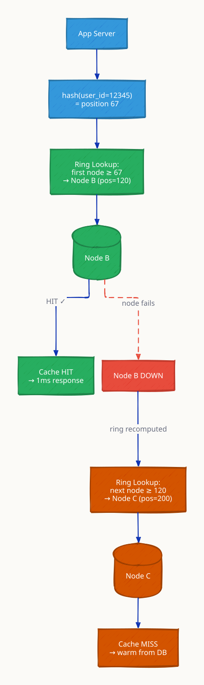
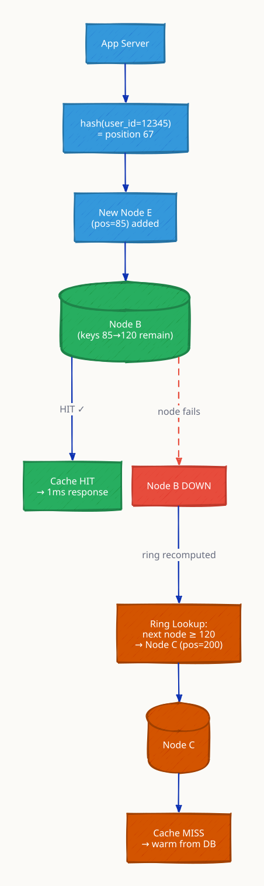

# Consistent Hashing

**When you distribute data across N servers using naive modular hashing (`hash(key) % N`), adding or removing a single server forces almost every key to be remapped — causing a thundering herd of cache misses or data migrations. Consistent hashing solves this by placing both keys and servers on a circular ring: a key routes to the first server clockwise from its hash position. When a server is added or removed, only the keys between the new server and its predecessor need to move — roughly `1/N` of all keys instead of nearly all of them. This property is what makes Cassandra, Amazon Dynamo, and Memcached ketama able to scale horizontally with surgical precision, moving the minimum possible data on every topology change.**

---

## The Problem with Naive Mod-N Hashing



With 3 servers, adding a 4th causes `(N-1)/N` ≈ 75% of all keys to remap. For a cache, this means 75% cache miss rate immediately after a scale-out event — a thundering herd hitting your database.

---

## The Consistent Hash Ring



The ring is conceptually a number line wrapped into a circle, spanning `0` to `2^32 - 1` (or `2^64 - 1` with a 64-bit hash function). Both keys and nodes are mapped onto this space using the same hash function. A key belongs to the first node clockwise from its hash position.

---

## Adding and Removing a Node



When adding a node at position P, only keys in the range `(predecessor(P), P]` need to migrate — from P's successor. All other keys are unaffected. This is the core property that makes consistent hashing efficient for cache invalidation and data rebalancing.

---

## Virtual Nodes (Vnodes)

Without virtual nodes, a ring with 3 physical servers has 3 positions. The arcs between them will be unequal in length, meaning some servers handle far more keys than others. If one server is faster (more RAM, more CPU), it still gets the same share as a weaker node.

**Virtual nodes solve both problems:** each physical server gets V hash positions on the ring. Keys are distributed across V arcs instead of 1, giving a much more uniform distribution.



With V=150 vnodes per server (Cassandra's default), each server owns 150 small arcs spread around the ring. The expected standard deviation of load across servers drops to approximately `1/sqrt(V)` — with 150 vnodes, load variance is under 10%.

---

## Hotspot Problem: Without vs With Vnodes

| Metric | 3 physical nodes (no vnodes) | 3 nodes × 150 vnodes |
|---|---|---|
| Keys per node (expected) | ~33%, but arcs vary wildly | ~33%, uniform via 150 arcs |
| Load std deviation | Up to ±30% | Under ±5% |
| Adding 1 node | Keys from exactly 1 arc reassign | Keys from 150 arcs reassign (but 1/N total) |
| Weighted nodes | Not supported | Powerful node gets more vnodes |
| Failure impact | 1 node's entire key range bursts onto successor | 150 small bursts spread across all survivors |

**Weighted vnodes:** a server with 4x the RAM of others gets 4x the vnodes — it owns 4x more arcs proportionally. Cassandra uses this to handle heterogeneous hardware without manual intervention.

---

## Implementation: Sorted Array + Binary Search

The ring is not literally a circle in memory — it is a sorted array of `(position, node_id)` pairs. Looking up a key's node is a binary search for the first position `>= hash(key)`, wrapping to index 0 if hash is past the last node.

```
ring = sorted array of (position, node)
         [(100, S0), (300, S1), (450, S_new), (600, S2), (850, S3)]

lookup(key):
    h = hash(key)
    i = binary_search(ring, h)     # O(log N)
    if i == len(ring): i = 0       # wrap around
    return ring[i].node
```

With V vnodes per server and N servers, the array has `N * V` entries. Lookup is `O(log(N*V))` — with N=100 servers and V=150 vnodes, that is `log(15000) ≈ 14` comparisons. Practically instantaneous.

---

## Consistent Hashing vs Alternatives

| Approach | Keys remapped on node add | Keys remapped on node remove | Balance | Complexity |
|---|---|---|---|---|
| Mod-N hashing | ~(N-1)/N ≈ 75%+ | ~(N-1)/N | Perfect (if keys are uniform) | Trivial |
| Consistent hashing (no vnodes) | ~1/N | ~1/N | Poor (arc length variance) | Low |
| Consistent hashing (vnodes) | ~1/N | ~1/N | Excellent | Medium |
| Rendezvous hashing | ~1/N | ~1/N | Good | Low |
| Jump consistent hashing | ~1/N | ~1/N | Excellent | Low — no ring needed |

**Rendezvous hashing:** for each key, compute `score(key, node)` for all N nodes and pick the highest. Adding a node only steals keys where the new node scores highest — ~1/N of all keys. No ring needed, but O(N) per lookup (fine for small N).

**Jump consistent hashing (Google):** uses a mathematical formula to jump directly to the assigned bucket in O(ln N) time with zero memory overhead. Limitation: only supports removing the highest-numbered bucket (no arbitrary removal).

---

## Real-World Usage

| System | How It Uses Consistent Hashing | Notes |
|---|---|---|
| Amazon Dynamo | Each item's key hashed onto ring; N replicas on next N nodes | Preference lists skip unhealthy nodes |
| Apache Cassandra | Vnodes (default 256/node in v4+) on Murmur3 ring | Token allocation automatic since v3 |
| Memcached (ketama) | Client-side consistent hashing across cache nodes | `libketama` library |
| Redis Cluster | 16384 hash slots (mod 16384); slots assigned to nodes | Simpler variant — not a ring but equivalent |
| Riak | Ring with configurable Q (ring size, power of 2) | Preference lists for replication |
| Akamai CDN | Consistent hashing for edge cache node selection | Original paper by Karger et al. (1997) |

---

## Replication on the Ring

In Dynamo-style systems, data is replicated across the next N nodes clockwise (the "preference list"). If the replication factor is 3, writing key K places a copy on the first 3 healthy nodes clockwise from `hash(K)`.



With replication factor 3 and 5 nodes, every key has 3 independent copies. The quorum rules (R+W>N) then determine the consistency/availability tradeoff for each read and write.

---

## Interview Angles

**Q1: How many keys need reassignment when you add a node?**
With consistent hashing, only the keys whose hash falls between the new node's position and its predecessor's position need to move — approximately `1/N` of all keys, where N is the number of nodes after the addition. With mod-N hashing, approximately `(N-1)/N` keys must remap. For a 10-node cache cluster, consistent hashing moves ~10% of keys vs ~90% for mod-N.

**Q2: Why do virtual nodes help with load balance?**
Without vnodes, each physical server occupies one arc on the ring. The length of that arc (and thus the number of keys it owns) depends on where its hash lands relative to its neighbors — this is random and uneven. With V vnodes, each server owns V small arcs distributed across the ring. The law of large numbers kicks in: with 150 arcs, the expected deviation from a 1/N share is under 5%. Vnodes also allow weighted allocation — giving more vnodes to more powerful servers.

**Q3: How does Cassandra use consistent hashing?**
Cassandra uses a Murmur3 hash ring. Each node is assigned one or more tokens (positions on the ring), where a token defines the start of the range of keys that node is responsible for. Since Cassandra 3.0, virtual nodes (vnodes) are the default, with 256 tokens per node (configurable). When you add a node, Cassandra automatically calculates which tokens the new node should own to achieve balance and streams the relevant data from existing nodes.

**Q4: What happens to consistent hashing when a node fails suddenly (no graceful removal)?**
The failed node's arc is inherited by its clockwise successor. All keys that were on the failed node become unavailable until either the node recovers or the system has a replication factor > 1. With replication factor 3 (Dynamo/Cassandra), the next 2 nodes already have copies of the data, so reads can still be satisfied from replicas. The coordinator routes to the next healthy replica in the preference list. When the node recovers or is replaced, a repair process re-synchronizes the replicas.

**Q5: What is the difference between Redis Cluster's approach and a true hash ring?**
Redis Cluster uses 16,384 fixed hash slots (`CRC16(key) % 16384`) rather than a continuous ring. Slots are assigned to nodes explicitly (e.g., slots 0-5460 to node A, 5461-10922 to node B, etc.). When scaling, an administrator moves slots between nodes. This is conceptually equivalent to consistent hashing with 16,384 virtual nodes but simpler to reason about and operationally explicit. The tradeoff is that rebalancing requires manual slot reassignment rather than automatic token calculation.

---

## Run the Demo

```sh
docker compose up --build -d && sleep 3 && bash test.sh
```

The demo runs a Go ring router (port 8080) backed by 3 nodes (8081/8082/8083), with 150 vnodes per physical node. `test.sh` sends 1000 key lookups and shows the distribution, then simulates adding a 4th node and measures how many keys remapped.

**References**

- [Karger et al. — Consistent Hashing and Random Trees (1997)](https://dl.acm.org/doi/10.1145/258533.258660)
- [Amazon Dynamo Paper (2007)](https://www.allthingsdistributed.com/files/amazon-dynamo-sosp2007.pdf)
- [Cassandra Virtual Nodes](https://cassandra.apache.org/doc/latest/cassandra/architecture/dynamo.html)
- [Jump Consistent Hash — Lamping & Veach (Google, 2014)](https://arxiv.org/abs/1406.2294)
- [Rendezvous Hashing](https://www.eecs.umich.edu/techreports/cse/96/CSE-TR-316-96.pdf)

---

## Architecture Diagrams

> Generated from D2 sources in [`docs/diagrams/src/4.3_consistent_hashing/`](../../../docs/diagrams/src/4.3_consistent_hashing/).
> Regenerate: `just diagrams-topic 4.3_consistent_hashing`.

### Overview

Keys and nodes on the same hash ring — each key belongs to the first node clockwise, and vnodes smooth the distribution.



**`hotspot` scenario:** too few vnodes leave one physical node owning a fat arc; more vnodes per node flatten the load.



**`node_removed` scenario:** node C leaves and only its keys migrate (~1/N of total) — versus modulo hashing where nearly every key would move.



### Request Flow

A cache cluster losing a node: only that node's arc remaps to its successor; everything else stays put.



**`rebalance` scenario:** a new node joins and claims arcs from several predecessors — incremental, bounded data movement.


