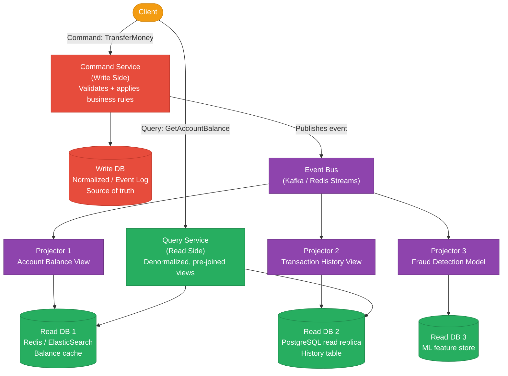
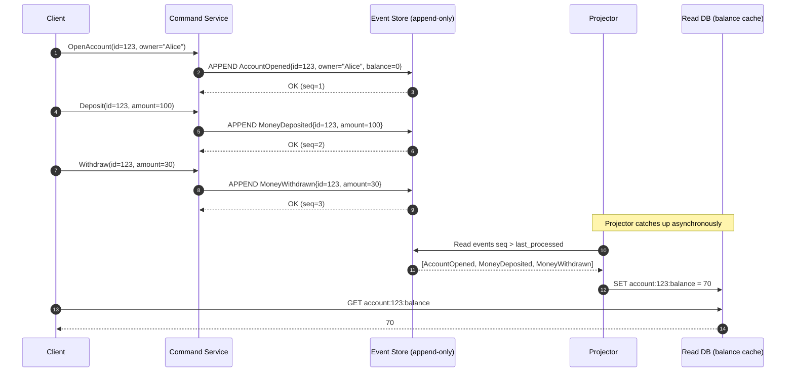
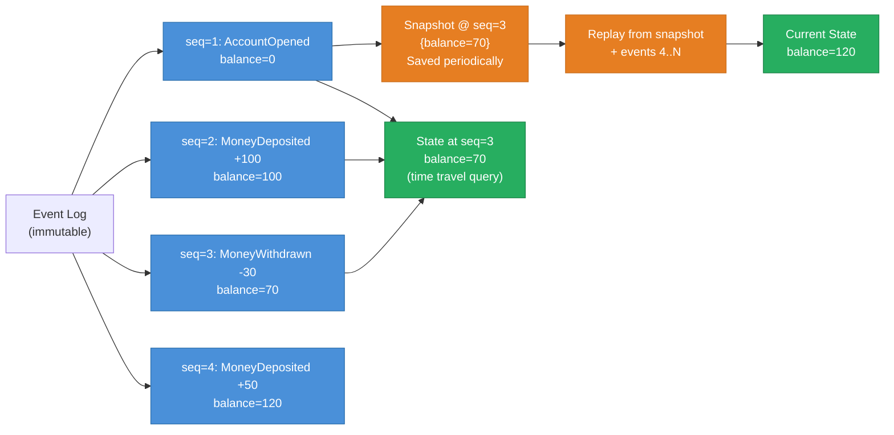
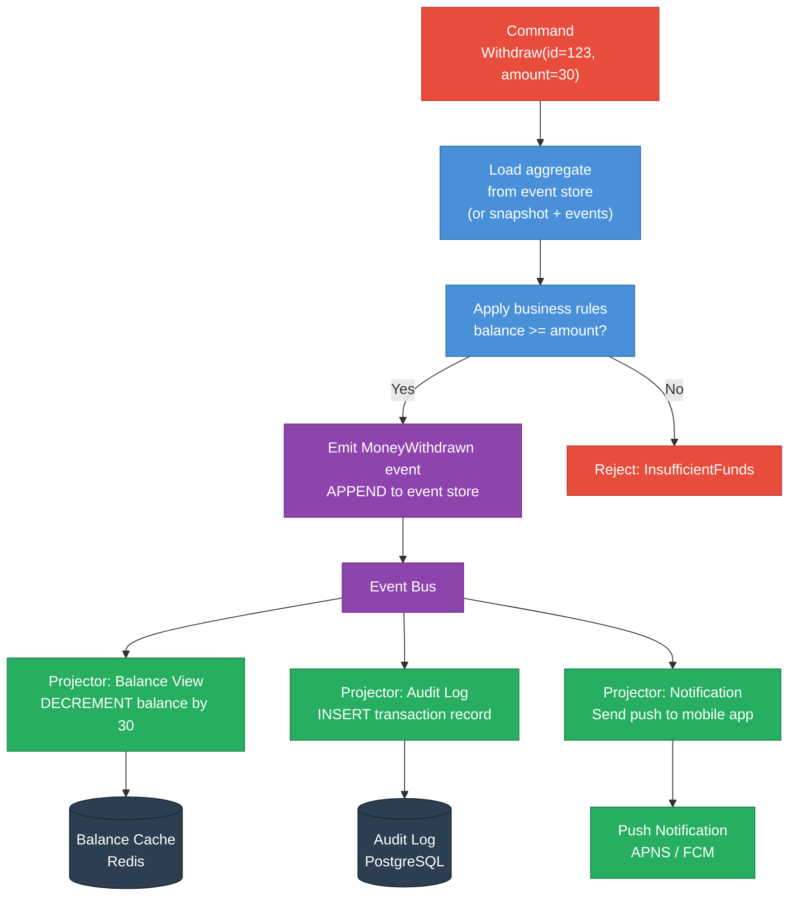
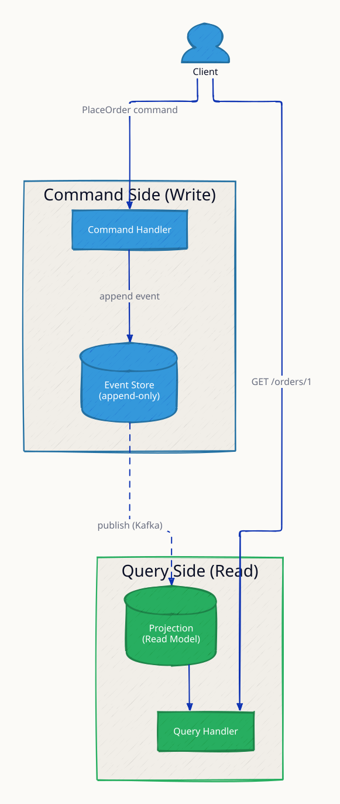
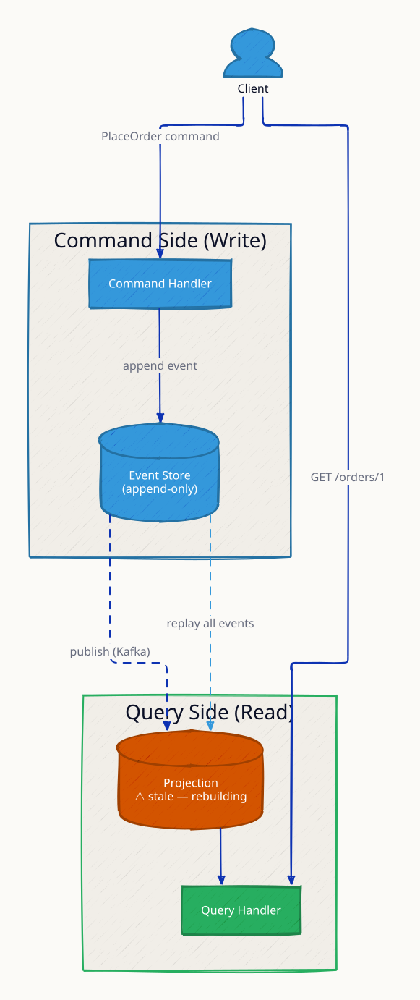
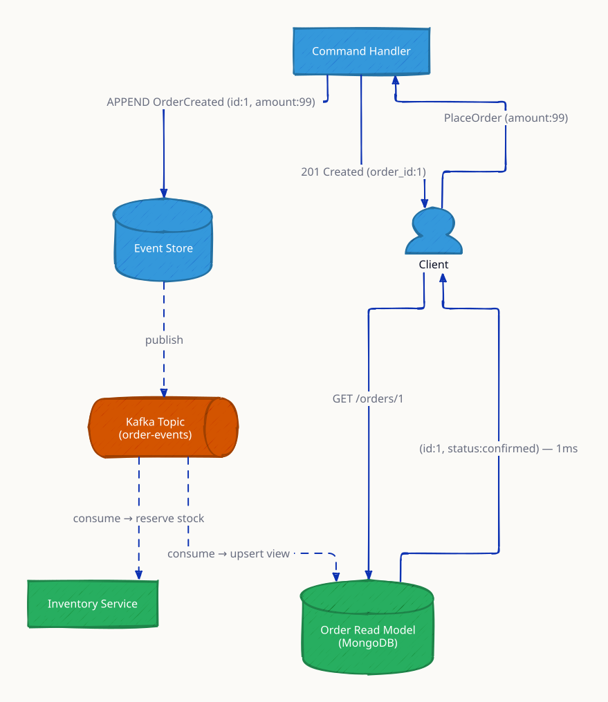
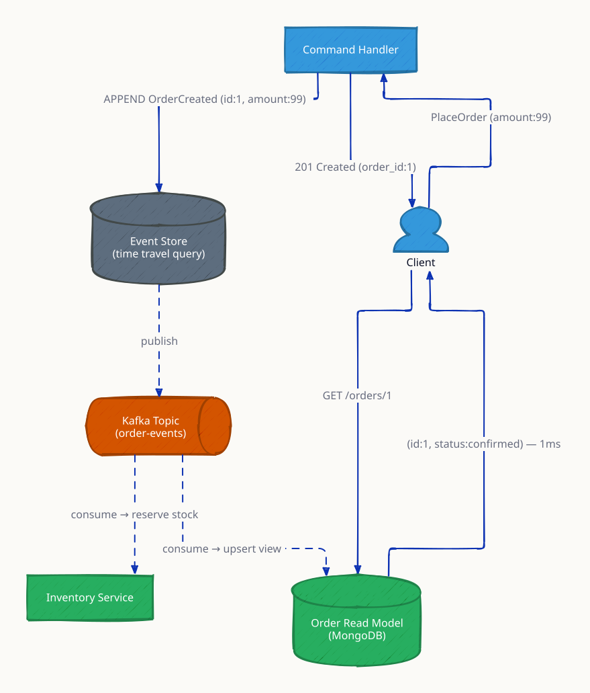

# CQRS & Event Sourcing

**Most applications read data far more than they write it, yet traditional CRUD systems use a single model for both operations — the same schema, the same objects, the same database tables. CQRS (Command Query Responsibility Segregation) breaks this symmetry: commands (writes) go to a write model optimized for correctness and consistency, while queries (reads) go to a separate read model optimized for the shape of the UI or API response. Event Sourcing takes this further: instead of storing the current state, you store an immutable, append-only log of every event that changed state. The current state is derived by replaying the event log. Together, CQRS and Event Sourcing unlock audit trails by default, trivial temporal queries ("what was the balance at 3pm yesterday?"), and the ability to add new read projections retroactively without ever touching stored data.**

---

## CQRS Architecture



The write side focuses exclusively on validating commands and maintaining invariants. The read side is free to denormalize, pre-compute joins, and model data exactly as the UI needs it — often in a completely different database technology. The event bus is the bridge between the two sides.

---

## Event Sourcing: Storing Events, Not State

In traditional CRUD, a bank account table stores the current balance:

```
accounts: id=123, balance=70, updated_at=...
```

The history is gone. You cannot answer "what was the balance on Tuesday?" or "who caused this change?"

With event sourcing, the event log stores everything:

```
events: AccountOpened      { id=123, initial_balance=0 }
events: MoneyDeposited     { id=123, amount=100 }
events: MoneyWithdrawn     { id=123, amount=30 }
```

Current state = replay of all events → balance = 0 + 100 - 30 = **70**.

---

## Event Sourcing Sequence: Bank Account



---

## Rebuilding State from Events

The core power of event sourcing: you can always reconstruct state at any point in time by replaying events up to that moment.



### Snapshots

Replaying 10 million events every time you need the current state is impractical. Snapshots are periodic checkpoints: save the state at event sequence N, then on load replay only events from N+1 onward.

- Snapshot frequency is a tradeoff: more frequent = faster startup, more storage; less frequent = slower startup, less storage
- Snapshots never replace the event log — they are a performance optimization only
- On replay, load the latest snapshot and apply all subsequent events

---

## CQRS + Event Sourcing Together

CQRS and Event Sourcing are independent patterns but complement each other naturally. The event log becomes the write model; projectors consume events to build read models.



---

## Eventual Consistency Between Write and Read Sides

The write side commits an event synchronously. Projectors process events asynchronously — there is a window (typically milliseconds, occasionally seconds under load) where the read side is behind.

| Scenario | Impact | Mitigation |
|---|---|---|
| User deposits and immediately refreshes balance | May see old balance | Use optimistic UI update on write, or read from write side for critical operations |
| Projector crashes mid-batch | Events are not lost — replay from last checkpoint | Track processed event sequence in projector state |
| Projector has a bug and produces wrong read model | Rebuild by replaying all events | Fix bug, drop read table, replay from event store |
| Read side is temporarily unavailable | Write side continues working | Graceful degradation — show cached or error state |

**This is the most common CQRS complaint in practice:** developers expect immediate consistency and are surprised when a just-committed write is not visible in the read model. Solutions: read-your-writes consistency (route immediate reads to the write side or event store), UI optimistic updates, or acknowledge the user's action before projection is complete.

---

## Rebuilding a Read Model After a Bug

This is one of the most powerful properties of event sourcing:

1. Discover that the `balance_view` projector had a bug: it was computing balances incorrectly for multi-currency accounts
2. Fix the projector code
3. Drop (or archive) the `balance_view` read table
4. Restart the projector from event sequence 0
5. The projector replays all historical events with the corrected logic and rebuilds the view correctly
6. No raw data was lost — the event log is the source of truth

With traditional CRUD, step 4 would be "restore from backup and re-apply writes" — which often means data loss.

---

## CQRS + Event Sourcing vs Traditional CRUD

| Dimension | Traditional CRUD | CQRS Only | CQRS + Event Sourcing |
|---|---|---|---|
| Data model | Single model (read + write) | Separate read/write models | Immutable event log as write model |
| Query flexibility | One schema — flexible queries | Read model optimized per query | Multiple read models per query need |
| Audit trail | Manual (add `updated_at`, `updated_by`) | Optional | Built-in — events are the history |
| Time-travel queries | Not possible without backup | Not possible | Replay events up to any point |
| Rebuild bad read model | Impossible (data overwritten) | Recompute if raw data exists | Always possible — replay events |
| Complexity | Low | Medium | High |
| Latency (reads) | Low (direct query) | Very low (pre-computed) | Very low (pre-computed) |
| Latency (writes) | Low (single DB write) | Low | Low (append-only) |
| Learning curve | Low | Medium | High |
| Schema evolution | One migration | Per-model migrations | Must version event schemas |

---

## Schema Evolution of Events

Events are immutable — once written, they cannot change. But your event schema will evolve as the product changes. Strategies:

- **Upcasting:** when loading old events, a transformer upgrades old format to current format in memory (never changes stored events)
- **Versioning:** `MoneyDeposited_v1`, `MoneyDeposited_v2` — projectors handle each version explicitly
- **Weak schema:** use JSON/Protobuf with additive changes only (new fields, never remove/rename required fields)

The hardest case: renaming a core field. Requires reading both old and new field names simultaneously during a migration window.

---

## Use Cases

| Use Case | Why CQRS + ES Fits |
|---|---|
| Financial ledgers | Immutable audit trail required; temporal queries needed |
| Order management | Multiple views needed (status, history, analytics) per order |
| Collaborative editing (Google Docs) | Operations are events; undo = reverse event; conflict resolution via CRDT |
| Inventory management | Every stock change is an event; current stock = sum of events |
| Microservices integration | Events as integration contracts between services (Kafka topics) |
| Gaming leaderboards | Score changes are events; leaderboard = projection of score events |

---

## Pitfalls

- **Projection rebuild cost:** with 5 years of events and 50M events per day, a full replay takes hours. Use snapshots and parallel replay to reduce rebuild time.
- **Eventual consistency complexity:** developers unfamiliar with the pattern will build UIs that assume synchronous consistency. Document and enforce the consistency model.
- **Event schema proliferation:** after 2 years, you may have 200 event types. Use a schema registry (Confluent Schema Registry, AWS Glue) to manage versions.
- **Over-engineering:** CQRS + ES is serious complexity. Use it when the benefits (audit trail, multiple read models, temporal queries) are needed. For a simple CRUD app, it is overkill.
- **Testing projectors:** each projector is a pure function `(state, event) → new_state`. Test by feeding a sequence of events and asserting the final read model state.

---

## Interview Angles

**Q1: How do you rebuild a read model after a bug in the projector?**
Because the event log is immutable and complete, you fix the bug in the projector code, drop the corrupted read table, and replay all events from sequence 0. The projector processes every historical event with the corrected logic and regenerates the view correctly. This is only possible with event sourcing — in traditional CRUD, the state was overwritten and the history is gone.

**Q2: What are the tradeoffs of event sourcing?**
Benefits: complete audit history, time-travel queries, ability to add new projections retroactively, natural fit for async integration. Drawbacks: significantly higher complexity (event schema versioning, eventual consistency between sides, snapshot management), projection rebuild cost at scale, and steep learning curve for teams accustomed to CRUD. Only reach for it when the benefits — especially audit trails or multiple async read models — are genuinely needed.

**Q3: How does CQRS relate to Kafka-based architectures?**
They fit naturally together: the command service appends domain events to Kafka topics (acting as the durable event store or at minimum the event bus). Projector services are Kafka consumer groups that maintain their own offsets and process events to build read models. Kafka's consumer group offsets replace manual "last processed sequence" tracking. If a projector crashes, Kafka replays from the last committed offset. Multi-region architectures can use Kafka MirrorMaker to replicate events, and each region projects its own read models.

**Q4: What is the difference between CQRS and read replicas?**
Read replicas (e.g., PostgreSQL streaming replication) copy the write model verbatim to the replica — same schema, same table structure. Queries on the replica are the same SQL as on the primary. CQRS goes further: the read model is a separate, differently-shaped data store optimized for specific query patterns. A CQRS read model might be a Redis hash (for fast key lookup), an Elasticsearch index (for full-text search), or a pre-aggregated summary table — none of which match the normalized write schema.

**Q5: How do you handle the case where a user expects to see their write immediately?**
Several strategies: (a) read-your-writes — after a command succeeds, route the immediate subsequent read to the write side (event store) rather than the eventually-consistent read model; (b) optimistic UI — update the UI immediately on submit, and reconcile if the server state differs when the projection catches up; (c) command acknowledgment — return the event sequence number to the client, and the client polls the read side until its projected sequence reaches that number; (d) synchronous projection — for critical paths, run the projector in-process synchronously before returning from the command (sacrificing some scalability).

---

## Run the Demo

```sh
docker compose up --build -d && sleep 3 && bash test.sh
```

The demo runs a Redis Streams-based event store (write side) with a projector that materializes account balance views into Redis Hashes (read side). `test.sh` issues a sequence of deposits and withdrawals, verifies the read model balance, then kills the projector and replays from sequence 0 to demonstrate rebuild.

**References**

- [Martin Fowler — CQRS](https://martinfowler.com/bliki/CQRS.html)
- [Martin Fowler — Event Sourcing](https://martinfowler.com/eaaDev/EventSourcing.html)
- [Greg Young — CQRS and Event Sourcing (original talk)](https://www.youtube.com/watch?v=JHGkaShoyNs)
- [Microsoft CQRS Pattern](https://learn.microsoft.com/en-us/azure/architecture/patterns/cqrs)
- [Axon Framework — CQRS/ES in Java](https://docs.axoniq.io/reference-guide/)

---

## Architecture Diagrams

> Generated from D2 sources in [`docs/diagrams/src/4.4_cqrs_event_sourcing/`](../../../docs/diagrams/src/4.4_cqrs_event_sourcing/).
> Regenerate: `just diagrams-topic 4.4_cqrs_event_sourcing`.

### Overview

Writes append immutable events to an event store; Kafka carries them to projections that build denormalized read models — two sides, two optimized shapes.



**`projection_rebuild` scenario:** a bug corrupts the read model, so it is rebuilt by replaying every event from the store — the event log is the source of truth, projections are disposable.



### Request Flow

An order's life as events: PlaceOrder → OrderCreated appended → consumed by inventory and the read-model projector → queried as a single document.



**`temporal_query` scenario:** replaying events up to T-2h reconstructs the system state at that moment — time travel as a query feature, impossible with update-in-place storage.


