# Leader Election

**Many distributed tasks require exactly one coordinator: a primary database accepting writes, a job scheduler firing cron tasks, a lock holder serializing access to a shared resource. Without a leader election protocol, you get two failure modes: no leader (system stalls) or two leaders simultaneously (split-brain — both accept conflicting writes, data diverges irreparably). A correct leader election algorithm guarantees that at any moment at most one node believes it is the leader, and that if the current leader fails, a new one is elected within a bounded time. Getting this right under network partitions, clock skew, and partial failures is hard — which is why production systems universally rely on battle-tested protocols like Raft, Paxos, or ZooKeeper ephemeral nodes rather than home-grown solutions.**

---

## Why Leader Election Matters

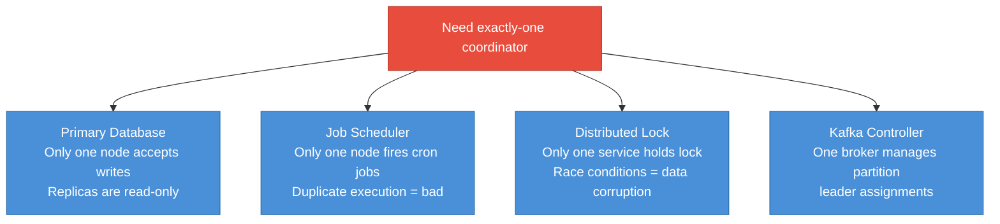

---

## Split-Brain: The Core Problem

Split-brain occurs when two nodes simultaneously believe they are the leader — typically after a network partition that heals asymmetrically. Both leaders accept writes. When connectivity is restored, the data has diverged and there is no ground truth.

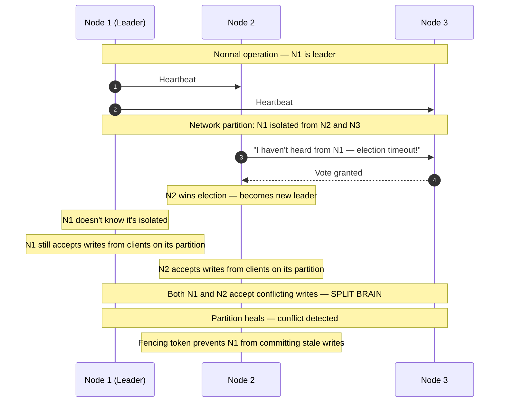

The solution is not just electing a new leader — it is ensuring the old leader cannot act after losing leadership. This is the job of fencing tokens.

---

## Raft Leader Election

Raft is a consensus algorithm designed to be understandable. Every node is in one of three states: follower, candidate, or leader. Time is divided into terms — monotonically increasing integers that act as logical clocks.

```mermaid
flowchart TD
    Follower["Follower\nPassively receives\nheartbeats + log entries"]
    Candidate["Candidate\nSoliciting votes\nfrom other nodes"]
    Leader["Leader\nSends heartbeats\nAppends to log"]

    Follower -->|Election timeout fires\n(no heartbeat from leader)| Candidate
    Candidate -->|Receives majority votes| Leader
    Candidate -->|Discovers higher term\nor another leader| Follower
    Leader -->|Discovers higher term| Follower

    classDef follower fill:#4A90D9,stroke:#2C6FAC,color:#fff
    classDef candidate fill:#E67E22,stroke:#CA6F1E,color:#fff
    classDef leader fill:#27AE60,stroke:#1E8449,color:#fff

    class Follower follower
    class Candidate candidate
    class Leader leader
```

### Raft Election Step-by-Step

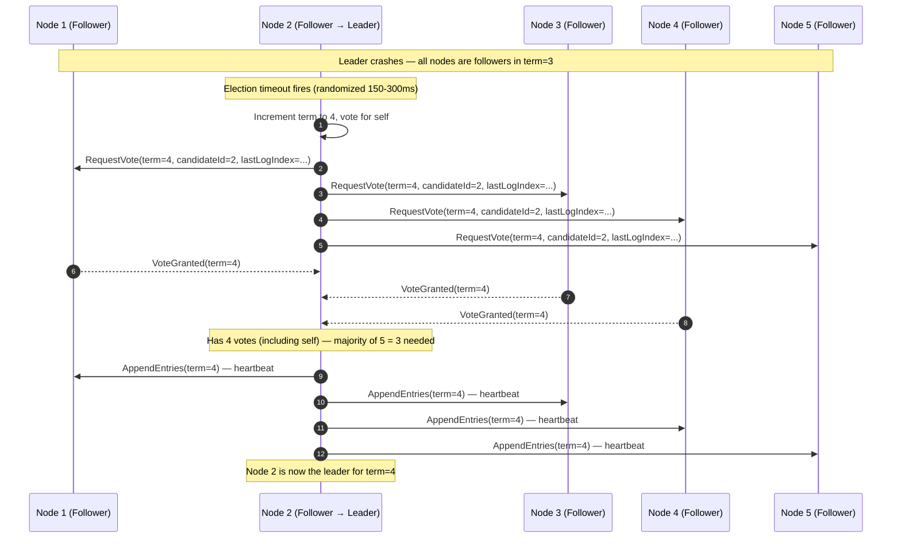

**Key Raft guarantees:**

- **Election safety:** at most one leader per term (majority vote ensures uniqueness)
- **Leader completeness:** a leader has all committed log entries from previous terms (only nodes with up-to-date logs can be elected)
- **Log matching:** if two logs have the same index and term, all entries up to that index are identical

---

## Fencing Tokens: Preventing Stale Leaders from Acting

A fencing token is a monotonically increasing number issued with every leadership grant. Every write to a shared resource must include the fencing token. The resource (database, lock service) rejects writes with a token lower than the highest it has seen.

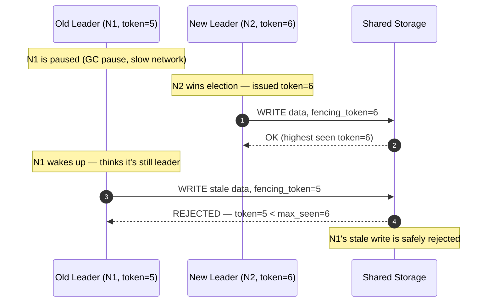

Without fencing tokens, a paused GC (a JVM pause of several seconds is real) could cause an old leader to write after a new leader has taken over. The write would succeed, overwriting the new leader's data — silent data corruption.

---

## 5-Node Raft Cluster with Heartbeats

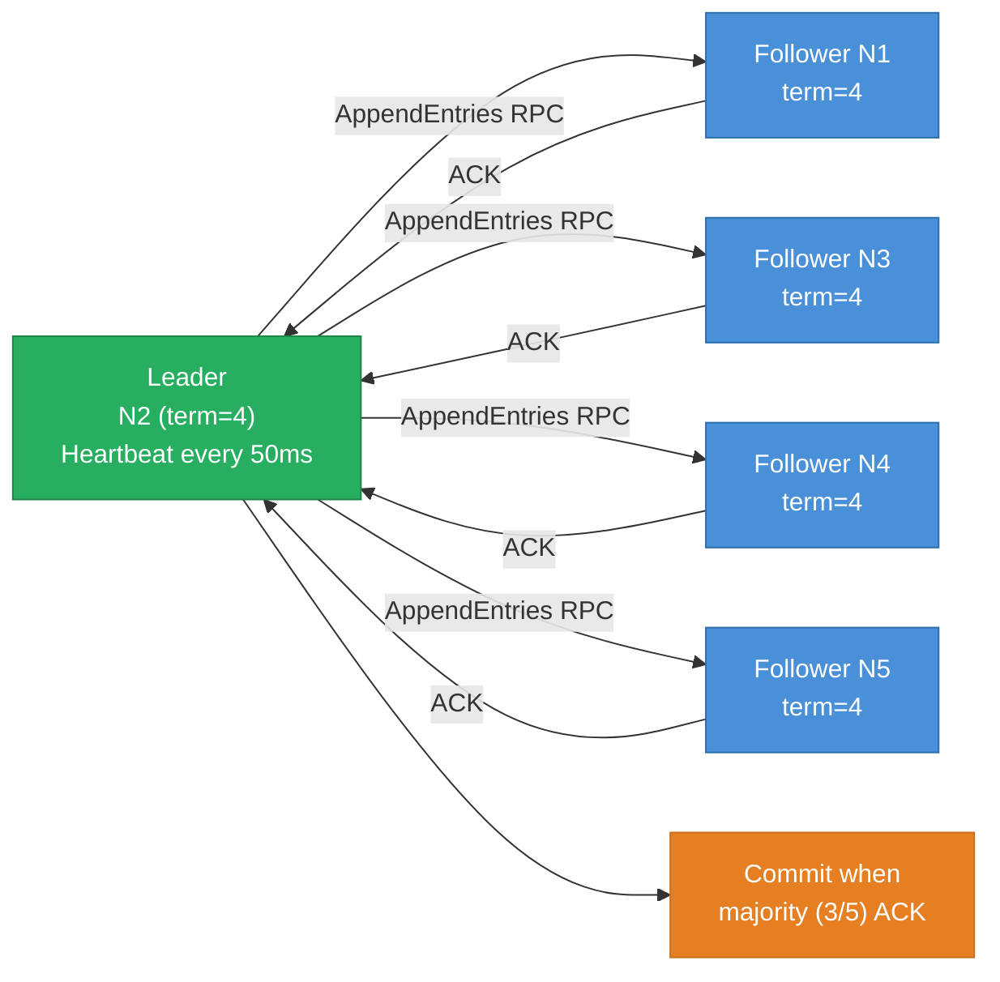

The leader sends heartbeats (empty `AppendEntries` RPCs) every 50ms. If a follower doesn't receive a heartbeat within its election timeout (150-300ms, randomized), it starts an election. The randomized timeout ensures only one node typically starts an election at a time, avoiding vote splitting.

---

## ZooKeeper Ephemeral Znodes

ZooKeeper provides a simple and widely-used mechanism for leader election using ephemeral sequential znodes:

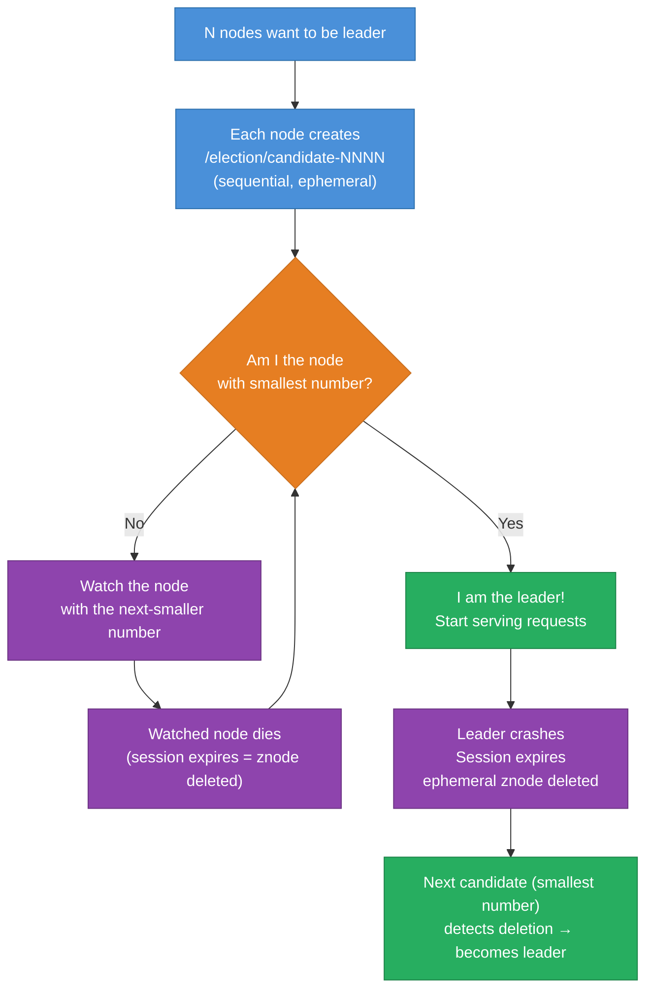

**Ephemeral znode:** exists only as long as the ZooKeeper session is alive. If the node crashes (or network isolates it), its session times out, the znode disappears, and the next node in line detects the deletion via a watch and claims leadership.

**Why watch the previous node, not /leader directly?** The "herd effect" — if all N nodes watch the same `/leader` znode, when it disappears all N nodes are notified simultaneously, causing a thundering herd of election attempts. Watching the previous sequential node means only one node is notified on each deletion.

---

## Lease-Based Leadership

A simpler mechanism: one node acquires a lease — a time-bounded lock — by writing to a shared store (etcd, Redis, database). The leader must renew the lease every T seconds. If renewal fails, the lease expires and other nodes can acquire it.

```mermaid
flowchart LR
    LNode["Leader Node"] -->|WRITE leader=N1, expires=now+10s| Store[("Shared Store\netcd / Redis")]
    LNode -->|Renew every 5s| Store
    Store -->|OK| LNode

    OtherNode["Other Nodes"] -->|Poll: is lease expired?| Store
    Store -->|Lease expired!| OtherNode
    OtherNode -->|WRITE leader=N2, expires=now+10s\n(CAS: only if old leader's token expired)| Store

    classDef leader fill:#27AE60,stroke:#1E8449,color:#fff
    classDef store fill:#2C3E50,stroke:#1A252F,color:#fff
    classDef other fill:#4A90D9,stroke:#2C6FAC,color:#fff

    class LNode leader
    class Store store
    class OtherNode other
```

**Tradeoff:** if the leader pauses (GC, slow disk), it may fail to renew, causing a spurious re-election. But with a fencing token (the lease's revision number), the old leader's stale writes are rejected by the storage even if it woke up and tried to write after losing the lease.

---

## etcd vs ZooKeeper vs Consul vs Raft-Native

| Feature | etcd | ZooKeeper | Consul | Raft-Native (in-process) |
|---|---|---|---|---|
| Consensus | Raft | ZAB (similar to Paxos) | Raft | Raft (e.g., Hashicorp Raft) |
| API | HTTP/gRPC (key-value) | Custom TCP (znodes) | HTTP/gRPC | Embedded library |
| Watch mechanism | Watch on key changes | Watch on znode changes | Watch + blocking queries | N/A (in-process) |
| TTL / lease | Yes (lease expiry) | Ephemeral session | Yes (session TTL) | Application-managed |
| Fencing token | Revision number (monotonic) | `cversion` / `version` | Modify index | Application-managed |
| Deployment | 3-5 node cluster | 3-5 node ensemble | 3-5 server agents | Embedded in your app |
| Used by | Kubernetes, etcd-operator | HBase, Kafka (older), Hadoop | HashiCorp stack | CockroachDB, TiKV |

---

## Single-Region vs Multi-Region Leader Election

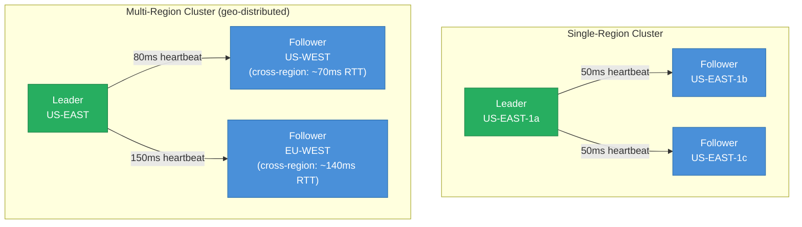

| Concern | Single-Region | Multi-Region |
|---|---|---|
| Heartbeat latency | <5ms intra-AZ, <10ms cross-AZ | 70-150ms cross-region |
| Election timeout | 150-300ms | Must be >2× max RTT — often 1-3 seconds |
| Quorum latency | <10ms | 70-150ms per commit (writes must wait for cross-region ACK) |
| Split-brain risk | Low (fast detection) | Higher (slow heartbeats increase false-positive election timeouts) |
| Write latency | <10ms | 70-150ms (limited by speed of light) |
| Strategy | Raft default settings work well | Flexible quorum (prefer local region), leader pinned to region with most writes |

**Google Spanner's approach:** pins the leader to the region with the most write traffic. Uses TrueTime to avoid requiring cross-region reads for linearizability. Paxos group spans regions but leadership is stable under normal operation.

---

## Generation Numbers / Epoch Numbers

Every leadership grant is tagged with a monotonically increasing generation (epoch) number. This number is included in every write. Storage nodes reject any write whose epoch is lower than the highest they have seen.

```mermaid
flowchart LR
    E1["Epoch 1\nLeader: N1"] -->|N1 pauses| E2["Epoch 2\nLeader: N2"]
    E2 -->|N1 wakes up\n(thinks epoch=1)| Fence["Storage: REJECT\nEpoch 1 < max(2)"]
    E2 -->|N2 writes\n(epoch=2)| Accept["Storage: ACCEPT\nEpoch 2 = max(2)"]

    classDef epoch fill:#8E44AD,stroke:#6C3483,color:#fff
    classDef accept fill:#27AE60,stroke:#1E8449,color:#fff
    classDef reject fill:#E74C3C,stroke:#C0392B,color:#fff

    class E1,E2 epoch
    class Accept accept
    class Fence reject
```

Epoch numbers (sometimes called generation numbers, ballot numbers, or fencing tokens depending on the system) are the primary defense against split-brain data corruption. They are used in:

- Raft (term number)
- ZooKeeper (zxid + epoch)
- etcd (revision number per key)
- Database primary election (MySQL GTID, PostgreSQL timeline ID)
- Distributed locks (Redis SET NX return value or Redlock version)

---

## Interview Angles

**Q1: What is split-brain and how do you prevent it?**
Split-brain is when two nodes simultaneously believe they are the leader — typically after a network partition that heals asymmetrically. Both accept writes, data diverges, and there is no way to reconcile without business logic. Prevention has two layers: first, use a majority quorum for elections (a node can only become leader if it has heard from >50% of nodes — two leaders cannot both have a majority); second, use fencing tokens so that even if a stale leader wakes up and tries to write, the storage layer rejects its token as outdated.

**Q2: Explain Raft leader election.**
When a follower does not hear a heartbeat from the leader within its election timeout (randomized 150-300ms), it increments its term number, transitions to candidate, votes for itself, and sends `RequestVote` RPCs to all other nodes. A node grants a vote if the candidate's term is higher than its own and the candidate's log is at least as up-to-date. The first candidate to receive a majority of votes (>N/2) becomes the leader for that term and immediately starts sending heartbeats. If no candidate wins (split vote), the term expires and a new election begins. Randomized timeouts make split votes rare.

**Q3: How do fencing tokens prevent double-leader issues?**
A fencing token is a monotonically increasing number issued each time a leader is elected (equivalent to Raft's term number). Every write the leader makes to shared storage must include its fencing token. Storage nodes track the highest token they have processed and reject any write with a lower token. If an old leader wakes up from a GC pause after a new leader has been elected, its token is lower than the new leader's — its writes are rejected, preventing data corruption even though the old leader thinks it is still authoritative.

**Q4: What is the difference between ZooKeeper ephemeral znodes and etcd leases for leader election?**
Both provide the same underlying guarantee: when the leader process dies or loses connectivity, its claim to leadership is automatically revoked by the coordination service. ZooKeeper uses ephemeral sequential znodes — each candidate creates `/election/candidate-N`, and the one with the smallest N is leader; a watch on the preceding node ensures only one node is notified per failure (avoiding herd effect). etcd uses leases: the leader creates a key with a TTL-bound lease and must call `KeepAlive` periodically; if it fails, the lease expires and the key is deleted. etcd's gRPC API is generally considered simpler and more cloud-native; ZooKeeper has more ecosystem support (HBase, older Kafka).

**Q5: How does multi-region leader election differ from single-region, and what are the latency implications?**
In a single-region cluster, nodes are 5-10ms apart. Heartbeat intervals of 50ms and election timeouts of 150-300ms work well. In a multi-region cluster, cross-region RTT is 70-150ms. Election timeouts must be set well above the maximum cross-region RTT to avoid spurious elections — typically 1-3 seconds. More critically, every committed write in Raft requires acknowledgment from a quorum, which means if the quorum includes nodes in another region, write latency is bounded by cross-region RTT. Solutions: configure quorum groups to prefer a single region for writes (Raft flexible quorum), pin the leader to the write-heavy region, or accept the latency as the cost of multi-region durability.

---

## Run the Demo

```sh
docker compose up --build -d && sleep 3 && bash test.sh
```

The demo runs 3 nodes competing for a Redis-based lease (SET NX PX 5000). One node wins and becomes leader; the others poll every 500ms. `test.sh` kills the leader container and verifies a new leader is elected within the TTL window (5 seconds), demonstrating automatic failover.

**References**

- [Raft Paper — In Search of an Understandable Consensus Algorithm](https://raft.github.io/raft.pdf)
- [Raft Visualization](https://raft.github.io/)
- [ZooKeeper Leader Election Recipe](https://zookeeper.apache.org/doc/current/recipes.html#sc_leaderElection)
- [etcd Leader Election](https://etcd.io/docs/v3.5/dev-guide/api_concurrency_reference_v3/)
- [Martin Kleppmann — How to do distributed locking](https://martin.kleppmann.com/2016/02/08/how-to-do-distributed-locking.html)
- [Fencing Tokens — Designing Data-Intensive Applications](https://dataintensive.net/)

---

## Architecture Diagrams

> Generated from D2 sources in [`docs/diagrams/src/4.5_leader_election/`](../../../docs/diagrams/src/4.5_leader_election/).
> Regenerate: `just diagrams-topic 4.5_leader_election`.

### Overview

A 5-node Raft cluster in steady state: the leader heartbeats followers, and silence is what triggers elections.

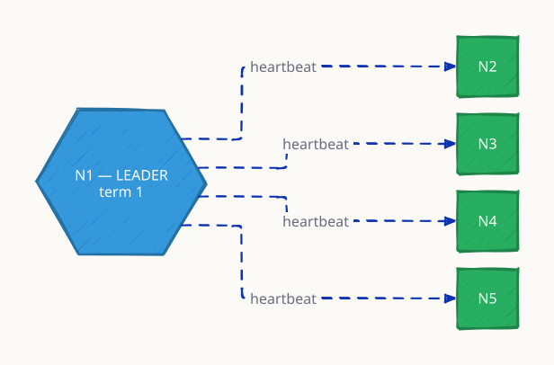

**`leader_crash` scenario:** heartbeats stop, a follower's election timer fires first, and it wins a majority — leadership transfers in roughly one timeout period.

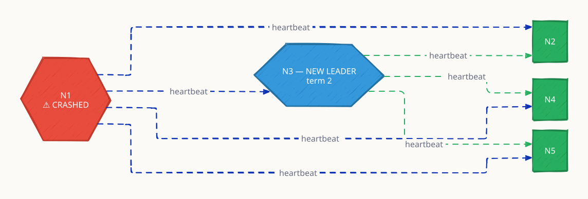

### Request Flow

A full election: leader crashes → timers fire → Node 3 becomes candidate (term=2) → gathers 3/5 votes → leads.

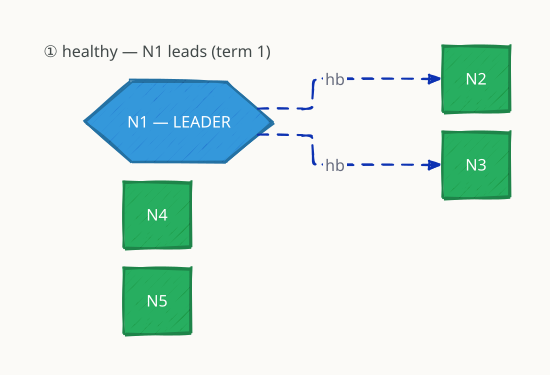

*Animated walkthrough (4s per frame, one change per frame): [`request-flow.gif`](../../../docs/diagrams/gif/4.5_leader_election/request-flow.gif)*

1. healthy (term 1) → 2. N1 crashes → 3. N3 candidate (term 2) → 4. quorum 3/5 → 5. N3 leads


**partition diagram:** the majority side (3 of 5) elects and makes progress; the minority (2 of 5) cannot reach quorum and accepts no writes — quorum is what prevents split-brain.

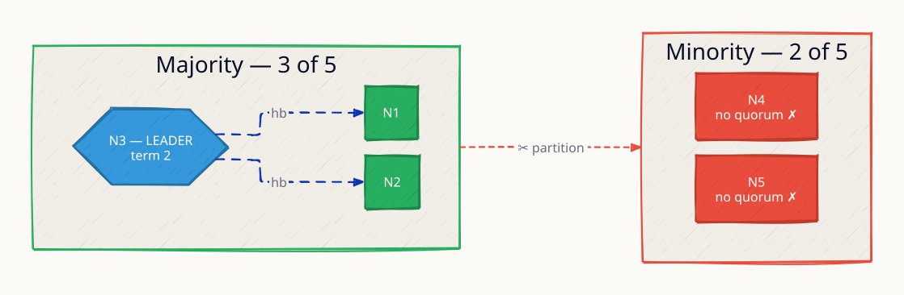
