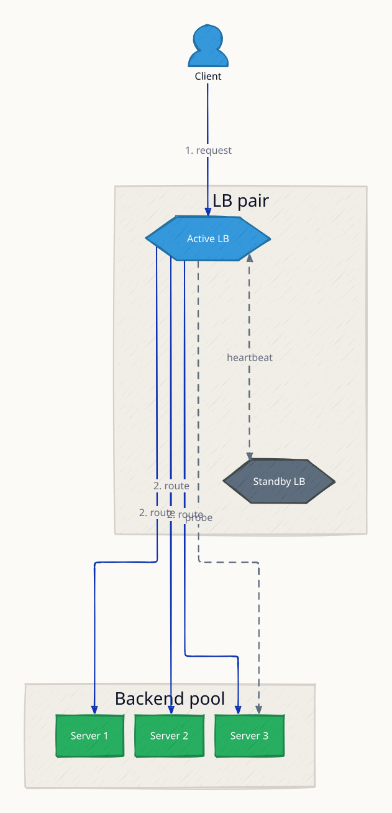
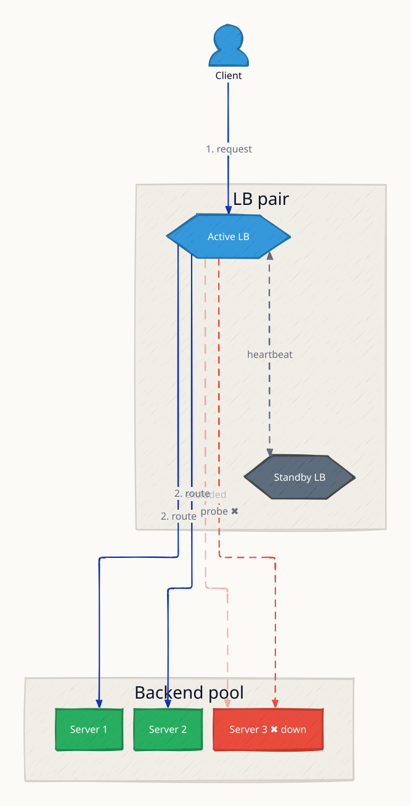
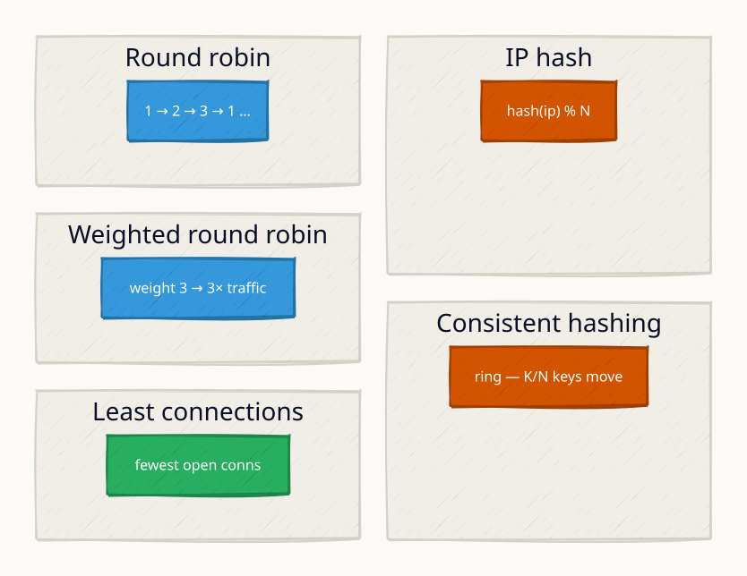
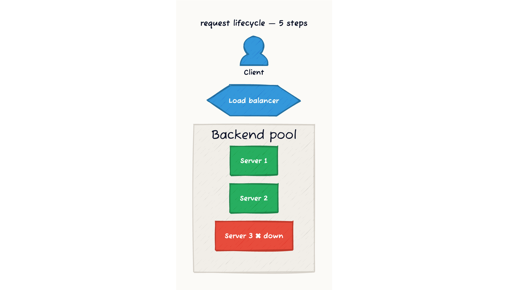
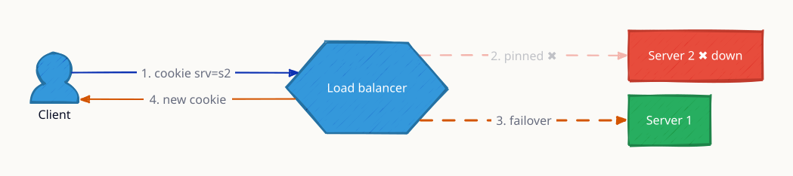

# Load Balancing

A load balancer sits in front of a pool of servers and distributes incoming requests across them so no single node becomes a bottleneck. Beyond spreading traffic, it provides health checking (automatically removing unhealthy servers from rotation), SSL termination, sticky sessions for stateful apps, and a single entry point that hides backend topology. At scale — think Netflix serving 700k+ concurrent streams or AWS ELB handling millions of RPS — load balancing is the mechanism that turns a cluster of commodity machines into a fault-tolerant, horizontally-scalable service.

> **Diagrams** generated from [`docs/diagrams/src/2.1_load_balancer/`](../../../docs/diagrams/src/2.1_load_balancer/).
> Regenerate: `just diagrams-topic 2.1_load_balancer` (requires `d2`, `brew install d2`).

---

## Architecture Overview

The active LB holds the VIP, terminates TLS, and routes requests to the backend pool. The health checker runs continuously — probing each server every 10 s and removing failed nodes from the routing table. The standby LB claims the VIP via VRRP within ~1 s if the active goes silent.



**Failure scenario:** Server 3 fails three consecutive probes — the LB removes it from the routing table and redirects its share of traffic to the remaining healthy servers.



---

## L4 vs L7 Load Balancing

| Dimension | L4 (Transport) | L7 (Application) |
|---|---|---|
| Inspects | IP + port only | HTTP headers, URL, cookies, body |
| Latency | Lower (no parsing) | Slightly higher |
| SSL termination | Pass-through or terminate | Terminate and re-encrypt |
| Routing granularity | Per-connection | Per-request |
| Typical tools | AWS NLB, HAProxy TCP mode | AWS ALB, Nginx, Envoy |
| Use case | TCP services, databases | HTTP microservices, gRPC |

**L4** operates at the transport layer — it sees only IP addresses and ports and forwards raw TCP/UDP segments. No HTTP inspection means lower CPU overhead.

**L7** terminates the connection, parses the HTTP/gRPC request, and can route based on URL path, headers, or cookies — enabling content-based routing, auth checks, and request transformation at the edge.

---

## Load Balancing Algorithms

Each algorithm makes a different trade-off between simplicity, load accuracy, and stickiness. Choose based on your request profile and whether backend servers are homogeneous.



### Algorithm Comparison

| Algorithm | Distribution | Sticky? | Best For | Weakness |
|---|---|---|---|---|
| Round Robin | Equal | No | Homogeneous servers | Ignores actual load |
| Weighted Round Robin | Proportional | No | Mixed-capacity fleet | Weight must be tuned |
| Least Connections | Load-aware | No | Long-lived / variable requests | State sync overhead in distributed LB |
| IP Hash | Deterministic | Yes (by IP) | Sessions without cookies | NAT collapses many users to 1 IP |
| Consistent Hashing | Even on ring | Yes (by key) | Cache sharding, stateful services | Slight hot-spot if vnodes are few |
| Random | Equal (probabilistic) | No | Simple, stateless | No guarantee of balance |

---

## Request Flow — Lifecycle and Sticky Session Failover

The animated diagram walks through the full lifecycle of a request:
1. Client hits the LB (TLS terminated here)
2. LB checks the routing table — Server 3 is excluded (failed probes)
3. LB selects Server 1 via round-robin
4. Server processes and returns a response
5. LB forwards response to client



*Final state: [`request-flow/5.svg`](../../../docs/diagrams/svg/2.1_load_balancer/request-flow/5.svg)*

**Sticky-session failover:** when a cookie-pinned server goes down, the LB must reassign — session state on the downed server is lost unless externalized to Redis.



**Takeaway:** Sticky sessions trade statefulness for availability. If the pinned server dies, session state is lost unless it is externalized to a shared store (Redis, Memcached).

---

## Health Checks

The animated diagram walks the probe cycle:
1. Server healthy — receiving traffic
2. Probe fires every 10 s
3. Third consecutive probe fails
4. Removed from rotation — retry probes continue
5. Probe passes — back in rotation


*Static state machine: [`health-checks/index.svg`](../../../docs/diagrams/svg/2.1_load_balancer/health-checks/index.svg)*

| Check Type | How it works | Pros | Cons |
|---|---|---|---|
| TCP connect | LB opens TCP socket | Fast, any service | Does not verify app logic |
| HTTP GET /health | LB checks status code | App-aware | Slightly more overhead |
| gRPC health protocol | Uses `grpc.health.v1` | Native for gRPC | Requires app support |
| Custom script | External probe (e.g. Redis PING) | Flexible | Complex setup |

**Slow-start on recovery:** When a server comes back online, ramping its weight from 0 to full over 30–60 s avoids the thundering-herd spike that occurs when a cold server instantly receives its full traffic share.

---

## Trade-offs & When to Use

| Scenario | Recommended Approach |
|---|---|
| Stateless HTTP microservices | L7 LB (ALB / Nginx) with round-robin or least-conn |
| Database read replicas | L4 LB (NLB / HAProxy) to avoid SSL overhead |
| Shopping cart / session apps | Consistent hashing or cookie-based sticky sessions |
| Multi-region active-active | GeoDNS + regional L7 LBs |
| WebSocket / gRPC long connections | L7 LB with connection-level persistence |
| High-throughput, low-latency UDP | L4 (DPDK-based) — e.g. gaming, VoIP |

---

## Real-World Examples

| Provider | Product | Layer | Notes |
|---|---|---|---|
| AWS | Application Load Balancer (ALB) | L7 | Path/host routing, WAF integration, gRPC |
| AWS | Network Load Balancer (NLB) | L4 | Millions RPS, static IP, ultra-low latency |
| Google Cloud | Cloud Load Balancing | L4/L7 | Global anycast, no pre-warming needed |
| Nginx | nginx upstream | L7 | Open-source, widely used as edge/sidecar |
| HAProxy | HAProxy | L4/L7 | Battle-tested, very high connection count |
| Envoy | Envoy Proxy | L7 | Service mesh (Istio), observability built-in |
| Cloudflare | Cloudflare LB | L7 | Health checks + GeoDNS + DDoS protection |

---

## Interview Angles

**Q1: What is the difference between L4 and L7 load balancing, and when would you choose each?**

L4 operates at the transport layer — it sees only IP addresses and ports and forwards raw TCP/UDP segments. It is faster because there is no application-layer parsing, making it suitable for database traffic, raw TCP services, or scenarios where you need millions of connections per second (AWS NLB). L7 terminates the connection, parses the HTTP/gRPC request, and can route based on URL path, headers, or cookies. Choose L7 when you need content-based routing (e.g., `/api` to service A, `/static` to CDN), SSL termination with certificate management, or request transformation.

**Q2: How would you design a load balancer that avoids the thundering-herd problem when a backend node restarts?**

Use slow-start: when a node comes back up, ramp its weight from 0 to full over a configurable window (e.g., 30–60 s). Nginx supports `slow_start` in upstream config; Envoy calls it "warmup duration." Combined with connection draining on shutdown (stop accepting new requests, finish in-flight ones), this avoids the spike where a freshly restarted server suddenly receives 100% of its share before its JIT/caches are warm.

**Q3: How does consistent hashing minimize reshuffling when a node is added or removed?**

In standard modular hashing, adding a node changes `hash(key) % N` for nearly every key. Consistent hashing places both keys and nodes on a circular ring. A key routes to the first node clockwise from its hash position. Adding a node only affects keys between the new node and its predecessor — roughly `1/N` of all keys. Removing a node migrates only that node's keys to its successor. Virtual nodes (vnodes) — where each physical server occupies multiple ring positions — smooth out load imbalance caused by non-uniform key distribution.

---

## Code

The Go implementation in this module demonstrates all four algorithms running behind Nginx in Docker Compose:

```
high-level-design/networking-and-edge/2.1_load_balancer/
├── server/
│   └── main.go               # Go HTTP server — SERVER_ID + REGION env vars
├── nginx/
│   ├── round_robin.conf
│   ├── least_conn.conf
│   ├── geo_env_based.conf
│   └── consistent_hashing.conf
├── docker-compose.yml
└── test.sh                   # curl-based test suite for all four algorithms
```

```sh
just load-balancing-up
just load-balancing-test
just load-balancing-down
```

**References**

- [AWS — What is Load Balancing?](https://aws.amazon.com/what-is/load-balancing/)
- [Nginx HTTP Load Balancer Docs](https://docs.nginx.com/nginx/admin-guide/load-balancer/http-load-balancer/)
- [Consistent Hashing — High Scalability](https://highscalability.com/consistent-hashing-algorithm/)
- [HAProxy Architecture Guide](https://www.haproxy.org/download/1.3/doc/architecture.txt)
