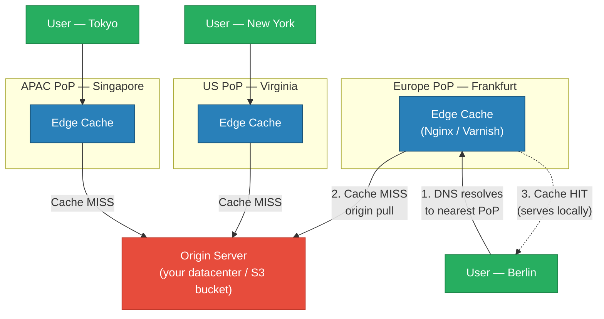
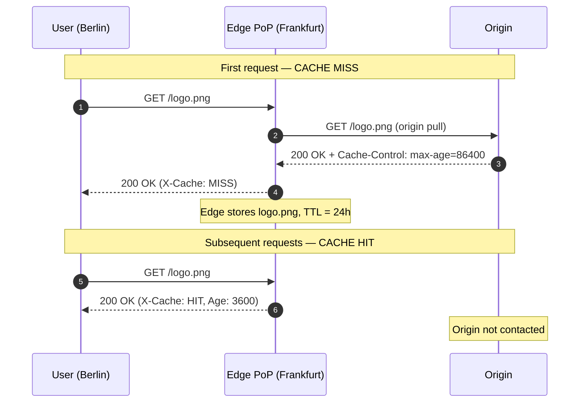
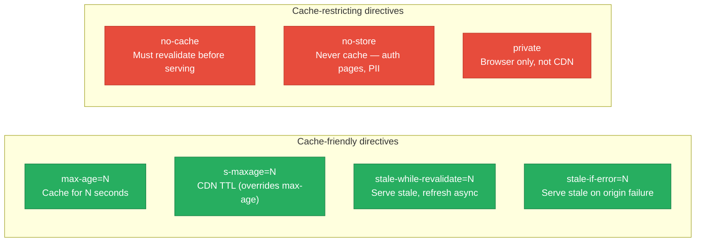
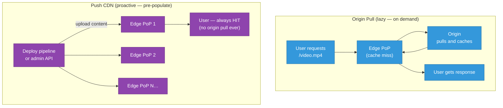
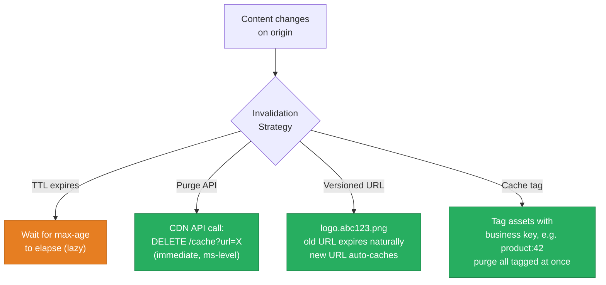
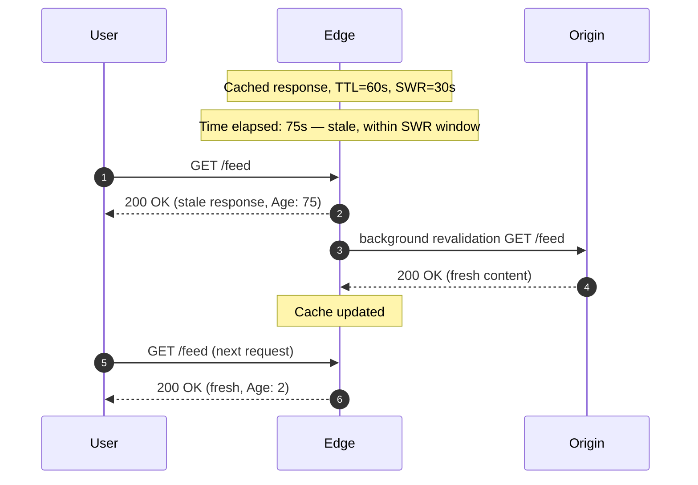
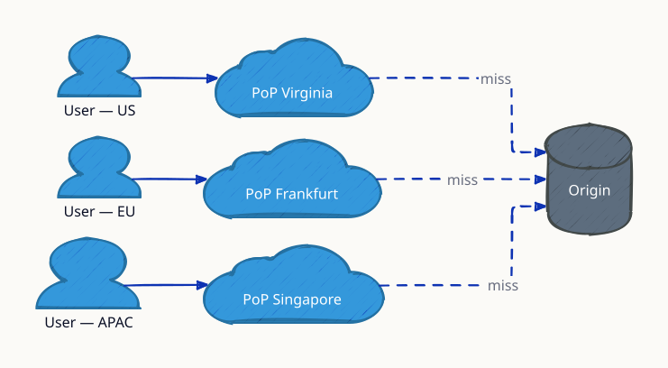
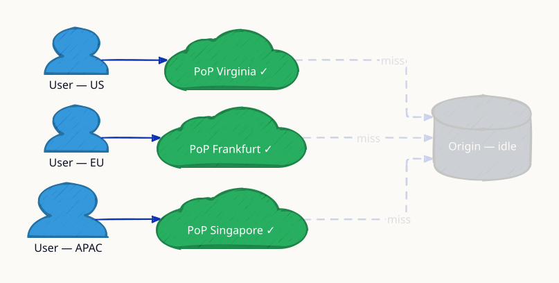
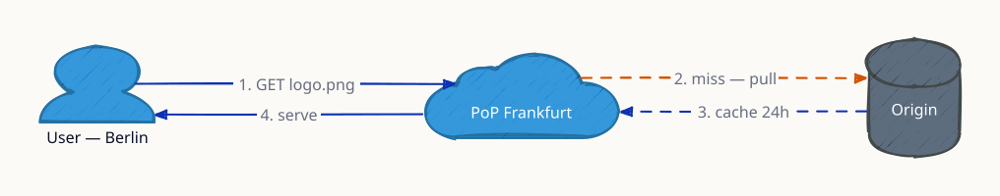
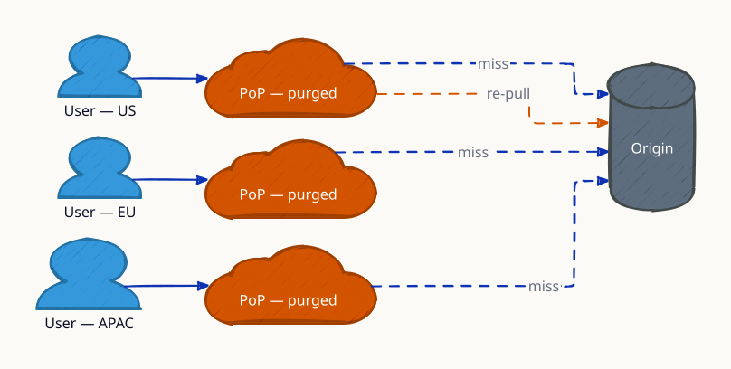

# Content Delivery Network (CDN)

A Content Delivery Network is a geographically distributed network of proxy servers — called Points of Presence (PoPs) or edge nodes — that cache content close to end users. Instead of every request crossing the globe to a single origin, a CDN intercepts the request at the nearest PoP and serves the cached response. The result is dramatically lower latency (50–300 ms savings are common), reduced origin bandwidth costs, and built-in DDoS absorption because attack traffic is distributed across hundreds of edge nodes rather than reaching your infrastructure. CDNs are used by nearly every large web property: Cloudflare serves over 20% of all internet traffic, while AWS CloudFront and Akamai handle media streaming, software downloads, and API acceleration at planetary scale.

---

## Global PoP Architecture



---

## Cache-Miss vs Cache-Hit Flow



---

## Cache-Control Headers



### Header Decision Guide

| Content Type | Recommended Header | Rationale |
|---|---|---|
| Static assets with hashed filenames (JS, CSS, images) | `public, max-age=31536000, immutable` | Filename changes on update — cache forever |
| HTML pages | `public, s-maxage=60, stale-while-revalidate=30` | Short CDN TTL, serve stale while refreshing |
| Public API responses (slow-changing) | `public, s-maxage=10` | Short edge TTL, origin not hammered |
| User-specific data | `private, no-store` | Must not cache at shared edge |
| Auth endpoints | `no-store` | Security — never cache credentials |

---

## Origin Pull vs Push CDN



| Dimension | Origin Pull | Push CDN |
|---|---|---|
| Setup | Zero config — edge pulls on first miss | Manual upload to each PoP |
| Warm-up latency | First user in region gets a slow miss | None — content pre-populated |
| Storage cost | Edge evicts based on TTL/LRU | You pay for all stored content |
| Best for | Websites, apps with unpredictable traffic | Large media files, software releases |
| Examples | CloudFront default, Cloudflare, Fastly | Akamai NetStorage, manual S3-to-CDN sync |

---

## Cache Invalidation Strategies



**Rule of thumb:** URL versioning (content hash in filename) is the most reliable strategy because it requires no purge coordination. Reserve purge APIs for content that cannot be renamed (e.g., `/news/latest`).

---

## stale-while-revalidate Deep Dive



`stale-while-revalidate` decouples user latency from origin refresh. The user never waits for a slow origin — they get the stale copy immediately while the edge silently refreshes in the background. This is the standard pattern for news feeds, product listings, and anything that tolerates a few seconds of staleness.

---

## CDN for Dynamic Content

CDNs are not limited to static files. Modern CDNs accelerate dynamic content through:

| Technique | How | Example |
|---|---|---|
| Route optimization | Traffic travels over CDN backbone, not public internet | Cloudflare Argo, AWS Premium Tier |
| Edge computing | Run auth, A/B tests, personalization at PoP | Cloudflare Workers, Lambda@Edge |
| Short-TTL caching | Cache API responses 1–5 s to absorb spikes | `Cache-Control: s-maxage=3` on `/products` |
| TCP connection reuse | CDN keeps persistent connections to origin | Faster TLS handshake for users to nearby PoP |
| Protocol upgrade | CDN speaks HTTP/2 or QUIC to client, HTTP/1.1 to origin | Improved multiplexing without origin changes |

---

## Trade-offs & When to Use

| Scenario | Recommendation |
|---|---|
| Static site (docs, marketing) | Full CDN caching with immutable hashed assets |
| E-commerce product pages | Short `s-maxage` (30–60 s) + `stale-while-revalidate` |
| User-specific dashboards | `Cache-Control: private` — CDN as pass-through only |
| Live video streaming | CDN with HLS segment caching, short TTL per segment |
| Software downloads / large files | Push CDN — pre-populate to all PoPs |
| Global low-latency APIs | Route optimization (Cloudflare Argo / AWS Premium) |

---

## Real-World Examples

| Provider | Notable Feature | Used By |
|---|---|---|
| Cloudflare | 300+ PoPs, Workers edge compute, DDoS protection | Shopify, Discord |
| AWS CloudFront | Lambda@Edge, S3 origin, signed URLs | Twitch, Amazon |
| Akamai | Push/pull, advanced WAF, oldest CDN | Banks, large media companies |
| Fastly | Real-time purge API (<150 ms), VCL programmable | GitHub, Stripe, The Guardian |
| Google Cloud CDN | Anycast, HTTP/2 + QUIC, Cloud Armor integration | Google-ecosystem apps |
| Azure CDN | Rules engine, multi-origin, 116 PoP countries | Microsoft properties |

---

## Interview Angles

**Q1: How does a CDN know which PoP to send a user to?**

Primarily through **Anycast routing** (Cloudflare, Google) or **DNS-based steering** (Akamai, CloudFront). With Anycast, the same IP address is advertised from every PoP — BGP routing automatically delivers packets to the topologically nearest one. With DNS steering, the CDN's authoritative DNS server inspects the resolver's IP, maps it to a region, and returns the IP of the closest PoP. Some CDNs combine both: Anycast for initial resolution, then an HTTP redirect or Geo-CNAME for finer control.

**Q2: What is the difference between `Cache-Control: no-cache` and `no-store`?**

`no-cache` does not mean "do not cache." It means the edge must revalidate with the origin before serving — using `ETag`/`If-None-Match` or `Last-Modified`/`If-Modified-Since`. If the origin returns `304 Not Modified`, the edge serves its cached copy without downloading the body again. This is efficient for content that changes occasionally. `no-store` is an absolute prohibition: the response must never be written to any cache, disk, or log. Use `no-store` for authentication responses, banking pages, or anything containing PII.

**Q3: A news site publishes a breaking story. How do you ensure the CDN serves the fresh article immediately?**

Several options in order of reliability: (1) Call the **CDN purge API** — Cloudflare and Fastly can purge by URL or surrogate key globally in under 150 ms. (2) Use **short `s-maxage`** (5–10 s) with `stale-while-revalidate` so the CDN refreshes very frequently without blocking readers. (3) Append a **version parameter** (`?v=2`) or change the URL slug, though this only works if you control the URL structure. In practice, a CMS triggers a purge webhook on publish — the CDN's purge API flushes the article URL and any aggregation pages (homepage, RSS feed) tagged with a surrogate key like `article:42`.

---

## Code

The Nginx-based CDN simulation in this module demonstrates three caching strategies side by side:

```
high-level-design/networking-and-edge/2.2_cdn/
├── origin/
│   └── main.go          # Origin server with configurable Cache-Control headers
├── nginx/
│   ├── no_cache.conf    # Port 8081 — no caching (baseline)
│   ├── edge_cache.conf  # Port 8082 — full edge cache, 5-min TTL
│   └── selective.conf   # Port 8083 — /static/* cached, /api/* bypassed
├── docker-compose.yml
└── test.sh
```

Run it:

```sh
docker compose up --build -d && sleep 2 && bash test.sh
```

**References**

- [MDN — HTTP Caching](https://developer.mozilla.org/en-US/docs/Web/HTTP/Caching)
- [Nginx proxy_cache documentation](https://nginx.org/en/docs/http/ngx_http_proxy_module.html#proxy_cache)
- [Cloudflare — How CDNs work](https://www.cloudflare.com/learning/cdn/what-is-a-cdn/)
- [RFC 7234 — HTTP/1.1 Caching](https://datatracker.ietf.org/doc/html/rfc7234)

---

## Architecture Diagrams

> Generated from D2 sources in [`docs/diagrams/src/2.2_cdn/`](../../../docs/diagrams/src/2.2_cdn/).
> Regenerate: `just diagrams-topic 2.2_cdn`.

### Overview

Three regional PoPs cache content close to users; only misses travel to the origin.



**`cache_hit` scenario:** all PoPs serve from local cache and the origin goes nearly idle — the steady state a CDN exists to create.



### Request Flow

One EU request's cache lifecycle: MISS → origin pull → cached → every subsequent request is a local HIT.



**`cache_purge` scenario:** a deploy invalidates cached objects; PoPs re-pull from origin on next request — why purge APIs and cache-busting filenames exist.


