# DNS — Domain Name System

DNS is the internet's distributed phone book: it translates human-readable hostnames (e.g., `api.example.com`) into IP addresses that routers understand. The translation is hierarchical and cached at every layer — from the OS resolver on your laptop to ISP-level recursive resolvers and root name servers — giving DNS both global scale and sub-millisecond lookup times for cached records. Because every client connection begins with a DNS lookup, DNS has evolved far beyond simple hostname resolution: it is now a core traffic-management layer supporting geographic routing, health-based failover, weighted canary releases, and a surprisingly effective form of global load balancing — all without touching a single application server.

---

## DNS Resolution Chain

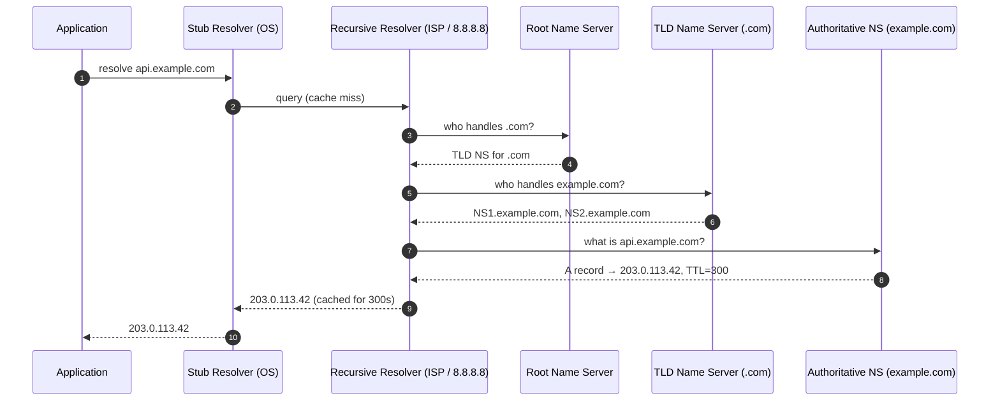

**Key insight:** Only the first lookup pays the full chain cost. Subsequent lookups within the TTL window are served from resolver or OS cache in microseconds.

---

## DNS Record Types

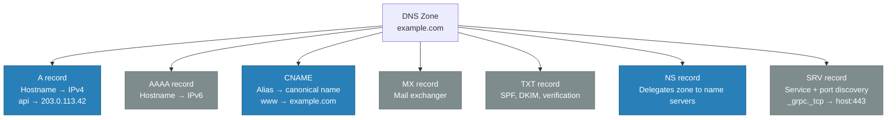

---

## TTL Trade-offs

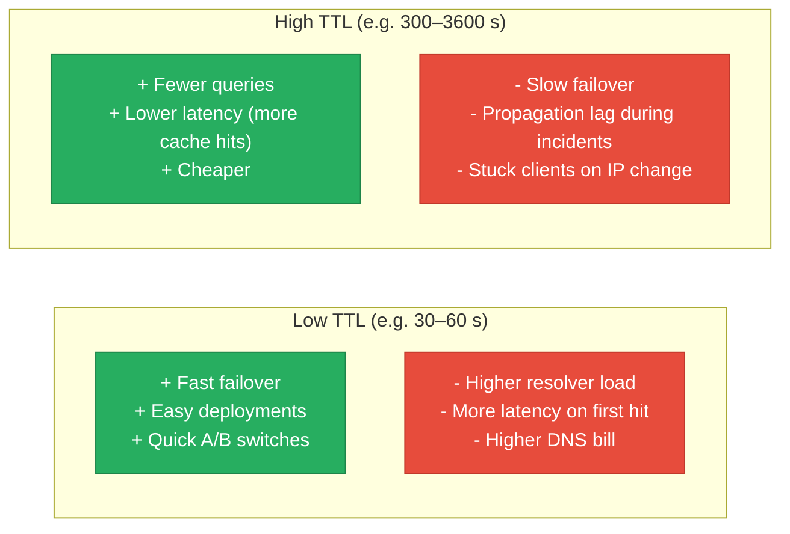

| TTL Range | Use Case |
|---|---|
| 30–60 s | Active/active failover, canary deployments, on-call runbooks |
| 300 s (5 min) | Standard web services — good balance |
| 3600+ s (1 h+) | Static infrastructure, CDN origins, mail servers |
| 86400 s (1 day) | Root zone delegations, rarely-changed records |

---

## GeoDNS — Geographic Routing

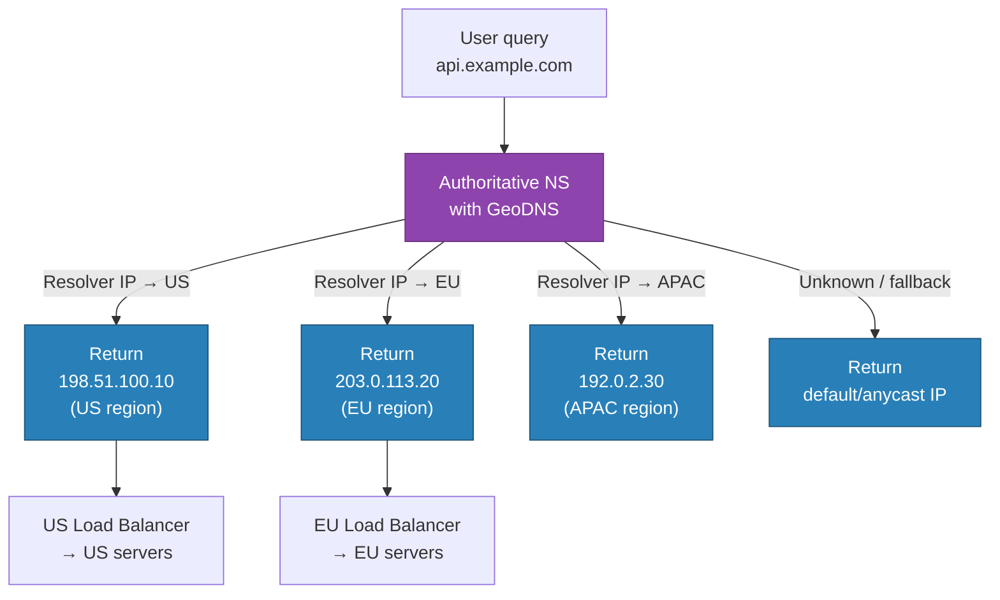

**Caveat:** GeoDNS uses the resolver's IP (usually the ISP's), not the end user's. A user in Germany using Google's `8.8.8.8` resolver may be routed to the US PoP. EDNS Client Subnet (ECS) partially addresses this by forwarding a prefix of the client's IP to the authoritative server.

---

## Health-Based Routing (DNS Failover)

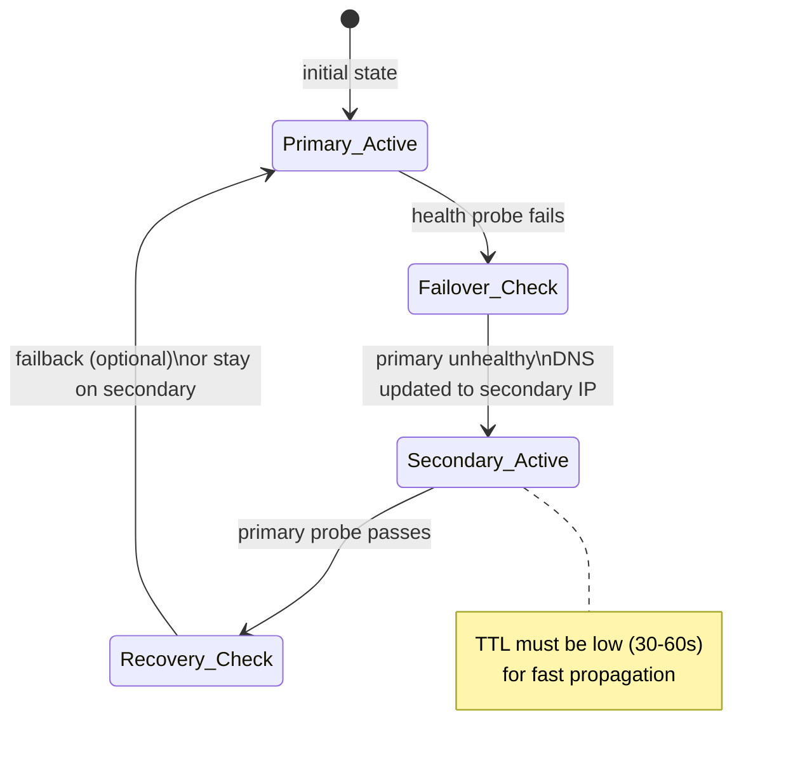

| Provider | Health Check Frequency | Failover Time |
|---|---|---|
| AWS Route 53 | Every 10 or 30 s | ~60 s (TTL dependent) |
| Cloudflare DNS | Every 60 s | 2–3 min |
| Google Cloud DNS | External (Cloud Monitoring) | Minutes |
| Azure Traffic Manager | Every 30 s | ~3 min |

---

## DNS as a Load Balancer

DNS can distribute traffic without any hardware load balancer by returning multiple A records for the same hostname:

```
api.example.com.  60  IN  A  203.0.113.10
api.example.com.  60  IN  A  203.0.113.11
api.example.com.  60  IN  A  203.0.113.12
```

Clients (and resolvers) typically pick the first record, but many implementations rotate order on each response (round-robin DNS). Traffic is distributed but unevenly — stickier clients (browsers, OS caches) may always use the first address.

| Approach | Stickiness | Health Awareness | Use Case |
|---|---|---|---|
| Round-robin DNS | Low | No (TTL-based only) | Basic distribution, dev/staging |
| Weighted DNS (Route 53) | Configurable | Yes (with health checks) | Canary releases, blue/green |
| GeoDNS | By region | Yes | Multi-region active-active |
| Latency-based routing | By measured RTT | Yes | AWS Route 53 latency policy |
| Failover DNS | Active/passive | Yes | DR / standby environments |

---

## DNS Propagation Lag

DNS changes do not take effect instantly because cached records are served until their TTL expires:

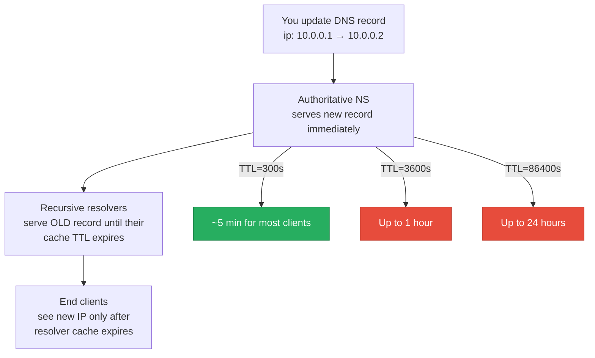

**Pre-migration checklist:** Lower TTL to 60 s at least 2x the current TTL before a planned migration. After migration, raise TTL back. This ensures a fast rollback window if something goes wrong.

---

## Trade-offs & When to Use

| Scenario | Recommendation |
|---|---|
| Global multi-region routing | GeoDNS + latency-based routing (Route 53 / Cloudflare) |
| Zero-downtime deployments | Low TTL (60 s) + weighted DNS for canary |
| Disaster recovery failover | DNS failover with health checks, passive secondary |
| Simple horizontal scaling | Round-robin DNS (no hardware LB needed) |
| CDN integration | CNAME to CDN hostname (CloudFront, Cloudflare) |
| Internal service discovery | Not DNS — use Consul, CoreDNS + Kubernetes, or Eureka |

---

## Real-World Examples

| Provider | Feature | Notes |
|---|---|---|
| AWS Route 53 | Latency, weighted, failover, geolocation policies | 100% SLA on authoritative NS |
| Cloudflare DNS | 1.1.1.1 resolver + anycast authoritative | Fastest public resolver (avg 11 ms) |
| Google Cloud DNS | Managed, 100% uptime SLA, low-latency anycast | Integrated with GCP load balancing |
| NS1 | Traffic steering with Filter Chain | Advanced: custom routing logic |
| Azure Traffic Manager | DNS-based LB with health probes | Works across Azure regions + on-prem |

---

## Interview Angles

**Q1: What happens when a DNS record's TTL expires mid-request?**

The TTL governs how long a cached record can be served without revalidation. The in-flight request at the moment of TTL expiry is not affected — it already has the IP and has opened a TCP connection. The next DNS lookup (next request, or next resolver cache expiry) will fetch a fresh record. There is no mid-connection renegotiation. This is why very short TTLs (sub-10 s) are rarely used in production — the performance cost of constant re-resolution outweighs the agility benefit.

**Q2: Why is GeoDNS not a perfect solution for geo-routing?**

GeoDNS resolves based on the **recursive resolver's IP**, not the end user's actual IP. Since many users share resolvers (ISP DNS, 8.8.8.8, 1.1.1.1), their traffic may be misrouted. Google's resolver in Mountain View would cause European users to receive US IPs. EDNS Client Subnet (ECS, RFC 7871) mitigates this by having the resolver include a masked prefix (e.g., /24) of the client's IP in the query, letting the authoritative server make a more accurate geo decision. Not all resolvers support ECS, and it has privacy implications.

**Q3: How would you design a zero-downtime DNS migration from one IP to another?**

1. Lower the record's TTL to 60 s at least `current_TTL * 2` time before the migration window (to drain resolver caches). 2. At migration time, update the A record to the new IP. 3. Monitor for exactly `TTL` seconds — old IP traffic will drop to near zero. 4. Decommission the old IP. 5. After confirming success, raise TTL back to 300 s or higher. If something goes wrong, revert immediately — with a 60 s TTL, clients see the rollback in about a minute. Never migrate with a multi-hour TTL; you lose the rollback window.

---

## Code

The Docker Compose setup in this module demonstrates round-robin DNS resolution using Docker network aliases — two services share the same hostname, and the Go client alternates between them:

```
high-level-design/networking-and-edge/2.3_dns/
├── web/
│   └── main.go          # Simple HTTP server reporting its container ID
├── client/
│   └── main.go          # Resolves hostname in a loop, shows which IP responds
├── docker-compose.yml   # web-1 and web-2 both registered as "web-service"
└── test.sh
```

Run it:

```sh
docker compose up --build -d && sleep 2 && bash test.sh
```

**References**

- [RFC 1034 — Domain Names: Concepts and Facilities](https://datatracker.ietf.org/doc/html/rfc1034)
- [AWS Route 53 Routing Policies](https://docs.aws.amazon.com/Route53/latest/DeveloperGuide/routing-policy.html)
- [Cloudflare — What is DNS?](https://www.cloudflare.com/learning/dns/what-is-dns/)
- [EDNS Client Subnet — RFC 7871](https://datatracker.ietf.org/doc/html/rfc7871)

---

## Architecture Diagrams

> Generated from D2 sources in [`docs/diagrams/src/2.3_dns/`](../../../docs/diagrams/src/2.3_dns/).
> Regenerate: `just diagrams-topic 2.3_dns`.

### Overview

The full resolution hierarchy: browser → recursive resolver → root → TLD → authoritative nameserver, with caches at every layer.

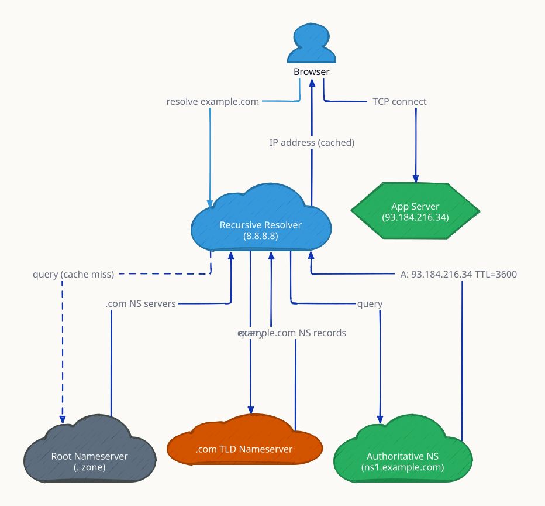

**`cache_hit` scenario:** the recursive resolver answers from cache and the root/TLD/authoritative chain never runs — the case for ~90% of queries.

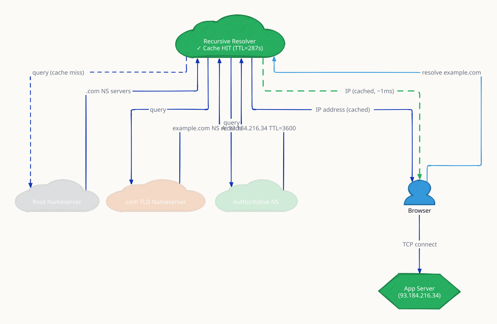

**`ttl_expired` scenario:** the cached record ages out and the resolver re-walks the chain — TTL choice trades failover speed against query load.

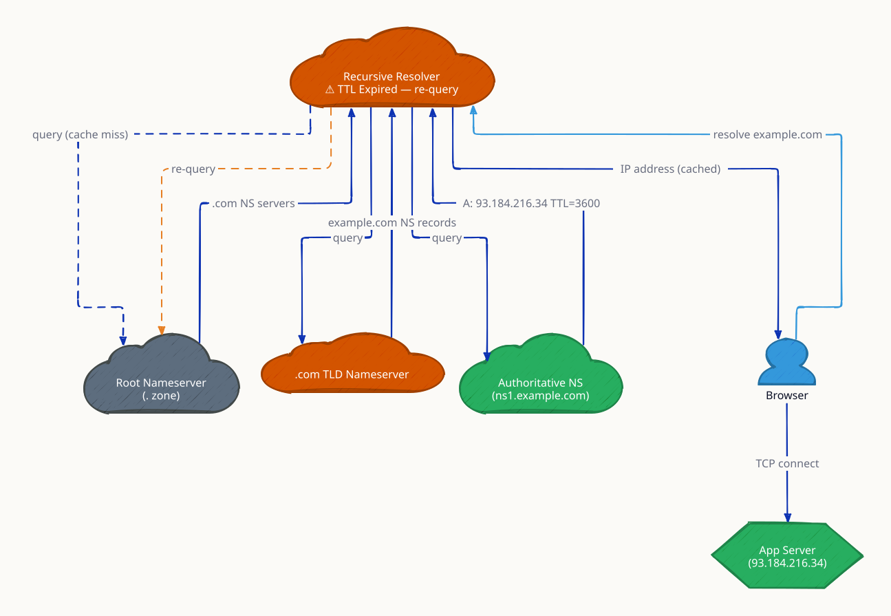

### Request Flow

All 10 steps of an uncached lookup, each hop annotated with what it returns.

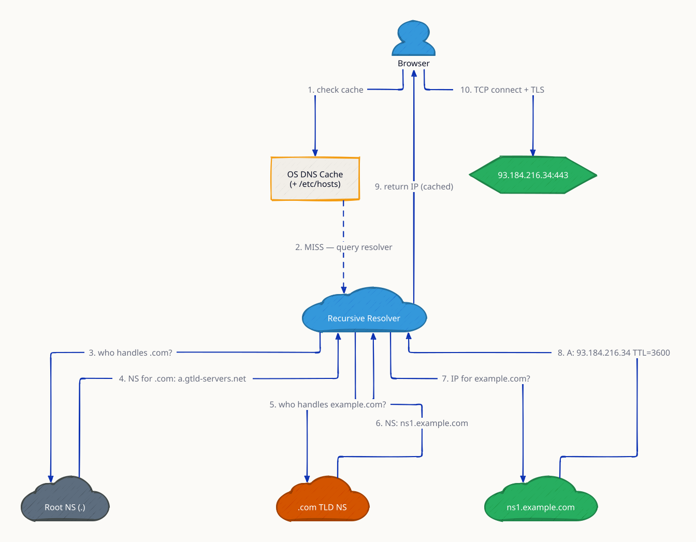

**`dnssec` scenario:** each response carries signatures validated up the chain of trust, preventing spoofed answers (cache poisoning).

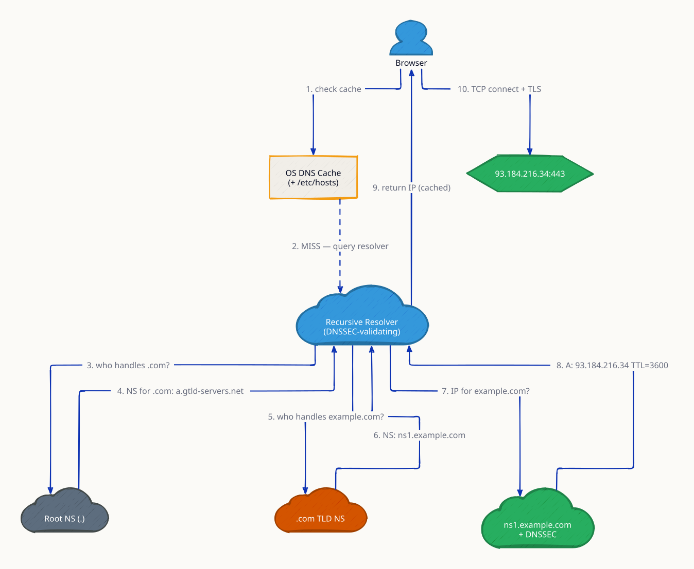
