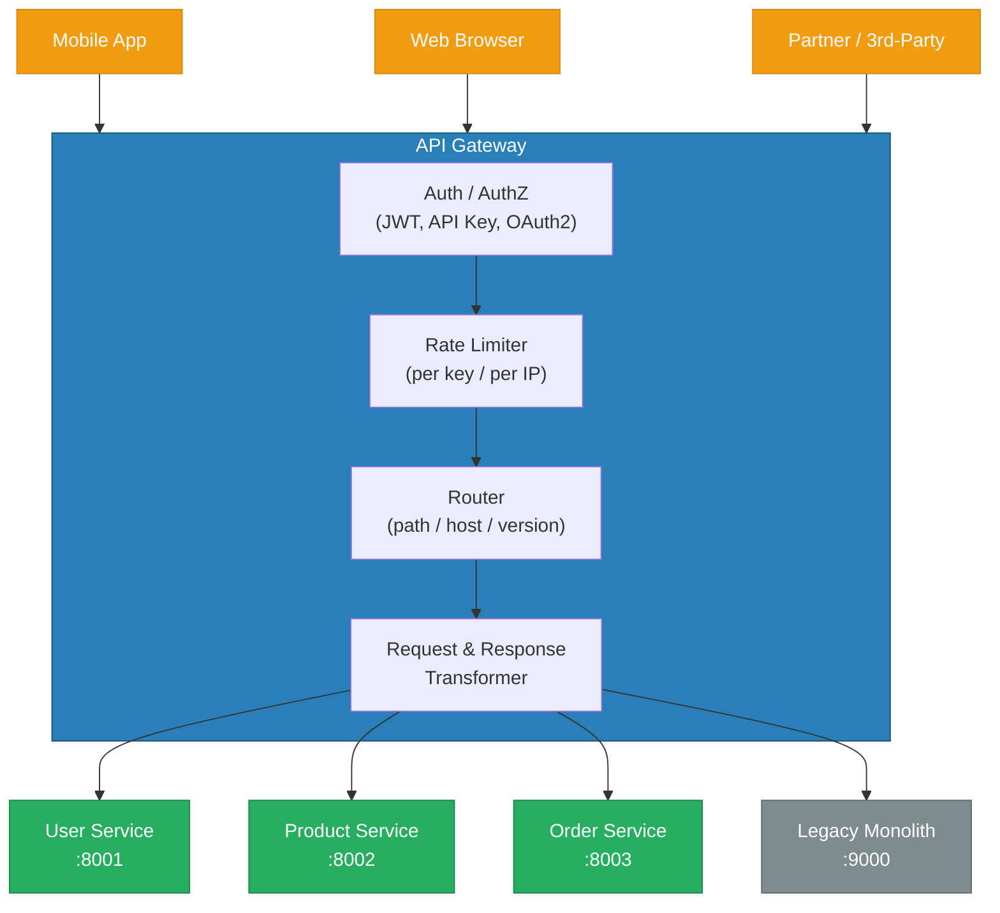
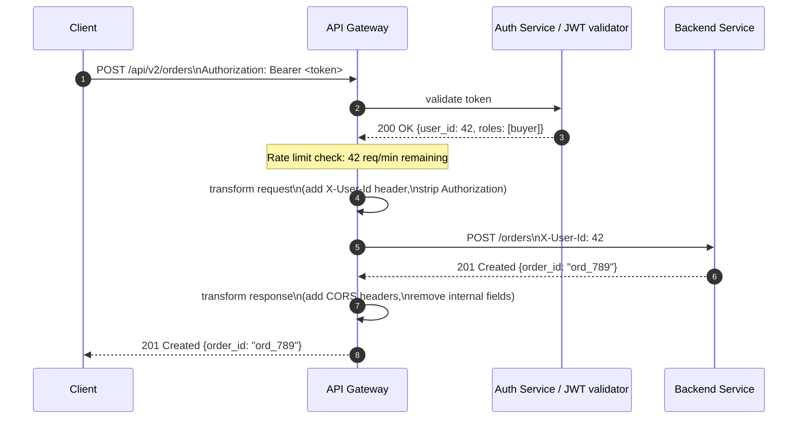
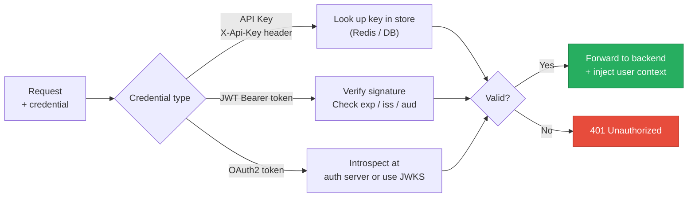
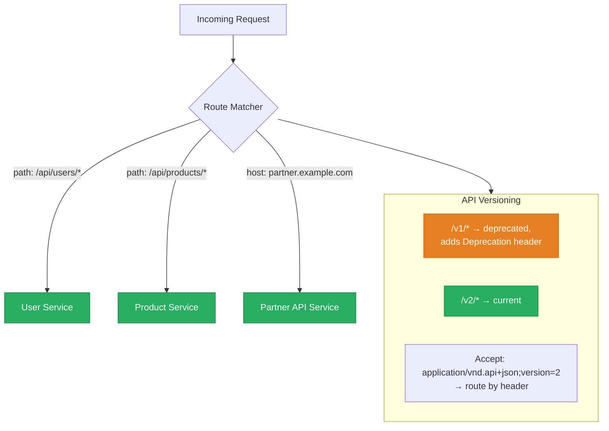
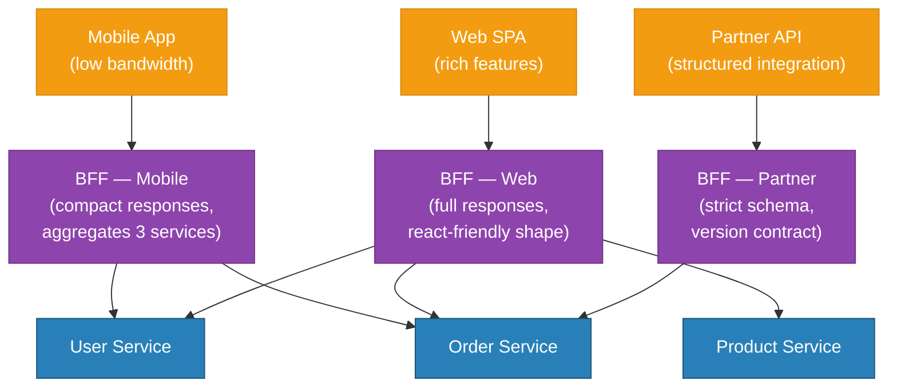
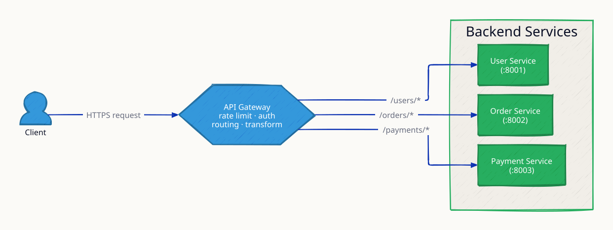
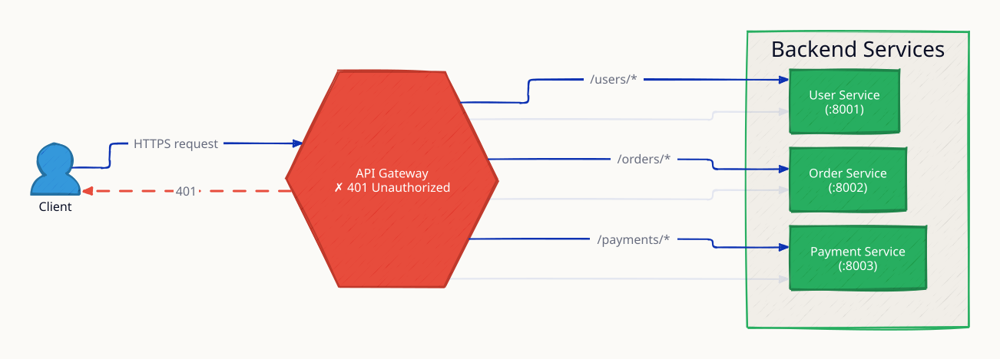
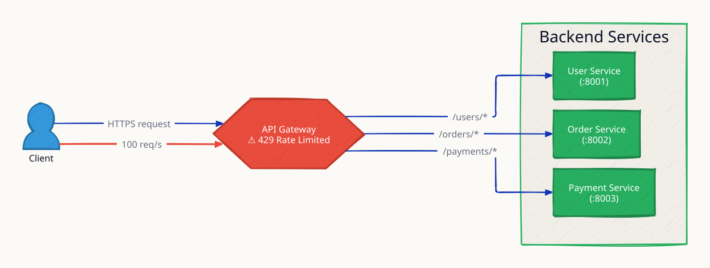
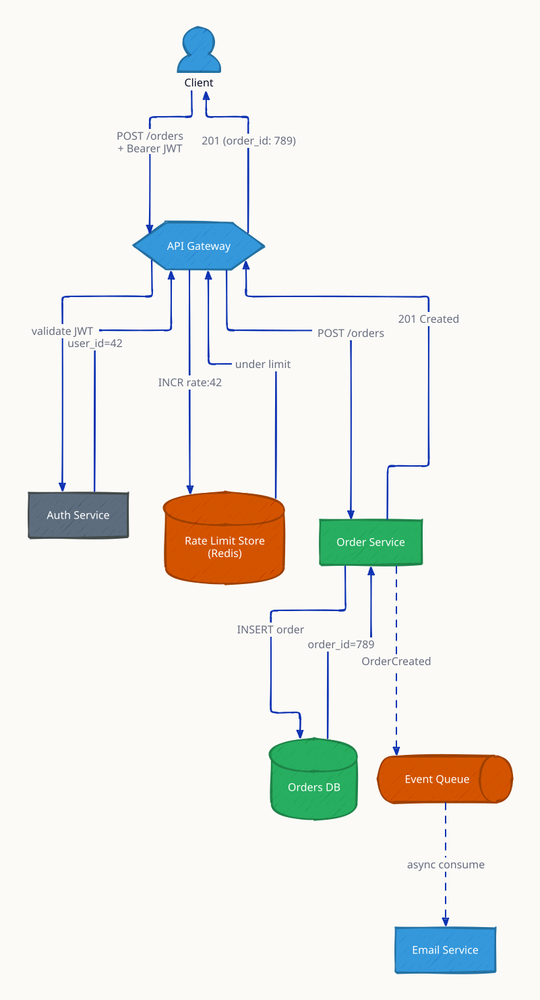
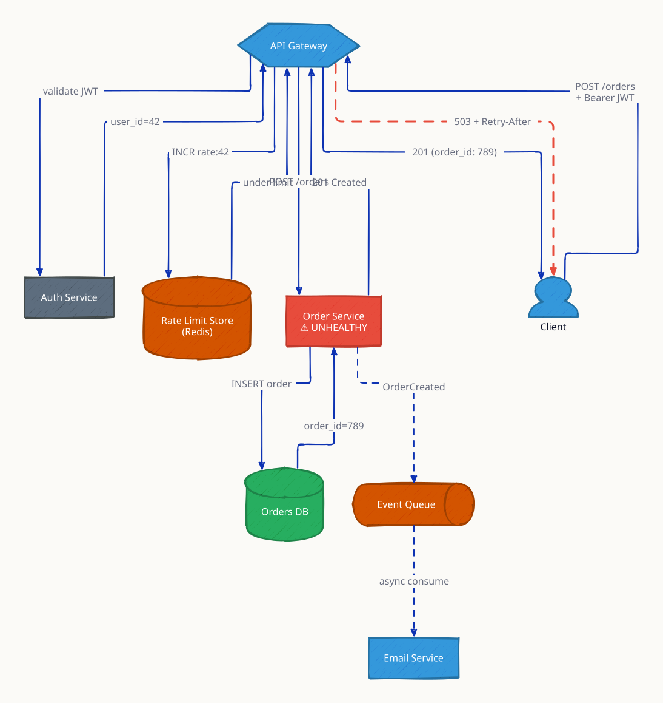

# API Gateway

An API Gateway is a managed reverse proxy that sits between clients and backend services, acting as the single entry point for all external traffic. Rather than each client knowing which microservice to call — and each service reimplementing auth, rate limiting, and logging — the gateway centralises these cross-cutting concerns in one place. It authenticates the caller, enforces quotas, routes to the correct service, transforms request/response shapes, and returns a unified response. At companies like Stripe, Uber, and Netflix, the API gateway handles billions of calls per day and enforces SLAs across hundreds of downstream services, all without any of those services needing to know who the caller is or where they came from.

---

## High-Level Architecture



---

## Request Lifecycle



---

## Core Capabilities

### Authentication & Authorization



### Rate Limiting

| Strategy | Scope | Example |
|---|---|---|
| Fixed window | Resets every N seconds | 1000 req / 60 s per API key |
| Sliding window | Rolling N-second average | 100 req in last 10 s |
| Token bucket | Burst allowed, average enforced | 10 tokens/s, burst 50 |
| Leaky bucket | Smooth constant output rate | Protect downstream services |

Response on limit exceeded: `429 Too Many Requests` + `Retry-After` header.

---

## Routing & Versioning



| Versioning Strategy | Example | Trade-off |
|---|---|---|
| URL path | `/v1/users` vs `/v2/users` | Simple, cacheable, breaks bookmarks on upgrade |
| Query parameter | `/users?version=2` | Easy to test, ugly, cache-busting issues |
| HTTP header | `Accept-Version: v2` | Clean URLs, harder to test in browser |
| Content negotiation | `Accept: application/vnd.api.v2+json` | Most RESTful, complex client code |

---

## Backend for Frontend (BFF) Pattern



The BFF pattern creates one gateway per client type, allowing each to evolve independently. The mobile BFF returns trimmed payloads to save bandwidth; the web BFF returns richer data with pagination cursors; the partner BFF enforces strict contract versioning. Avoids a "universal gateway" that becomes a dumping ground for every client's special case.

---

## Request / Response Transformation

| Transformation | Direction | Example |
|---|---|---|
| Header injection | Request | Add `X-User-Id` from validated JWT claim |
| Header stripping | Request | Remove `Authorization` before forwarding |
| Path rewriting | Request | `/api/v2/orders` → `/orders` (internal path) |
| Protocol translation | Both | REST JSON ↔ gRPC protobuf |
| Response envelope | Response | Wrap `{data: ..., meta: {request_id: ...}}` |
| Field filtering | Response | Remove internal fields (e.g. `internal_flags`) |
| CORS headers | Response | Add `Access-Control-Allow-Origin` |

---

## Trade-offs & When to Use

| Scenario | Recommendation |
|---|---|
| Microservices with many clients | Centralise auth + rate limiting in gateway |
| Mobile + web with different data needs | BFF pattern — one gateway per client type |
| API monetisation / metering | Gateway with API key management and usage tracking |
| Legacy modernisation | Gateway as strangler-fig facade; route new paths to new services, old paths to monolith |
| Internal service-to-service calls | Skip the gateway — use service mesh (Istio/Linkerd) instead |
| Very high throughput (>100k RPS/node) | Evaluate Envoy or Kong; avoid feature-heavy gateways |

---

## Real-World Examples

| Product | Type | Notes |
|---|---|---|
| AWS API Gateway | Managed | REST + HTTP + WebSocket APIs, Lambda integration |
| AWS App Mesh + Envoy | Service mesh | Internal traffic, sidecar model |
| Kong Gateway | Open-source + managed | Plugin ecosystem, declarative config |
| Nginx + Lua | DIY | High performance, flexible, complex to maintain |
| Traefik | Open-source | Auto-discovery in Kubernetes, Let's Encrypt |
| Azure API Management | Managed | Enterprise features, developer portal |
| Google Cloud Apigee | Managed | API analytics, monetisation, enterprise |

---

## Interview Angles

**Q1: What is the difference between an API Gateway and a service mesh, and when do you use each?**

An API gateway handles **north-south traffic** — requests entering your system from external clients. It focuses on authentication, rate limiting, routing, and API contract enforcement at the perimeter. A service mesh (Istio, Linkerd) handles **east-west traffic** — service-to-service calls within your cluster — with mTLS, circuit breaking, and observability injected via sidecar proxies without changing application code. In a mature microservices system you use both: the gateway at the edge, and the mesh for internal communication. Using the API gateway for internal service calls introduces a single point of failure and unnecessary latency.

**Q2: How do you implement rate limiting in an API gateway across multiple gateway nodes?**

Local in-memory counters are fast but only track per-node limits, so a cluster of 10 gateway nodes effectively allows 10x the intended limit. The correct solution is a **centralised distributed counter**, typically in Redis using atomic `INCR` with `EXPIRE`. A common pattern is the **token bucket** algorithm: store the token count and last refill time per key in Redis; on each request, compute tokens added since last refill, subtract one, and check if the result is non-negative — all in a single Lua script for atomicity. For very high throughput, use Redis cluster or a leaky-bucket approximation with a sliding window log.

**Q3: How would you design API versioning with zero client breakage?**

Use a URL path prefix (`/v1`, `/v2`) for discoverability and cacheability. Run both versions simultaneously during a deprecation window — at least one major version cycle (typically 12–24 months). The gateway can route by prefix, add `Deprecation` and `Sunset` headers to v1 responses (RFC 8594) to warn clients, and log which API keys are still calling deprecated endpoints for targeted outreach. Never silently change a v1 response shape. When ready to retire v1, change the gateway to return `410 Gone` before fully removing the route — this gives clients a chance to detect and handle the removal programmatically.

---

## Code

The Nginx-based API Gateway simulation in this module demonstrates three scenarios:

```
high-level-design/networking-and-edge/2.4_api_gateway/
├── user-service/
│   └── main.go          # Go HTTP service responding to /api/users
├── product-service/
│   └── main.go          # Go HTTP service responding to /api/products
├── nginx/
│   ├── routing.conf     # Port 8081 — path-based routing
│   ├── auth.conf        # Port 8082 — X-Api-Key validation
│   └── versioned.conf   # Port 8083 — /v1 deprecated, /v2 current
├── docker-compose.yml
└── test.sh
```

Run it:

```sh
docker compose up --build -d
sleep 2
bash test.sh
```

**References**

- [AWS API Gateway documentation](https://docs.aws.amazon.com/apigateway/latest/developerguide/welcome.html)
- [Kong — What is an API Gateway?](https://konghq.com/learning-center/api-gateway/what-is-an-api-gateway)
- [Sam Newman — Building Microservices (BFF pattern)](https://samnewman.io/patterns/architectural/bff/)
- [RFC 8594 — Sunset HTTP Header Field](https://datatracker.ietf.org/doc/html/rfc8594)

---

## Architecture Diagrams

> Generated from D2 sources in [`docs/diagrams/src/2.4_api_gateway/`](../../../docs/diagrams/src/2.4_api_gateway/).
> Regenerate: `just diagrams-topic 2.4_api_gateway`.

### Overview

One entry point layering rate limiting, JWT auth, routing, and request transformation in front of every backend service.



**`auth_failure` scenario:** an invalid JWT is rejected at the gateway with 401 — backend services never see unauthenticated traffic.



**`rate_limited` scenario:** a client exceeds its quota and gets 429 at the edge, protecting backends from overload before any business logic runs.



### Request Flow

An order request passing each gateway stage in sequence: JWT validation → rate-limit check in Redis → route to Order service → async event to the email consumer.



**`circuit_open` scenario:** the Order service's error rate trips the gateway's circuit breaker; clients get an immediate 503 with Retry-After instead of hanging on a dying backend.


