# WebSockets & Server-Sent Events (SSE)

Traditional HTTP follows a strict request-response model: the client asks, the server answers, and the connection closes. This works perfectly for fetching a web page but breaks down for real-time features like live chat, collaborative editing, financial tickers, or live sports scores — scenarios where the server needs to push data without waiting for a client request. WebSockets solve this with a full-duplex persistent connection: once the HTTP upgrade handshake completes, either side can send frames at any time. Server-Sent Events (SSE) offer a simpler alternative for the common case where data flows in only one direction — from server to client — over a plain HTTP response stream, using the browser's built-in `EventSource` API with automatic reconnection. Choosing between them comes down to directionality, infrastructure compatibility, and the cost of managing persistent state at scale.

---

## Protocol Comparison

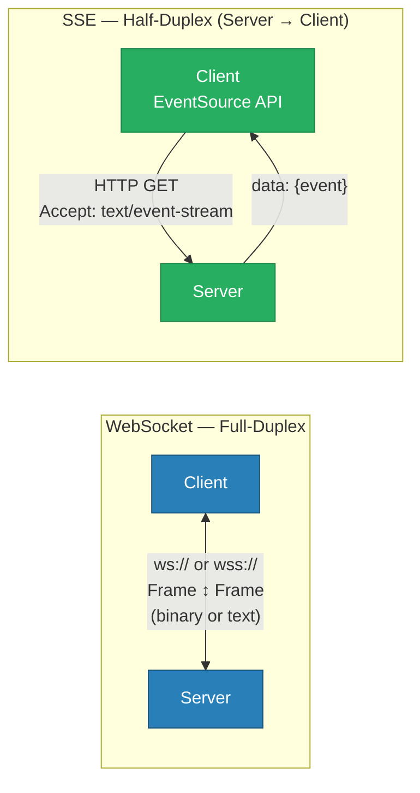

| Dimension | WebSocket | SSE |
|---|---|---|
| Directionality | Full-duplex (bidirectional) | Half-duplex (server → client only) |
| Protocol | Custom framing over TCP (RFC 6455) | Plain HTTP chunked response |
| Browser API | `new WebSocket(url)` | `new EventSource(url)` |
| Reconnection | Manual (client must implement) | Automatic (built into EventSource) |
| Proxy / firewall friendliness | Lower — requires Upgrade passthrough | High — plain HTTP |
| Binary support | Yes (ArrayBuffer, Blob) | No (text only) |
| Message ordering | Guaranteed (TCP) | Guaranteed (TCP) |
| Use case | Chat, gaming, collaborative editing | Notifications, live feeds, dashboards |

---

## WebSocket Connection Lifecycle

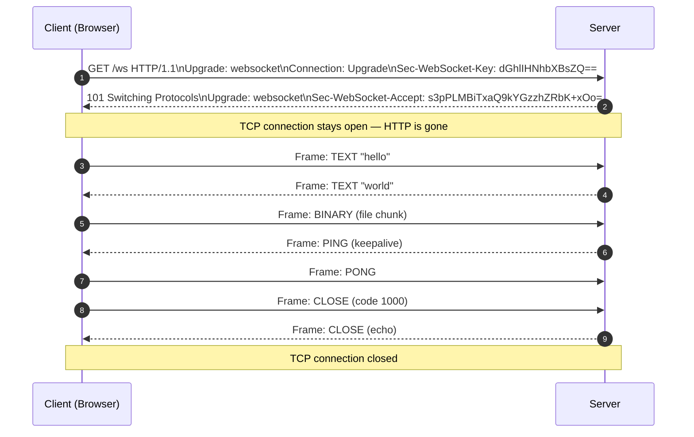

**Key detail:** After the `101 Switching Protocols` response, the connection is no longer HTTP. The same TCP socket carries WebSocket frames. Load balancers and proxies must be explicitly configured to support this upgrade.

---

## SSE Stream Format & Reconnection

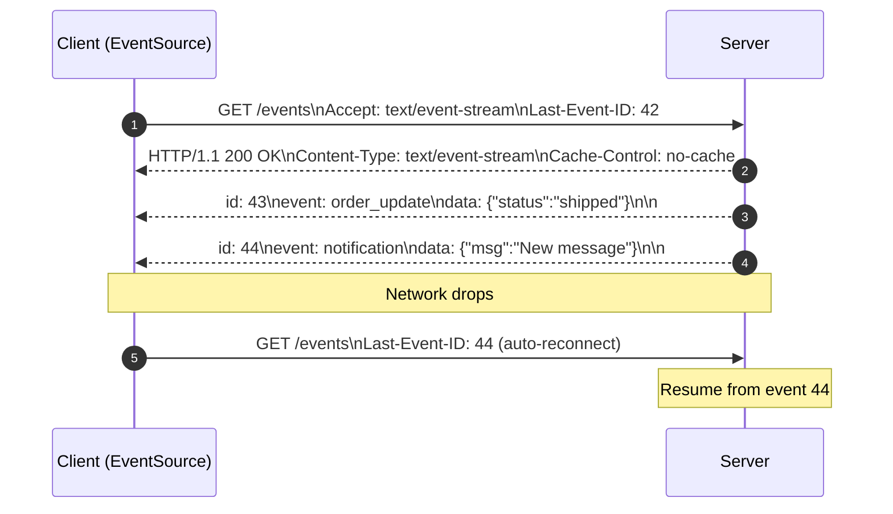

SSE wire format is plain text:

```
id: 44
event: notification
data: {"msg": "New message"}
retry: 3000

```

Each message ends with a blank line (`\n\n`). The `retry` field sets the reconnection delay in milliseconds. The browser automatically resumes from `Last-Event-ID`.

---

## Scaling WebSockets: The Fan-Out Problem

A single WebSocket node works well in development. In production with multiple nodes, a message sent by one client lands on one server — other servers have no way to deliver it to their connected clients.

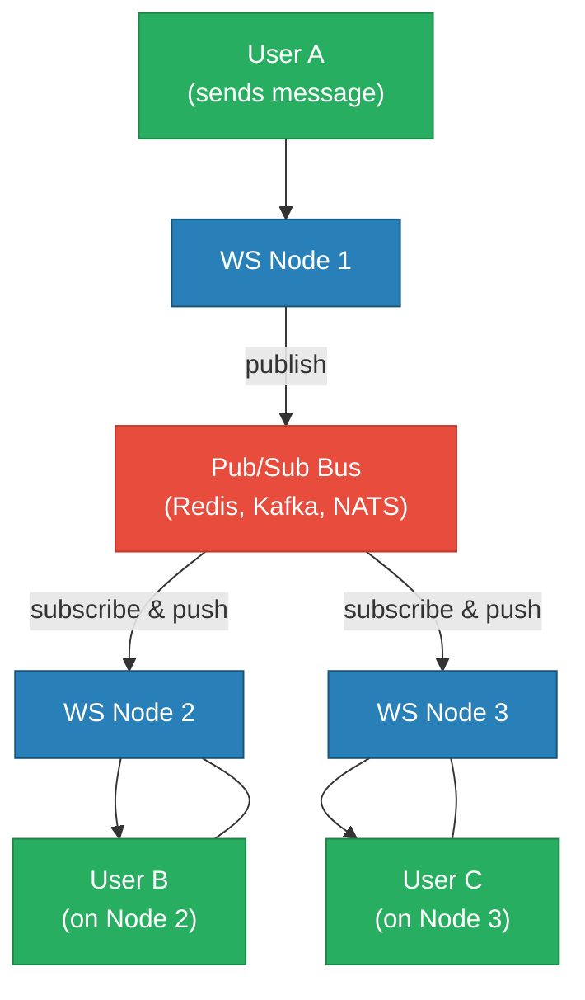

**Solution:** Use a pub/sub broker. Each WS node subscribes to the relevant channel. When Node 1 receives a message from User A, it publishes to the broker. All nodes subscribed to that channel push the message to their connected clients.

---

## Fan-Out Patterns

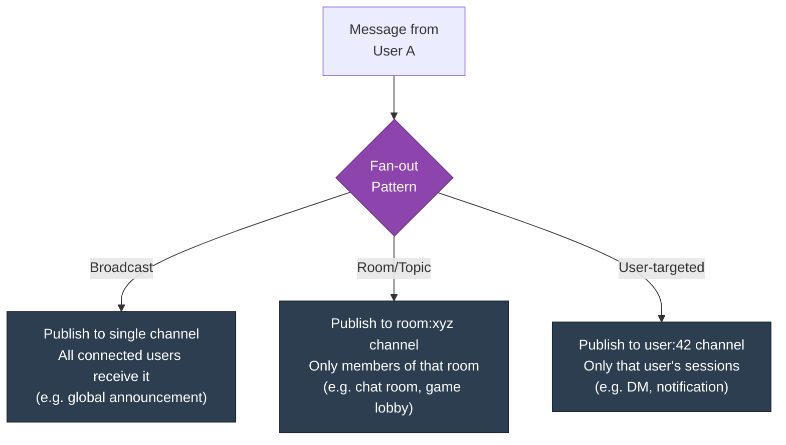

| Pattern | Redis Structure | Scale Consideration |
|---|---|---|
| Broadcast | `PUBLISH global:events <msg>` | Every node receives every message |
| Room/channel | `PUBLISH room:{id} <msg>` | Only nodes with members in that room |
| User session | `PUBLISH user:{id} <msg>` | Works across multiple browser tabs |
| Presence tracking | `SADD online_users {id}` + expiry | Expensive with millions of users; use dedicated presence service |

---

## WebSocket Behind a Reverse Proxy (Nginx)

```nginx
# Nginx WebSocket passthrough
location /ws {
    proxy_pass http://ws_backend;
    proxy_http_version 1.1;

    # Required for WebSocket upgrade
    proxy_set_header Upgrade $http_upgrade;
    proxy_set_header Connection "upgrade";

    # Prevent timeout on idle connections
    proxy_read_timeout 3600s;
    proxy_send_timeout 3600s;
}

# SSE — must disable buffering
location /events {
    proxy_pass http://sse_backend;
    proxy_buffering off;
    proxy_cache off;
    proxy_set_header Connection "";
    proxy_http_version 1.1;
}
```

---

## Scaling & Operational Challenges

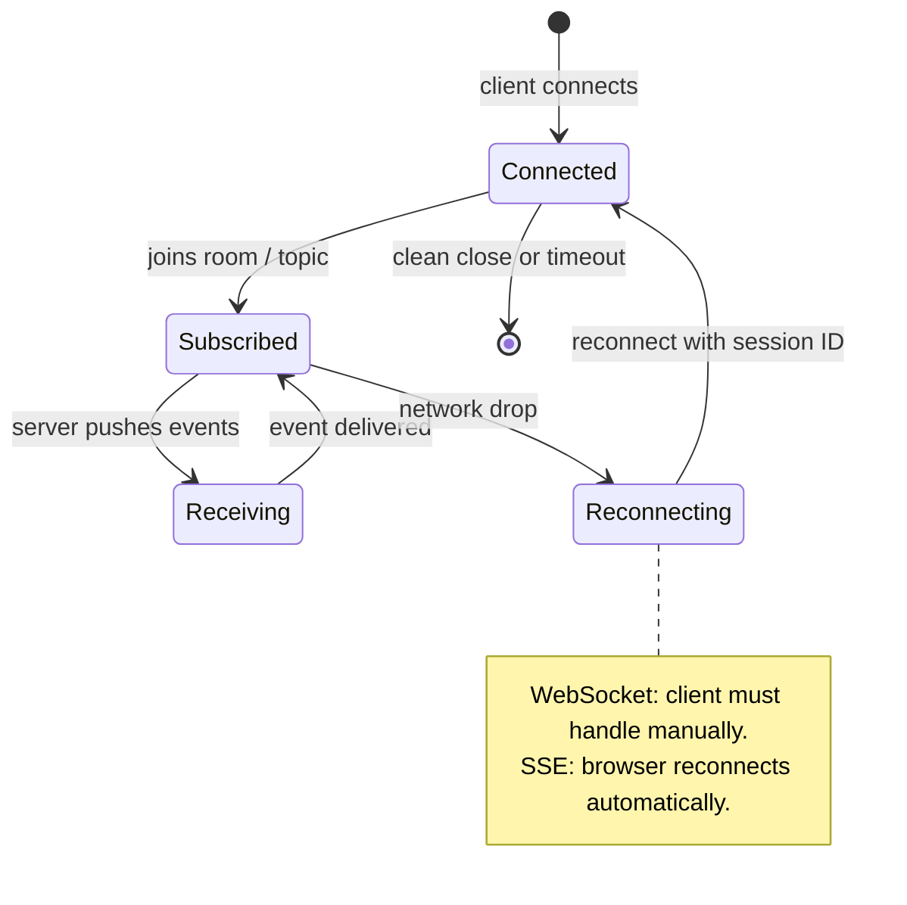

| Challenge | Solution |
|---|---|
| Sticky sessions (same node) | Use consistent-hash LB on session ID, or make nodes stateless via pub/sub |
| Connection count limits | Tune OS `ulimit -n`, use async I/O (Go goroutines, Node.js event loop) |
| Slow consumers | Backpressure or per-connection send queue with drop policy |
| Presence tracking at scale | Dedicated service (e.g., Pusher Channels, Ably) or heartbeat + TTL in Redis |
| Message ordering | Per-room sequence numbers; clients re-sort if gaps detected |
| Horizontal pod autoscaling | Drain connections gracefully before scale-down (SIGTERM + close frames) |

---

## Trade-offs & When to Use

| Use Case | Protocol | Reason |
|---|---|---|
| Live chat / messaging | WebSocket | Bidirectional, low latency |
| Multiplayer game state | WebSocket | Binary frames, sub-10 ms required |
| Collaborative editing (Google Docs style) | WebSocket | CRDT operations are bidirectional |
| Live notifications / alerts | SSE | Server-only push, simpler infrastructure |
| Live dashboard / metrics | SSE | Periodic server updates, no client events |
| Financial ticker / stock prices | SSE or WebSocket | SSE if read-only feed; WS if user can trade |
| Progress bars for long jobs | SSE | Simple chunked HTTP, no JS library needed |

---

## Real-World Examples

| Company | Protocol | Scale | Notes |
|---|---|---|---|
| Slack | WebSocket | Millions of connections | Per-workspace channels in Redis |
| Figma | WebSocket | Thousands/doc | CRDT delta sync, WebRTC for cursors |
| Discord | WebSocket | Millions of guilds | Elixir/Erlang for connection handling |
| Twitter/X | SSE | Home timeline feed | Replaced polling with SSE push |
| GitHub | SSE | Live PR / CI updates | EventSource on pull request pages |
| Pusher / Ably | WebSocket | Managed service | Abstracts pub/sub + reconnection |

---

## Interview Angles

**Q1: How do you scale a WebSocket service to handle millions of concurrent connections across multiple nodes?**

The core problem is that WebSocket connections are stateful — a client is pinned to a node. The standard solution is to decouple connection state from message routing. Each WS node maintains its active connections in memory but publishes and subscribes via a shared broker (Redis Pub/Sub, Kafka, NATS). When User A on Node 1 sends a message to Room 99, Node 1 publishes to `room:99`. All other nodes subscribed to `room:99` push the message to their connected members. This makes the application logic stateless at the business level while the connection itself remains on one node. Load balancers use consistent hashing or sticky cookies to route reconnections to the same node for warm-cache benefits.

**Q2: What is the difference between WebSockets and Long Polling, and when would you still choose Long Polling?**

Long polling is HTTP where the client holds an open request until the server has new data (or a timeout fires), then immediately sends another request. WebSockets are a full-duplex TCP session with custom framing. Long polling has much higher per-message overhead (full HTTP headers on every cycle) and higher latency. However, long polling works everywhere — through corporate proxies, old firewalls, and networks that block non-HTTP traffic — whereas WebSockets require the `Upgrade` header to pass through proxies. Choose long polling when you need maximum compatibility and message frequency is low (< 1/s). Choose WebSockets when you need sub-second bidirectional messaging or binary payloads.

**Q3: SSE uses plain HTTP — what does that mean for load balancers and proxies?**

Because SSE is just a long-lived HTTP response with `Content-Type: text/event-stream`, most infrastructure handles it correctly by default — no special `Upgrade` headers, no protocol switching. The critical configuration is **disabling response buffering**: Nginx, HAProxy, and AWS ALB all buffer responses by default, which causes SSE events to accumulate in the proxy and never reach the client until the buffer flushes. In Nginx: `proxy_buffering off`. In ALB: ensure the target group health check and idle timeout allow long-lived connections (default ALB idle timeout is 60 s — increase it to match your reconnection strategy). HTTP/2 provides an added benefit: many SSE streams multiplex over a single connection without the 6-connection browser limit of HTTP/1.1.

---

## Code

The Go WebSocket and SSE implementation in this module, proxied through Nginx:

```
high-level-design/networking-and-edge/2.5_websockets_sse/
├── server/
│   └── main.go          # Go server: /ws WebSocket echo, /events SSE broadcast, /publish trigger
├── nginx/
│   └── default.conf     # Upgrade headers for WS, proxy_buffering off for SSE
├── docker-compose.yml
└── test.sh
```

Run it:

```sh
docker compose up --build -d && sleep 2 && bash test.sh
```

Interactive WebSocket test:

```sh
npx wscat -c ws://localhost:8080/ws
```

Trigger an SSE broadcast while a client is listening:

```sh
# Terminal 1 — listen
curl -N http://localhost:8080/events

# Terminal 2 — publish
curl -X POST http://localhost:8080/publish -d '{"msg":"hello world"}'
```

**References**

- [RFC 6455 — The WebSocket Protocol](https://datatracker.ietf.org/doc/html/rfc6455)
- [MDN — Server-Sent Events](https://developer.mozilla.org/en-US/docs/Web/API/Server-sent_events)
- [Nginx WebSocket Proxying](https://nginx.org/en/docs/http/websocket.html)
- [Redis Pub/Sub](https://redis.io/docs/manual/pubsub/)

---

## Architecture Diagrams

> Generated from D2 sources in [`docs/diagrams/src/2.5_websockets_sse/`](../../../docs/diagrams/src/2.5_websockets_sse/).
> Regenerate: `just diagrams-topic 2.5_websockets_sse`.

### Overview

WebSocket (full-duplex, fanned out across server instances via Redis pub/sub) vs SSE (server→client only over a long-lived HTTP response).

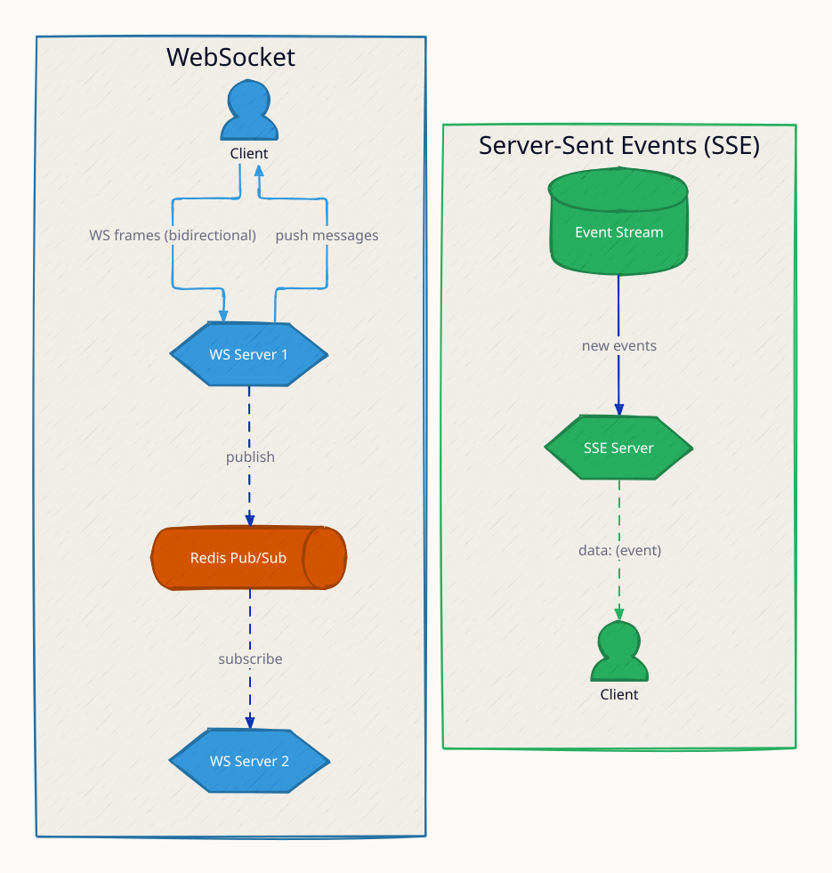

**`sse_backpressure` scenario:** a slow consumer forces the SSE server to buffer; TCP flow control eventually pushes back — why SSE suits low-volume notification streams.

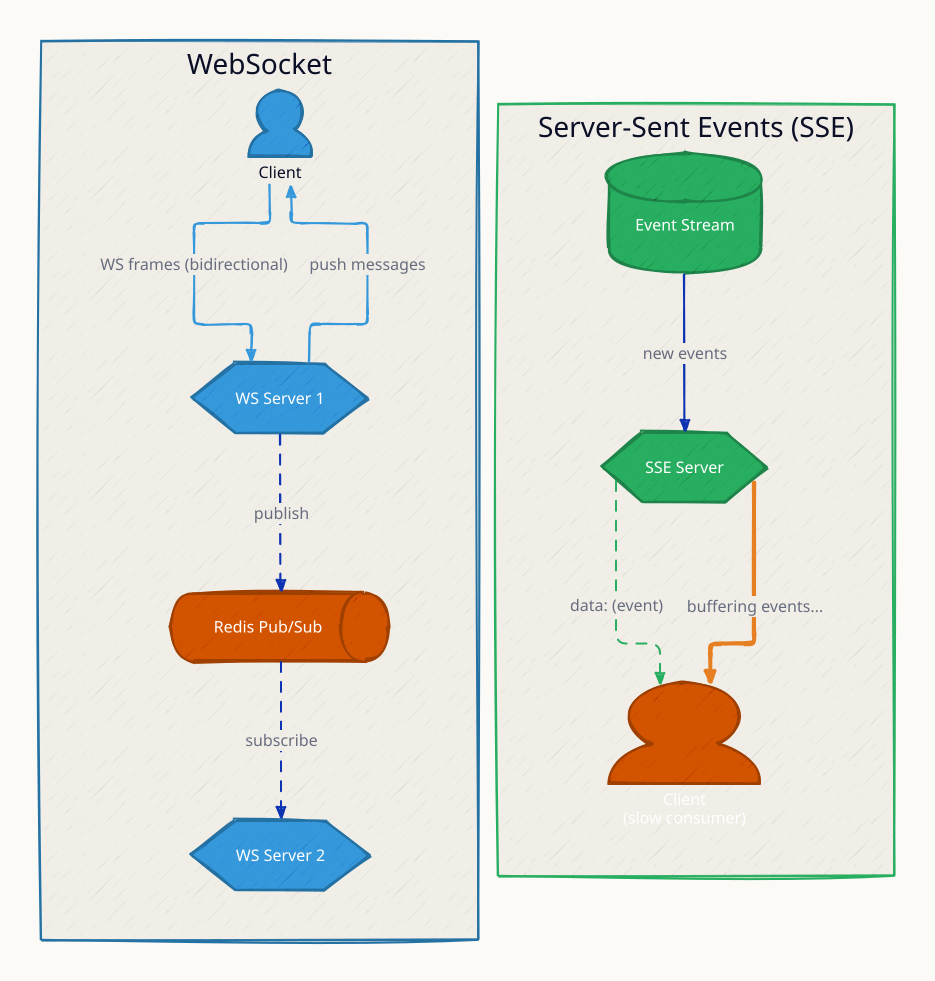

**`ws_reconnect` scenario:** the connection drops and the client reconnects with exponential backoff (1s, 2s, 4s…) — reconnect logic is the client's job in WebSocket-land.

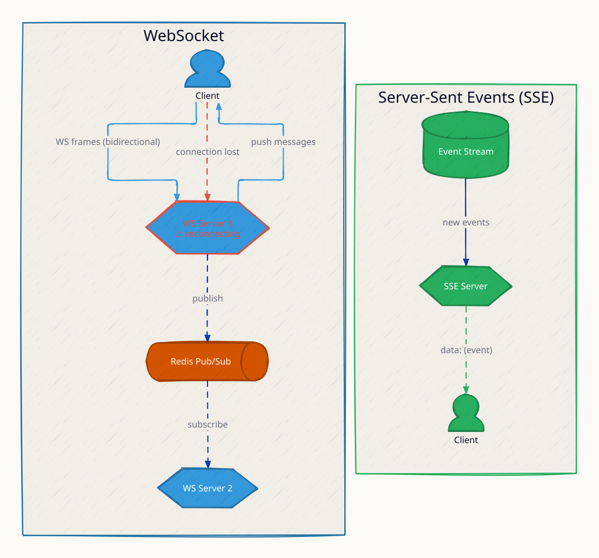

### Request Flow

The WebSocket lifecycle: HTTP Upgrade → 101 Switching Protocols → bidirectional frames → Redis fanout to peers on other servers → close.

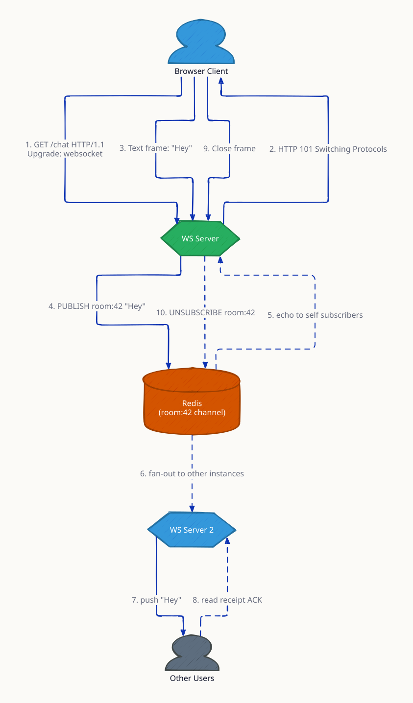

**`server_restart` scenario:** a WS server restarts and its clients reconnect to peers; missed messages are replayed from the stream — connection state is ephemeral, message state must not be.

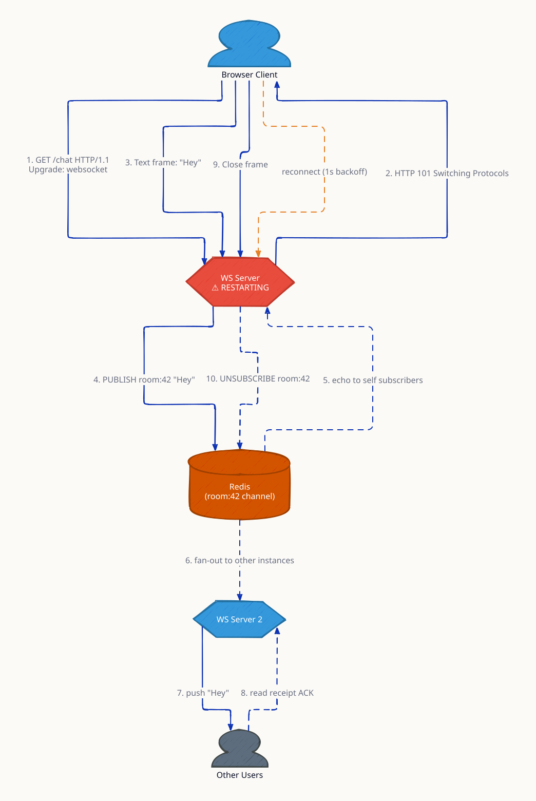
