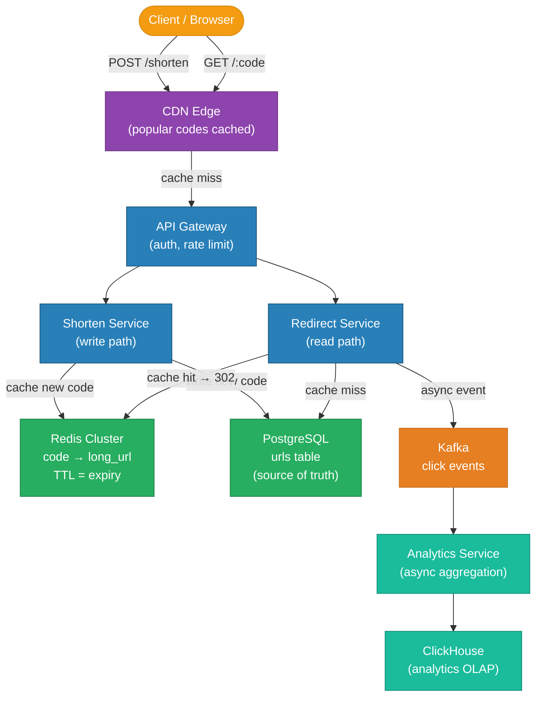
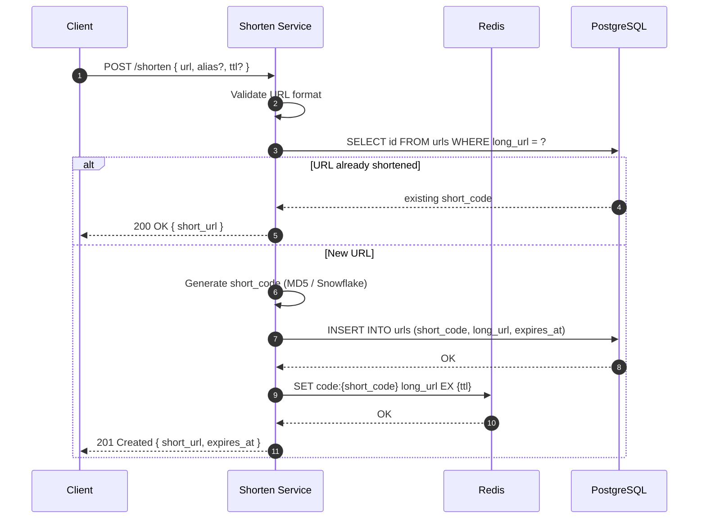
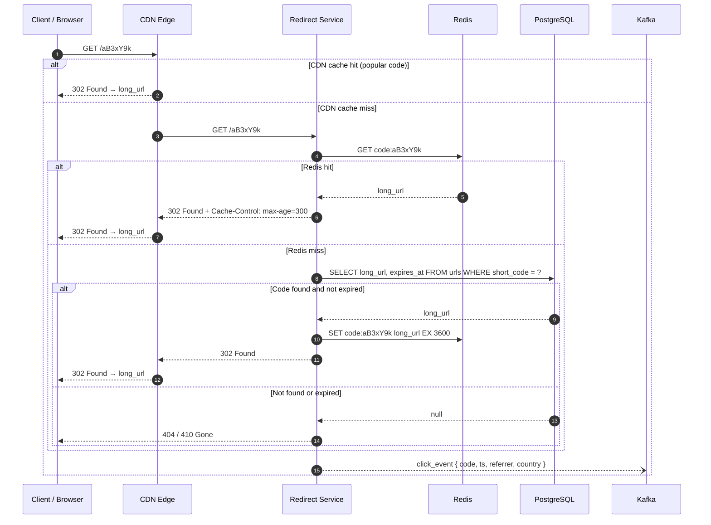
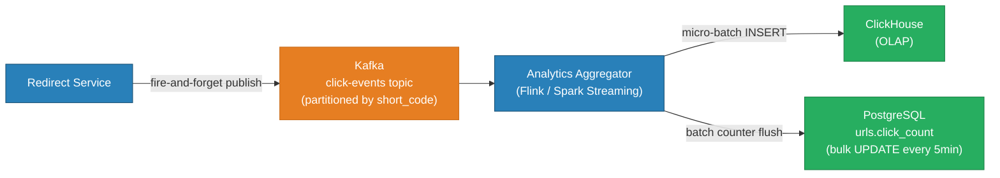
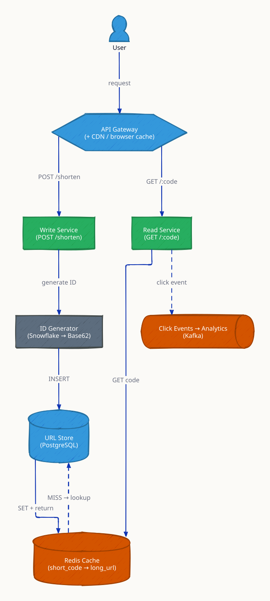
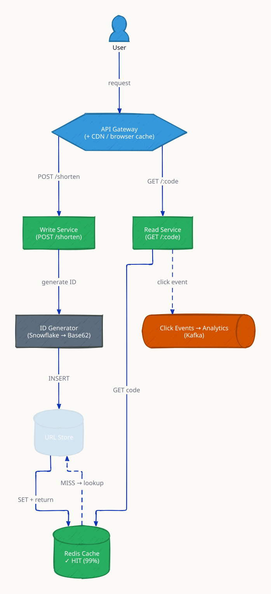
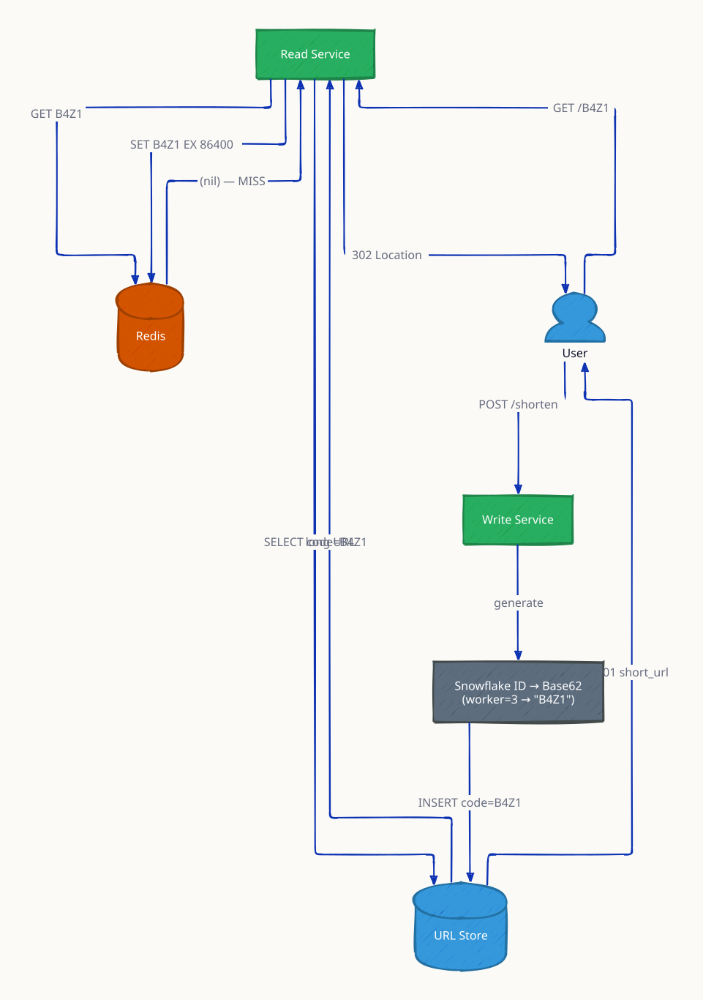
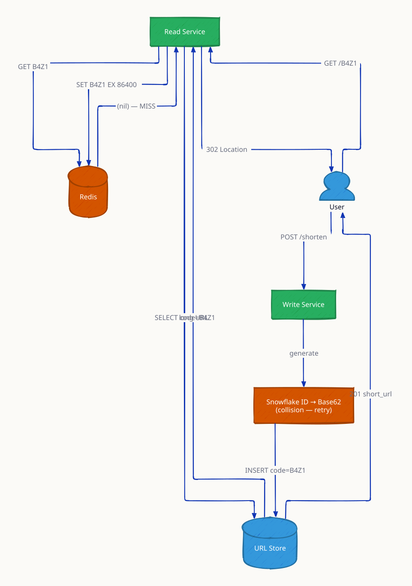

# URL Shortener (bit.ly / TinyURL)

A URL shortener takes a long URL and returns a short alias (e.g. `https://sho.rt/aB3xY9k`) that redirects to the original. At scale this is deceptively hard: the redirect path must survive 100,000+ RPS with sub-10ms p99 latency, short codes must be globally unique without coordination, and click analytics must not block the hot path.

---

## Requirements

### Functional
- **Shorten URL** — given a long URL, return a unique 7-character short code
- **Redirect** — `GET /:code` responds with HTTP 302 to the original URL
- **Custom alias** — users may choose their own short code if it is not taken
- **Expiry** — URLs may have an optional TTL; expired codes return 410 Gone
- **Click analytics** — track total clicks, referrer, country, and timestamp per code

### Non-Functional
- 100M URL shortens per day (write-heavy but read-dominant overall)
- 10B redirects per day (~100:1 read-to-write ratio)
- p99 redirect latency ≤ 10ms (cache-hit path)
- High availability — 99.99% uptime for redirect service
- Short codes are immutable once created; no reassignment after expiry

---

## Capacity Estimation

| Metric | Calculation | Result |
|---|---|---|
| Shorten RPS | 100M / 86,400 | ~1,160 RPS (writes) |
| Redirect RPS | 10B / 86,400 | ~115,000 RPS (reads) |
| Read : Write ratio | 10B / 100M | **100 : 1** |
| URL storage per record | ~500 bytes avg | — |
| Storage per day | 100M × 500 B | ~50 GB/day |
| Storage over 5 years | 50 GB × 365 × 5 | ~91 TB total |
| Redis working set (top 20% URLs = 80% traffic) | 20M × 500 B | ~10 GB RAM |
| Bandwidth (redirect, headers only) | 115K × 200 B | ~23 MB/s |

Key insight: at 100:1 read:write ratio, the redirect path is the bottleneck. A multi-layer cache (CDN + Redis) must absorb nearly all redirect reads before they reach the database.

---

## Architecture Overview



---

## Short Code Generation

### Option 1: MD5 Hash (default)

```
MD5(long_url) → 128-bit hash
→ take first 43 bits (first 8 hex chars)
→ base-62 encode → 7 characters  (62^7 = 3.52 trillion combinations)
```

**Collision handling:** if the generated code already exists in the database for a *different* URL, append a counter suffix and re-hash (`MD5(url + "1")`), retry up to 3 times, then fall back to Snowflake ID.

**Idempotency:** the same long URL always produces the same hash → same code, so repeated shortens return the existing code instead of creating a duplicate entry.

### Option 2: Auto-increment ID → base-62

```
DB sequence: id = 1_000_000_001  (start high to avoid very short codes)
base62(1_000_000_001) → "dnh7Qk"   (7 chars)
```

Pros: no collisions, simple. Cons: codes are sequential and guessable — users can enumerate all short URLs by incrementing.

### Option 3: Distributed Snowflake ID (recommended at scale)

```
Snowflake ID: 41-bit timestamp | 10-bit machine ID | 12-bit sequence
→ 63-bit integer → base-62 encode → 10-11 chars  (trim to 7 with epoch offset)
```

Pros: globally unique, time-sortable, no DB round-trip for ID generation. Used in production by Twitter/X for all entity IDs.

### Base-62 Alphabet

```
0-9  A-Z  a-z    →  62 symbols
7 characters     →  62^7 = 3,521,614,606,208 unique codes (~3.5 trillion)
```

---

## Database Schema

```sql
-- Core URL table
CREATE TABLE urls (
    id            BIGINT PRIMARY KEY,          -- Snowflake ID
    short_code    VARCHAR(16) UNIQUE NOT NULL, -- e.g. "aB3xY9k"
    long_url      TEXT NOT NULL,
    user_id       BIGINT,                      -- NULL for anonymous
    created_at    TIMESTAMPTZ NOT NULL DEFAULT now(),
    expires_at    TIMESTAMPTZ,                 -- NULL = never expires
    is_active     BOOLEAN NOT NULL DEFAULT true,
    click_count   BIGINT NOT NULL DEFAULT 0    -- eventually consistent counter
);

CREATE INDEX idx_urls_short_code ON urls (short_code);
CREATE INDEX idx_urls_user_id    ON urls (user_id);
CREATE INDEX idx_urls_expires_at ON urls (expires_at) WHERE expires_at IS NOT NULL;

-- Custom alias table (user-defined vanity codes)
CREATE TABLE custom_aliases (
    alias         VARCHAR(64) PRIMARY KEY,
    url_id        BIGINT NOT NULL REFERENCES urls(id),
    created_at    TIMESTAMPTZ NOT NULL DEFAULT now()
);

-- Click events (hot partition for recent data; cold archive in ClickHouse)
CREATE TABLE click_events (
    id            BIGINT PRIMARY KEY,
    short_code    VARCHAR(16) NOT NULL,
    clicked_at    TIMESTAMPTZ NOT NULL,
    referrer      TEXT,
    country_code  CHAR(2),
    user_agent    TEXT
);
```

---

## Shorten Flow



---

## Redirect Flow



**Why 302 (temporary) instead of 301 (permanent)?** A 301 causes the browser to cache the redirect indefinitely — clicks never reach the server, breaking analytics. Use 302 so every redirect hits infrastructure and is counted.

---

## Caching Strategy

| Layer | What is cached | TTL | Eviction |
|---|---|---|---|
| CDN (Cloudflare / CloudFront) | Top 0.1% codes (viral links) | 5 minutes | LRU, explicit purge on expiry |
| Redis Cluster | All recently accessed codes | Matches URL expiry, max 24h | allkeys-lru |
| Application memory | Hot 1000 codes (local LRU) | 30 seconds | Caffeine / groupcache |

**Cache invalidation on expiry:** a background worker runs every minute, scans `urls WHERE expires_at <= now() + 5min`, pre-emptively DELs from Redis, and sets CDN cache-control to `no-store` for those codes.

---

## Click Analytics Pipeline



**Why async?** At 115K redirects/sec, synchronous `UPDATE urls SET click_count = click_count + 1` would create a write bottleneck on PostgreSQL. Fire-and-forget Kafka publish adds < 0.5ms overhead; the aggregator batches updates every 5 minutes.

**Real-time counters:** Redis `INCR click:{short_code}` gives a live counter for the stats dashboard. The Kafka pipeline feeds the authoritative historical store.

---

## Rate Limiting

| Surface | Limit | Algorithm |
|---|---|---|
| Anonymous shorten | 10 req/min per IP | Token Bucket |
| Authenticated shorten | 1,000 req/min per user | Token Bucket |
| Redirect | No limit (public CDN) | — |
| Stats API | 100 req/min per user | Sliding Window |

Implemented at the API Gateway layer using Redis-backed token buckets. Bursts up to 2× the sustained rate are allowed for 10 seconds.

---

## Key Design Decisions

| Decision | Choice | Why |
|---|---|---|
| Short code generation | MD5 → base-62 (idempotent) | Same URL returns same code without DB uniqueness check; deterministic |
| HTTP redirect code | 302 Temporary | Ensures every redirect hits analytics pipeline; 301 caches in browser |
| Cache layer | Redis Cluster | Fits entire working set (~10 GB) in RAM; sub-millisecond reads |
| Analytics path | Async Kafka | Decouples hot redirect path from write-heavy analytics; no latency impact |
| Database | PostgreSQL | Strong consistency for writes; read replicas for stats queries |
| ID generation at scale | Snowflake ID | No coordination needed; time-sortable; avoids sequential guessing |
| CDN caching | Short TTL (5 min) | Viral URLs get massive CDN offload; TTL ensures expiry propagates quickly |

---

## Trade-offs

| Option A | Option B | Winner | Reason |
|---|---|---|---|
| Fan-out cache warm on write | Lazy cache population | Lazy (redirect-time) | 100M new URLs/day; warming all would waste cache space |
| SQL database | NoSQL (DynamoDB) | SQL (PostgreSQL) | Transactions needed for alias conflict resolution; schema is fixed |
| 302 redirect | 301 redirect | 302 | Analytics require every hit to reach servers |
| MD5 hash | Snowflake ID | Snowflake at scale | MD5 has collisions; Snowflake is globally unique without coordination |

---

## Interview Angles

**Q1: How do you generate globally unique short codes without a central coordinator?**
Use Snowflake IDs — each app server includes its machine ID in the 63-bit ID, so IDs are unique across nodes without a lock. Convert to base-62 for a compact URL-safe string.

**Q2: How do you handle 10 billion redirects per day at sub-10ms p99?**
Multi-layer caching: CDN absorbs viral links; Redis Cluster holds the working set in memory (~10 GB). Fewer than 1% of redirects ever touch PostgreSQL.

**Q3: What happens when a custom alias is already taken?**
The shorten service does a `SELECT` on `custom_aliases` before inserting — if it exists, return `409 Conflict` with a suggestion (e.g. append random suffix). Wrap in a transaction to prevent TOCTOU races.

**Q4: How do you expire URLs without a full table scan?**
Maintain a Redis sorted set `expiry_queue` with `score = expires_at epoch`. A background cron runs every 60s, calls `ZRANGEBYSCORE expiry_queue 0 now`, and deactivates matching codes in PostgreSQL + deletes from Redis.

**Q5: Why not use a single counter for click_count in PostgreSQL?**
At 115K RPS, every redirect doing `UPDATE urls SET click_count+1` would serialize writes on one row per popular URL — catastrophic. Use Redis INCR for real-time and batch-flush to PostgreSQL every 5 minutes.

---

## Run

```sh
docker compose up --build -d && sleep 2 && bash test.sh
```

## Test

```sh
go test -v ./api/
```

---

## Architecture Diagrams

> Generated from D2 sources in [`docs/diagrams/src/SD01_url_shortener/`](../../../docs/diagrams/src/SD01_url_shortener/).
> Regenerate: `just diagrams-topic SD01_url_shortener`.

### Overview

Write path (Snowflake ID → Base62 → store) and read path (Redis first, DB on miss) — separated because reads outnumber writes ~100:1.



**`cache_hit` scenario:** the redirect is answered entirely from Redis — the database sees only the long tail of cold links.



### Request Flow

Both flows step by step: POST /shorten returning sho.rt/B4Z1, then GET /B4Z1 resolving through cache to a 302 redirect.



**`collision` scenario:** Snowflake IDs make collisions effectively impossible, but the insert still verifies and retries with a fresh ID — cheap insurance.


