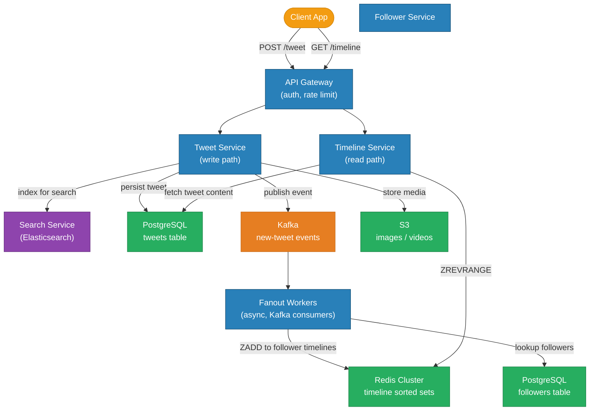
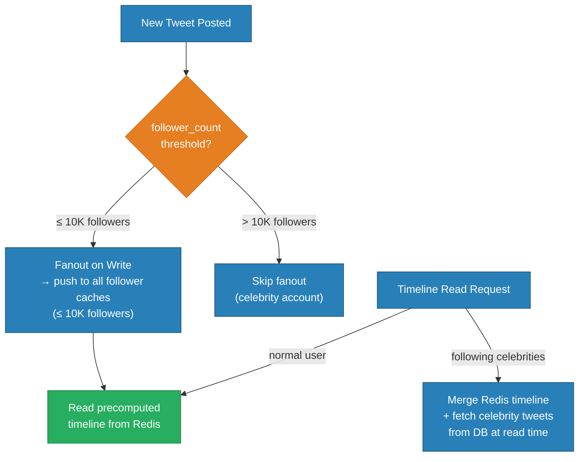
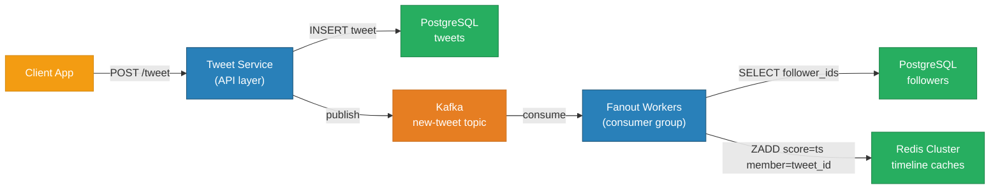
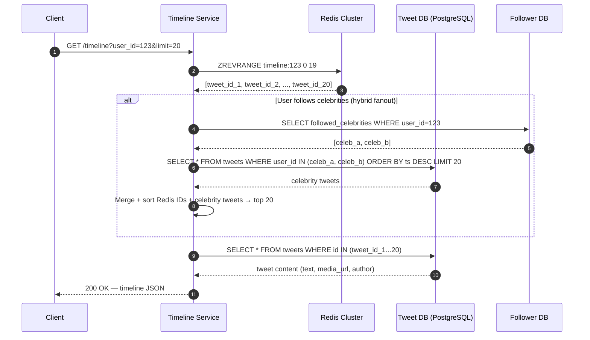
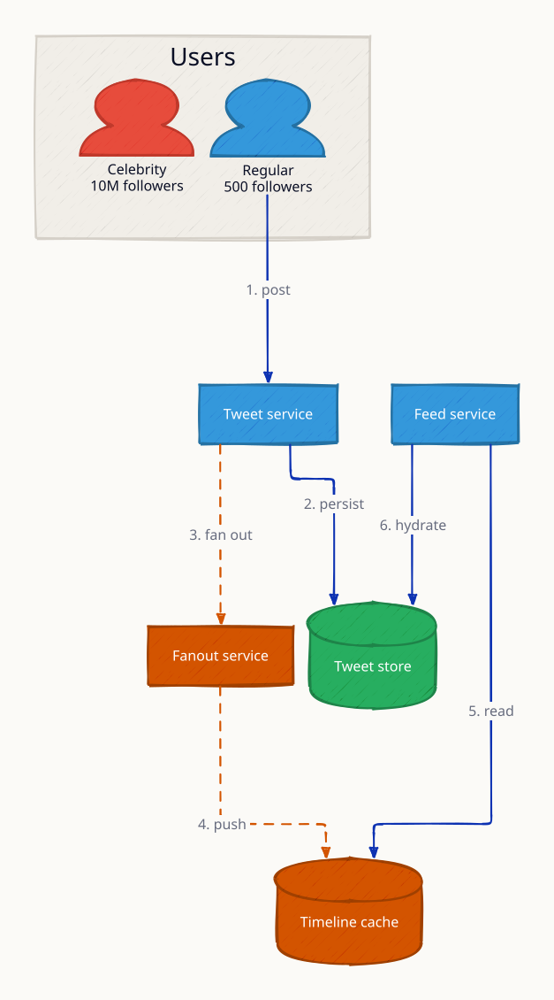
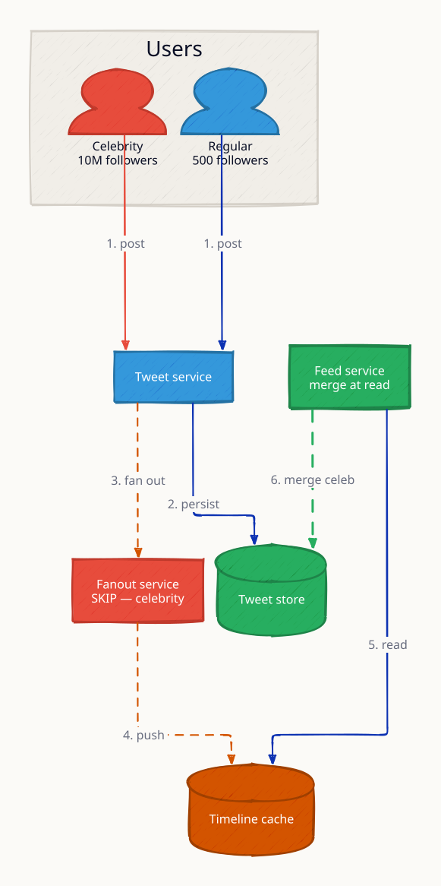
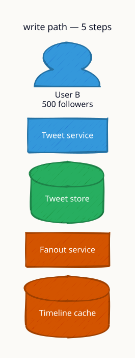
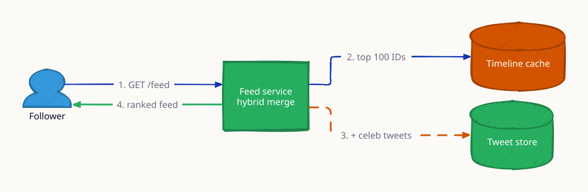

# Twitter / X Feed (Social Media Timeline)

A social media feed system lets users post short messages, follow others, and read a personalized timeline showing recent posts from followed accounts. The engineering challenge is serving a personalized, time-ordered view to 300 million daily active users with hundreds of thousands of reads per second — while handling "celebrities" with 100M+ followers without melting the write infrastructure.

---

## Requirements

### Functional
- **Post tweet** — up to 280 characters of text, images, or video references
- **Follow / unfollow** — directed relationship; Alice follows Bob, not vice-versa
- **Home timeline** — reverse-chronological feed of tweets from accounts you follow
- **Profile timeline** — all tweets by a specific user
- **Retweet / Quote tweet** — reshare with or without added commentary
- **Search** — full-text search over recent tweets

### Non-Functional
- 300M DAU; 500M tweets per day
- Home timeline read latency ≤ 200ms (p99)
- Eventual consistency acceptable — a new tweet may take up to 5s to appear in all followers' timelines
- 99.99% read availability (timelines degrade gracefully under partial outages)
- Data retention: tweets stored indefinitely; timeline cache covers last 800 tweets

---

## Capacity Estimation

| Metric | Calculation | Result |
|---|---|---|
| Tweet write RPS | 500M / 86,400 | ~5,800 RPS |
| Timeline read RPS | 300M DAU × 10 reads/day / 86,400 | ~35,000 RPS baseline |
| Peak read RPS (10× baseline) | 35K × 10 | ~350,000 RPS |
| Read : Write ratio | 350K / 5.8K | ~60 : 1 |
| Tweet storage | 280 chars + metadata ≈ 1 KB | — |
| Storage per day | 500M × 1 KB | ~500 GB/day |
| Timeline cache per user | 800 tweet IDs × 8 bytes | ~6.4 KB |
| Total timeline cache (300M users) | 300M × 6.4 KB | ~1.9 TB RAM |
| Fanout writes/tweet (avg 200 followers) | 5,800 × 200 | ~1.16M fanout writes/sec |

The timeline cache (1.9 TB) fits comfortably in a sharded Redis cluster. The fanout writes (~1.16M/sec) are the hard scaling problem.

---

## Architecture Overview



---

## Fan-out Models

### Fan-out on Write (Push Model)

When a user tweets, the system immediately pushes the tweet ID into every follower's timeline cache.

```
Tweet posted → lookup N followers → ZADD tweet_id into N Redis sorted sets
```

- **Read**: O(1) — `ZREVRANGE timeline:{user_id} 0 99` — instant, pre-computed
- **Write**: O(N) — one write per follower; for a celebrity with 50M followers, this is 50M Redis writes per tweet
- **Best for**: users with ≤ 10,000 followers (normal users)

### Fan-out on Read (Pull Model)

Timeline is computed at query time by merging the tweet streams of all followed accounts.

```
Timeline request → fetch followed_user_ids → SELECT tweets WHERE user_id IN (...) ORDER BY ts DESC LIMIT 100
```

- **Read**: expensive — merge sort across N users' tweets
- **Write**: O(1) — just store the tweet
- **Best for**: celebrity accounts (millions of followers); computing timeline is cheap, writing is cheap

### Hybrid Approach (used in production)



---

## Tweet Write Path



The fanout workers are Kafka consumer group members — scaling them horizontally scales fanout throughput linearly. Each worker owns a partition (partitioned by `user_id mod N`).

---

## Timeline Read Path



---

## Redis Data Model

```
# Timeline sorted set per user
Key:    timeline:{user_id}
Type:   Sorted Set
Score:  Unix timestamp (seconds)
Member: tweet_id (Snowflake integer as string)

# Write (fanout worker)
ZADD timeline:456 1717600000 "98765432100001"

# Read (timeline service)
ZREVRANGE timeline:456 0 99  → 100 most recent tweet IDs

# Trim to cap cache size at 800 tweets
ZREMRANGEBYRANK timeline:456 0 -801

# TTL on the entire key (refresh on access)
EXPIRE timeline:456 604800  # 7 days
```

A sorted set lookup is O(log N + M) where M is the number of returned items — effectively O(log 800) ≈ O(10) per timeline fetch.

---

## Database Schema

```sql
-- Tweets
CREATE TABLE tweets (
    id          BIGINT PRIMARY KEY,          -- Snowflake
    user_id     BIGINT NOT NULL,
    content     VARCHAR(280),
    media_urls  TEXT[],
    reply_to_id BIGINT,                      -- NULL for root tweets
    retweet_of  BIGINT,                      -- NULL for original tweets
    created_at  TIMESTAMPTZ NOT NULL,
    like_count  INT NOT NULL DEFAULT 0,
    retweet_count INT NOT NULL DEFAULT 0
);
CREATE INDEX idx_tweets_user_ts ON tweets (user_id, created_at DESC);

-- Follow graph (directed edges)
CREATE TABLE follows (
    follower_id BIGINT NOT NULL,
    followee_id BIGINT NOT NULL,
    created_at  TIMESTAMPTZ NOT NULL,
    PRIMARY KEY (follower_id, followee_id)
);
CREATE INDEX idx_follows_followee ON follows (followee_id);  -- "who follows me?"
CREATE INDEX idx_follows_follower ON follows (follower_id);  -- "who do I follow?"
```

---

## Celebrity Problem — Deep Dive

**Threshold:** if `followee.follower_count > 1,000,000` → celebrity tier.

| User tier | Fanout strategy | Timeline latency | Write cost |
|---|---|---|---|
| Normal (≤ 10K followers) | Fan-out on write | O(1) Redis read | O(N) writes |
| Mid-tier (10K–1M) | Fan-out on write (async) | O(1) Redis read | Acceptable async |
| Celebrity (> 1M) | Fan-out on read only | O(K) DB reads at query | O(1) write |

At read time, the timeline service:
1. Reads the precomputed sorted set for normal followees.
2. Fetches the last 20 tweets per celebrity followee from PostgreSQL.
3. Merges both streams with a heap merge (O((N+M) log K)).

Caching celebrity profile timelines separately (TTL 60s) avoids repeated DB hits — a celebrity's tweets are read by millions of followers, making this cache extremely hot.

---

## Retweet and Quote Tweet

- **Retweet:** stored as a `tweets` row with `retweet_of = original_tweet_id`, content = NULL.
- **Quote tweet:** stored with `retweet_of = original_tweet_id`, content = user's commentary.
- Timeline service dereferences `retweet_of` to render the original tweet inline.
- Retweet count is updated via a Kafka consumer (same click-counting pattern as analytics).

---

## Key Design Decisions

| Decision | Choice | Why |
|---|---|---|
| Fanout model | Hybrid (write for normal, read for celebrities) | Pure write-fanout breaks on 50M-follower accounts; pure read-fanout is too slow for normal users |
| Timeline storage | Redis sorted set (score = timestamp) | O(log N) insert, O(log N + M) range read; memory-efficient with sorted ordering built in |
| Async fanout | Kafka consumer group | Decouples tweet write latency from fanout; Kafka retries ensure at-least-once delivery |
| Tweet IDs | Snowflake | Time-sortable without querying DB; avoid global sequence lock |
| Eventual consistency | Accepted (5s lag) | Synchronous fanout to millions would be too slow; users tolerate brief delay |
| Data model separation | Tweets DB separate from timeline cache | Different scaling axes — tweet writes vs. timeline reads; Redis for speed, PG for durability |

---

## Trade-offs

| Option A | Option B | Winner | Reason |
|---|---|---|---|
| Fan-out on write | Fan-out on read | Hybrid | Neither extreme works at 300M DAU |
| Redis sorted set | Redis list | Sorted set | ZREVRANGE is O(log N); lists lose time-ordering on merge |
| Cassandra for tweets | PostgreSQL | PostgreSQL | Follow-graph joins + transactions need relational model; Cassandra for append-only timelines only if needed |
| Push notifications in same service | Separate notification service | Separate | Different scaling, retry, and delivery guarantees |

---

## Interview Angles

**Q1: What is the difference between fan-out on write and fan-out on read?**
Write fanout pushes the tweet ID to every follower's cache immediately — O(1) read, O(N) write. Read fanout computes the timeline at query time — O(1) write, expensive read. Production systems use a hybrid: write fanout for ordinary users, read fanout for celebrities.

**Q2: How do you handle a celebrity account with 50 million followers?**
Skip the fanout queue entirely. At read time, fetch the celebrity's recent tweets directly from the DB (or a hot per-celebrity cache) and merge with the user's precomputed timeline. The celebrity's tweet cache is extremely hot so this is cheap.

**Q3: How does Redis store the timeline, and how is it kept fresh?**
Each user has a sorted set `timeline:{user_id}` where the score is the tweet's Unix timestamp and the member is the tweet ID. Fanout workers call `ZADD` and `ZREMRANGEBYRANK` to cap it at 800 entries. The key expires after 7 days of inactivity; on next access it is rebuilt from the DB.

**Q4: How do you ensure timeline consistency when a fanout worker crashes mid-delivery?**
Kafka provides at-least-once delivery with consumer offsets. If a worker crashes after processing 40% of followers, it restarts from the last committed offset. Duplicate `ZADD` calls are idempotent (same score + member is a no-op), so re-delivery is safe.

**Q5: How do you scale the follower lookup during fanout?**
The followers table is sharded by `followee_id`. A fanout worker for user X queries `SELECT follower_id FROM follows WHERE followee_id = X` on the shard that owns X. For celebrities with 50M followers the lookup itself is batched in pages of 10K and processed in parallel worker goroutines.

---

## Run

```sh
docker compose up --build -d && sleep 2 && bash test.sh
```

## Test

```sh
go test -v ./api/
```

---

## Architecture Diagrams

> Generated from D2 sources in [`docs/diagrams/src/SD02_twitter_feed/`](../../../docs/diagrams/src/SD02_twitter_feed/).
> Regenerate: `just diagrams-topic SD02_twitter_feed`.

### Overview

The hybrid fanout: a regular user's tweet is pushed to 500 follower timelines at write time; a celebrity's tweet is merged into feeds at read time, because 10M cache writes per tweet is infeasible.



**`celebrity_tweet` scenario:** the fanout service skips celebrities entirely; the feed service fetches their recent tweets at read time and merges — write cost shifted to the read path where it's bounded.



### Request Flow

Fanout-on-write end to end: tweet persisted to Cassandra → fanout service reads the follower list → ZADDs 500 Redis sorted sets → followers read precomputed feeds.



*Animated walkthrough (base → scenario): [`request-flow.gif`](../../../docs/diagrams/gif/SD02_twitter_feed/request-flow.gif)*


**`hot_celebrity` scenario:** the read-time merge under load: precomputed timeline + celebrity tweets combined per request, trading read latency for write feasibility.


