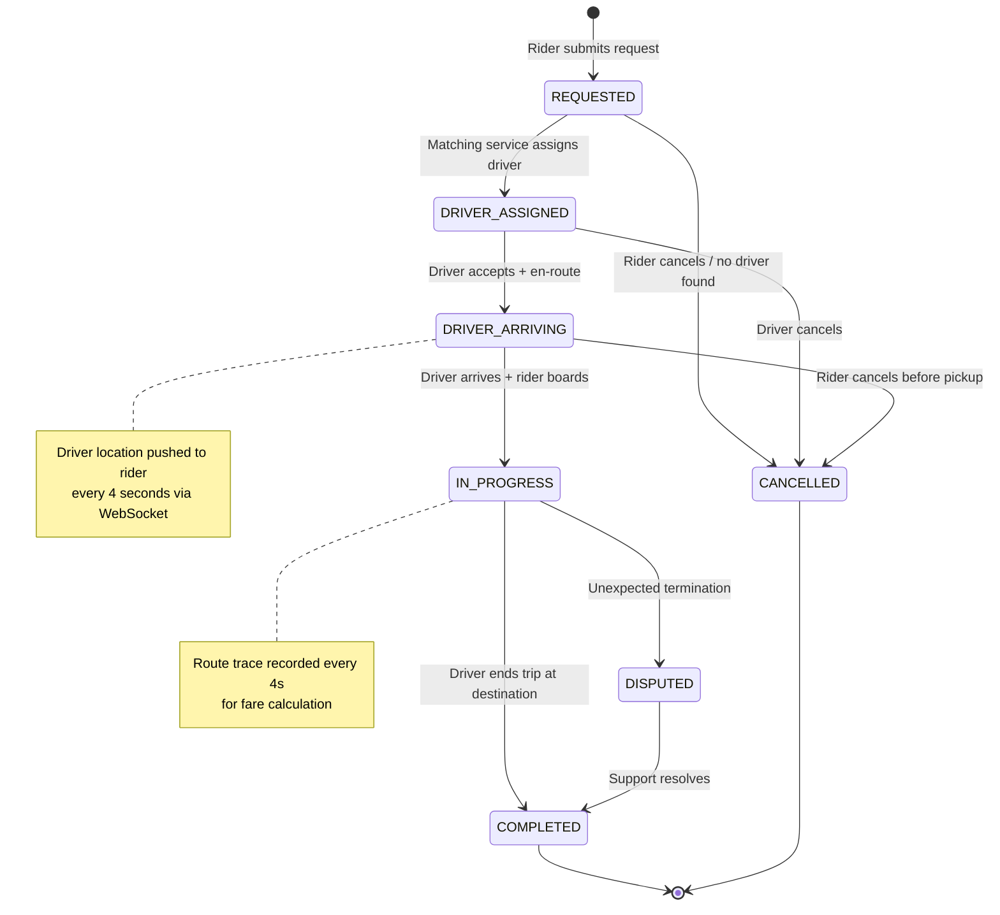
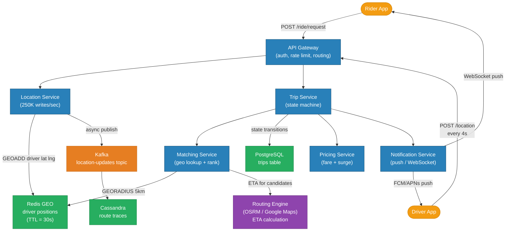
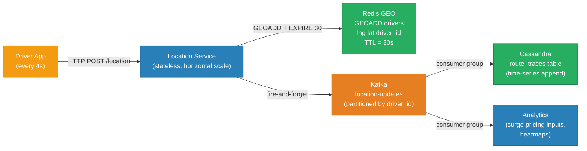
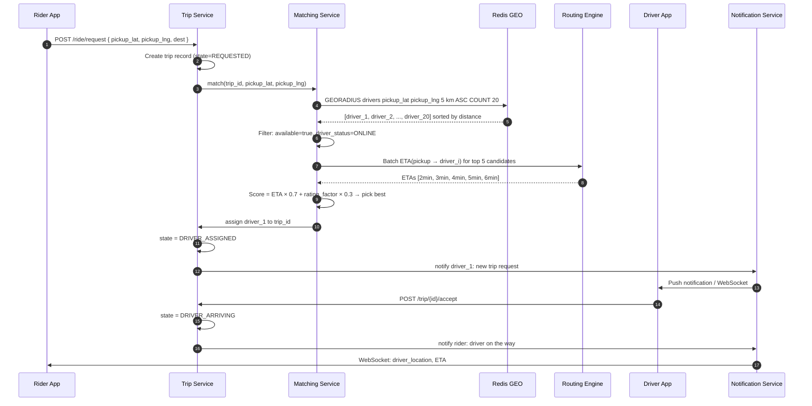
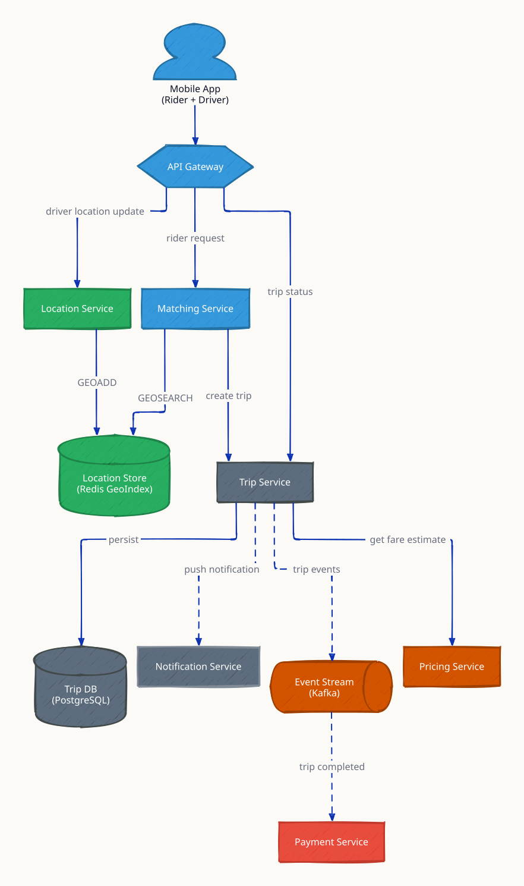
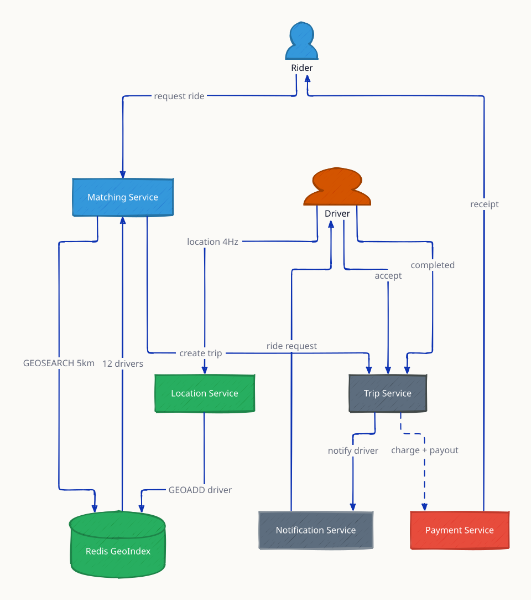
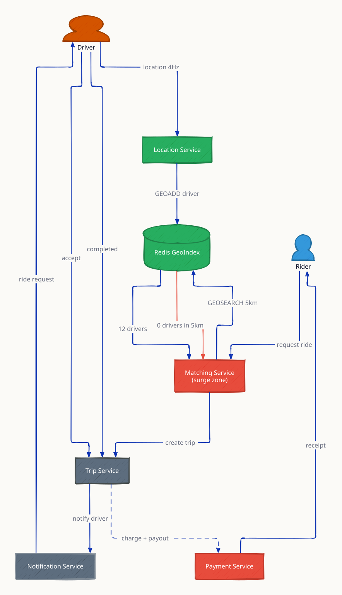

# Ride Sharing (Uber / Lyft)

A ride-sharing platform matches riders who need transport with nearby drivers in real time. The core engineering challenge is a two-sided marketplace with hard latency requirements: a rider must see nearby drivers within 500ms, matching must complete in under 5 seconds, and location updates from 1M+ active drivers must be processed continuously — roughly 250,000 GPS writes per second.

---

## Requirements

### Functional
- **Request ride** — rider specifies pickup and dropoff; system finds nearby drivers
- **Driver matching** — assign the best available driver based on proximity and ETA
- **Real-time tracking** — rider sees driver location updating every 4 seconds during approach and trip
- **Trip lifecycle** — state machine from REQUESTED to COMPLETED or CANCELLED
- **Pricing** — fare estimate before booking; surge pricing based on supply/demand
- **Trip history** — riders and drivers can view past trips and receipts

### Non-Functional
- 14M trips per day globally (Uber scale)
- 1M active drivers sending location updates every 4 seconds = **250,000 location writes/sec**
- Driver lookup (find drivers within 5 km) ≤ 500ms
- Matching decision ≤ 5 seconds end-to-end
- Trip state updates delivered in ≤ 2 seconds (WebSocket/push)
- 99.99% availability for the matching service

---

## Capacity Estimation

| Metric | Calculation | Result |
|---|---|---|
| Trips per day | Uber global peak estimate | 14M trips/day |
| Trip RPS | 14M / 86,400 | ~162 RPS |
| Active drivers (peak) | Estimate 1M globally | 1,000,000 |
| Location update RPS | 1M drivers / 4s interval | **250,000 writes/sec** |
| Location record size | driver_id + lat + lng + ts = ~64 bytes | — |
| Location write bandwidth | 250K × 64 B | ~16 MB/s |
| Rider lookups per trip | Multiple retries, ETA queries | ~5 lookups/trip |
| Geo query RPS | 162 × 5 | ~810 RPS |
| Redis GEO memory (1M drivers) | 1M × ~64 bytes | ~64 MB (tiny) |
| Trip history storage/day | 14M × ~2 KB | ~28 GB/day |

Key insight: location updates dominate the write path at 250K/sec. The trip lifecycle itself (162 RPS) is trivial by comparison.

---

## Trip State Machine



---

## Architecture Overview



---

## Location Update Pipeline



**Redis GEO internals:** `GEOADD` encodes latitude/longitude into a 52-bit geohash and stores it as a sorted set score. `GEORADIUS` decodes the geohash and performs a bounding-box + distance filter. For 1M drivers this runs in under 5ms.

**TTL = 30s:** if a driver stops sending updates (app crashes, phone off), their position expires automatically — they will no longer appear in GEORADIUS results. No manual cleanup needed.

---

## Matching Flow



---

## Surge Pricing

Surge pricing multiplies the base fare when demand exceeds supply in a geographic cell.

```
Base fare = (base_rate) + (per_km × distance) + (per_min × duration)
Surge multiplier = f(demand / supply ratio)

Geohash cell (precision 6 ≈ 1.2 km × 0.6 km):
  supply  = GEORADIUS count of available drivers in cell
  demand  = trip requests in last 5 minutes for cell
  ratio   = demand / supply
  surge   = 1.0  if ratio < 1.0
           = 1.5  if ratio in [1.0, 1.5)
           = 2.0  if ratio in [1.5, 2.5)
           = 3.0+ if ratio ≥ 2.5
```

Surge is computed every 60 seconds per geohash cell by a background job reading from Redis (live driver counts) and Kafka (recent demand events). Results are stored in Redis with a 90s TTL.

---

## Real-time Location Push to Rider

During `DRIVER_ARRIVING` and `IN_PROGRESS` states:

1. Driver app sends `POST /location` every 4 seconds.
2. Location Service writes to Redis GEO and publishes to Kafka.
3. A Kafka consumer reads the event, looks up the active trip for that driver, and pushes the location to the rider's WebSocket connection.
4. The rider app receives `{ lat, lng, eta_seconds }` and animates the driver pin.

WebSocket connections are managed per-server. A routing table in Redis (`trip:{id}:rider_ws_node`) maps trip IDs to the server holding the rider's connection, so the location push reaches the correct server.

---

## Database Schema

```sql
-- Active trips (hot path)
CREATE TABLE trips (
    id              BIGINT PRIMARY KEY,
    rider_id        BIGINT NOT NULL,
    driver_id       BIGINT,
    status          VARCHAR(32) NOT NULL,  -- enum: REQUESTED, DRIVER_ASSIGNED, etc.
    pickup_lat      DOUBLE PRECISION,
    pickup_lng      DOUBLE PRECISION,
    dest_lat        DOUBLE PRECISION,
    dest_lng        DOUBLE PRECISION,
    requested_at    TIMESTAMPTZ NOT NULL,
    matched_at      TIMESTAMPTZ,
    started_at      TIMESTAMPTZ,
    completed_at    TIMESTAMPTZ,
    fare_cents      INT,
    surge_multiplier NUMERIC(4,2) NOT NULL DEFAULT 1.0
);
CREATE INDEX idx_trips_status      ON trips (status) WHERE status NOT IN ('COMPLETED','CANCELLED');
CREATE INDEX idx_trips_driver      ON trips (driver_id, status);

-- Driver state (small, hot table)
CREATE TABLE drivers (
    id              BIGINT PRIMARY KEY,
    status          VARCHAR(16) NOT NULL DEFAULT 'OFFLINE',  -- ONLINE, ON_TRIP, OFFLINE
    rating          NUMERIC(3,2),
    vehicle_type    VARCHAR(32),
    last_seen_at    TIMESTAMPTZ
);
```

Route traces (lat/lng every 4s for each IN_PROGRESS trip) are written to Cassandra:

```cql
CREATE TABLE route_traces (
    trip_id     BIGINT,
    recorded_at TIMESTAMP,
    lat         DOUBLE,
    lng         DOUBLE,
    speed_kmh   FLOAT,
    PRIMARY KEY (trip_id, recorded_at)
) WITH CLUSTERING ORDER BY (recorded_at ASC)
  AND default_time_to_live = 7776000;  -- 90 days
```

---

## Key Design Decisions

| Decision | Choice | Why |
|---|---|---|
| Driver location store | Redis GEO (sorted set + geohash) | Sub-5ms GEORADIUS on 1M drivers; 30s TTL auto-expires offline drivers |
| Location history | Cassandra | Append-only, time-series — Cassandra's clustering key is perfect; immutable once written |
| Trip state machine | PostgreSQL | Requires ACID transitions; state must not be lost or duplicated |
| Fanout of driver location to rider | Kafka consumer + WebSocket routing table | Decouples location ingestion from real-time push; Redis routing table maps trip → WebSocket server |
| Matching algorithm | ETA-weighted scoring (not pure distance) | A driver 500m away stuck in traffic is worse than one 1km away on a clear road |
| Surge pricing granularity | Geohash precision 6 cells (~1 km²) | Fine enough to reflect local supply/demand; coarse enough to compute cheaply every minute |
| Driver TTL in Redis | 30 seconds | 2× heartbeat interval; tolerates one missed update before expiring the driver |

---

## Trade-offs

| Option A | Option B | Winner | Reason |
|---|---|---|---|
| Redis GEO for live positions | PostGIS spatial queries | Redis GEO | 250K writes/sec would overwhelm Postgres; Redis GEO is in-memory |
| WebSocket for driver location push | Polling every 4s | WebSocket | Polling 300K concurrent riders every 4s = 75K HTTP requests/sec overhead |
| Cassandra for route traces | PostgreSQL | Cassandra | Time-series append-only; no updates; Cassandra scales writes horizontally |
| Google Maps ETA | Self-hosted OSRM | Depends | Google Maps is more accurate; OSRM cheaper at scale (no per-query cost) |

---

## Interview Angles

**Q1: How do you find available drivers in real time at scale?**
Use Redis GEO (`GEOADD` on every heartbeat, `GEORADIUS` on ride request). At 1M drivers the index is ~64 MB in memory. `GEORADIUS` returns the N nearest drivers in under 5ms. Drivers that go offline expire automatically via 30s TTL.

**Q2: How do you implement surge pricing?**
Compute demand/supply ratio per geohash cell every 60 seconds. Supply = live `GEORADIUS` count of online drivers per cell. Demand = Kafka-aggregated ride requests per cell in the last 5 minutes. Store surge multipliers in Redis with 90s TTL so all servers read the same value.

**Q3: How does the system handle a driver going offline mid-trip?**
The trip state remains `IN_PROGRESS` in PostgreSQL. If no location heartbeat is received for 30s, the location TTL expires and a trip monitor job detects a stale `last_seen_at`. It sends push notifications to both parties and opens a support ticket. The trip is eventually moved to `DISPUTED` for manual resolution.

**Q4: How do you scale the location service to 250,000 writes/sec?**
The Location Service is stateless and horizontally scalable behind a load balancer. Each instance does a single Redis GEOADD (fast pipeline command) and publishes to Kafka. Redis Cluster shards by driver_id key hash. At 250K/sec with 10 Redis shards, each shard handles 25K writes/sec — well within Redis single-shard capacity of ~100K+ simple ops/sec.

**Q5: How do you deliver the matching decision within 5 seconds?**
Match flow: GEORADIUS (<5ms) → availability filter (in-memory) → batch ETA for top 5 candidates (~500ms per call cached by route segment) → score and select (microseconds) → write to DB + push notification (~50ms). Total: well under 1 second in the happy path. The 5-second SLA covers retries and notification delivery.

---

## Run

```sh
docker compose up --build -d && sleep 2 && bash test.sh
```

## Test

```sh
go test -v ./api/
```

---

## Architecture Diagrams

> Generated from D2 sources in [`docs/diagrams/src/SD03_ride_sharing/`](../../../docs/diagrams/src/SD03_ride_sharing/).
> Regenerate: `just diagrams-topic SD03_ride_sharing`.

### Overview

Six services around a Redis geo-index and Kafka: location ingestion, matching, trip lifecycle, pricing, payment, notification.



**`surge_pricing` scenario:** demand outstrips drivers in a zone and the pricing service raises multipliers in real time — price as the load balancer for physical supply.


### Request Flow

A complete ride: REQUESTED → driver matched via GEOSEARCH → ACCEPTED → PICKUP → IN_PROGRESS → COMPLETED → payment captured, each transition an event.



**`no_drivers` scenario:** the search radius widens progressively, then the request queues or fails gracefully — every matching system needs an empty-result strategy.


