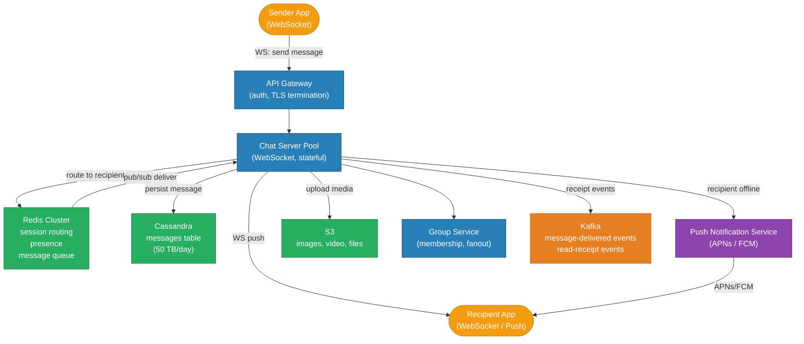
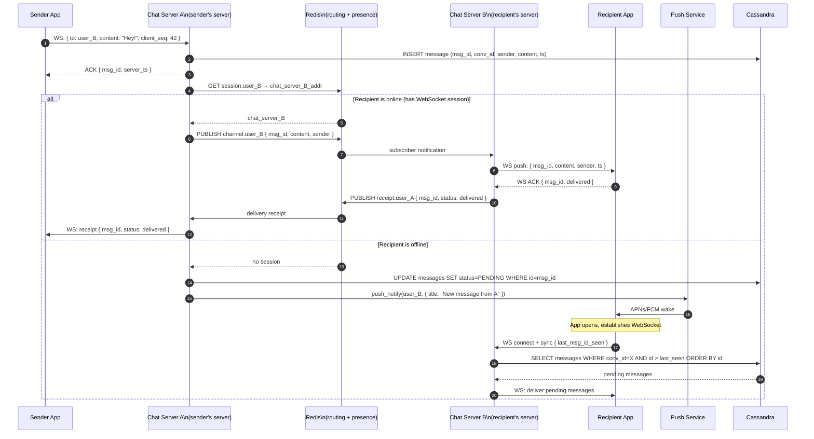
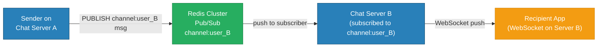
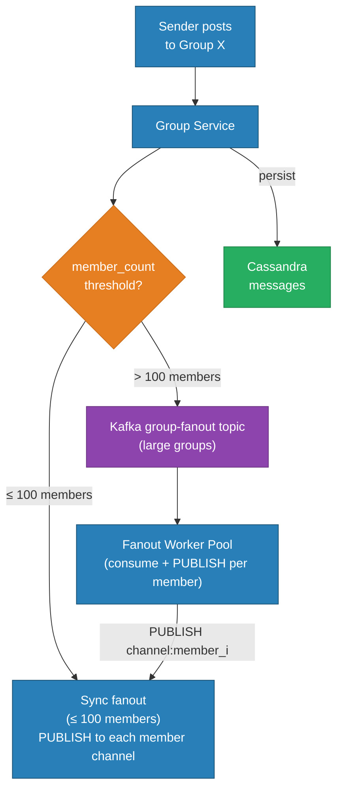
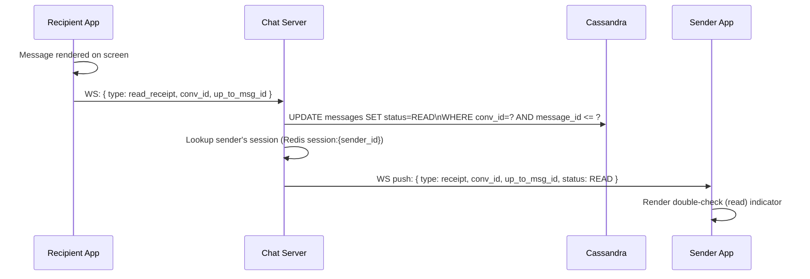
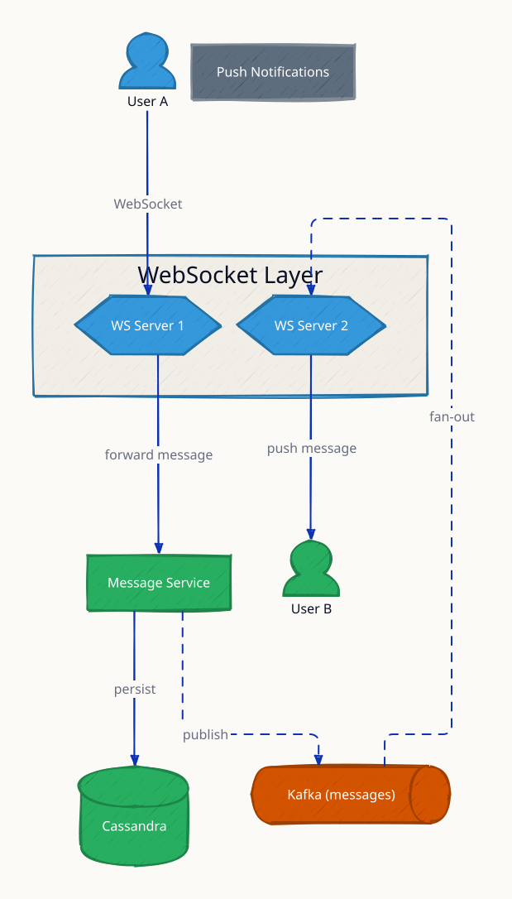
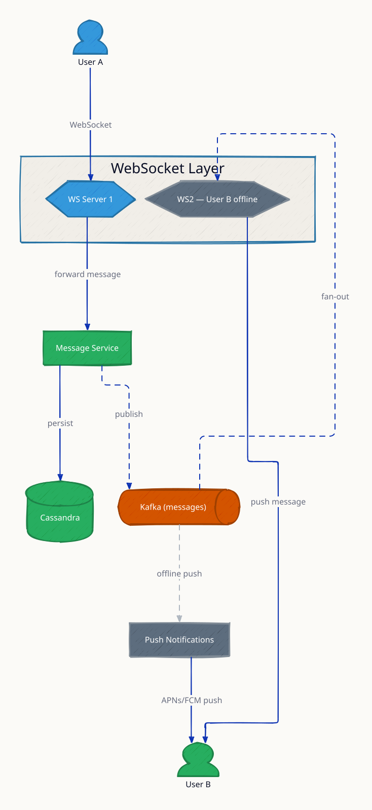
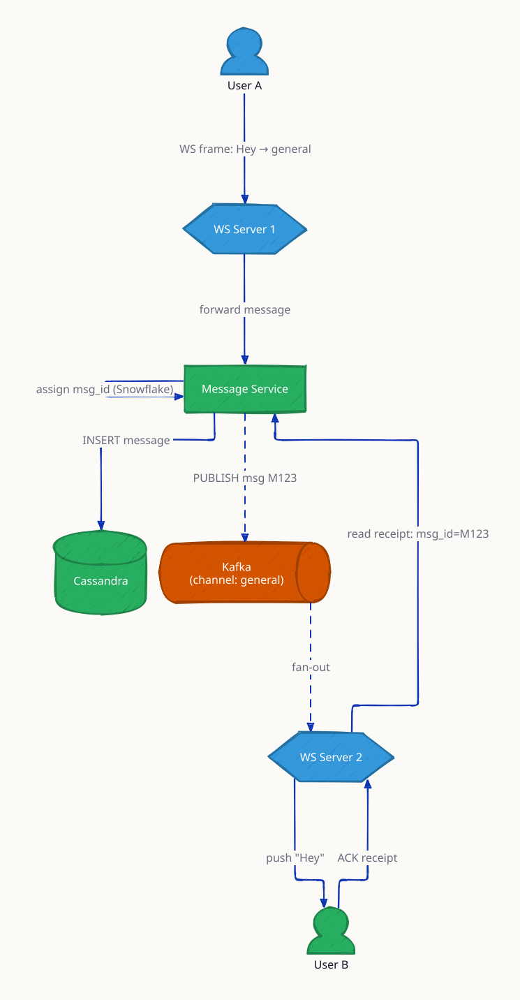
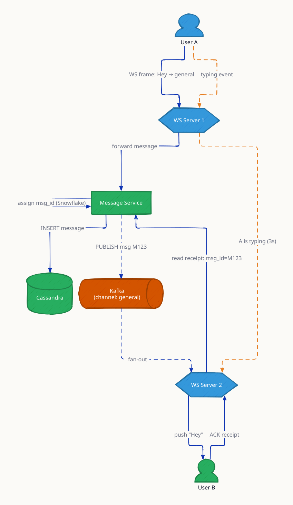

# Real-time Chat (WhatsApp / Slack)

A real-time chat system delivers messages between users within milliseconds, maintains message order and persistence, handles offline users gracefully, and scales to hundreds of millions of concurrent connections. The core challenges are: mapping a sender's message to the correct WebSocket connection on one of thousands of servers; storing billions of messages durably; and reliably delivering to offline users via push notifications.

---

## Requirements

### Functional
- **1-on-1 messaging** — send text, images, files between two users
- **Group chats** — up to 1,000 members per group
- **Real-time delivery** — messages appear on recipient's screen within 200ms if online
- **Offline queue** — messages persisted and delivered when recipient comes online
- **Read receipts** — single check (delivered) and double check (read) indicators
- **Presence** — show online/last-seen status for contacts
- **Message history** — scroll back through past messages; sync across devices

### Non-Functional
- 500M DAU; 100 messages per user per day = **50 billion messages/day**
- Peak message RPS: 50B / 86,400 × 3 (peak factor) ≈ **1.7M RPS**
- Message delivery latency ≤ 200ms (p99, same region)
- Messages must not be lost — at-least-once delivery
- Messages must be ordered within a conversation
- Store messages for 5 years minimum

---

## Capacity Estimation

| Metric | Calculation | Result |
|---|---|---|
| Messages per day | 500M users × 100 msgs | 50B messages/day |
| Baseline message RPS | 50B / 86,400 | ~580,000 RPS |
| Peak message RPS (3× burst) | 580K × 3 | ~1.74M RPS |
| Message size average | 1 KB (text + metadata) | — |
| Storage per day | 50B × 1 KB | ~50 TB/day |
| Storage over 5 years | 50 TB × 365 × 5 | ~91 PB |
| WebSocket connections (peak) | 500M DAU × 50% concurrent | ~250M connections |
| Connections per chat server (at 65K per server) | — | ~4,000 servers needed |
| Presence Redis memory | 500M users × 32 bytes | ~16 GB |

50 TB/day of message storage is the dominant cost driver. In practice, WhatsApp uses end-to-end encryption so messages are not stored on the server after delivery — this collapses the storage problem to undelivered messages only.

---

## Connection Model

| Client state | Transport | Mechanism |
|---|---|---|
| App in foreground | WebSocket (persistent) | Full-duplex, low-latency, server can push without polling |
| App backgrounded (Android) | FCM (Firebase Cloud Messaging) | OS-level push wakes the app |
| App backgrounded (iOS) | APNs (Apple Push Notification service) | Same; battery-efficient |
| WebSocket not available | HTTP long-poll (fallback) | 30s hanging GET; server responds when message arrives |

---

## Architecture Overview



---

## 1-on-1 Message Delivery



---

## Cross-Server Message Routing with Redis Pub/Sub

When a user connects via WebSocket, the chat server registers the session:

```
# Register session on connect
SET session:{user_id} {server_addr}  EX 300   # refreshed every heartbeat

# Subscribe to user's personal channel
SUBSCRIBE channel:{user_id}
```

When Server A needs to deliver to a user on Server B:

```
# Server A publishes to Redis channel
PUBLISH channel:{user_id_B}  {message_json}

# Server B (subscribed) receives and pushes via WebSocket
```



**Scaling note:** Redis Pub/Sub is not persistent — if Server B crashes, messages published while it was down are lost. Combine with the Cassandra message store: Server B re-reads pending messages from Cassandra on restart.

---

## Message Storage — Cassandra Schema

Cassandra is ideal for chat: append-only inserts, time-ordered reads within a conversation, horizontal scale for write throughput.

```cql
CREATE TABLE messages (
    conversation_id  UUID,
    message_id       BIGINT,   -- Snowflake (time-sortable)
    sender_id        BIGINT,
    content          TEXT,
    media_url        TEXT,
    status           TINYINT,  -- 0=SENT 1=DELIVERED 2=READ
    created_at       TIMESTAMP,
    PRIMARY KEY (conversation_id, message_id)
) WITH CLUSTERING ORDER BY (message_id DESC)
  AND default_time_to_live = 157680000;  -- 5 years

-- For syncing: last N messages in a conversation
SELECT * FROM messages
WHERE conversation_id = ?
AND message_id < ?        -- cursor-based pagination
LIMIT 50;
```

**Why Cassandra over PostgreSQL for messages?**
- Write throughput: Cassandra handles millions of inserts/sec across nodes; PostgreSQL would require massive sharding complexity.
- Access pattern: always `WHERE conversation_id = ?` — perfect fit for a partition key.
- No joins needed: messages are denormalized; user metadata fetched separately.

---

## Group Chat Fanout

For groups with ≤ 100 members: synchronous fanout — write the message to each member's delivery queue inline.

For large groups (100 – 1,000 members): async fanout via a dedicated group fanout worker.



---

## Presence System

```
# User comes online (WebSocket connect)
SET presence:{user_id}  online  EX 60    # 60s TTL

# Heartbeat every 30s (app in foreground)
SET presence:{user_id}  online  EX 60    # refresh TTL

# User goes offline (WebSocket disconnect or TTL expires)
→ key expires → read returns null → show "last seen {last_known_ts}"

# Last seen timestamp stored separately
SET last_seen:{user_id}  {unix_ts}       # no TTL — persistent
```

**Why not a DB for presence?**
500M users × SET/refresh every 30s = ~16.7M ops/sec — only Redis can handle this in memory. A SQL row-per-user would serialize on UPDATE.

**Privacy:** users can opt out of showing presence. Clients are told "presence_hidden" and should not display last-seen.

---

## Read Receipts



Receipts are sent in batches: one receipt covers all messages up to `up_to_msg_id` — not one receipt per message.

---

## Message Ordering and Deduplication

**Client-side sequence numbers:** each client sends a monotonically increasing `client_seq` per conversation. The server assigns a `message_id` (Snowflake). If the same `client_seq` arrives twice (network retry), the server deduplicates by checking for an existing `(conversation_id, sender_id, client_seq)` entry.

**Out-of-order delivery:** the client buffers messages locally by `message_id` and renders them in order — gaps are filled when missing messages are fetched from history.

---

## End-to-End Encryption Overview

WhatsApp uses the Signal Protocol:

1. **Key exchange:** each device generates a keypair and uploads the public key to the server.
2. **Session initiation:** sender fetches recipient's public key, performs X3DH (Extended Triple Diffie-Hellman) key exchange.
3. **Double ratchet:** each message uses a new symmetric key derived from a ratcheting chain — forward secrecy (old keys discarded) and break-in recovery.
4. **Server sees only:** encrypted ciphertext + metadata (sender, recipient, timestamp). Content is never decrypted on the server.

Consequence for the system design: messages can be stored as opaque blobs; the server cannot index content for search.

---

## Key Design Decisions

| Decision | Choice | Why |
|---|---|---|
| Connection protocol | WebSocket (persistent) | Full-duplex; server can push without client polling; essential for real-time feel |
| Cross-server routing | Redis Pub/Sub | Lightweight; O(1) per-user channel; no shared memory needed between servers |
| Message store | Cassandra | Append-only, time-ordered within partition, horizontal write scale to 50 TB/day |
| Presence | Redis with TTL | In-memory key expiry handles "went offline" automatically; 16.7M presence ops/sec |
| Offline delivery | Push + offline queue in Cassandra | APNs/FCM wakes device; Cassandra holds pending messages for pull on reconnect |
| Group fanout | Async Kafka for large groups | 1,000-member group × 1.7M msg/sec = catastrophic if synchronous |
| Read receipts | Batch (up-to-msg_id) | One receipt per render, not per message — 100× fewer events |

---

## Trade-offs

| Option A | Option B | Winner | Reason |
|---|---|---|---|
| Redis Pub/Sub for routing | Consistent hash ring (sender pushes directly to recipient's server) | Redis Pub/Sub | Pub/Sub is simpler and handles server restarts without re-routing logic |
| Cassandra for messages | PostgreSQL with sharding | Cassandra | Sharded PG is operationally complex; Cassandra purpose-built for this access pattern |
| Server-side message storage | Client-only (E2E encrypted) | Depends on product | WhatsApp stores ephemerally (delete on delivery); Slack stores permanently for search |
| Per-message TTL | Conversation-level archiving | Conversation archiving | Simpler to manage; per-message TTL overhead in Cassandra is high |

---

## Interview Angles

**Q1: How do you deliver a message when the recipient is offline?**
When Redis session lookup returns no server address, mark the message as PENDING in Cassandra and send a push notification via APNs/FCM. When the recipient reconnects, the client sends its last seen message ID, and the server queries Cassandra for all messages since that ID in the conversation.

**Q2: How do you scale WebSocket connections across multiple servers?**
Each server maintains its own WebSocket connections. On connect, the server writes `SET session:{user_id} {this_server_addr}` to Redis. Any server can route a message to the correct peer by publishing to `channel:{user_id}` in Redis Pub/Sub — the owning server receives it and pushes to the WebSocket.

**Q3: How does the system handle group message delivery at scale?**
For small groups (≤ 100 members), inline fanout via Redis Pub/Sub. For large groups, publish one message to a Kafka topic partitioned by group_id; fanout workers consume and deliver to each member channel. This keeps the sender's write path O(1) regardless of group size.

**Q4: How do you guarantee message ordering within a conversation?**
Each message is assigned a Snowflake ID (monotonically increasing) at the receiving server. Cassandra clusters messages by `(conversation_id, message_id DESC)`, ensuring reads return messages in insertion order. Clients use a client-sequence number for deduplication on retries.

**Q5: What happens if the chat server crashes mid-delivery?**
The message is already persisted in Cassandra before attempting delivery. If the server crashes, the recipient's app will sync from Cassandra on reconnect. If the delivery receipt was lost, the sender will not see "delivered" — but the message is safe in the store. Redis session entry expires, and the reconnecting client registers with a new server.

---

## Run

```sh
docker compose up --build -d && sleep 2 && bash test.sh
```

## Test

```sh
go test -v ./api/
```

---

## Architecture Diagrams

> Generated from D2 sources in [`docs/diagrams/src/SD04_realtime_chat/`](../../../docs/diagrams/src/SD04_realtime_chat/).
> Regenerate: `just diagrams-topic SD04_realtime_chat`.

### Overview

Users hold WebSockets to different servers; Kafka fans each message across servers so any sender reaches any recipient, with Cassandra persisting history and Redis tracking presence.



**`offline_delivery` scenario:** the recipient has no connection, so the message rests in Cassandra and a push notification fires via APNs/FCM; reconnect replays missed messages from the store.



### Request Flow

One message's path: WS frame → persisted with a Snowflake message ID → published to Kafka → fanned to the recipient's server → delivered → read receipt back.



**`typing_indicator` scenario:** typing events broadcast with a 3s expiry and are never persisted — ephemeral signals take the fast path, durable messages take the safe path.


