# Video Streaming (YouTube / Netflix)

A video streaming platform lets users upload, transcode, and stream video to billions of viewers globally. The engineering challenges span multiple disciplines: a multi-stage upload and transcoding pipeline that must handle 500 hours of video per minute (YouTube scale); adaptive bitrate streaming that smoothly adjusts quality to the viewer's bandwidth; and a CDN strategy that can absorb a viral video spiking to millions of concurrent viewers without touching the origin.

---

## Requirements

### Functional
- **Upload video** — accept raw video files up to 10 GB, chunked upload for resumability
- **Transcode** — automatically produce multiple resolutions: 360p, 720p, 1080p, 4K
- **Adaptive bitrate stream** — HLS / MPEG-DASH manifest; client selects quality per segment
- **Global delivery** — serve segments from CDN edge nodes near viewers
- **Search** — full-text search over titles, descriptions, tags
- **Recommendations** — personalized video feed; "Up Next" autoplay
- **View counts** — approximate real-time counter visible on every video page

### Non-Functional
- 500 hours of video uploaded per minute (YouTube scale)
- 1 billion hours watched per day
- Video start latency ≤ 3 seconds globally (CDN-cached segments)
- 99.9% playback success rate (buffer ratio < 0.5%)
- Support 4K (50 Mbps) down to 240p (0.3 Mbps) adaptive streams
- Transcode new uploads within 5 minutes of upload completion

---

## Capacity Estimation

| Metric | Calculation | Result |
|---|---|---|
| Upload rate | 500 hr/min × 60 min | 30,000 hr/hr of raw video |
| Storage per hour of video (all qualities) | 1080p ~4 GB + 720p ~2 GB + 360p ~0.5 GB | ~7 GB/hr |
| Raw upload storage per minute | 500 hr × 60 min × ~1 GB/hr raw | ~30 TB/min raw |
| Encoded storage per day | 500 hr/min × 60 min × 24 hr × 7 GB | ~5 PB/day encoded |
| Watch hours per day | 1B hours/day | — |
| Concurrent viewers (assuming 1hr avg session) | 1B / 24 | ~41M concurrent |
| Bandwidth (avg 2 Mbps × 41M concurrent) | 41M × 2 Mbps | **~82 Tbps** CDN egress |
| Metadata storage per video | ~10 KB | — |
| Total videos (estimate 1B videos) | 1B × 10 KB | ~10 TB metadata |

82 Tbps of CDN egress is why YouTube and Netflix are the single largest consumers of internet bandwidth globally. This is only feasible through deep CDN peering with ISPs.

---

## Upload Pipeline

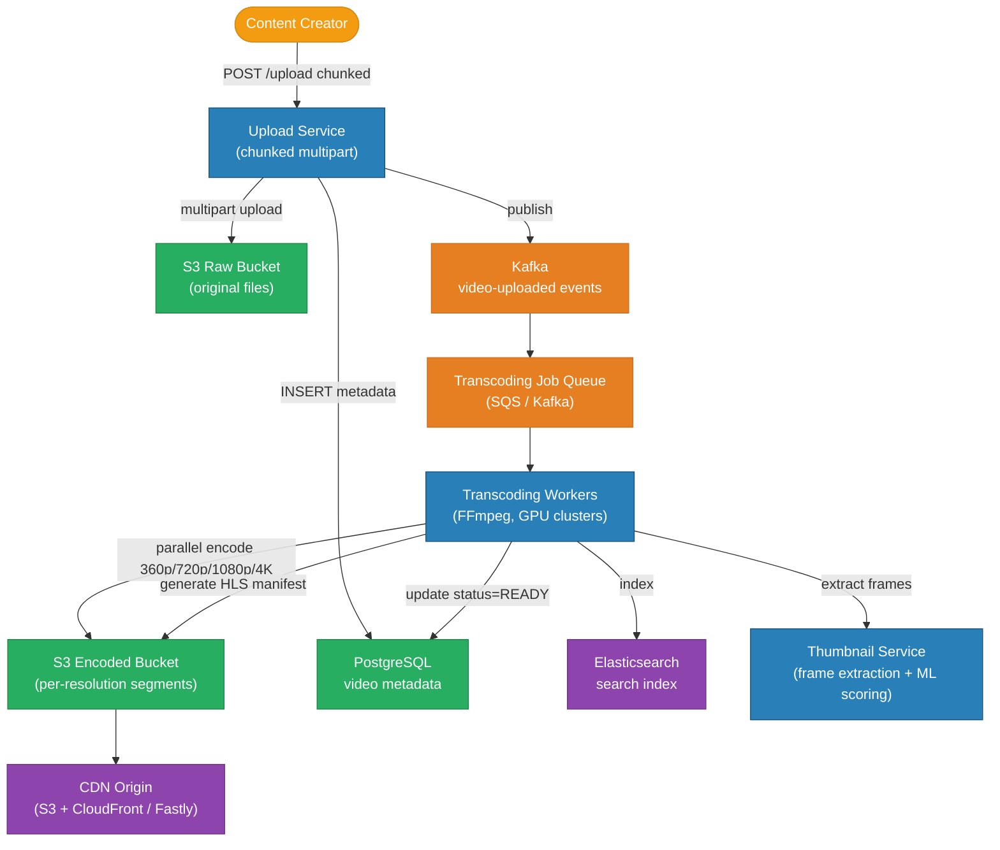

---

## Video Encoding

### Codec Comparison

| Codec | Year | Compression vs H.264 | Compatibility | Use case |
|---|---|---|---|---|
| H.264 / AVC | 2003 | Baseline | Universal (every device) | Default for all resolutions |
| H.265 / HEVC | 2013 | ~40% better | Wide (not all browsers) | 4K, HDR content |
| VP9 | 2013 | ~35% better | Chrome, Android, Firefox | YouTube default |
| AV1 | 2018 | ~50% better | Growing (latest devices) | Future default; expensive to encode |

**Chunk-based encoding:** the raw video is split into 2-minute chunks and encoded in parallel across a worker pool. A 2-hour movie → 60 chunks → 60 workers encode simultaneously → 4× resolution each → 240 parallel FFmpeg jobs. This reduces a 4-hour sequential encode to under 10 minutes.

---

## Adaptive Bitrate Streaming (HLS)

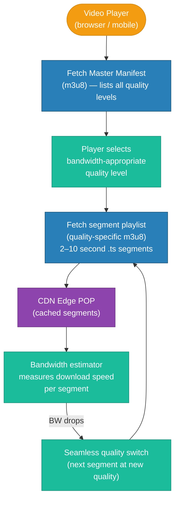

### HLS Manifest Structure

```
# Master playlist (master.m3u8)
#EXTM3U
#EXT-X-STREAM-INF:BANDWIDTH=800000,RESOLUTION=640x360
https://cdn.example.com/vid123/360p.m3u8

#EXT-X-STREAM-INF:BANDWIDTH=2800000,RESOLUTION=1280x720
https://cdn.example.com/vid123/720p.m3u8

#EXT-X-STREAM-INF:BANDWIDTH=5000000,RESOLUTION=1920x1080
https://cdn.example.com/vid123/1080p.m3u8

# Quality playlist (720p.m3u8)
#EXTM3U
#EXT-X-TARGETDURATION:6
#EXT-X-VERSION:3
#EXTINF:6.000,
https://cdn.example.com/vid123/720p/seg001.ts
#EXTINF:6.000,
https://cdn.example.com/vid123/720p/seg002.ts
...
```

Each `.ts` segment is ~1 MB (at 720p). Segments are individually cacheable by CDN — the most popular segments (beginning of video) get extreme cache hit ratios.

---

## Streaming Flow

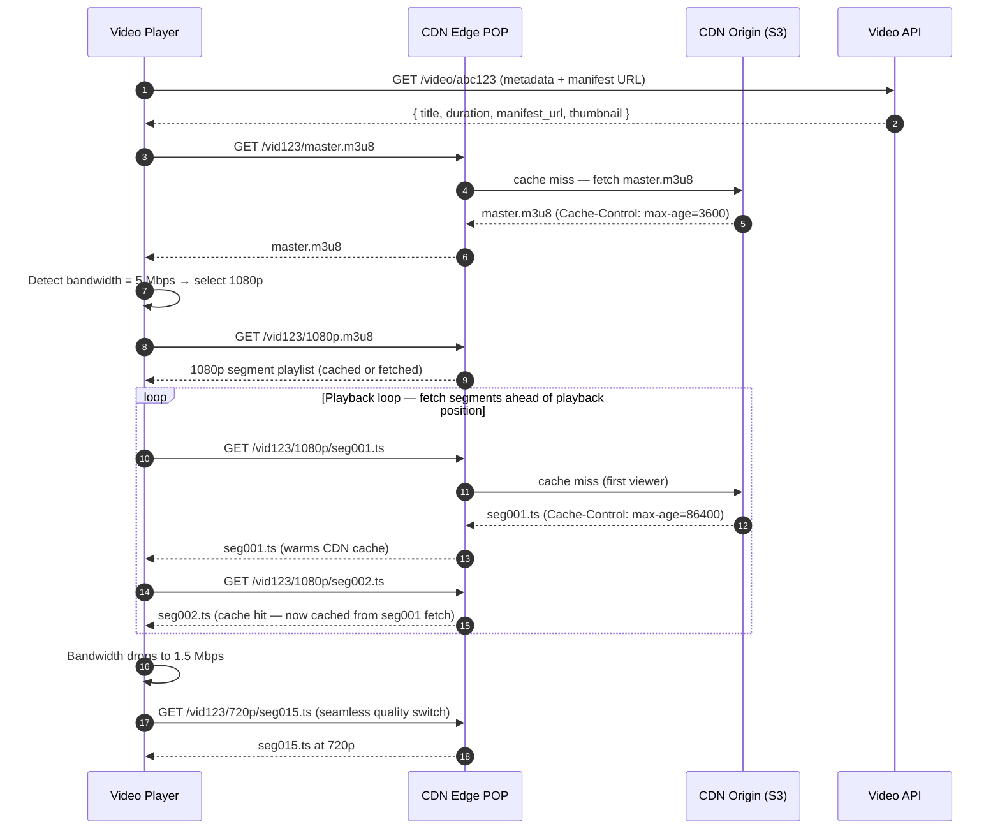

---

## CDN Strategy

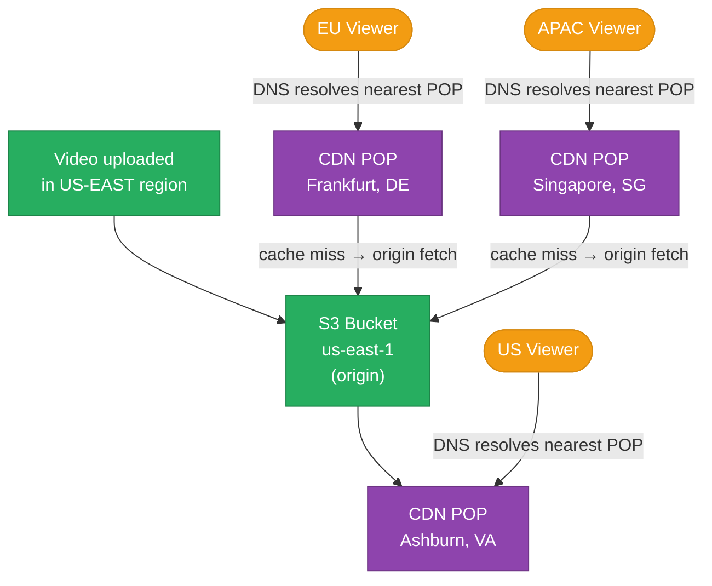

**Cache policy by asset type:**

| Asset | Cache-Control | Rationale |
|---|---|---|
| Master manifest (`master.m3u8`) | `max-age=3600` | May update (new quality added); 1h TTL |
| Quality playlist (`720p.m3u8`) | `max-age=3600` | Same — segment list can grow |
| Video segment (`seg001.ts`) | `max-age=86400` (1 day) | Immutable once transcoded; aggressive caching |
| Thumbnail | `max-age=86400` | Changes rarely |
| Video metadata (API) | `max-age=60` | View count updates frequently |

**CDN warm-up for viral videos:** when a new video is published, a pre-warming job pushes the first 5 segments of each quality to key CDN POPs proactively. This eliminates origin hits for the initial burst of traffic.

---

## Database Architecture

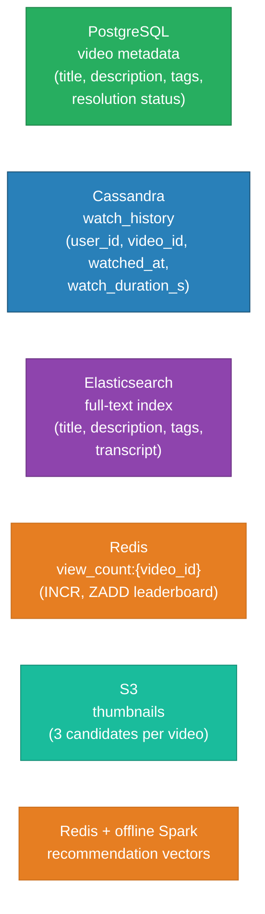

```sql
-- Video metadata (PostgreSQL)
CREATE TABLE videos (
    id              BIGINT PRIMARY KEY,       -- Snowflake
    creator_id      BIGINT NOT NULL,
    title           VARCHAR(200) NOT NULL,
    description     TEXT,
    status          VARCHAR(20) NOT NULL,     -- UPLOADING, PROCESSING, READY, REMOVED
    duration_s      INT,
    raw_s3_key      TEXT,
    view_count      BIGINT NOT NULL DEFAULT 0,
    like_count      BIGINT NOT NULL DEFAULT 0,
    published_at    TIMESTAMPTZ,
    created_at      TIMESTAMPTZ NOT NULL
);

CREATE INDEX idx_videos_creator ON videos (creator_id, published_at DESC);
CREATE INDEX idx_videos_published ON videos (published_at DESC) WHERE status = 'READY';
```

---

## Thumbnail Generation

During transcoding:
1. FFmpeg extracts frames at 10-second intervals.
2. A lightweight ML model scores each frame on visual quality (no blurriness, no black frames, faces present, high color contrast).
3. Top 3 candidate frames are stored in S3.
4. Creator is shown the 3 candidates and may select or upload a custom thumbnail.
5. Selected thumbnail is pushed to CDN with `max-age=86400`.

---

## View Count System

At 1 billion watch-hours/day, accurate per-request view count writes would crush any database.

```
# On every video play (or every 30s of watch time):
INCR view_count:{video_id}                  # atomic Redis increment
ZADD trending_24h score={incr_ts} member={video_id}  # real-time leaderboard

# Background job every 5 minutes:
→ Read view_count:{video_id} from Redis
→ UPDATE videos SET view_count = view_count + delta WHERE id = ?
→ RESET Redis counter to 0 (or track delta separately)
```

This is the same pattern as the URL shortener click counter — Redis absorbs the write storm; PostgreSQL is updated in batches.

---

## Recommendations

**Offline (batch) component — runs nightly with Apache Spark:**
- Collaborative filtering: users who watched video X also watched videos Y and Z → recommend Y, Z to new viewers of X
- Content-based filtering: embed video metadata and transcript into dense vectors; recommend nearest neighbors in embedding space
- Output: precomputed recommendation list per video stored in Redis (`recs:{video_id}`)

**Online (real-time) component:**
- After each watch event, re-rank the precomputed recs list using real-time signals: watch duration, like/dislike, user watch history freshness
- A/B test different ranking models; winner deployed via feature flags

---

## Key Design Decisions

| Decision | Choice | Why |
|---|---|---|
| Video storage | S3 (object storage) | Immutable blobs; infinitely scalable; cheap; CDN origin pull built-in |
| Transcoding | Async worker pool (Kafka → FFmpeg) | Upload and transcode are decoupled; workers scale independently; GPU instances for fast H.265 |
| Streaming protocol | HLS (Apple) | Universal compatibility; 6-second segments balance latency vs resilience; MPEG-DASH is equally valid |
| Segment cache TTL | `max-age=86400` (immutable) | Segments never change after encode; long TTL maximizes CDN offload |
| View count | Redis INCR + batch flush | Cannot do 1M SQL UPDATEs/sec; Redis handles it trivially |
| Watch history | Cassandra | Append-only user events; partition by user_id; classic time-series pattern |
| Search | Elasticsearch | Full-text search with BM25 ranking; handles title, description, auto-complete |
| Recommendations | Batch Spark + real-time re-rank | Pure real-time is expensive; pure batch is stale; hybrid gives freshness at reasonable cost |

---

## Trade-offs

| Option A | Option B | Winner | Reason |
|---|---|---|---|
| HLS (Apple) | MPEG-DASH (ISO) | HLS | Better iOS/Safari support; functionally equivalent otherwise |
| Eager CDN pre-warming | Lazy cache fill (on first request) | Lazy for most; eager for top creators | Pre-warming 500hr/min of new content is too expensive; most videos are rarely watched |
| Server-sent events for live counts | Polling every 30s | Polling | Live view count has no strict latency requirement; polling cheaper at 1B/day scale |
| GPU transcoding workers | CPU-only | GPU | H.265/AV1 encoding is 10-50× faster on GPU; justifies cost at 500 hr/min |
| PostgreSQL for watch history | Cassandra | Cassandra | Append-only with user_id partition key — Cassandra's sweet spot; PG would shard poorly |

---

## Interview Angles

**Q1: How do you transcode 500 hours of video per minute?**
Chunk each upload into 2-minute raw segments and distribute them across a GPU worker pool via Kafka. Each worker runs FFmpeg to produce all quality levels for its chunk. Chunks are recombined into a final HLS manifest. Parallelism across chunks and resolutions allows a 2-hour movie to transcode in under 10 minutes with ~60 workers.

**Q2: What is adaptive bitrate streaming, and how does it work?**
The video is encoded at multiple quality levels (360p, 720p, 1080p) and split into short segments (6s each). An HLS master manifest lists all quality playlists. The player measures download speed per segment and switches to a higher or lower quality playlist for the next segment — seamlessly, mid-video — without any rebuffering.

**Q3: How do you handle a viral video with millions of concurrent viewers?**
The CDN does the heavy lifting. Once the first viewer in a region fetches a segment, it is cached at the CDN edge for all subsequent viewers. Segment immutability (`max-age=86400`) means zero origin hits for cached segments. For true viral spikes, a pre-warming job pushes the first 5 segments to top CDN POPs immediately on publish.

**Q4: How do you count views without melting the database?**
Use Redis INCR for real-time counting — it handles millions of increments per second. A background job reads the Redis counter every 5 minutes and applies a batch UPDATE to PostgreSQL. The Redis counter is reset to 0 after each flush (or a delta is tracked separately to avoid race conditions).

**Q5: How does search work at YouTube scale?**
Video metadata (title, description, tags, auto-generated transcript via speech-to-text) is indexed in Elasticsearch. Search queries use BM25 ranking combined with popularity signals (view count, engagement rate). The index is updated asynchronously after transcoding completes — a Kafka consumer triggers the Elasticsearch document upsert.

---

## Run

```sh
docker compose up --build -d && sleep 2 && bash test.sh
```

## Test

```sh
go test -v ./api/
```

---

## Architecture Diagrams

> Generated from D2 sources in [`docs/diagrams/src/SD05_video_streaming/`](../../../docs/diagrams/src/SD05_video_streaming/).
> Regenerate: `just diagrams-topic SD05_video_streaming`.

### Overview

Upload side: raw video → FFmpeg transcoding → HLS segments at four resolutions in S3. Playback side: signed-URL auth → CDN edge → client-side adaptive bitrate.

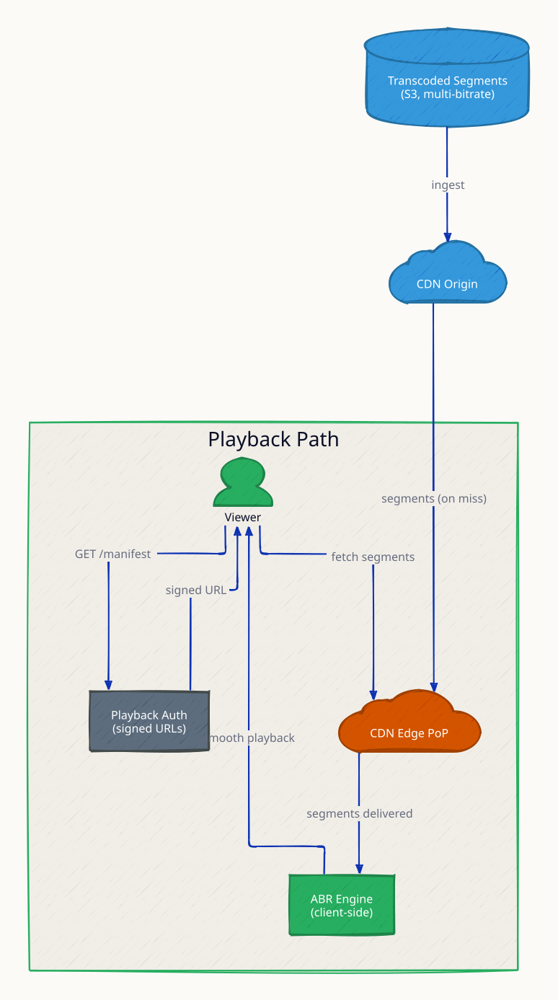

**`bandwidth_drop` scenario:** the network degrades and ABR steps 1080p→480p mid-stream — quality drops, playback never stalls; the buffer absorbs the transition.

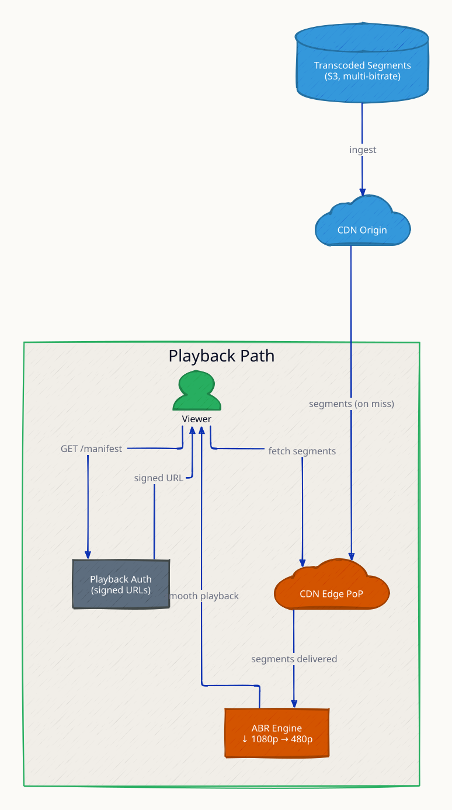

**`cdn_miss` scenario:** the first viewer in a region pulls segments from origin; everyone after is served from the PoP — popularity makes content cheaper to serve.

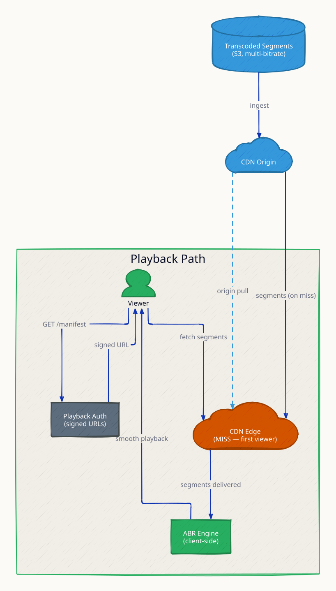

### Request Flow

Playback in detail: signed manifest → segment list → ABR picks 720p for 5Mbps bandwidth → buffer fills 30s ahead → smooth playback.

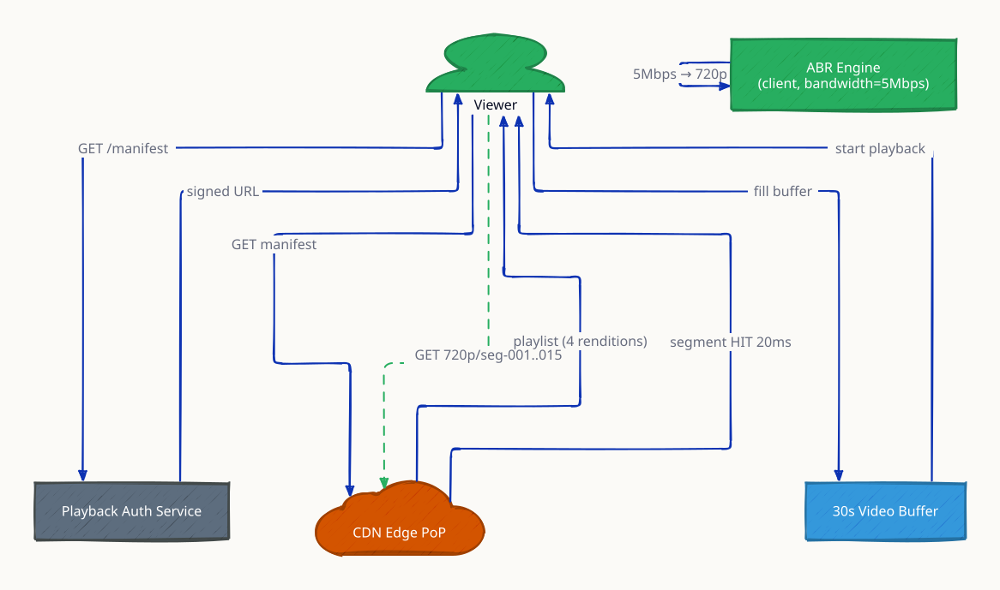

**`geo_restriction` scenario:** playback auth returns 403 for unlicensed territories — rights enforcement happens at token issuance, not at the CDN.

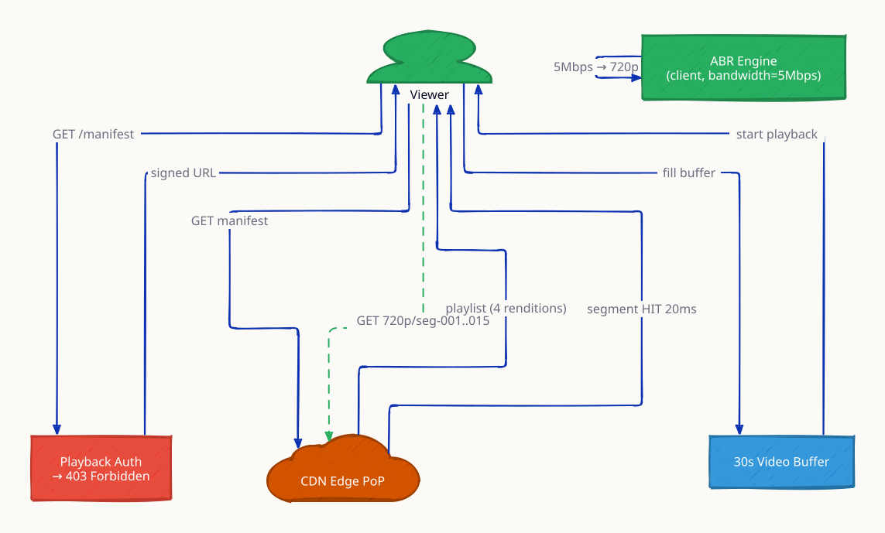

**`quality_switch` scenario:** bandwidth falls to 1Mbps and the client requests 360p segments from the next fetch onward — the server is oblivious; adaptation is entirely client-side.

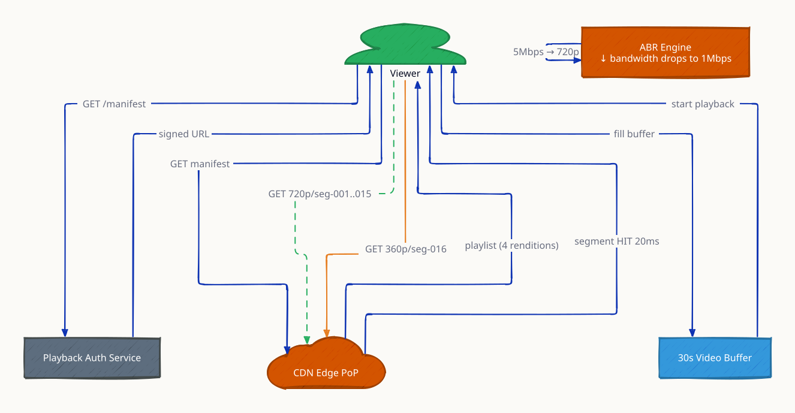
