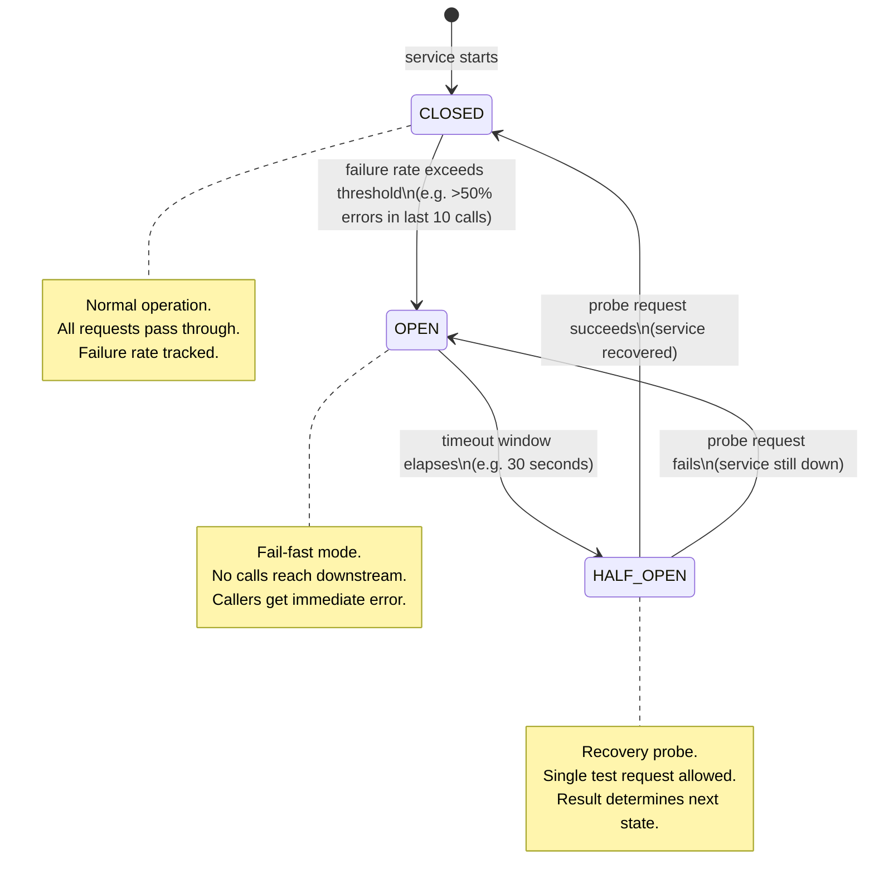
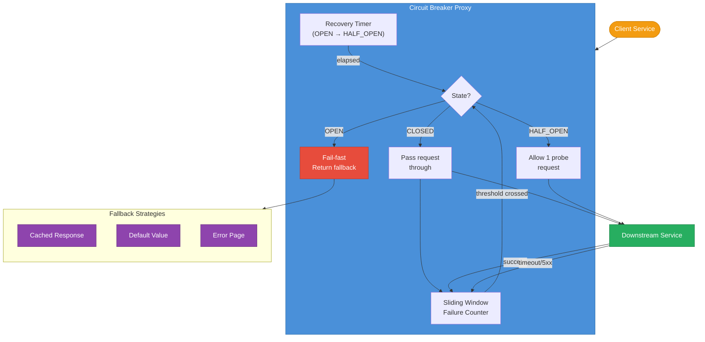
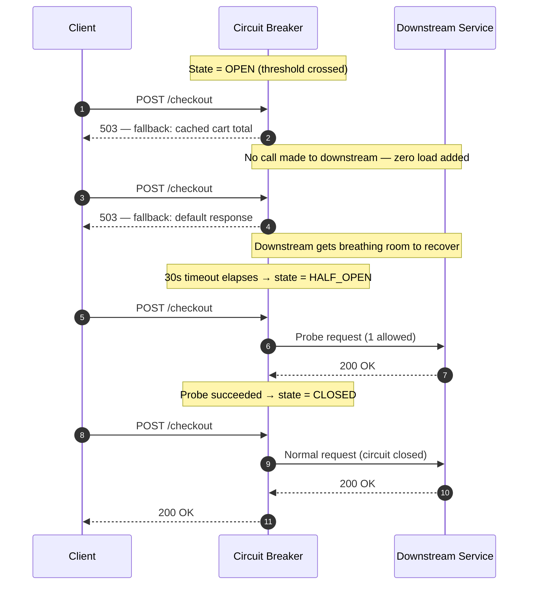
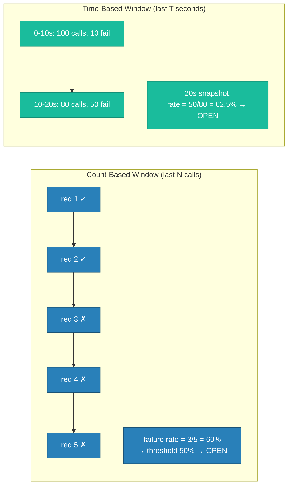
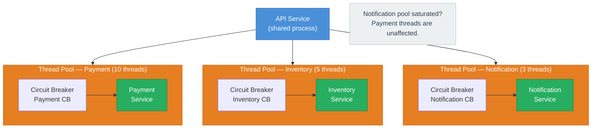
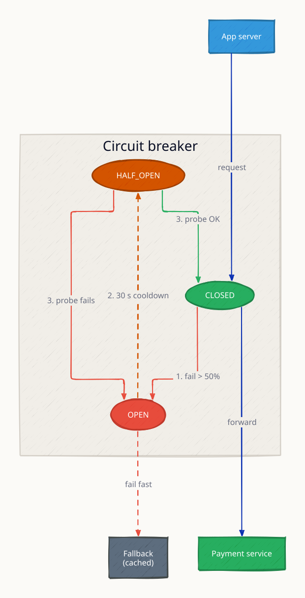
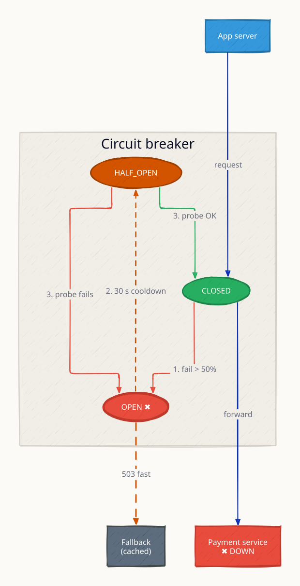
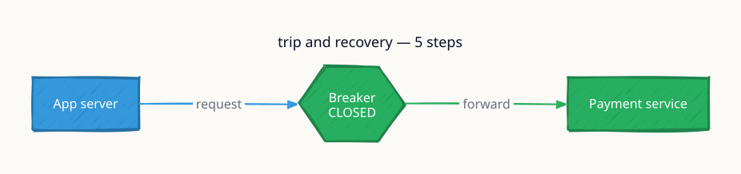
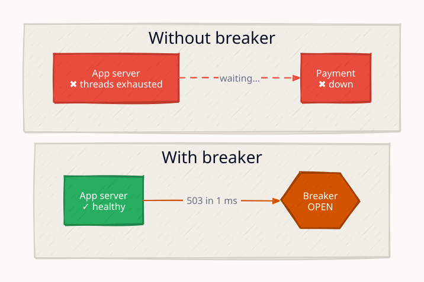

# Circuit Breaker

A circuit breaker is a stability pattern that prevents cascading failures in distributed systems. When a downstream service becomes slow or unavailable, without a circuit breaker every in-flight call blocks a thread waiting for a timeout — threads exhaust, connection pools fill up, and the failure propagates upstream through the entire call chain. The circuit breaker monitors failure rates and, once a threshold is crossed, trips open: all subsequent calls fail immediately without touching the downstream service, letting it recover while upstream callers receive a graceful fallback instead of a timeout-induced cascade.

Named after the electrical component: just as a household breaker protects wiring from overcurrent, a software circuit breaker protects a service from overloading a struggling dependency.

---

## State Machine



---

## Architecture Overview



---

## Request Flow — Circuit OPEN (Fail-Fast)



---

## Sliding Window Implementations

Circuit breakers track failures using one of two window strategies:



| Parameter | Description | Typical Starting Value |
|---|---|---|
| Failure rate threshold | % errors that trips the breaker | 50% |
| Minimum calls | Window must have N calls before evaluating | 10 requests |
| Slow call threshold | Calls over X ms count as failures | 2000 ms |
| Open timeout | How long to stay OPEN before probing | 30 s |
| Half-open probe count | Consecutive successes needed to close | 3 |

---

## Bulkhead Pattern — Combined with Circuit Breakers

Bulkheads (named after ship hull compartments) isolate thread pools per downstream dependency. Combined with circuit breakers, one slow service cannot exhaust the shared thread pool and drag down unrelated features.



---

## Library Comparison

| Feature | Hystrix (Netflix) | Resilience4j | Manual Go/etc. |
|---|---|---|---|
| Status | Maintenance mode | Actively maintained | Custom |
| Threading model | Thread pool per command | Decorator, no extra threads | Developer's choice |
| Count window | Yes | Yes | Yes |
| Time window | No | Yes | Manual |
| Slow call detection | No | Yes | Manual |
| Metrics | Hystrix dashboard | Micrometer / Prometheus | Custom |
| Bulkhead support | Semaphore + thread pool | Semaphore + thread pool | Manual |
| Half-open probe count | 1 fixed | Configurable N | Custom |

---

## Fallback Response Strategies

| Strategy | When to Use | Trade-off |
|---|---|---|
| Cached last-known response | Read-heavy, slightly stale OK | Cache invalidation complexity |
| Default / empty value | Non-critical enrichment (recommendations) | Degraded UX, not broken |
| Error page / 503 | No meaningful fallback exists | Honest to user, worst UX |
| Fail silently | Fire-and-forget (analytics, logging) | Easiest — just swallow the error |
| Queue for async retry | Write operations that must eventually complete | Adds DLQ complexity |

---

## Circuit Breaker vs Retry — Key Distinction

| Aspect | Circuit Breaker | Retry with Backoff |
|---|---|---|
| Purpose | Stop calling a broken service | Handle transient single-call failures |
| Scope | Tracks aggregate failure rate | Per-request attempt |
| Response | Immediate fail-fast (no downstream call) | Waits, then retries same call |
| When to use | Service is persistently failing | Service is transiently busy (503, timeout) |
| Danger without other | Cascading thread exhaustion | Retry storms amplifying load |
| Used together | CB prevents retries during outage | Retry handles brief hiccups before CB trips |

---

## This Module

The Go implementation demonstrates all three threshold configs running behind a proxy in Docker Compose:

```
high-level-design/resilience/5.1_circuit_breaker/
├── proxy/
│   └── main.go      # Circuit breaker state machine + HTTP proxy
├── backend/
│   └── main.go      # Backend with /admin/fail and /admin/recover endpoints
├── docker-compose.yml
└── test.sh          # Drives the state machine through CLOSED → OPEN → HALF_OPEN → CLOSED
```

| Port | Config | Failure Threshold | Open Timeout |
|------|--------|-------------------|--------------|
| 8081 | sensitive | 2 failures | 3 s |
| 8082 | standard | 3 failures | 5 s |
| 8083 | tolerant | 5 failures | 10 s |

Admin endpoints on port 8099: `/admin/fail` and `/admin/recover`

Run it:

```sh
docker compose up --build -d && sleep 2 && bash test.sh
```

---

## Interview Angles

**Q1: What problem does a circuit breaker solve?**

It prevents cascading failures: when a downstream service is slow, synchronous callers pile up waiting for timeouts, exhausting thread pools and connection pools. The circuit breaker detects the degradation early and short-circuits calls, returning a fallback immediately so upstream services remain responsive while the downstream recovers.

**Q2: What is the difference between a circuit breaker and a retry?**

A retry re-attempts the same failing call after a delay — it handles transient per-request failures. A circuit breaker tracks aggregate failure rates and stops all calls to a service for a time period — it handles persistent failures. Used together: retry handles momentary hiccups; the circuit breaker opens if the service is truly down, preventing retries from amplifying load on a struggling dependency.

**Q3: How do you tune circuit breaker thresholds?**

Start from production baselines. A common starting point: 50% error rate threshold, 10-request minimum window, 30 s open timeout, 3 successful probes to close. Slow-call thresholds should be set to p99 normal latency × 2-3x. Adjust based on observed false-positive trips (threshold too low) or missed outages (threshold too high). Monitor state-transition events as a key operational metric.

**Q4: What happens in a microservices chain without circuit breakers?**

Service A calls B calls C. C becomes slow. B's threads block waiting for C — B's pool fills. A's threads block waiting for B — A's pool fills. One slow downstream service triggers a full thread-exhaustion cascade where even unrelated A endpoints become unresponsive within seconds.

**Q5: How does HALF_OPEN prevent flip-flopping?**

HALF_OPEN allows only a limited number of probe requests. Only after N consecutive successful probes does the breaker fully close. This prevents the circuit from immediately re-opening if the recovering service is flapping — it must demonstrate sustained stability before full traffic is restored.

---

## Architecture Diagrams

> Generated from D2 sources in [`docs/diagrams/src/5.1_circuit_breaker/`](../../../docs/diagrams/src/5.1_circuit_breaker/).
> Regenerate: `just diagrams-topic 5.1_circuit_breaker`.

### Overview

The three-state machine: CLOSED (normal) → OPEN (failing fast) → HALF_OPEN (probing) and the transitions between them.



**`tripped` scenario:** the breaker opens and callers get instant failures instead of 30-second timeouts — failing fast frees threads and lets the downstream recover.



### Request Flow

Failure accumulating in real time: 6 failures out of 10 trips the breaker; 30s later one probe request decides reset or re-trip.



*Animated walkthrough (base → scenario): [`request-flow.gif`](../../../docs/diagrams/gif/5.1_circuit_breaker/request-flow.gif)*


**`cascade_prevention` scenario:** without the breaker, a slow dependency exhausts the caller's thread pool and the failure climbs the stack; the breaker cuts the chain at the first link.


