# Retry and Backoff

Retrying a failed request is one of the simplest resilience tools, yet it is also one of the easiest to misapply. Done correctly — with exponential backoff, jitter, and idempotency awareness — retries turn transient failures invisible to end users. Done incorrectly — with fixed delays, no jitter, or on non-idempotent operations — retries cause thundering-herd storms, duplicate charges, and cascading overload on a service that is already struggling.

---

## What to Retry and What Not To

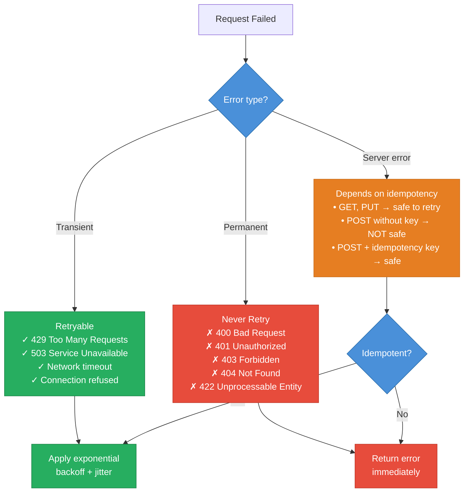

---

## Exponential Backoff with Jitter

**Formula:** `delay = min(base × 2^attempt, max_delay)`

**With jitter:** `delay = random(0, min(base × 2^attempt, max_delay))`

| Attempt | Base Delay | With Jitter (example) |
|---|---|---|
| 1 | 1 s | 0.4 s |
| 2 | 2 s | 1.7 s |
| 3 | 4 s | 3.1 s |
| 4 | 8 s | 6.9 s |
| 5 | 16 s | 11.2 s |
| Cap | 30 s max | 30 s max |

**Why jitter matters:** without it, N clients that all received a 503 at the same moment all retry at `t+1s`, `t+3s`, `t+7s` simultaneously — creating synchronized retry spikes that can overwhelm a service that is just recovering. Jitter desynchronizes those retries into a smooth distribution.

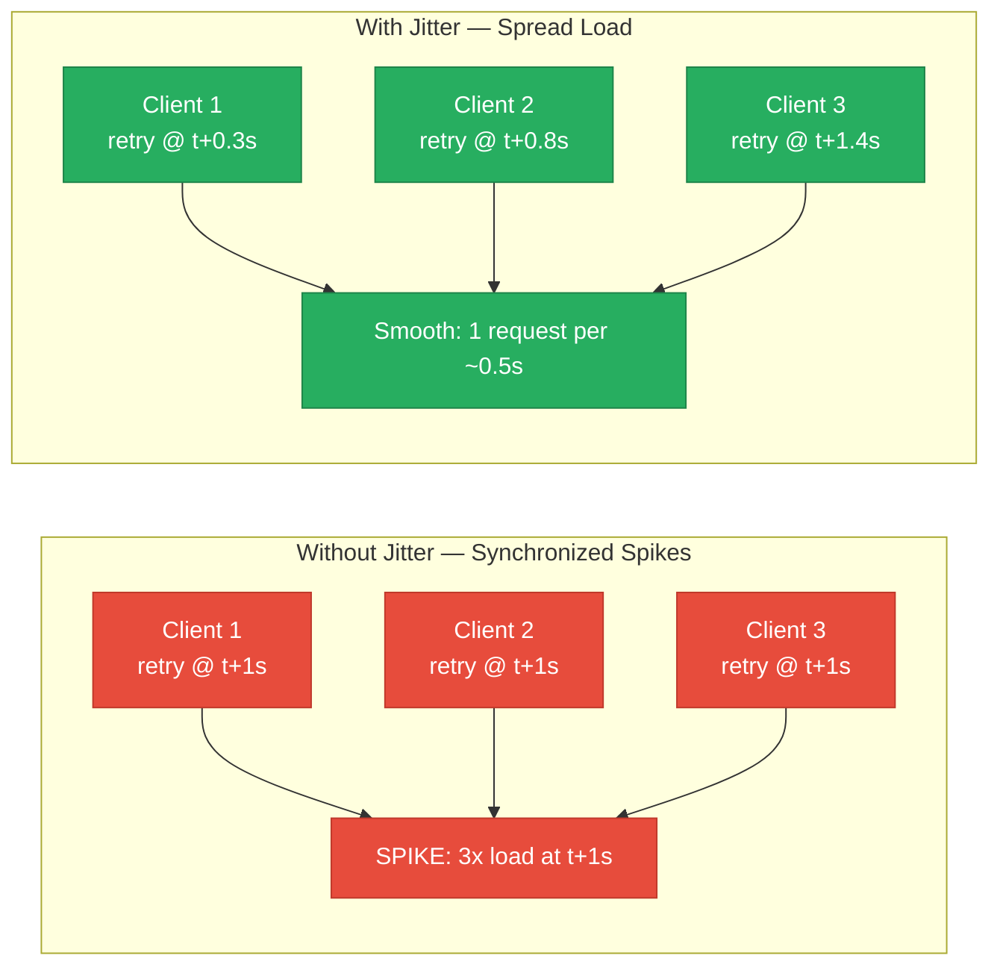

---

## Retry Sequence — Client with Exponential Backoff

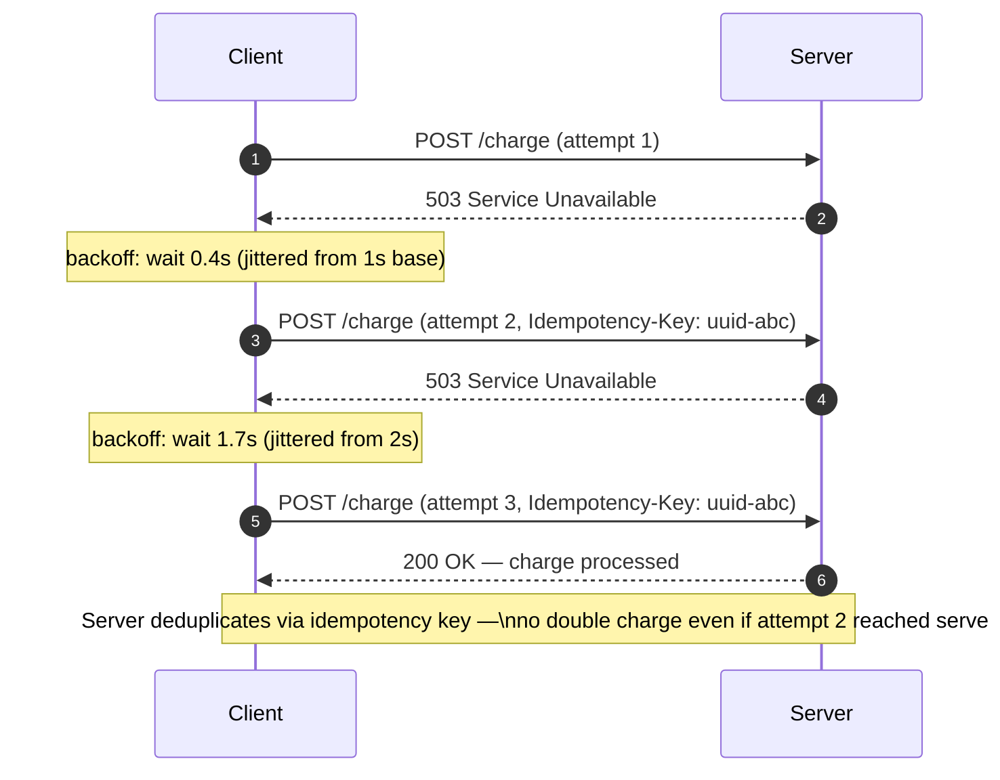

---

## Retry Decision Flowchart

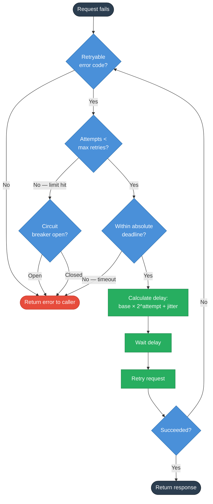

---

## Idempotency Key Pattern

A retry is only safe if the operation is idempotent — repeating it produces the same result with no duplicate side effects. For non-idempotent operations (payment, order creation, email dispatch), use an idempotency key:

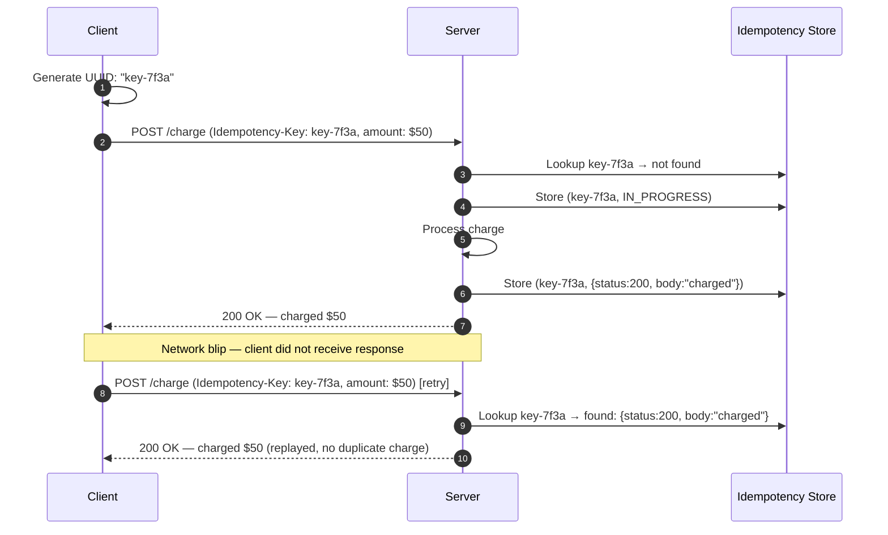

**Idempotent by method:**

| HTTP Method | Idempotent? | Safe to retry? |
|---|---|---|
| GET | Yes | Always |
| PUT | Yes (replace) | Yes |
| DELETE | Yes (result same) | Yes |
| POST | No (by default) | Only with idempotency key |
| PATCH | No (by default) | Only with idempotency key |

---

## Retry Storms — Distributed Amplification

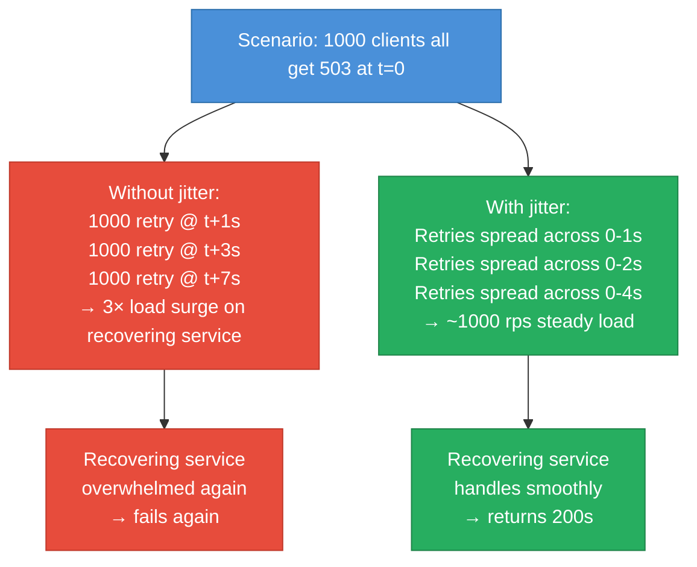

**Retry budget:** at large scale, enforce a system-wide retry budget. If 10% of requests are already retries, stop adding more retries — the system is overloaded and more retries will make it worse.

---

## Circuit Breaker + Retry Together

These patterns complement each other:

| Pattern | Problem it solves | Without the other |
|---|---|---|
| Retry | Brief transient errors (single request) | Without CB: retries pile up during a full outage, amplifying load |
| Circuit Breaker | Persistent failures (whole service down) | Without retry: single transient hiccup returns error to user |
| Together | Retry handles blips; CB handles outages | Best of both worlds |

**Rule of thumb:** retry up to 2-3 times with backoff + jitter. If the circuit breaker trips (service is truly down), stop retrying entirely until the circuit probes recovery.

---

## Implementation (Go)

```go
type RetryPolicy struct {
    MaxAttempts int
    BaseDelay   time.Duration
    MaxDelay    time.Duration
    Jitter      bool
}

func (p *RetryPolicy) Do(ctx context.Context, fn func() error) error {
    var err error
    for attempt := 0; attempt < p.MaxAttempts; attempt++ {
        if err = fn(); err == nil {
            return nil
        }
        if !isRetryable(err) {
            return err // permanent error — don't retry
        }
        delay := min(p.BaseDelay * (1 << attempt), p.MaxDelay)
        if p.Jitter {
            delay = time.Duration(rand.Int63n(int64(delay)))
        }
        select {
        case <-ctx.Done():
            return ctx.Err() // absolute deadline exceeded
        case <-time.After(delay):
        }
    }
    return fmt.Errorf("max retries (%d) exceeded: %w", p.MaxAttempts, err)
}
```

---

## This Module

```
high-level-design/resilience/5.2_retry_backoff/
├── client/
│   └── main.go    # Retry library: exponential backoff, jitter, max delay cap
├── backend/
│   └── main.go    # Configurable failure rate backend for testing
├── docker-compose.yml
└── test.sh        # Demonstrates retry behavior with different failure rates
```

Default policy: 5 attempts, base=200ms, multiplier=2×, max=5s, jitter=on

```sh
docker compose up --build -d && sleep 2 && bash test.sh
go test -v ./client/
```

**References**

- [AWS Architecture Blog: Exponential Backoff and Jitter](https://aws.amazon.com/blogs/architecture/exponential-backoff-and-jitter/)
- Google SRE Book — Chapter 21: Handling Overload
- Marc Brooker: "Jitter: Making Things Better with Randomness"

---

## Interview Angles

**Q1: When should you NOT retry a request?**

Never retry on 4xx client errors (400, 401, 403, 404, 422) — these indicate a bug in the request itself, not a transient server issue, so retrying will always fail. Also do not retry non-idempotent POST/PATCH operations without an idempotency key — you risk duplicate charges, duplicate emails, or duplicate records. And do not retry when the circuit breaker is open — the service is down and retries only add load.

**Q2: How do you prevent retry storms in a distributed system?**

Three mechanisms together: (1) exponential backoff so the delay between retries grows geometrically; (2) jitter (full or decorrelated) to desynchronize retries from many clients that failed at the same instant; (3) a retry budget that caps the percentage of in-flight requests that are retries system-wide, so a recovering service is not immediately re-overwhelmed.

**Q3: What makes an operation safe to retry?**

Idempotency: the operation can be applied multiple times and produces the same result. GET is naturally idempotent. PUT with a full replacement body is idempotent. DELETE is idempotent (deleting an already-deleted resource returns 404, not a new deletion). POST is not idempotent by default — to make it safe, the client generates a unique idempotency key (UUID) sent in a header; the server stores (key → response) and replays the stored response on duplicates.

**Q4: What is "decorrelated jitter" and why is it better than full jitter?**

Decorrelated jitter breaks the correlation between the current delay and the next delay: `delay = random(base, prev_delay × 3)`. Unlike full jitter which is bounded by the current backoff level, decorrelated jitter can produce longer delays independent of the attempt count. AWS research showed it produces the best combination of low total completion time and reduced load on the server during recovery.

**Q5: How do you set a maximum retry timeout (absolute deadline)?**

Use a context deadline set at the start of the entire operation (not per-attempt). Before each retry, check `ctx.Done()`. If the deadline would be exceeded by the next backoff wait, abort immediately and return the deadline-exceeded error. This prevents a retry loop from silently blocking for minutes when the user-facing timeout is 5 seconds.

---

## Architecture Diagrams

> Generated from D2 sources in [`docs/diagrams/src/5.2_retry_backoff/`](../../../docs/diagrams/src/5.2_retry_backoff/).
> Regenerate: `just diagrams-topic 5.2_retry_backoff`.

### Overview

Three retry strategies compared: immediate (hammers the victim), fixed interval (synchronized waves), exponential + jitter (spreads load and survives).

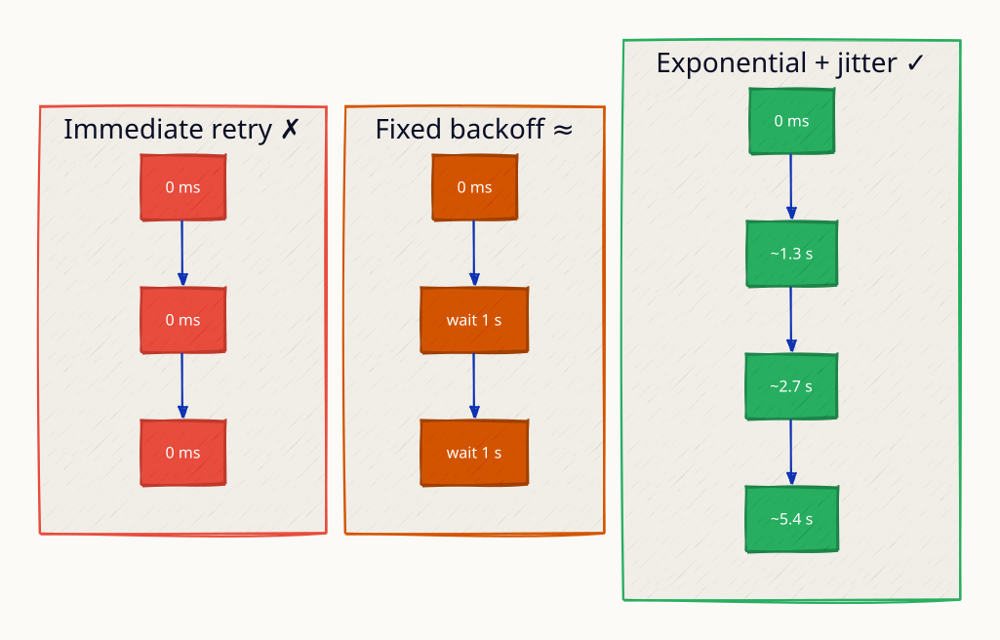

*Animated walkthrough (base → scenario): [`overview.gif`](../../../docs/diagrams/gif/5.2_retry_backoff/request-flow.gif)*


**`jitter_spread` scenario:** randomized delays decorrelate the same thousand clients into a smooth trickle the service can absorb.

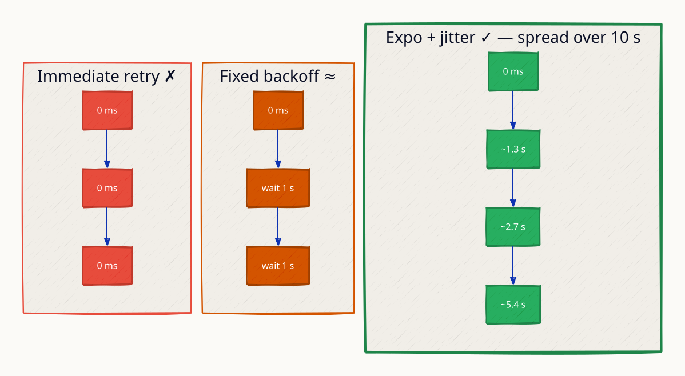

**`thundering_herd` scenario:** a thousand clients retry at the same instant after an outage, re-killing the recovering service — synchronized retries are a self-inflicted DDoS.

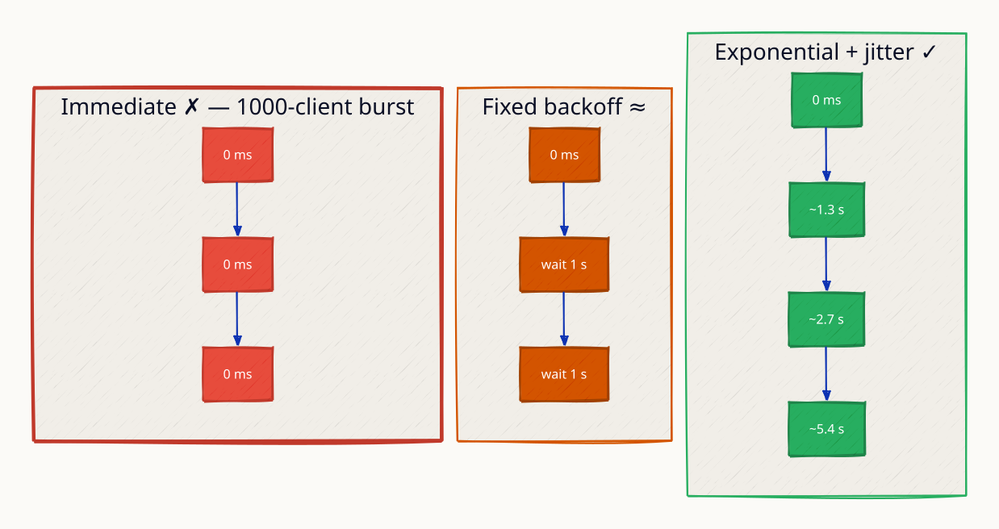

### Request Flow

A payment retried correctly: 503 → wait 1s+jitter → 503 → wait 2s+jitter → 200, with one Idempotency-Key across all attempts so the charge happens once.

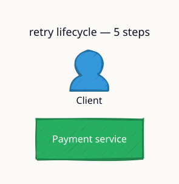

**`non_retryable` scenario:** a 400 fails immediately with no retries — client errors never succeed on retry; only retry what can plausibly heal (5xx, timeouts).

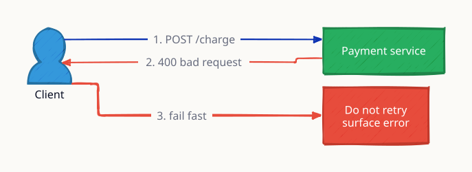
