# Distributed Locking

In a single-process system, a mutex serializes access to a shared resource. In a distributed system, multiple nodes running in separate processes — potentially on different machines — need the same guarantee: only one node executes a critical section at a time. Distributed locks solve this by introducing a shared external coordinator (Redis, ZooKeeper, a database) that all nodes agree on as the source of truth for lock ownership.

Common use cases: preventing duplicate cron job execution across a pod fleet, serializing payment processing to avoid double-charge, coordinating leader election, and protecting shared inventory during flash sales.

---

## Architecture Overview

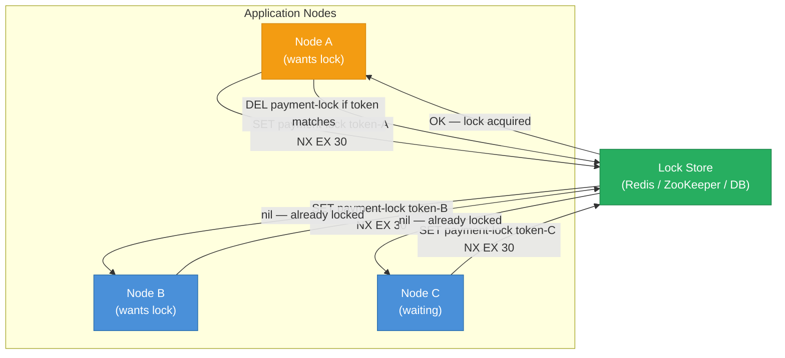

---

## Redis SETNX Lock — Sequence Diagram

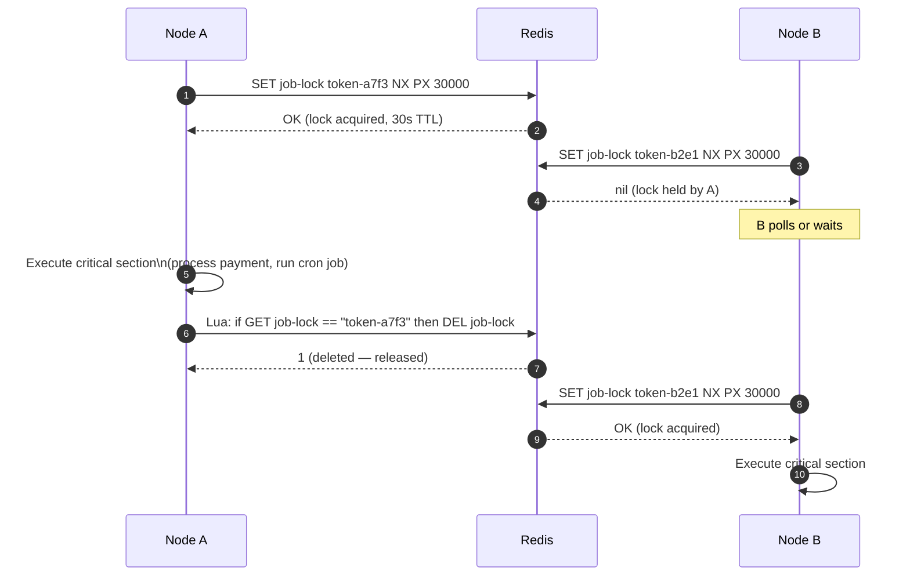

**Why atomic release matters:** a simple `DEL job-lock` without checking the token would delete a lock acquired by a different node if Node A's lock expired and Node B re-acquired it between A's check and delete. The Lua script makes check-and-delete atomic.

```lua
-- Atomic compare-and-delete (runs as single Redis command)
if redis.call("GET", KEYS[1]) == ARGV[1] then
    return redis.call("DEL", KEYS[1])
else
    return 0
end
```

---

## Fencing Token — Protecting Against Stale Lock Holders

A clock pause (GC, OS scheduling) can cause a lock holder to resume after its TTL has expired — meaning another node acquired the lock while the first was paused. The fencing token pattern prevents stale writes by including a monotonically increasing token in every storage operation.

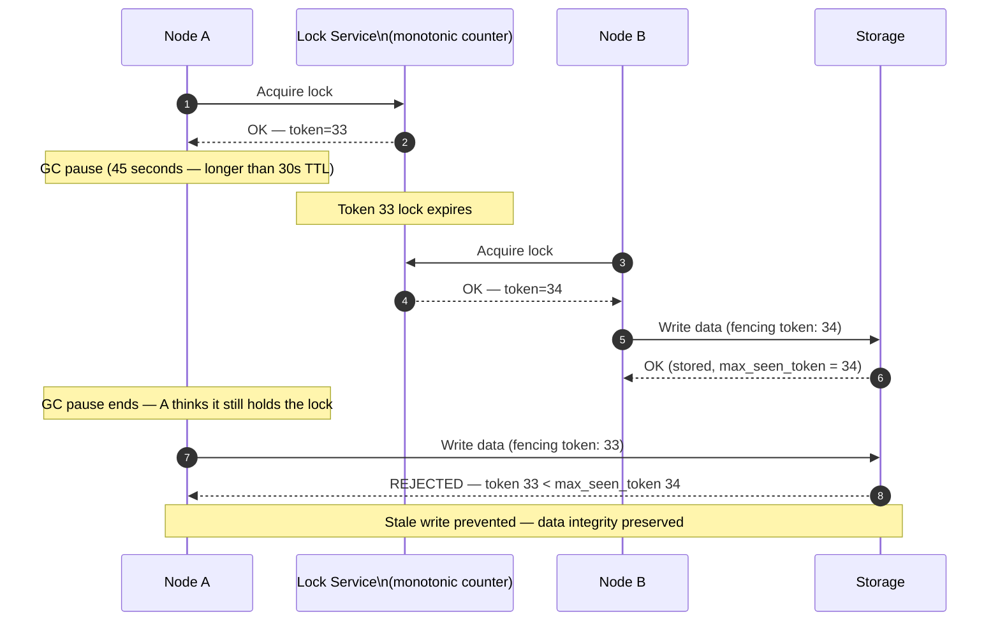

---

## The Lock TTL Dilemma

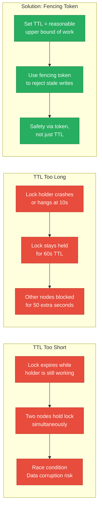

---

## Redlock — Multi-Node Redis Locking

Redlock acquires locks on a majority (N/2 + 1) of N independent Redis nodes. This tolerates up to N/2 node failures without losing the lock guarantee.

**Algorithm (N=5):**

1. Record start time `t0`
2. Try to acquire lock on all 5 nodes with the same key and unique token
3. If acquired on ≥ 3 nodes AND `elapsed < TTL`, lock is valid
4. To release: send Lua delete to all 5 nodes

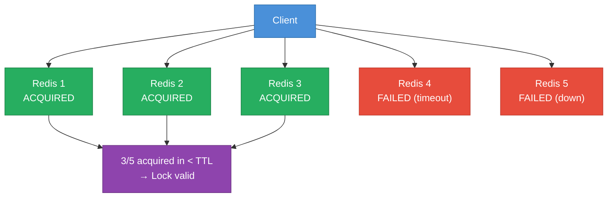

**Martin Kleppmann's critique:** GC pauses and clock skew can still violate the majority assumption — a process paused for longer than TTL can resume after another node acquired the lock, creating dual lock holders. **Recommendation:** Use Redlock only for "advisory" locks where occasional conflicts are tolerable; for strong mutual exclusion, use ZooKeeper or a fencing token with a single authoritative counter.

---

## ZooKeeper Ephemeral Sequential Znodes

ZooKeeper provides a cleaner distributed lock primitive via ephemeral sequential znodes:

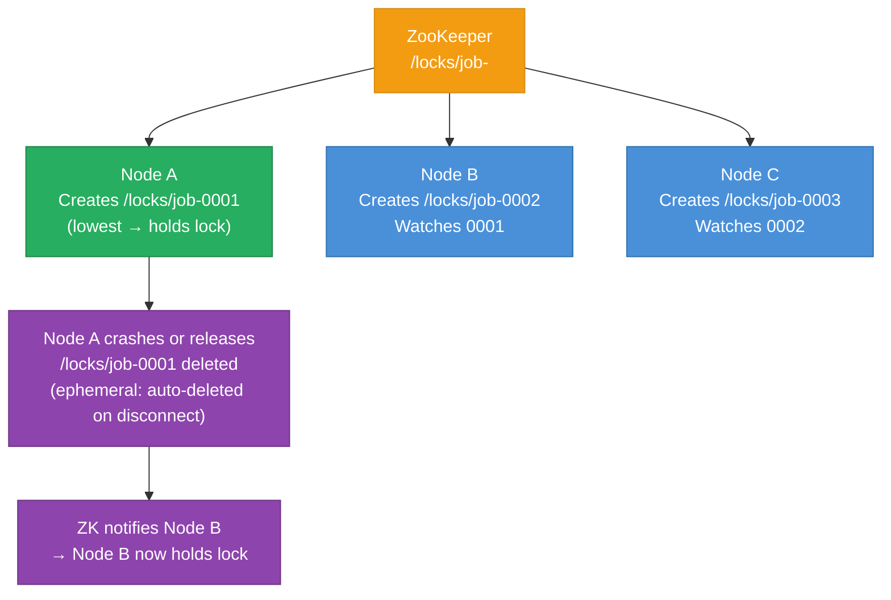

**Advantages over Redis:** ephemeral znodes are automatically deleted if the holder's session disconnects — no TTL needed. The sequential numbering provides a natural queue with fairness (FIFO acquisition order). Watch notifications avoid polling.

---

## When to Use Distributed Locking vs Alternatives

| Approach | When to Use | Trade-offs |
|---|---|---|
| Distributed lock (Redis) | Short critical sections; acceptable advisory semantics | Simple; TTL/GC risk |
| Distributed lock (ZooKeeper) | Strong mutual exclusion; fairness needed | Operational complexity |
| Optimistic concurrency (version/ETag) | Conflicts rare; read-heavy | No blocking; retry on conflict |
| Message queue (serialized processing) | Order matters; at-least-once OK | Adds latency; async only |
| DB row-level lock (SELECT FOR UPDATE) | Single DB; transactions needed | Limited to DB scope |
| Idempotency key | Duplicate prevention (payments) | Storage overhead |

---

## This Module

The Go implementation demonstrates three workers competing for a single Redis lock:

```
high-level-design/resilience/5.3_distributed_locking/
├── worker/
│   └── main.go    # Redis SET NX PX with compare-and-delete Lua release
├── docker-compose.yml
└── test.sh
```

| Worker | Port | Behavior |
|--------|------|----------|
| worker-1 | 8081 | First acquires lock |
| worker-2 | 8082 | Gets 409 while lock held |
| worker-3 | 8083 | Gets 409 while lock held |

```sh
docker compose up --build -d && sleep 3 && bash test.sh
```

**References**

- [Martin Kleppmann: "How to do distributed locking" (2016)](https://martin.kleppmann.com/2016/02/08/how-to-do-distributed-locking.html)
- [Redis SET NX PX documentation](https://redis.io/docs/latest/commands/set/)
- [Redlock algorithm — antirez](https://redis.io/docs/latest/develop/use/patterns/distributed-locks/)
- ZooKeeper Recipes — Distributed Lock

---

## Interview Angles

**Q1: What is a fencing token and why is it necessary?**

A fencing token is a monotonically increasing number issued with each lock acquisition. The lock holder includes this token in every write to shared storage; the storage layer rejects writes with a token lower than the last seen. This prevents a node that was paused (GC, OS scheduling) during its lock TTL from writing stale data after another node acquired the lock — even if the paused node believes it still holds the lock.

**Q2: Is Redlock safe?**

Redlock provides probabilistic mutual exclusion across N independent Redis nodes and is safe for advisory locks (e.g., preventing duplicate cron jobs where an occasional overlap is tolerable). For strong safety guarantees, it has known weaknesses: GC pauses and clock skew between Redis nodes can result in dual lock holders after a lease expiry. For truly strong mutual exclusion, prefer ZooKeeper (which uses Paxos/ZAB and explicit session management) combined with fencing tokens.

**Q3: How do you handle a lock holder crashing mid-critical-section?**

The lock TTL ensures automatic expiry — other nodes can acquire the lock after TTL elapses. The critical section must be designed for crash recovery: either the operation is idempotent (safe to re-run), or it writes to a durable WAL/transaction log before acting, allowing a new lock holder to complete or roll back the incomplete work. Fencing tokens prevent the crashed node (if it resumes) from corrupting storage.

**Q4: What is the difference between a distributed lock and optimistic concurrency?**

A distributed lock is pessimistic — it blocks other nodes before reading/writing. Optimistic concurrency (compare-and-swap, ETag, version column) lets all nodes read freely and write with a version check; the write fails if the version changed. Use locks when conflicts are frequent and the critical section is long; use optimistic concurrency when conflicts are rare and the read-modify-write cycle is short — it scales much better under low-contention workloads.

**Q5: How do you avoid a lock holder holding the lock forever?**

Set a TTL on the lock (NX EX/PX in Redis). The TTL should be longer than the expected maximum duration of the critical section but short enough that a crashed holder does not block others too long. Additionally: implement a lock heartbeat for long-running jobs (extend TTL before expiry), use a watchdog thread that releases the lock if the owning thread is killed, and instrument lock acquisition wait time — spikes indicate contention.

---

## Architecture Diagrams

> Generated from D2 sources in [`docs/diagrams/src/5.3_distributed_locking/`](../../../docs/diagrams/src/5.3_distributed_locking/).
> Regenerate: `just diagrams-topic 5.3_distributed_locking`.

### Overview

Redlock: a client must win the lock on 3 of 5 independent Redis nodes within a drift-bounded window for the lock to count.

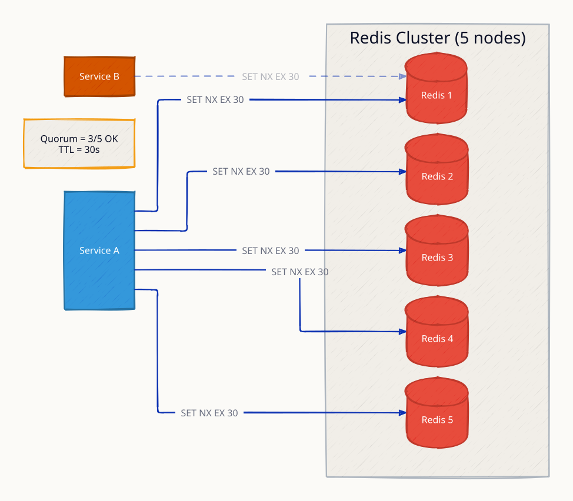

**`lock_acquired` scenario:** quorum reached (3/5) inside the validity window — the lock holds even if a minority of Redis nodes are down.

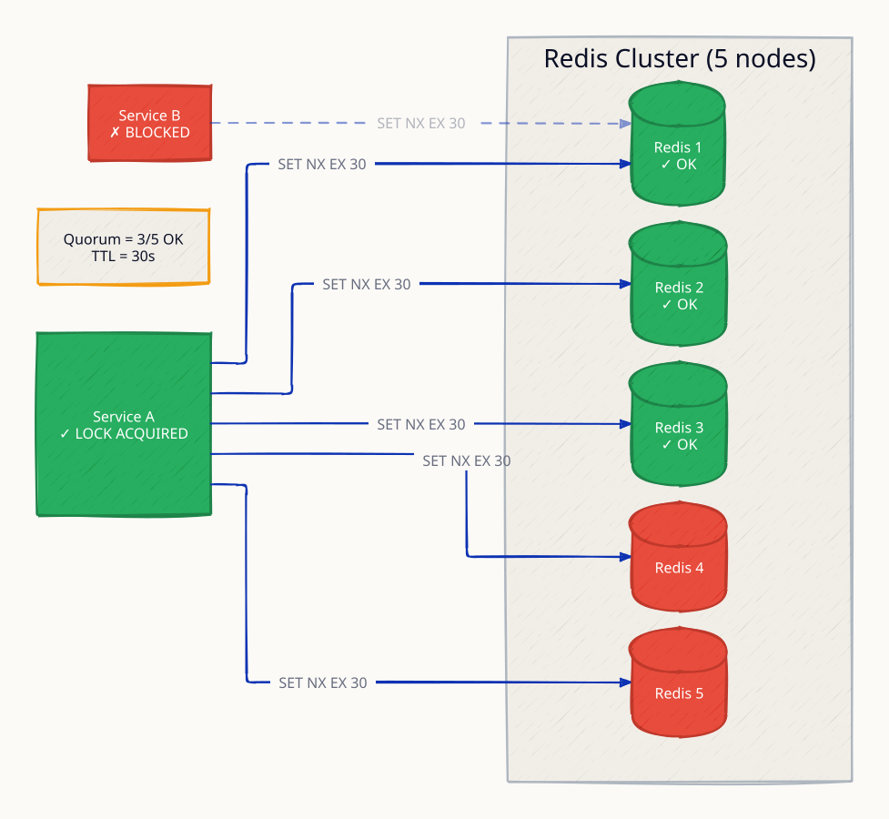

**`lock_expired` scenario:** a GC pause stalls the holder past its TTL; the lock expires and another client acquires it — why every lock grant needs a fencing token checked by the resource.

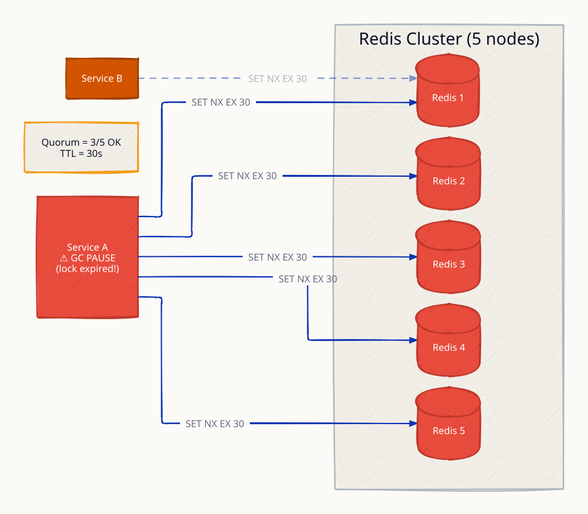

### Request Flow

An inventory reservation guarded by a lock: acquire with TTL → check stock → decrement → release.

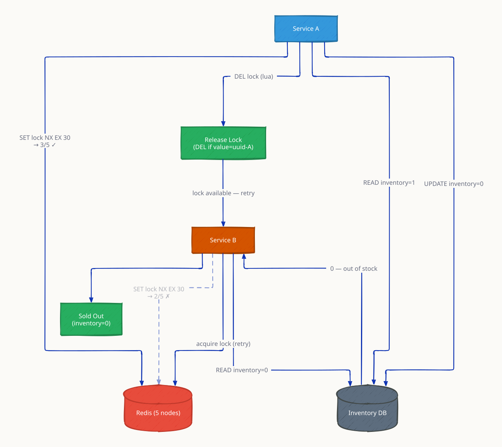

**`crash_recovery` scenario:** the holder crashes without releasing; the TTL expires the lock automatically — liveness without manual cleanup.

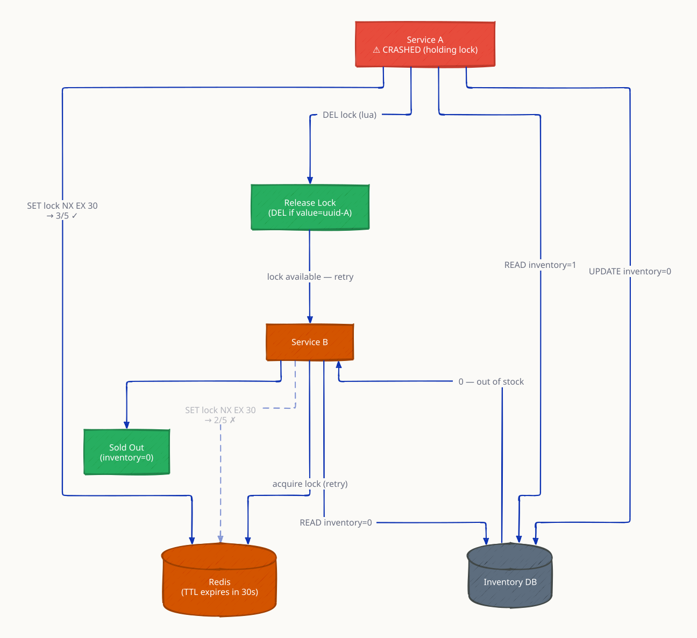
