# Caching

**Caching is the single highest-leverage optimization in distributed systems.** RAM delivers data in ~100 nanoseconds; a spinning disk takes ~10 milliseconds — a 100,000× gap. Even NVMe SSDs are ~1,000× slower than L3 cache. At scale, a cache hit rate of 99% means only 1 in 100 requests ever touches the database, cutting DB load by 100× and collapsing p99 latency from hundreds of milliseconds to single digits. Twitter's Memcached tier serves over 30 million QPS; Facebook's Tectonic cache absorbs petabytes of reads. Without caching, any service handling more than a few thousand requests per second either burns enormous DB money or collapses under its own weight.

---

## Cache Placement Hierarchy

Traffic flows outward from the client, and a cache at each layer intercepts requests before they reach a slower, more expensive layer behind it.

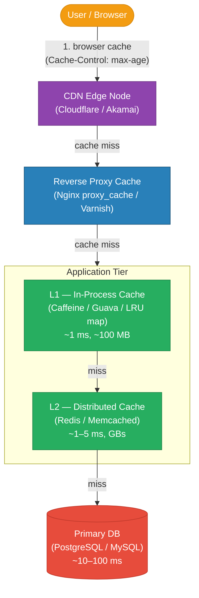

| Layer | Latency | Capacity | Typical Tool |
|---|---|---|---|
| Browser cache | 0 ms (local) | MBs | Cache-Control headers |
| CDN edge | ~5–20 ms (nearest PoP) | TBs per PoP | Cloudflare, Akamai, Fastly |
| Reverse proxy | ~1–5 ms (local network) | GBs on disk | Nginx proxy_cache, Varnish |
| In-process (L1) | ~0.1–1 ms | 10–500 MB | Caffeine, Guava, dict |
| Distributed (L2) | ~1–5 ms (network RTT) | GBs–TBs | Redis, Memcached |
| DB query cache | ~5–20 ms | Limited | PostgreSQL shared_buffers |

---

## Read Path: Cache Hit vs Miss

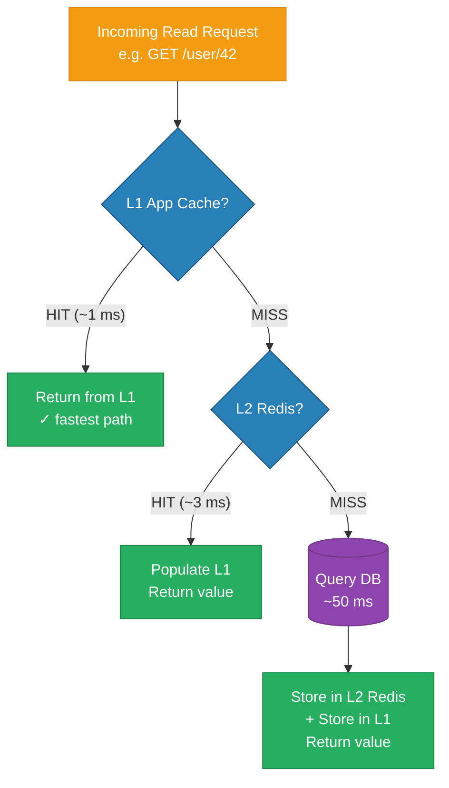

**Hit rate math:** If a cache has a 99% hit rate and DB latency is 50 ms while cache latency is 2 ms, average latency = `0.99 × 2 ms + 0.01 × 50 ms = 2.48 ms`. At 98% hit rate it becomes `2.96 ms`. At 95% it jumps to `4.4 ms`. The non-linear relationship means the last 1% of hit rate improvement matters enormously at high percentiles.

---

## Cache Patterns

### Cache-Aside (Lazy Loading)

The application manually checks the cache before hitting the DB. Most common pattern — gives the application full control.

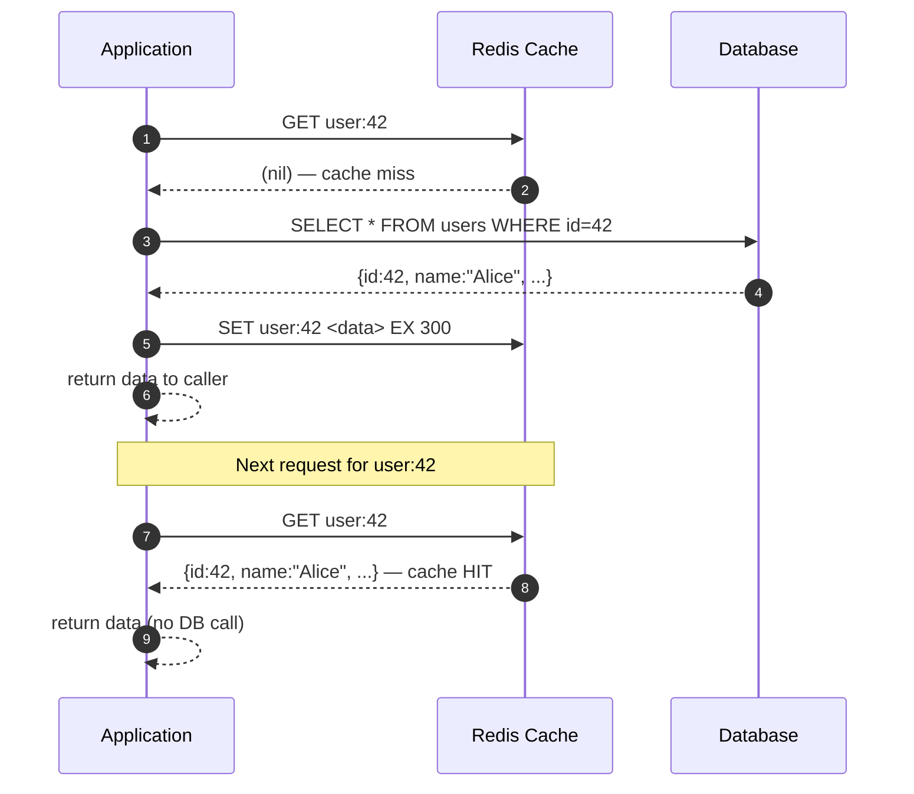

**Pros:** Only requested data is cached (no wasted memory). Cache failures are non-fatal — app falls back to DB.
**Cons:** First request always misses (cold start). Data can go stale if DB is updated without cache invalidation.

---

### Read-Through

A cache library/proxy sits in front of the DB and auto-populates on miss. The application always reads from cache only.

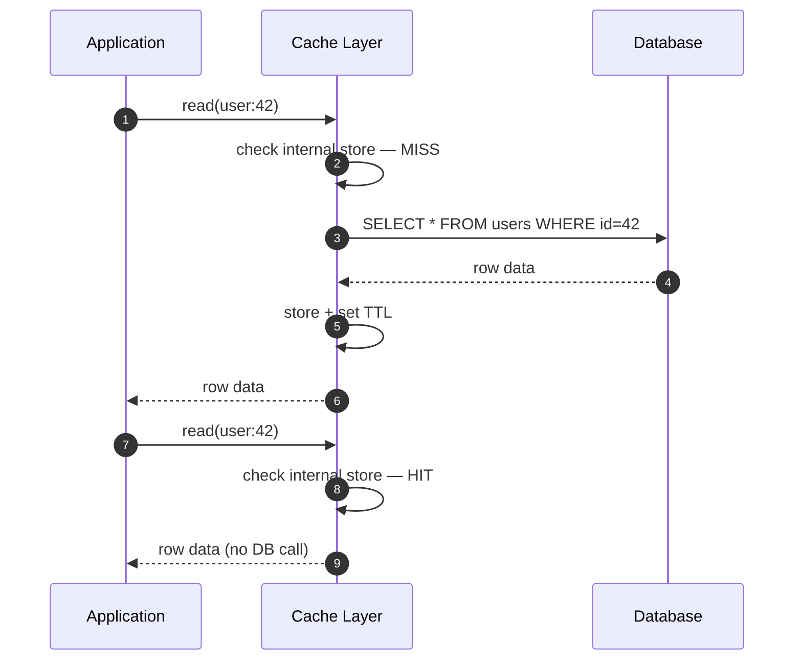

**Pros:** Application code is simpler — no cache-miss handling logic. **Cons:** Cache library must understand your data model; first-read latency is high (synchronous DB fetch).

---

### Write-Through

Every write goes to the cache AND the DB in the same operation. Cache is always consistent with DB.

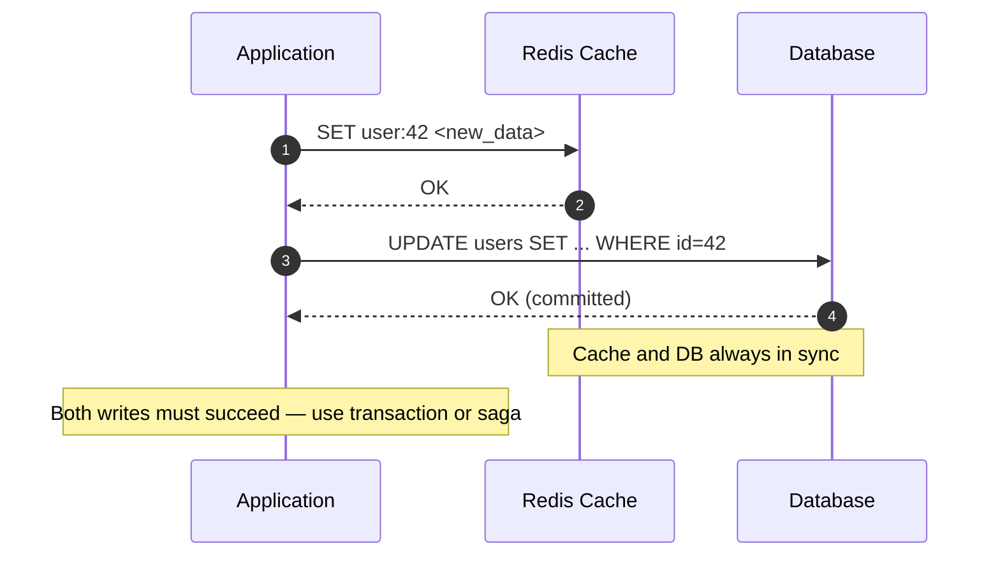

**Pros:** Reads are always fast; no stale reads. **Cons:** Write latency doubles (cache + DB). Cache fills with data that may never be read again.

---

### Write-Behind (Write-Back)

Writes go to cache immediately; the cache asynchronously flushes to DB. Optimizes write throughput at the cost of durability.

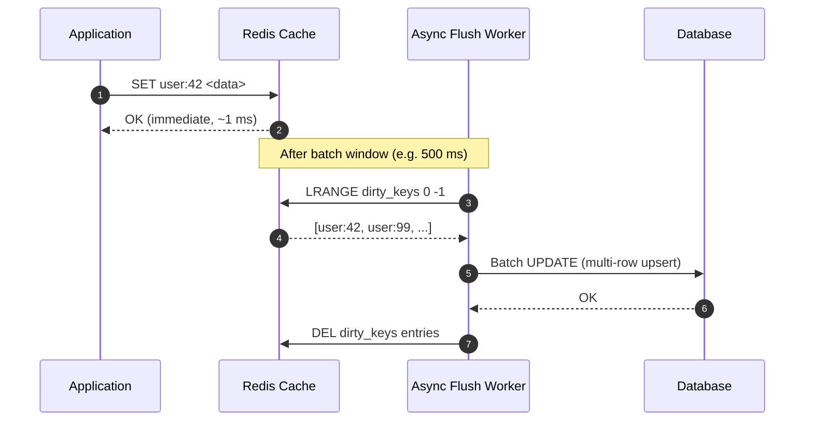

**Pros:** Write latency is cache-speed. Batches multiple writes into one DB call (huge throughput gain). **Cons:** Data loss if cache crashes before flush. Complexity: need durable write queue (Redis AOF or a separate queue like Kafka).

---

## Eviction Policies

When the cache reaches its memory limit, it must evict entries to make room for new ones.

| Policy | Full Name | How It Works | Best For | Weakness |
|---|---|---|---|---|
| LRU | Least Recently Used | Evict the entry not accessed for the longest time | General-purpose workloads with temporal locality | Expensive to implement exactly at scale — use approximated LRU |
| LFU | Least Frequently Used | Evict the entry with the lowest access count | Skewed workloads (popular items stay cached) | New items have low count and get evicted prematurely |
| TTL | Time To Live | Evict after fixed expiry regardless of access | Data with known freshness requirements | Stampede risk at mass-expiry |
| FIFO | First In, First Out | Evict oldest inserted entry | Simple, queue-like access patterns | Ignores access frequency; poor hit rate |
| Random | Random Replacement | Evict a random entry | Very simple caches, uniform access patterns | Unpredictable performance |
| ARC | Adaptive Replacement Cache | Balances recency + frequency dynamically | Mixed workloads | Complex to implement |

**Redis default policy** is `noeviction` (return error when full). Common production setting: `allkeys-lru` for general caches, `volatile-lru` when only TTL-keyed items should be evictable.

---

## Cache Stampede (Thundering Herd)

When a hot key's TTL expires, hundreds of requests simultaneously find a cache miss and all hit the DB at once.

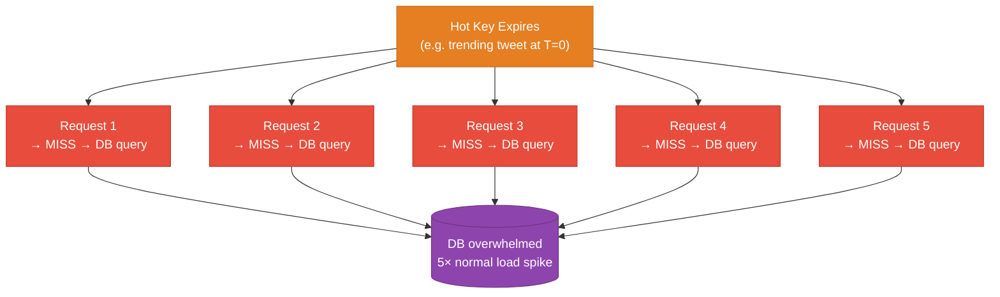

### Solutions

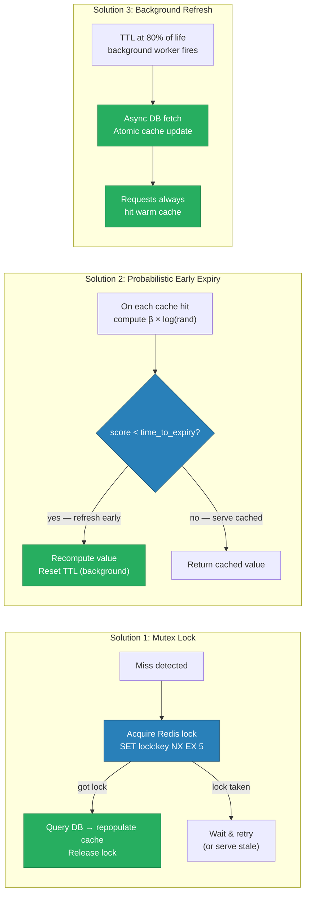

---

## Cache Invalidation Strategies

> "There are only two hard things in Computer Science: cache invalidation and naming things." — Phil Karlton

| Strategy | Mechanism | Consistency | Complexity |
|---|---|---|---|
| TTL expiry | Key auto-expires after N seconds | Eventual (bounded staleness) | Low |
| Write-through invalidation | App deletes/updates cache on every DB write | Strong | Medium |
| Event-driven (CDC) | DB change-data-capture publishes events; consumers invalidate cache | Near-real-time | High |
| Versioned keys | Key includes version/hash — new data = new key | Strong (old key naturally expires) | Medium |
| Tag-based | Cache entries tagged; invalidate all entries with tag | Flexible | High |

**Event-driven invalidation with CDC:** Debezium reads PostgreSQL WAL → publishes to Kafka → cache invalidation consumer deletes stale Redis keys. Zero application-code coupling to cache invalidation.

---

## Redis Data Structures for Caching

| Structure | Redis Command | Use Case | Example |
|---|---|---|---|
| String | `GET`/`SET`/`SETEX` | Single object cache, counters | `SET user:42 <json> EX 300` |
| Hash | `HGET`/`HSET`/`HMGET` | Partial field updates without full serialize/deserialize | User profile with selectable fields |
| Sorted Set | `ZADD`/`ZREVRANGE`/`ZINCRBY` | Leaderboards, rate limiting windows, ranked feeds | `ZADD leaderboard 1500 user:42` |
| Set | `SADD`/`SISMEMBER`/`SMEMBERS` | Deduplication, unique visitor counts | Unique IPs that saw an ad |
| List | `LPUSH`/`LRANGE`/`LTRIM` | Recent activity feeds, job queues | Last 100 actions for a user |
| Bitmap | `SETBIT`/`BITCOUNT` | Feature flags, daily active users | DAU: bit per user_id per day |

**Leaderboard example:**
```
ZINCRBY leaderboard 1 "player:42"    # player scored a point
ZREVRANGE leaderboard 0 9 WITHSCORES # top 10 players
```

---

## Distributed Cache: Consistent Hashing

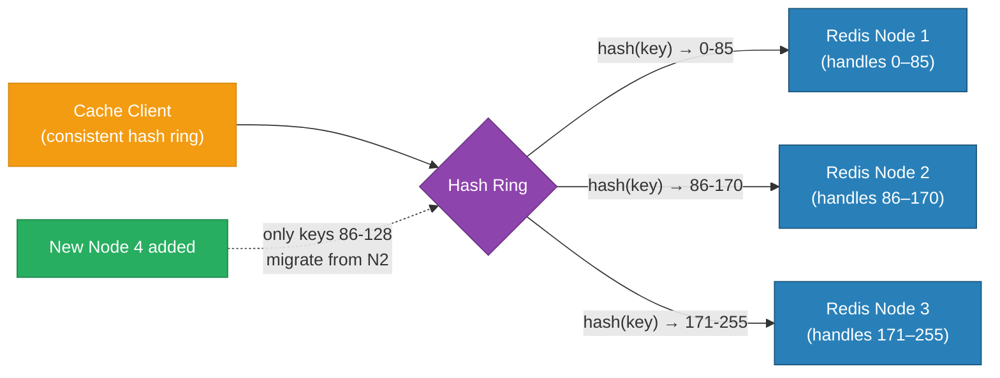

With naive `hash(key) % N`, adding one node remaps ~50% of all keys. With consistent hashing, adding one node migrates only ~`1/N` of keys. **Redis Cluster** uses 16,384 hash slots divided across nodes; resharding moves whole slots, not individual keys.

**Replica reads:** Each Redis node has one or more replicas. Read-heavy workloads route reads to replicas (Redis `READONLY` command in cluster mode), scaling read throughput horizontally while writes go to the primary.

---

## Real-World Examples

| Company | Cache Layer | Scale | Key Detail |
|---|---|---|---|
| Twitter | Memcached (Twemcache) | 30M+ QPS | Home timeline assembled from per-user caches |
| Facebook | Memcached + TAO | Billions of req/day | TAO is a graph cache with custom invalidation |
| Netflix | EVCache (Memcached) | Millions RPS | Multi-region replication, used for every API |
| Slack | Redis | Millions of workspaces | Channel membership, presence, typing indicators |
| GitHub | Redis | Global | Repository metadata, session store |
| Stack Overflow | Single Redis instance | 10M page views/day | Most of SO fits in one Redis node |

---

## Trade-offs Summary

| Concern | Recommendation |
|---|---|
| Data changes frequently (< 1 min) | Short TTL or event-driven invalidation |
| Data is large (> 1 MB per key) | Avoid caching in Redis; use CDN for binary blobs |
| Write-heavy workload | Write-behind with durable queue; accept eventual consistency |
| Need strong consistency | Write-through + read-through; avoid caching or use versioned keys |
| Budget-constrained | In-process LRU (Caffeine) before adding Redis |
| Multi-region | Replicate cache per region; accept cross-region staleness |

---

## Code

The implementation in this module demonstrates nginx `proxy_cache` with three configurations:

```
high-level-design/scalability/3.1_caching/
├── server/
│   └── main.go               # Go backend — simulated slow DB endpoint
├── nginx/
│   ├── no_cache.conf         # Baseline — no caching
│   ├── proxy_cache.conf      # proxy_cache with 30s TTL
│   └── stale.conf            # stale-while-revalidate, 10s TTL
├── docker-compose.yml
└── test.sh                   # curl test suite measuring latency with/without cache
```

Run it:

```sh
docker compose up --build -d
bash test.sh
```

---

## Interview Angles

**Q1: How do you handle cache invalidation when the DB is updated?**
Use write-through invalidation for strong consistency (delete/update cache key on every DB write), or event-driven CDC (Debezium → Kafka → cache consumer) to decouple invalidation from application code — CDC scales better and handles bulk updates without application changes.

**Q2: Design a real-time leaderboard for 10 million players using Redis.**
Use a Redis Sorted Set (`ZADD leaderboard <score> <player_id>`); `ZINCRBY` atomically adds points; `ZREVRANK` gets a player's rank in O(log N); `ZREVRANGE 0 9` returns the top 10. Shard by game_id prefix if there are millions of leaderboards. Persist to DB asynchronously every 30 seconds.

**Q3: What is cache stampede and how do you prevent it?**
Cache stampede (thundering herd) occurs when a hot key's TTL expires simultaneously for many concurrent requests, causing all of them to hit the DB at once. Prevent with: (1) mutex lock — only one request fetches from DB, others wait; (2) probabilistic early expiry — randomly refresh before TTL expires; (3) background refresh — a worker proactively recomputes before expiry, so cache is never cold.

**Q4: What is the difference between write-through and write-behind caching?**
Write-through writes to cache and DB synchronously in the same request — strong consistency but doubles write latency. Write-behind writes to cache immediately and flushes to DB asynchronously — low write latency and allows batching, but risks data loss if the cache crashes before flushing. Use write-through for financial data; write-behind for analytics counters, logs, or any workload where losing a few seconds of writes is acceptable.

**Q5: How does consistent hashing help with distributed cache scaling?**
Naive modular hashing (`hash(key) % N`) remaps ~50% of all keys when a node is added or removed — causing a mass cache miss spike. Consistent hashing places nodes on a hash ring; adding a node only migrates keys from its immediate predecessor (~1/N of total). Virtual nodes (vnodes) further smooth imbalance from uneven key distribution. Redis Cluster implements this with 16,384 fixed hash slots.

**References**

- [Redis Documentation — Eviction Policies](https://redis.io/docs/manual/eviction/)
- [AWS ElastiCache Best Practices](https://docs.aws.amazon.com/AmazonElastiCache/latest/red-ug/BestPractices.html)
- [Facebook — Scaling Memcache at Facebook (NSDI 2013)](https://research.facebook.com/publications/scaling-memcache-at-facebook/)
- [Martin Kleppmann — Designing Data-Intensive Applications, Ch. 5](https://dataintensive.net/)
- [Probabilistic Early Expiry — Optimal Probabilistic Cache Stampede Prevention](https://cseweb.ucsd.edu/~avattani/papers/cache_stampede.pdf)

---

## Architecture Diagrams

> Generated from D2 sources in [`docs/diagrams/src/3.1_caching/`](../../../docs/diagrams/src/3.1_caching/).
> Regenerate: `just diagrams-topic 3.1_caching`.

### Overview

Every cache layer a read can hit — CDN, app-local, Redis, then PostgreSQL — plus the cache-aside pattern that fills them.

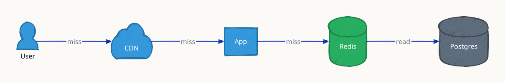

**`cache_hit` scenario:** a hit at the first layer — the CDN answers in ~5 ms and everything downstream idles.

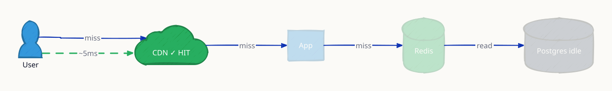

**`stampede` scenario:** a hot key expires and concurrent requests all dogpile the database — mitigated by request coalescing, jittered TTLs, or background refresh.

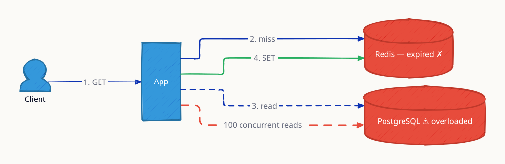

### Request Flow

Cache-aside in detail: MISS → read DB → SET with TTL → return (12ms); second request HITs Redis and returns in 1ms.

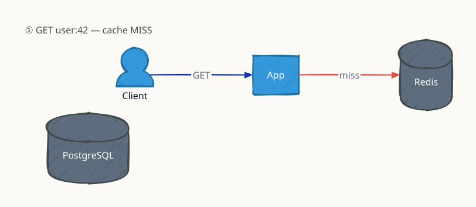

*Animated walkthrough (4s per frame, one change per frame): [`request-flow.gif`](../../../docs/diagrams/gif/3.1_caching/request-flow.gif)*

1. `GET user:42` — cache MISS → 2. read PostgreSQL → 3. `SET` fills cache → 4. next `GET` HITs in ~1 ms


**`write_through` scenario:** a price update writes the cache in the same operation as the DB, so readers never see the stale value — at the cost of slower writes.

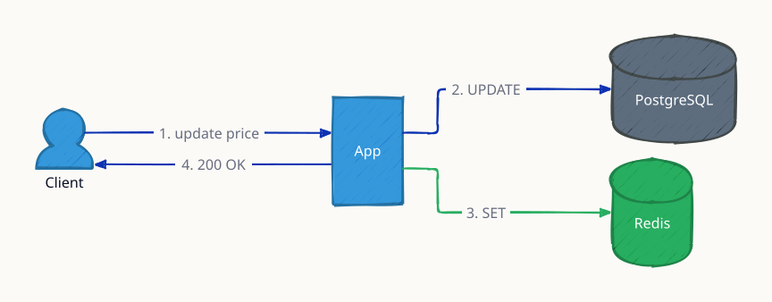
