# Rate Limiting

**Rate limiting is the traffic cop of distributed systems** — it protects backend services from being overwhelmed by abuse, runaway clients, or sudden traffic spikes, while ensuring fair resource distribution across all users. Without it, a single misconfigured client sending 10,000 requests per second can take down a service for everyone else. Rate limiting underpins the economic model of every public API (Stripe, GitHub, Twilio all publish rate limits), powers DDoS mitigation at the edge, and is a prerequisite for any system that needs to guarantee SLAs. At scale, Cloudflare blocks ~150 billion threats per day using rate limiting at the edge; GitHub enforces 5,000 requests/hour per authenticated user to keep their API responsive for all 100 million developers.

---

## Architecture Overview

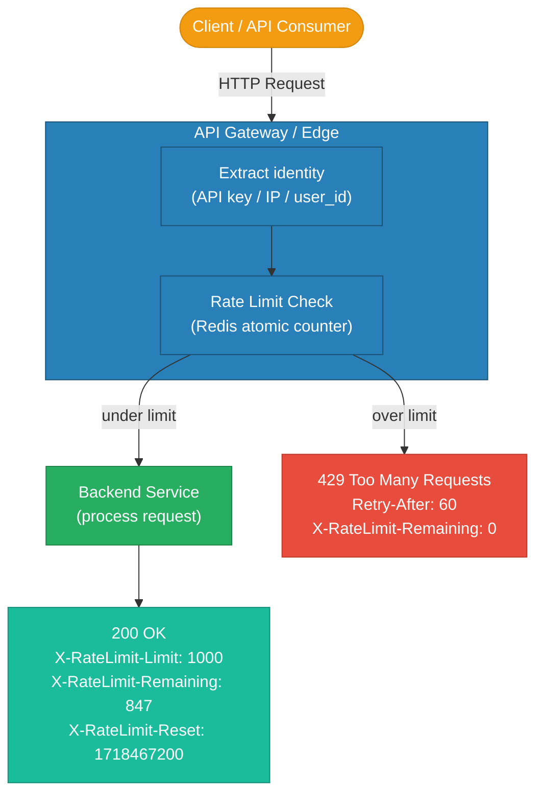

---

## Algorithm Comparison

| Algorithm | Memory | Accuracy | Burst Handling | Smoothness | Best For |
|---|---|---|---|---|---|
| Fixed Window Counter | O(1) | Low (boundary spikes) | Allows 2× limit at boundary | Bursty | Simple counters, internal services |
| Sliding Window Log | O(requests) | Exact | Accurate burst prevention | Smooth | Audit logs, low-traffic APIs |
| Sliding Window Counter | O(windows) | ~99% accurate | Good | Smooth | General purpose, high traffic |
| Token Bucket | O(1) | Exact | Controlled bursts allowed | Smooth | APIs that allow short bursts |
| Leaky Bucket | O(queue size) | Exact | No bursts — uniform output | Very smooth | Traffic shaping, payment processing |

---

## Token Bucket Algorithm

Each client gets a "bucket" with capacity `B` tokens. Tokens refill at rate `R` per second. Each request consumes 1 token. If the bucket is empty, the request is rejected.

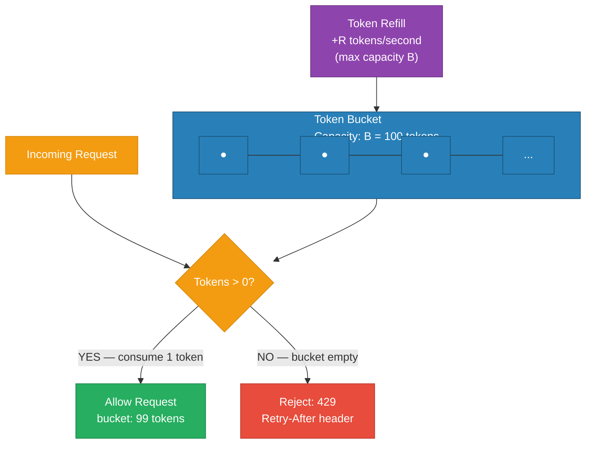

**Token Bucket vs Leaky Bucket:**
- **Token Bucket:** Allows bursts up to capacity `B`. A client that waited 10 seconds can fire 10×R requests instantly. Good for APIs where brief bursts are acceptable.
- **Leaky Bucket:** Requests drip out at a constant rate regardless of arrival pattern. A burst of requests queues up and exits at a fixed rate. Good for payment processing or DB writes where uniform load matters more than latency.

---

## Sliding Window Counter

Divide time into sub-windows (e.g., 6×10s buckets within a 60s window). At any moment, the effective count is a weighted sum of the current and previous window.

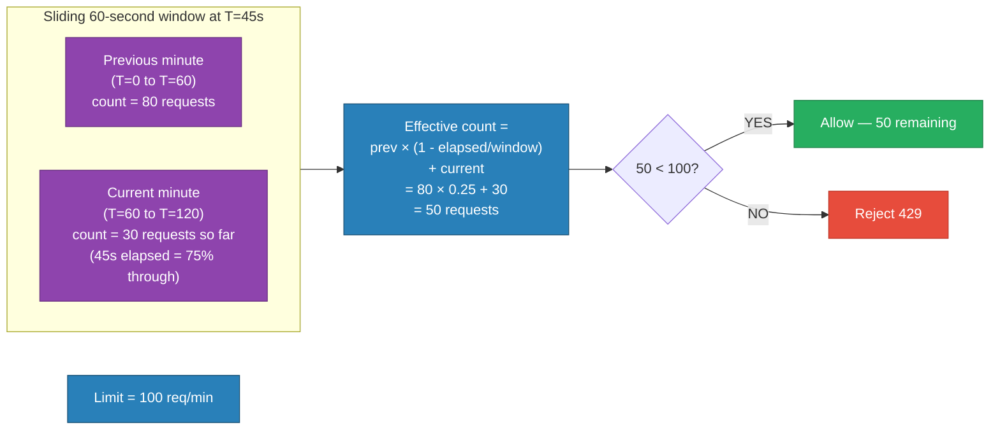

The sliding window counter approximation is accurate within ~0.003% error in practice and uses only O(1) memory — making it the sweet spot for high-throughput APIs.

---

## Fixed Window Boundary Problem

The classic weakness: a client can send 2× the limit in a short burst straddling a window boundary.

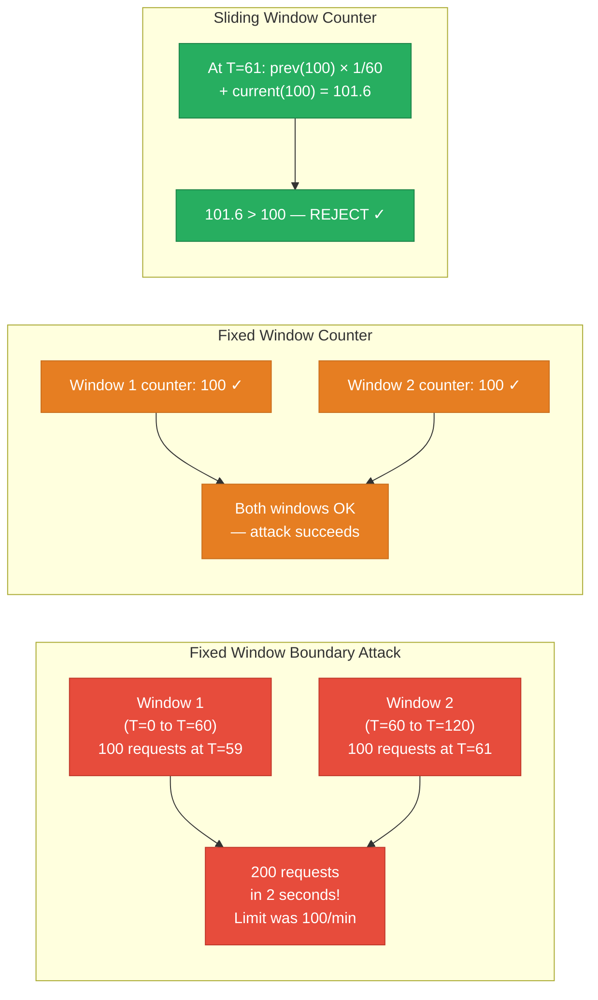

---

## Distributed Rate Limiting with Redis

For API gateways with multiple instances, rate limit state must be centralized in Redis so all instances share the same counter.

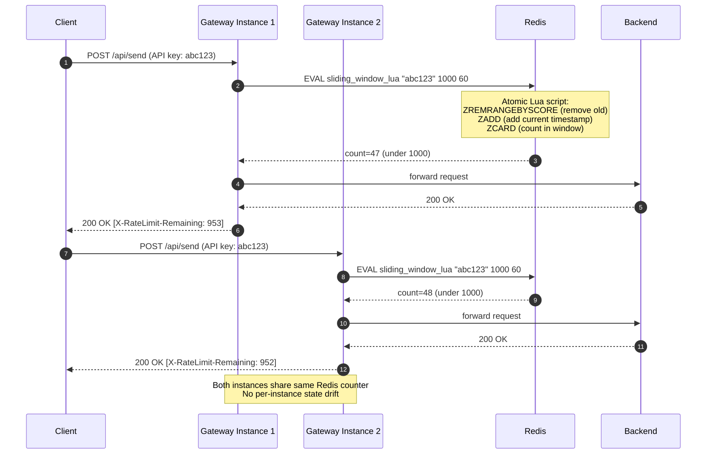

**Redis Lua script for sliding window log (atomic — no race conditions):**

```lua
local key = KEYS[1]
local limit = tonumber(ARGV[1])
local window = tonumber(ARGV[2])
local now = tonumber(ARGV[3])

-- Remove entries outside the window
redis.call("ZREMRANGEBYSCORE", key, 0, now - window * 1000)
-- Add current request
redis.call("ZADD", key, now, now)
-- Set TTL to auto-clean
redis.call("EXPIRE", key, window)
-- Count requests in window
local count = redis.call("ZCARD", key)

if count <= limit then
    return 1  -- allowed
else
    return 0  -- rejected
end
```

---

## Where to Enforce Rate Limits

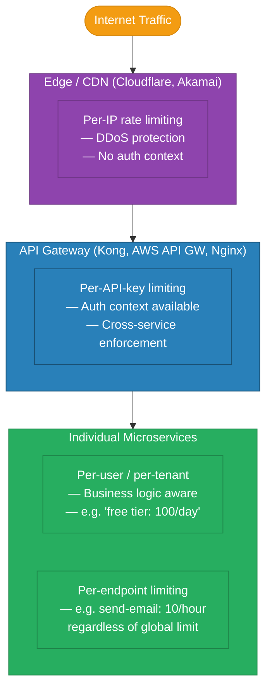

| Enforcement Level | Identity Available | Granularity | Bypass Risk |
|---|---|---|---|
| Edge / CDN | IP address only | Coarse | IP spoofing, shared IPs (NAT) |
| API Gateway | API key, JWT claims | Per-key, per-tier | Key leakage |
| Service level | User ID, tenant ID | Per-endpoint | Requires auth middleware |
| DB / queue level | Service identity | Per-resource | Last resort — adds latency |

**Layered defense:** Use edge for IP-based DDoS, API gateway for business-tier limits (free vs paid), and service-level for fine-grained per-feature limits.

---

## Response Headers Standard

Clients should receive enough information to self-throttle and implement smart retry logic:

| Header | Meaning | Example |
|---|---|---|
| `X-RateLimit-Limit` | Max requests allowed in the window | `1000` |
| `X-RateLimit-Remaining` | Requests remaining in current window | `847` |
| `X-RateLimit-Reset` | Unix timestamp when window resets | `1718467200` |
| `Retry-After` | Seconds to wait before retrying (on 429) | `42` |
| `X-RateLimit-Policy` | Human-readable policy description | `1000;w=3600;burst=50` |

HTTP `429 Too Many Requests` is the correct status code. Include `Retry-After` — without it, clients often retry immediately (amplifying the problem).

---

## Graceful Degradation

Not every rate-limited request should get a hard failure. Consider tiered responses:

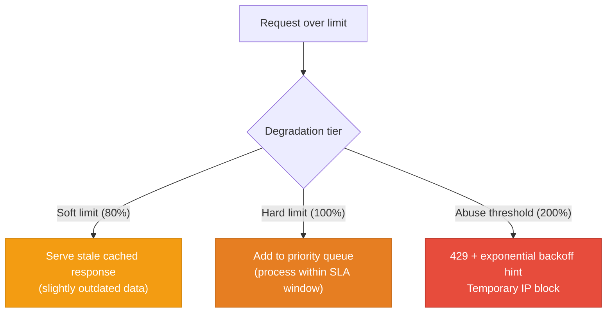

---

## Real-World Rate Limit Policies

| Service | Limit | Window | Notes |
|---|---|---|---|
| GitHub REST API | 5,000 requests | Per hour (authenticated) | 60/hour unauthenticated |
| GitHub GraphQL | 5,000 points | Per hour | Queries cost more points |
| Stripe API | 100 reads, 100 writes | Per second | Burst of 5,000 read/write in short window |
| Twitter API v2 | 300 tweets | Per 3 hours | Per-user, not per-app |
| Twilio SMS | 1 message/sec | Per number | Per phone number, not per account |
| OpenAI API | 60 RPM / 90,000 TPM | Per minute | Token-based + request-based |
| Cloudflare | 10,000 requests | Per 10 minutes | Default WAF rule, per IP |

---

## Code

The implementation in this module uses nginx `limit_req` with three configurations:

```
high-level-design/scalability/3.2_rate_limiting/
├── server/
│   └── main.go               # Go backend logging request identity
├── nginx/
│   ├── per_ip.conf           # 10 req/s per IP, burst=5
│   ├── per_api_key.conf      # limit_req_zone by $http_x_api_key
│   └── burst_nodelay.conf    # burst=20 nodelay — instant burst, then throttle
├── docker-compose.yml
└── test.sh                   # curl test suite with parallel requests
```

Run it:

```sh
docker compose up --build -d
bash test.sh
```

---

## Interview Angles

**Q1: Design a rate limiter for a REST API serving 100,000 req/s across 10 gateway instances.**
Use sliding window counter in Redis with an atomic Lua script (ZREMRANGEBYSCORE + ZADD + ZCARD). All 10 gateway instances share the same Redis cluster — no per-instance state. Shard by `hash(api_key) % redis_nodes` to distribute Redis load. For ultra-high throughput, add a local token bucket in each gateway process as a first pass (reducing Redis calls by ~90%), syncing periodically with Redis for accuracy.

**Q2: How do you rate limit across distributed API gateway instances?**
Centralize counter state in Redis. Each gateway calls an atomic Lua script per request — atomicity prevents race conditions where two gateways read stale counts. For even higher scale, use a two-tier approach: per-process token bucket (fast, approximate) + Redis sync every 100ms to enforce global limits. Accept ~100ms of over-limit tolerance for the eventual consistency window.

**Q3: What is the difference between token bucket and leaky bucket, and when would you use each?**
Token bucket allows controlled bursts — a client that was idle accumulates tokens and can fire them quickly. Leaky bucket enforces a constant output rate regardless of input bursts — excess requests queue up or are dropped. Use token bucket for general APIs where short bursts are acceptable (GitHub API). Use leaky bucket for payment processing, DB write queues, or any system where uniform, predictable load is more important than per-client latency.

**Q4: How would you handle a client that ignores 429 responses and keeps hammering your API?**
Layer the response: first 429 with Retry-After header; if they continue, escalate to a temporary IP/key block at the gateway (not just counter-based). Use exponential backoff hints in the response body. For persistent abuse, add the key/IP to a WAF blocklist. Track abuse patterns (requests after 429) as a signal for automatic circuit-breaking.

**Q5: What are the failure modes of Redis-based rate limiting, and how do you handle Redis being unavailable?**
If Redis is down, you have two choices: fail-open (allow all requests — protects availability, risks abuse) or fail-closed (reject all requests — protects backend, causes outage). Best practice: fail-open with logging and alerting, plus an in-process fallback limiter with a more permissive limit. Preempt with Redis Sentinel or Cluster for HA. Use circuit-breaker pattern to switch to local limiting immediately on Redis timeout rather than blocking on every request.

**References**

- [Stripe — Rate Limiting Algorithms](https://stripe.com/blog/rate-limiters)
- [Cloudflare — How We Built Rate Limiting Capable of Scaling to Millions of Domains](https://blog.cloudflare.com/counting-things-a-lot-of-different-things/)
- [GitHub — REST API Rate Limits](https://docs.github.com/en/rest/overview/rate-limits-for-the-rest-api)
- [Redis — Rate Limiting with Lua](https://redis.io/docs/manual/patterns/rate-limiting/)
- [Kong — Rate Limiting Plugin](https://docs.konghq.com/hub/kong-inc/rate-limiting/)

---

## Architecture Diagrams

> Generated from D2 sources in [`docs/diagrams/src/3.2_rate_limiting/`](../../../docs/diagrams/src/3.2_rate_limiting/).
> Regenerate: `just diagrams-topic 3.2_rate_limiting`.

### Overview

All four algorithms side by side — token bucket (bursts allowed), leaky bucket (fixed drain), fixed window (cheap but exploitable), sliding window log (exact but memory-hungry).

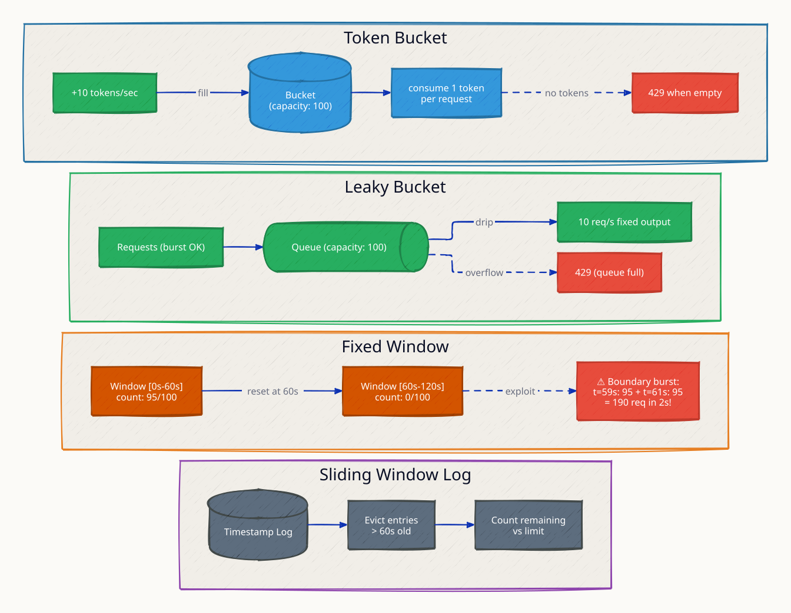

**`burst_allowed` scenario:** 50 queued requests drain instantly through the token bucket because the bucket held capacity — bursts within budget are a feature, not a bug.

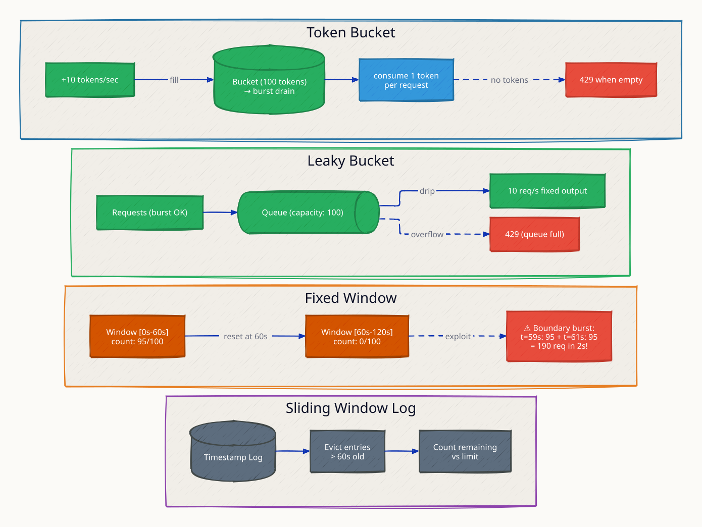

**`fixed_window_exploit` scenario:** 95 requests at t=59s plus 95 at t=61s — both windows individually legal, 190 requests in 2 seconds — the boundary flaw sliding windows fix.

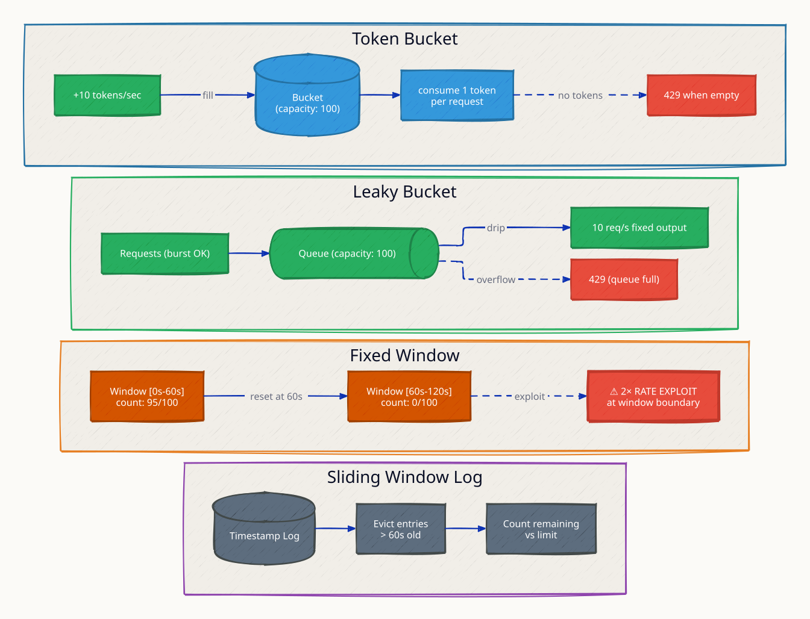

### Request Flow

A distributed implementation: every gateway instance INCRs the same Redis counter so the limit holds fleet-wide.

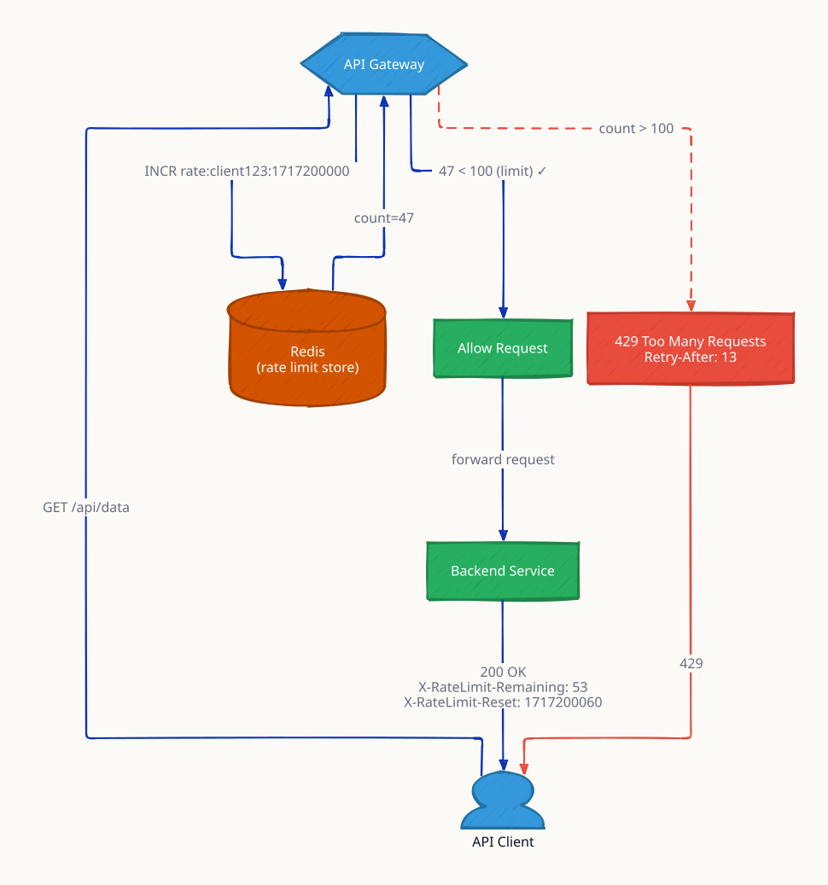

**`distributed_race` scenario:** two gateways read-then-increment concurrently and both admit the request; the fix is an atomic Lua script so check-and-increment is one Redis operation.

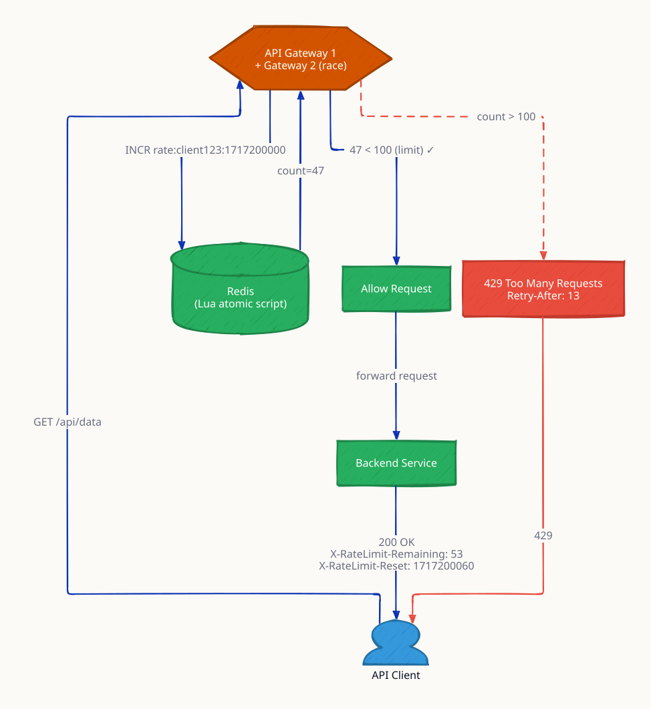
