# Database Sharding

**Sharding is horizontal partitioning of data across multiple independent database nodes** — each node owns a distinct subset of rows, called a shard. When a single database can no longer handle the write throughput, data volume, or query load of a system, sharding is the answer. A single PostgreSQL node can comfortably handle ~10,000 writes/second on commodity hardware; WhatsApp processes 100 billion messages per day — roughly 1.2 million/second. At that scale, you need hundreds of shards. Getting the shard key right is the most consequential architectural decision in a sharded system: a bad key creates hotspots that defeat the entire purpose; a good key distributes load so evenly that adding capacity is just spinning up another shard.

---

## Horizontal vs Vertical Partitioning

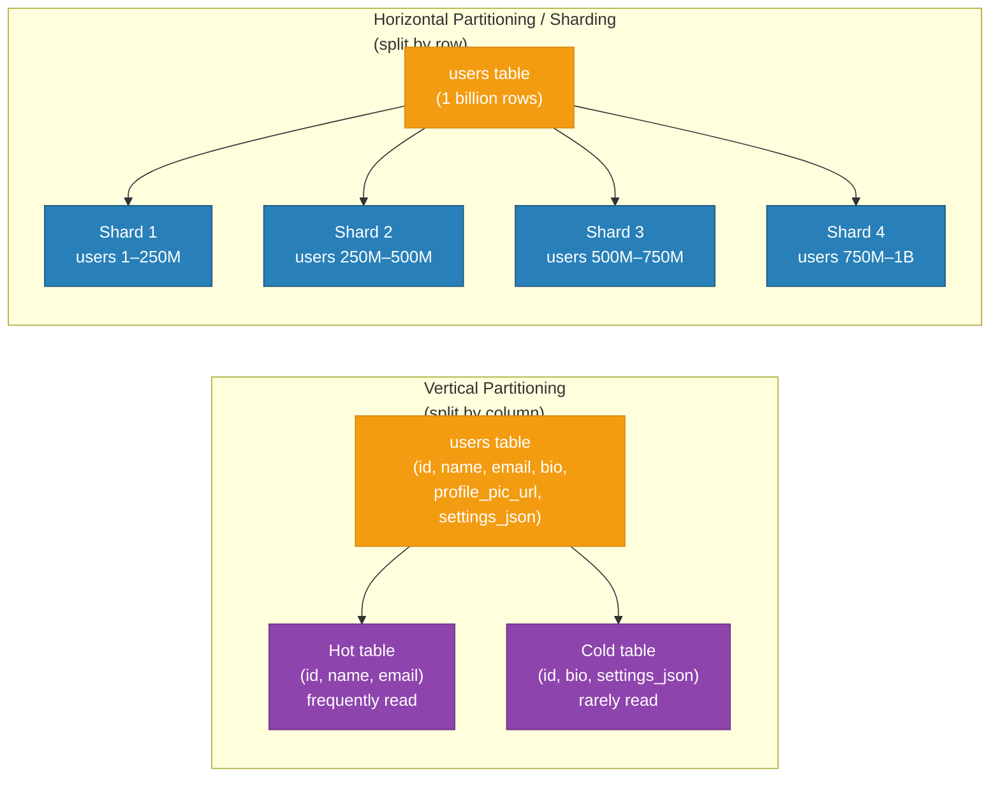

| Dimension | Vertical Partitioning | Horizontal Sharding |
|---|---|---|
| Split by | Columns | Rows |
| Addresses | Wide tables, I/O for unused columns | Volume and write throughput limits |
| Complexity | Low | High |
| Cross-partition queries | Require JOINs | Require scatter-gather |
| Typical tool | DB schema design, column families | Vitess, Cassandra, MongoDB |

---

## Shard Key Selection: Most Critical Decision

The shard key determines which shard receives each write and read. A poor choice means one shard receives 80% of traffic while others idle.

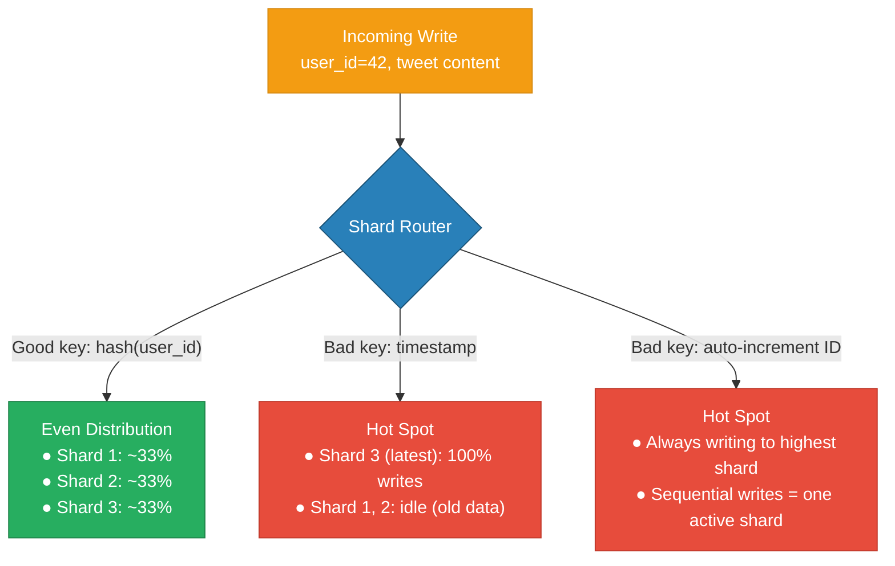

---

## Sharding Strategies

### Hash-Based Sharding

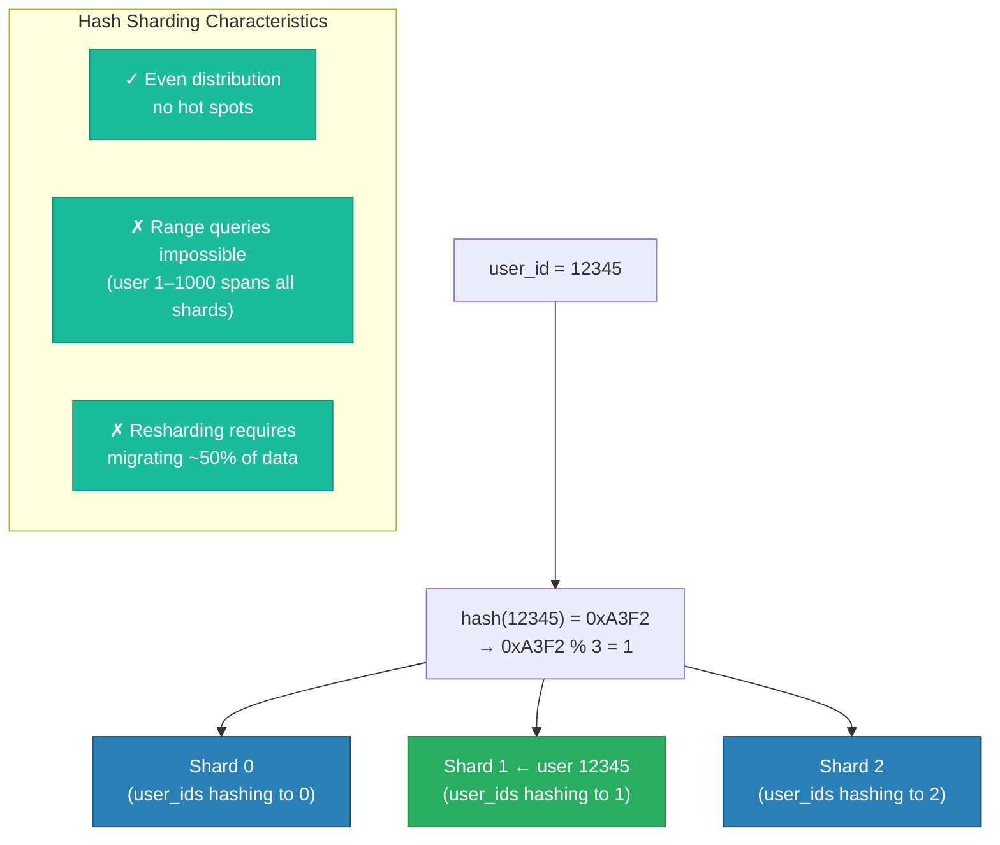

### Range-Based Sharding

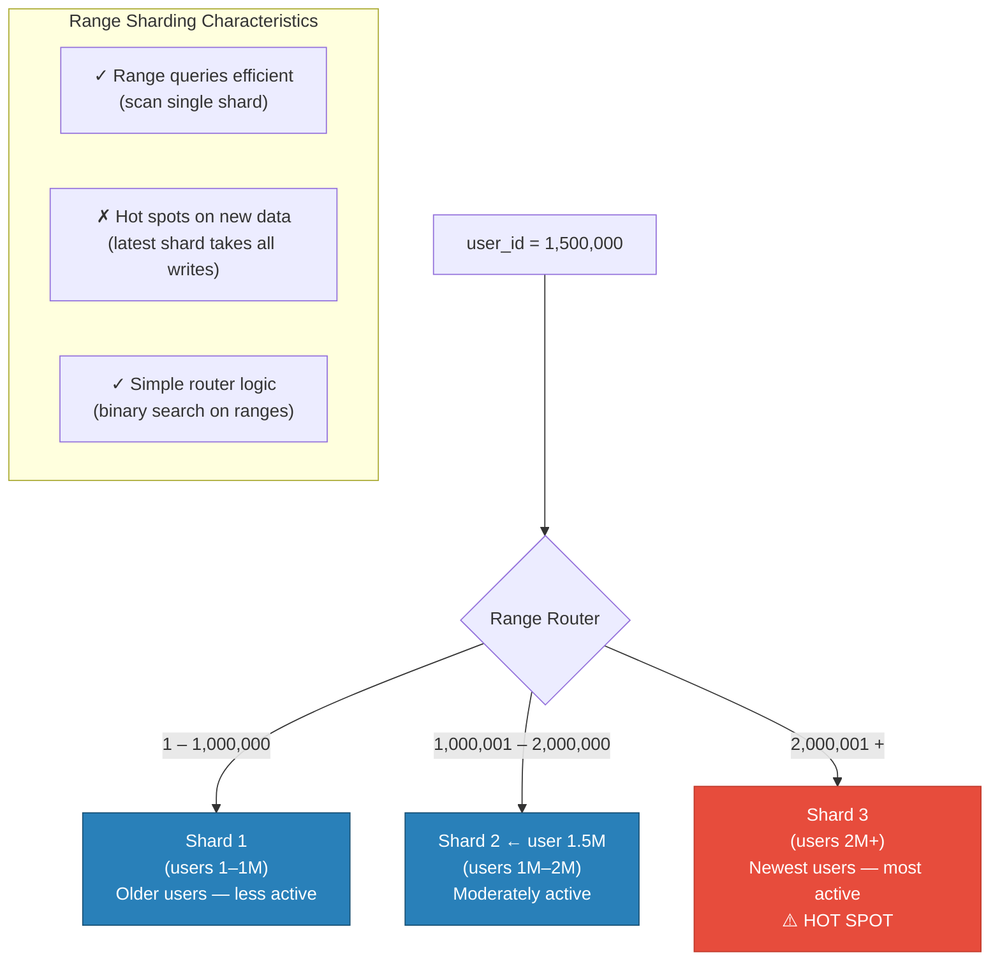

### Directory-Based Sharding

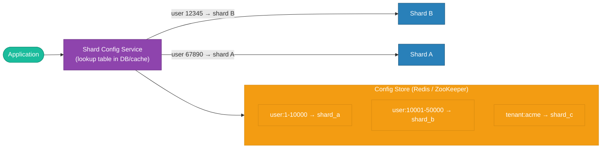

**Directory-based pros:** Fully flexible — move individual tenants between shards without resharding everyone. Supports geo-based placement (route EU users to EU shard). **Cons:** Extra network hop for every query; config service is a single point of failure (must be HA + cached).

---

## Query Router: hash(user_id) % N

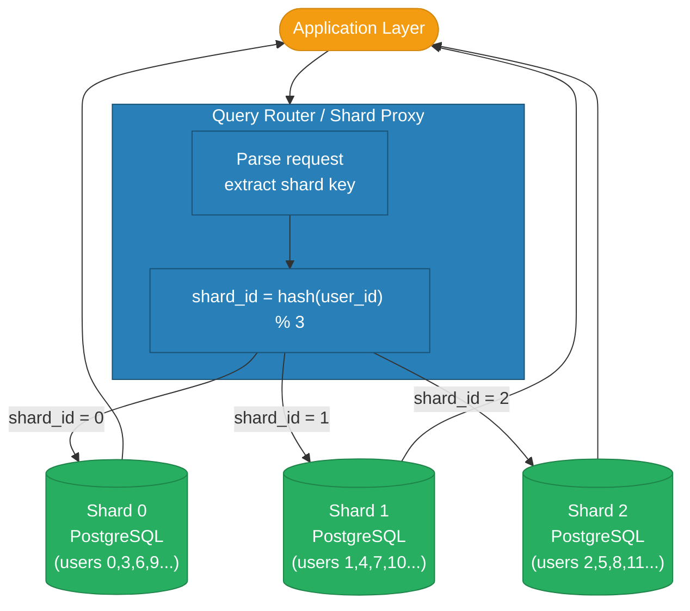

---

## Cross-Shard Queries Problem

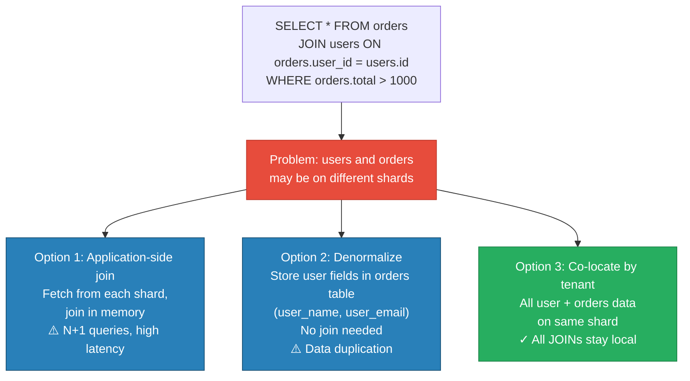

**Cross-shard transactions:** Two-phase commit (2PC) across shards is possible but expensive — adds latency and coordinator failure risk. Better: design the data model to avoid cross-shard transactions. Use the saga pattern (compensating transactions) when cross-shard coordination is unavoidable.

---

## Resharding with Consistent Hashing

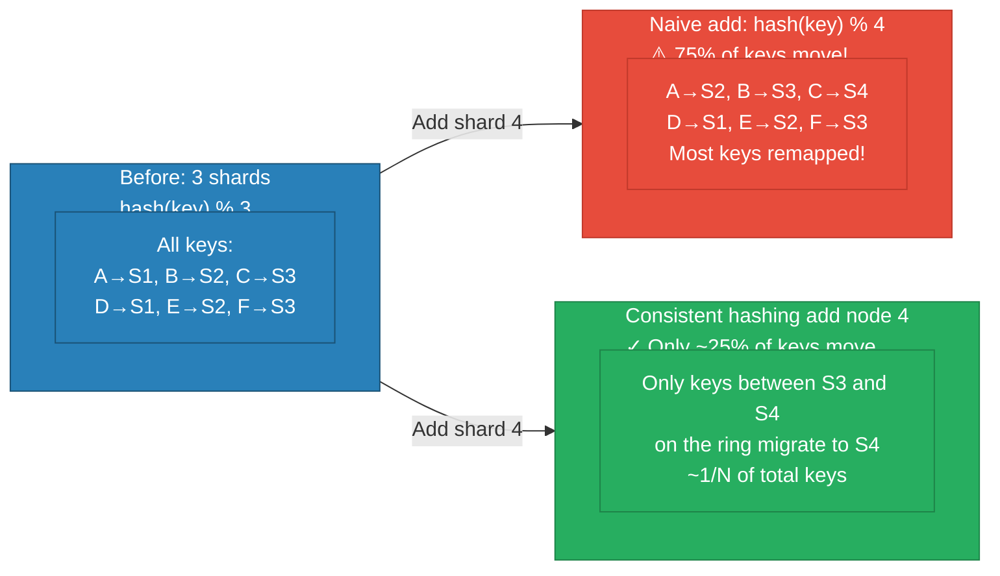

**Resharding in practice:**
1. Add new shard to the cluster
2. Copy ~1/N of data from neighbor shard (online, with dual-write)
3. Update routing config to include new shard
4. Drain and validate — old shard serves reads while copy is in progress
5. Switch over — new shard now handles its key range
6. Remove migrated data from old shard

Cassandra uses **vnodes** (each physical node owns 256 virtual ring positions) so resharding is automatic when nodes join/leave.

---

## Hotspot Mitigation

When a specific key naturally receives disproportionate traffic (celebrity tweet, viral post):

| Technique | How | Trade-off |
|---|---|---|
| Key salting | Append `user_id + "_" + random(0,9)` → 10 sub-keys, fan-in on read | Read requires fetching 10 keys and aggregating |
| Virtual shards | Assign hot tenants their own dedicated shard | Requires tenant-aware routing logic |
| CDN / cache layer | Hot data cached before hitting shards | Eventual consistency; cache invalidation complexity |
| Read replicas per shard | Each shard has multiple read replicas | Hot writes still hit one primary |
| Application-level queueing | Queue writes for hot keys, batch flush | Adds write latency for hot users |

**Twitter's approach to celebrity tweets:** Pre-compute and fan-out to follower caches at write time (push model), rather than computing a timeline from all shard queries at read time (pull model). Kylie Jenner's tweet goes to 150 million caches asynchronously, not to 150 million DB reads.

---

## Shard Key Anti-Patterns

| Anti-Pattern | Problem | Better Alternative |
|---|---|---|
| Auto-increment ID | All writes go to the highest shard (monotonic hot spot) | Random UUID, or hash(UUID) |
| Timestamp | Current-time bucket gets 100% of writes | Combine: `hash(user_id) + timestamp bucket` |
| Enum / low-cardinality field | Only N possible shard values (e.g., country has 200 options) | Composite key: `country + user_id` |
| Frequently-updated field | Resharding needed when value changes (e.g., account tier) | Use an immutable field for shard key |
| Globally unique sequential | Still monotonically increasing even if hashed | Twitter Snowflake IDs: time-based but sharded by machine ID |

---

## Real-World Sharding Systems

| System | Sharding Mechanism | Details |
|---|---|---|
| Cassandra | Consistent hashing with vnodes | 256 vnodes per node; automatic rebalancing |
| MongoDB | Chunk-based range sharding | Shards hold chunks; balancer migrates chunks |
| MySQL + Vitess | Application-level hash sharding | Vitess adds query routing, connection pooling |
| DynamoDB | Hash + range key, auto-partitioned | AWS manages shard splits transparently |
| CockroachDB | Range-based, auto-split/rebalance | Raft consensus per range (64 MB chunks) |
| Elasticsearch | Document routing by `_id` | Primary shards fixed at index creation |

---

## Code

The implementation in this module demonstrates hash-based and range-based shard routing in Go:

```
high-level-design/scalability/3.3_db_sharding/
├── router/
│   └── main.go               # Go shard router — hash and range strategies
├── shard/
│   └── main.go               # Go shard service — in-memory key/value store
├── docker-compose.yml        # 1 router + 3 shard services
└── test.sh                   # Write/read tests showing which shard handles each key
```

Run it:

```sh
docker compose up --build -d
bash test.sh
```

---

## Interview Angles

**Q1: How do you handle cross-shard transactions?**
Avoid them by design where possible — co-locate related data on the same shard (e.g., all of a user's data by user_id). When unavoidable, use the saga pattern: a sequence of local transactions with compensating actions on failure. Two-phase commit (2PC) works but adds coordinator complexity and is a single point of failure. Distributed SQL databases (CockroachDB, Spanner) handle this transparently with Raft per shard.

**Q2: What shard key would you choose for a Twitter DM system?**
Shard by `conversation_id` (a hash of the two participants' user IDs, lexicographically sorted). This ensures all messages in a conversation live on the same shard — reads and writes for a conversation hit exactly one shard. Avoid sharding by `sender_id` (half the messages for each conversation would be on different shards, requiring cross-shard joins). Avoid sharding by `timestamp` (hot new-message shard). The conversation_id key is immutable and provides natural co-location.

**Q3: How do you rebalance shards without downtime?**
Use consistent hashing so only `1/N` of keys migrate when adding a shard. Migration process: (1) add new shard, (2) start dual-write to both old and new shard for affected key range, (3) backfill historical data from old to new shard, (4) verify data integrity, (5) cut reads over to new shard, (6) stop dual-write, (7) delete migrated data from old shard. Cassandra and MongoDB's balancer do this automatically. For MySQL + Vitess, use Vitess's online schema change + resharding workflow.

**Q4: What is the hotspot problem and how do you mitigate it?**
A hotspot occurs when a disproportionate fraction of reads or writes routes to a single shard — usually due to a popular entity (viral post, celebrity account) or a bad shard key (timestamp, auto-increment). Mitigations: add a random salt suffix to split the key across N sub-shards (then aggregate on read); add a caching layer in front of the hot shard; use read replicas to scale reads for the hot shard; in extreme cases, give the hot entity its own dedicated shard (virtual tenant isolation).

**Q5: When would you choose range-based over hash-based sharding?**
Choose range-based when your access pattern involves range scans (e.g., "all orders from Jan–Mar", "all events from sensor ID 1000–2000"). Range sharding keeps sequential data local, making range queries efficient (single-shard scan). Choose hash-based for write-heavy workloads where even distribution matters more than range query performance (e.g., user profile data accessed by ID). Many real systems combine both: Cassandra uses hash sharding on the partition key for even distribution, and range ordering within a partition for efficient range scans.

**References**

- [Martin Kleppmann — Designing Data-Intensive Applications, Ch. 6](https://dataintensive.net/)
- [Vitess — Sharding for MySQL at YouTube Scale](https://vitess.io/docs/concepts/sharding/)
- [MongoDB — Sharding Architecture](https://www.mongodb.com/docs/manual/sharding/)
- [Cassandra — Consistent Hashing and vnodes](https://cassandra.apache.org/doc/latest/cassandra/architecture/dynamo.html)
- [Twitter — Snowflake ID Generation](https://blog.twitter.com/engineering/en_us/a/2010/announcing-snowflake)

---

## Architecture Diagrams

> Generated from D2 sources in [`docs/diagrams/src/3.3_db_sharding/`](../../../docs/diagrams/src/3.3_db_sharding/).
> Regenerate: `just diagrams-topic 3.3_db_sharding`.

### Overview

User data split across 4 shards by hash(user_id), each shard with its own replica — plus what makes a good shard key.

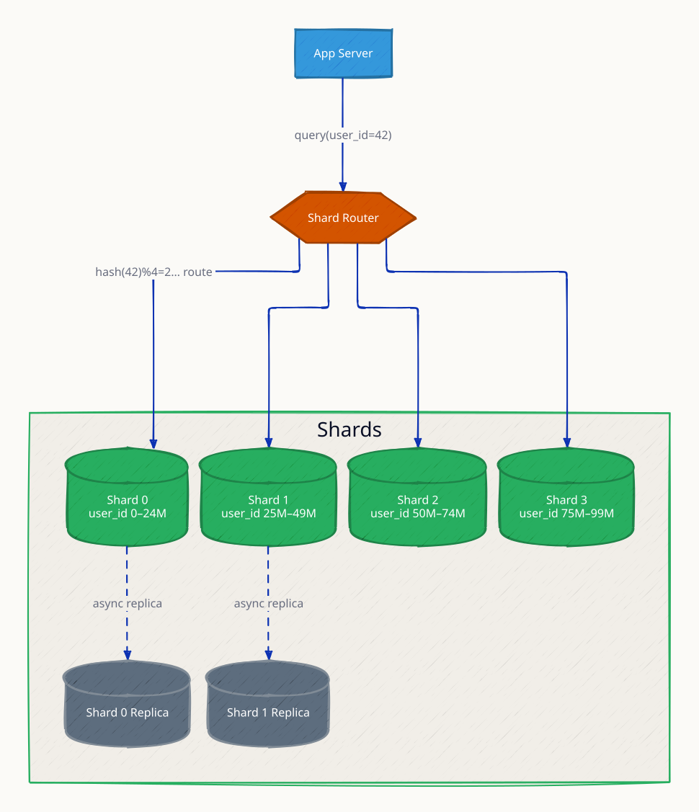

**`hotspot` scenario:** one celebrity user's shard takes disproportionate traffic — hash distribution balances key count, not load per key.

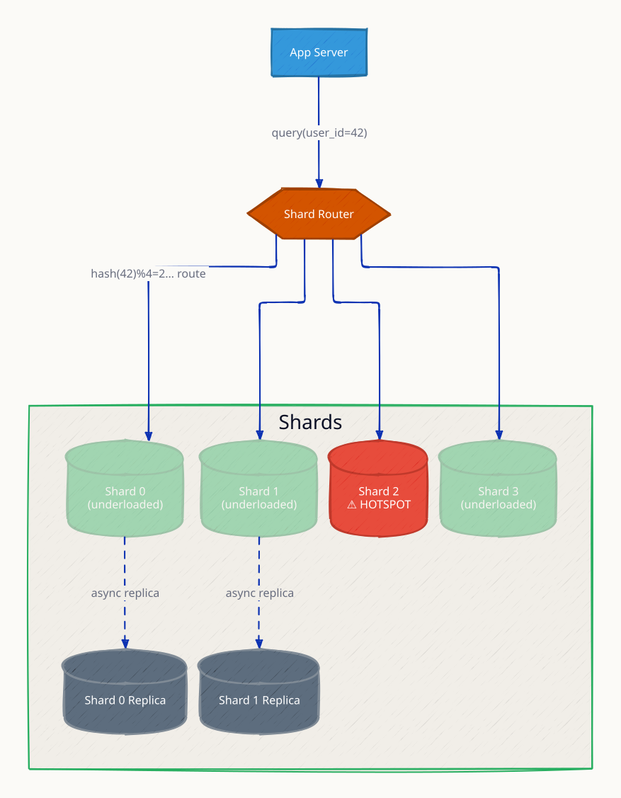

**`shard_split` scenario:** a hot shard splits into two, migrating half its key range — the operational answer to growth, painful without consistent hashing.

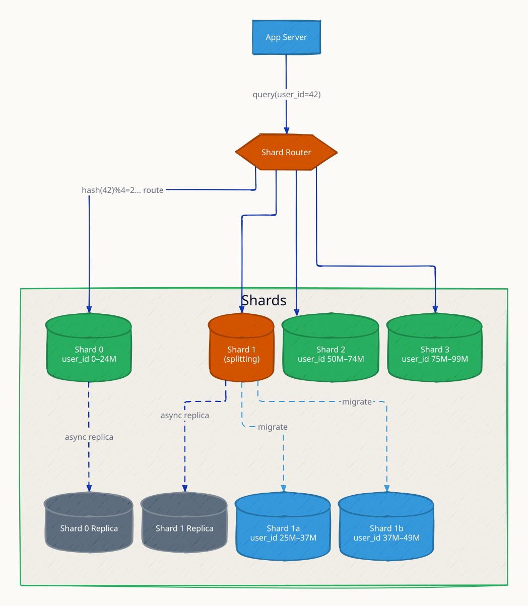

### Request Flow

Single-shard queries (one hop, fast) vs scatter-gather queries that fan out to every shard and merge results.

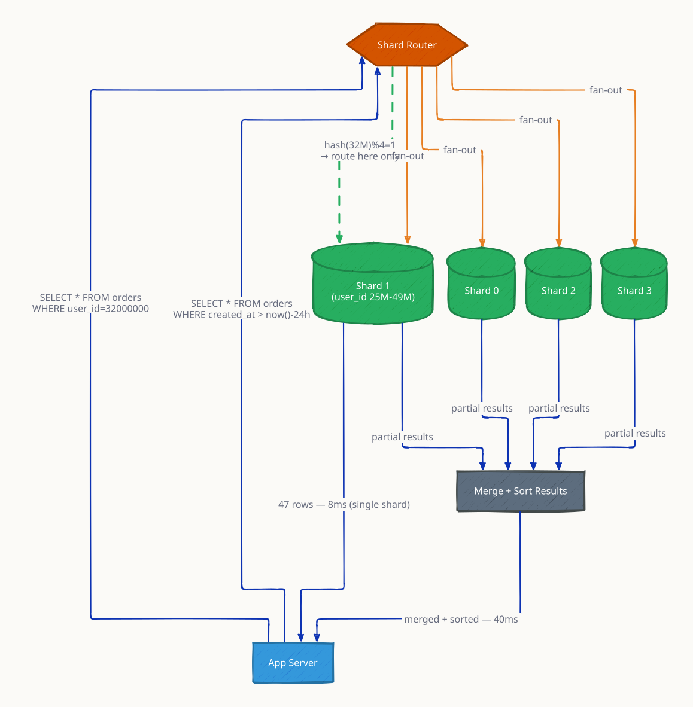

**`resharding` scenario:** adding a shard under naive modulo hashing remaps nearly every key; the diagram shows the migration cost that motivates consistent hashing.

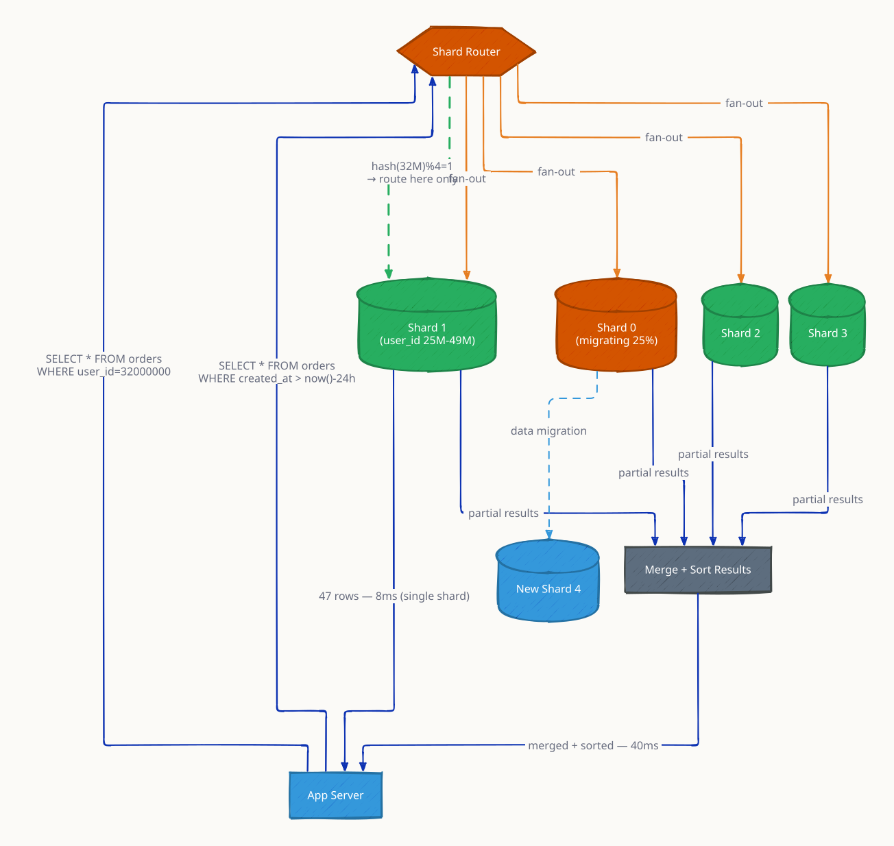
