# Database Replication

**Replication is the practice of maintaining multiple synchronized copies of data across different database nodes** — and it is the foundation of every high-availability, read-scalable, and geographically distributed database architecture. A single-node database is a single point of failure: one hardware failure, one network partition, or one botched migration, and your service is down. Replication solves three distinct problems simultaneously: **read scalability** (10 read replicas multiply your read throughput by 10×), **fault tolerance** (a primary failure triggers automatic failover to a replica in seconds), and **geographic proximity** (serve users from a replica in their continent, cutting latency from 200 ms to 20 ms). Netflix runs active-active multi-region replication for zero-downtime global availability; GitHub uses synchronous replication with Orchestrator for automatic failover; Amazon Aurora replicates across 6 storage nodes in 3 AZs by default.

---

## Replication Topologies

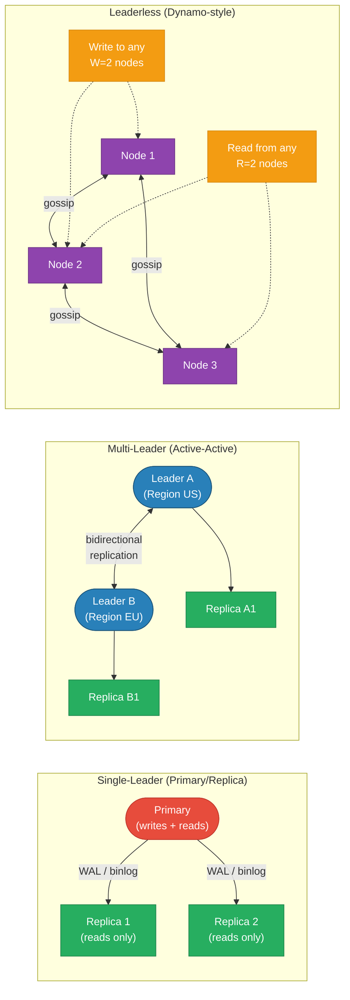

---

## Primary/Replica Setup: Sync vs Async

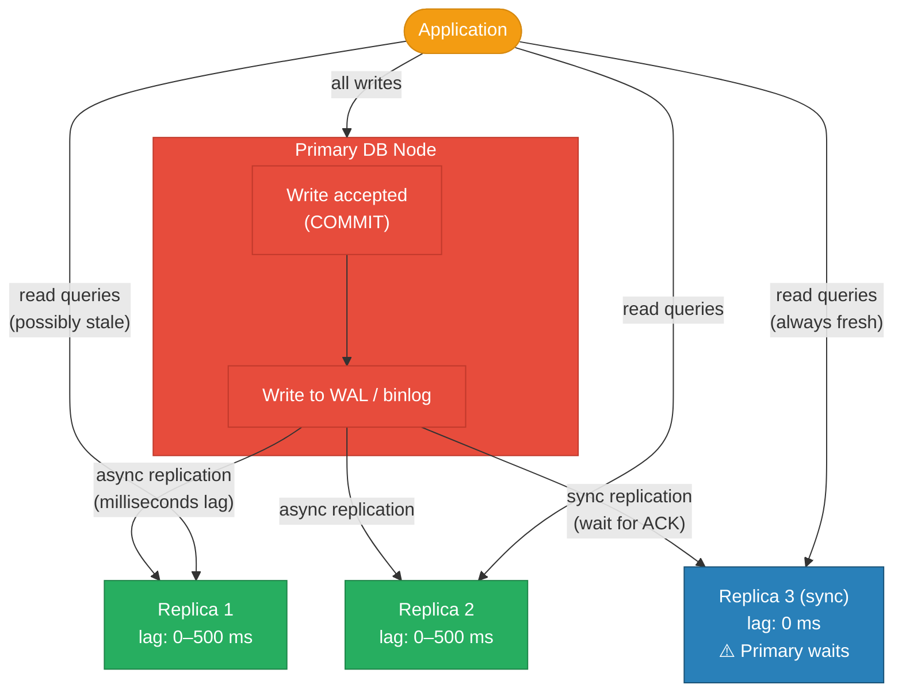

| Mode | Write Latency | Data Loss on Failure | Use Case |
|---|---|---|---|
| Fully async | Fast (~1 ms local) | Up to N seconds of WAL lag | Analytics replicas, reporting, BI |
| Semi-sync | Medium (wait for 1 replica ACK) | At most 1 transaction | Most production OLTP (MySQL semi-sync) |
| Fully sync | Slow (network RTT to each replica) | Zero | Financial ledgers, compliance-critical data |

**PostgreSQL synchronous_standby_names:** Set `synchronous_commit = remote_apply` and name one replica as synchronous — primary waits for that replica to apply the WAL before returning success. All other replicas remain async.

---

## Replication Flow: WAL-Based

```mermaid
sequenceDiagram
    autonumber
    participant App as Application
    participant P as Primary DB
    participant W as WAL Sender
    participant R1 as Replica 1
    participant R2 as Replica 2

    App->>P: BEGIN; UPDATE users SET name='Bob' WHERE id=42; COMMIT;
    P->>P: Write to WAL (LSN 0x1A4F2)
    P-->>App: OK (committed at primary)

    P->>W: WAL record ready at LSN 0x1A4F2
    W->>R1: stream WAL record (async)
    W->>R2: stream WAL record (async)

    R1->>R1: Apply: UPDATE users SET name='Bob' WHERE id=42
    R1-->>W: ACK LSN 0x1A4F2

    R2->>R2: Apply: UPDATE users SET name='Bob' WHERE id=42
    R2-->>W: ACK LSN 0x1A4F2

    Note over R1,R2: Replicas are now consistent<br/>(lag = network RTT + apply time)

    App->>R1: SELECT name FROM users WHERE id=42
    R1-->>App: "Bob" (if lag < time since write, else stale)
```

---

## Replication Lag

Replication lag = time between a write committing on the primary and being visible on a replica. Causes:
- Network latency between primary and replica data center
- Replica CPU/IO overload from applying a large transaction
- Long-running replica queries blocking the applier thread (MySQL)
- Replica taken offline for maintenance

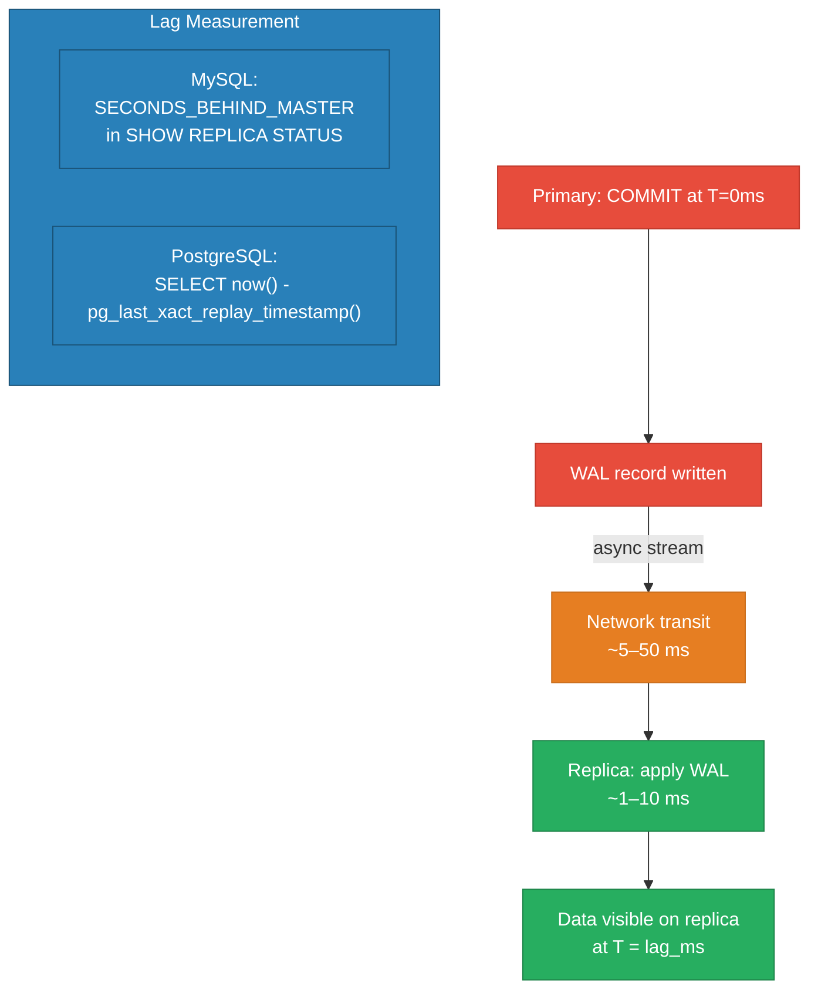

**Monitoring:** Alert at >10 seconds lag. At >30 seconds, exclude the replica from the read pool (traffic all returns to primary). At >5 minutes, investigate applier thread stall.

---

## Read-Your-Writes Consistency Problem

A user writes to the primary, then immediately reads from a stale replica — they don't see their own write.

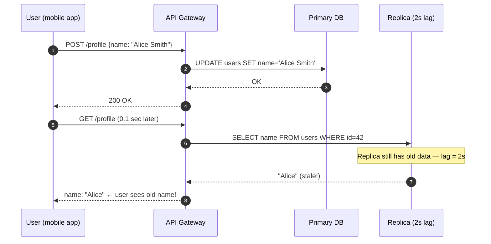

### Solutions for Read-Your-Writes

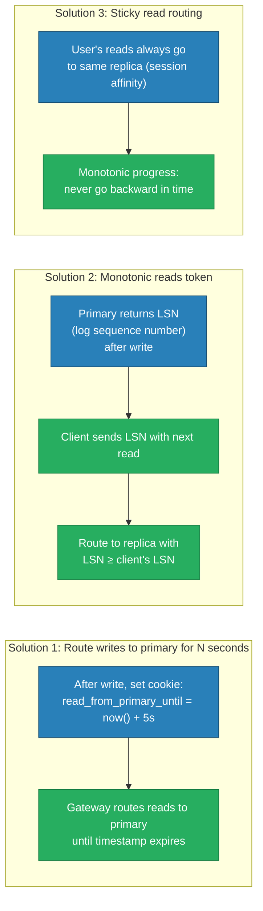

---

## Failover: Primary Goes Down

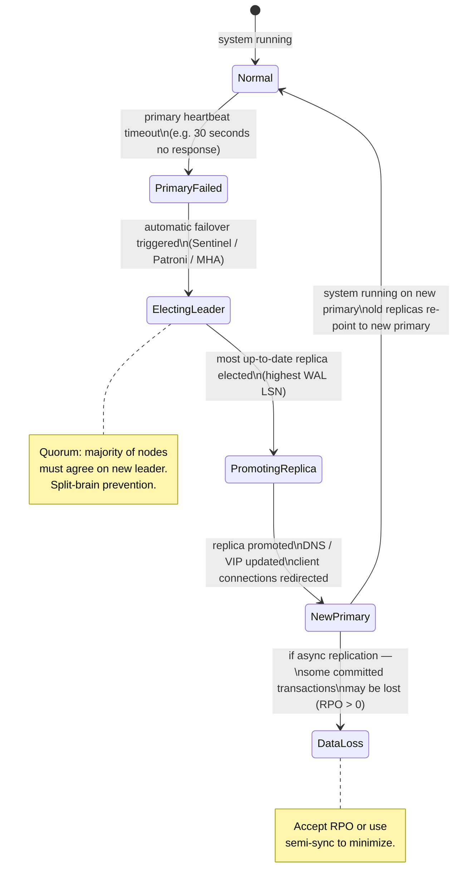

| Failover Tool | Database | RTO | RPO | Notes |
|---|---|---|---|---|
| MySQL MHA | MySQL | ~30–60s | Seconds (async) | Manual promotion option |
| MySQL Orchestrator | MySQL | ~15–30s | Near-zero (semi-sync) | Netflix OSS, topology-aware |
| Patroni + etcd | PostgreSQL | ~10–30s | Near-zero | Most common PG HA stack |
| AWS RDS Multi-AZ | MySQL/PG/Oracle | ~60–120s | Zero (sync standby) | Managed, DNS failover |
| AWS Aurora | Aurora MySQL/PG | ~30s | Zero (shared storage) | Storage-level replication, 6 copies |
| Sentinel | Redis | ~10–30s | Seconds | Redis-specific |

---

## Multi-Leader Replication

Both leaders accept writes simultaneously. Used for multi-region active-active setups where writes must go to a local data center without cross-region round trips.

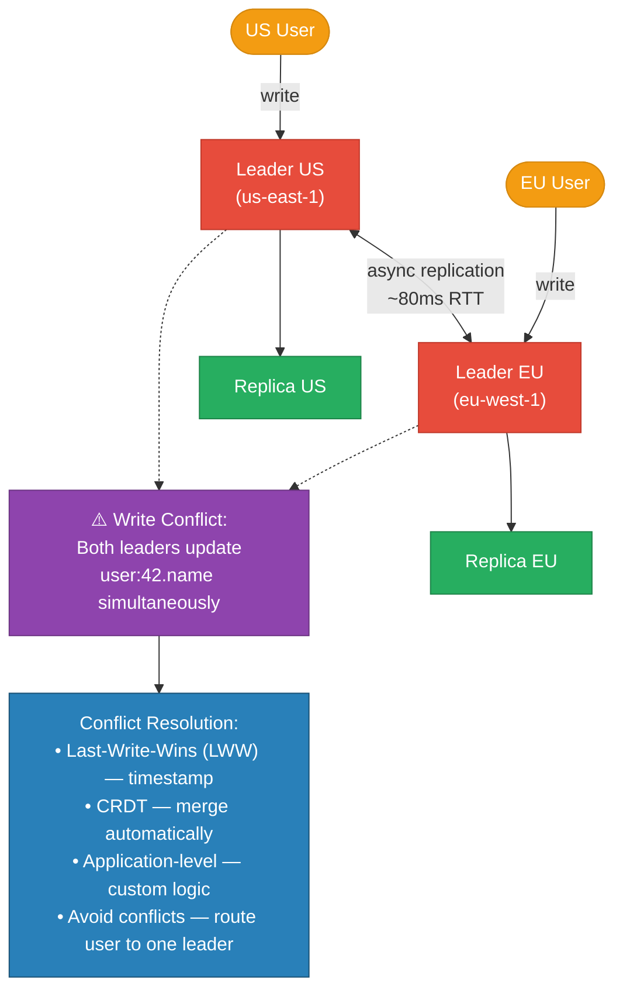

**Multi-leader use cases:** Collaborative editing (Google Docs CRDTs), multi-region active-active (CockroachDB), offline-capable mobile apps that sync on reconnect (CouchDB).

**Conflict avoidance is better than conflict resolution:** Route all writes for a given user to the same leader (sticky by user_id). Conflicts only happen if the user travels regions or the assigned leader fails.

---

## Leaderless Replication (Dynamo-Style)

Any node accepts reads and writes. Consistency is achieved through quorums.

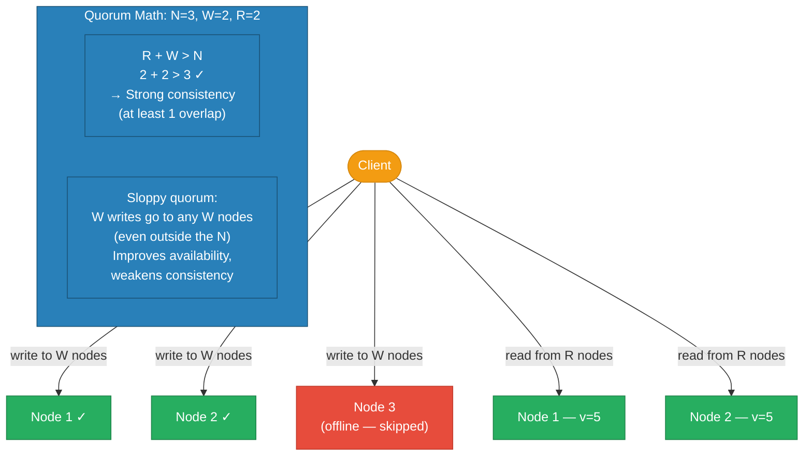

| Configuration | R | W | N | Consistency | Availability |
|---|---|---|---|---|---|
| Strong | 2 | 2 | 3 | Strong (R+W > N) | Lower (need 2 nodes up) |
| Eventual | 1 | 1 | 3 | Eventual | High (only 1 node needed) |
| Write-heavy | 1 | 3 | 3 | Strong writes | Read-optimized |
| Read-heavy | 3 | 1 | 3 | Strong reads | Write-optimized |

**Used by:** Amazon DynamoDB, Apache Cassandra, Riak, Voldemort.

---

## Replication Lag Monitoring & Alerting

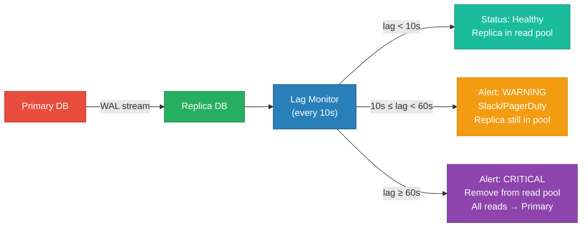

**PostgreSQL lag query:**
```sql
SELECT
    client_addr,
    state,
    sent_lsn,
    write_lsn,
    flush_lsn,
    replay_lsn,
    (sent_lsn - replay_lsn) AS replication_lag_bytes
FROM pg_stat_replication;

-- On replica: measure lag in time
SELECT now() - pg_last_xact_replay_timestamp() AS replication_delay;
```

---

## Real-World Examples

| Company | Setup | Detail |
|---|---|---|
| GitHub | MySQL + Orchestrator | Automatic failover; semi-sync replication; 99.99% uptime |
| Netflix | Cassandra multi-region | Leaderless, active-active across 3 AWS regions |
| Amazon RDS | Multi-AZ standby | Synchronous standby in another AZ; automatic DNS failover |
| Amazon Aurora | 6-way storage replication | Shared distributed storage layer; replicas share the same storage |
| Stripe | MySQL + semi-sync | Zero RPO for payments; semi-sync to at least 1 replica before ACK |
| PostgreSQL on Heroku | Patroni + etcd | Patroni for HA; continuous archiving to S3 (PITR) |

---

## Code

The implementation in this module demonstrates Go primary + 2 async replicas with nginx read/write routing:

```
high-level-design/scalability/3.4_db_replication/
├── primary/
│   └── main.go           # Go primary — accepts writes, exposes /log endpoint
├── replica/
│   └── main.go           # Go replica — polls /log every 500ms, serves reads
├── nginx/
│   └── router.conf       # /write → primary, /read → replicas (round-robin)
├── docker-compose.yml    # primary + 2 replicas + nginx
└── test.sh               # write to primary, read from replicas, show lag
```

Run it:

```sh
docker compose up --build -d && sleep 2
bash test.sh
```

---

## Interview Angles

**Q1: How do you handle replication lag in a social feed feature?**
For a user's own posts, use read-your-writes routing: after posting, route that user's reads to the primary (or a replica with LSN ≥ write LSN) for 5–10 seconds. For the social feed (reading other users' posts), eventual consistency is acceptable — a 2-second lag before a friend's post appears is imperceptible. Monitor lag; if it exceeds 30 seconds, serve a cached/stale feed with a staleness indicator rather than hammering the primary.

**Q2: What happens during a primary failover, and how do you minimize data loss?**
When the primary is unresponsive for N heartbeat intervals, a failover tool (Patroni, Orchestrator) elects the replica with the highest WAL LSN as the new primary. With async replication, any transactions committed at the old primary but not yet streamed are lost (RPO = lag at time of failure). To minimize: use semi-sync replication (primary waits for at least 1 replica ACK before returning success) or synchronous replication (zero RPO, but slower writes). Aurora's shared storage layer eliminates this problem — replicas never lag on storage writes.

**Q3: When would you use multi-leader replication?**
Multi-leader is appropriate when you need low-latency writes in multiple geographic regions simultaneously — each region writes to a local leader and replicates asynchronously. Use cases: global active-active deployments (Salesforce runs multi-leader across data centers), collaborative real-time editing (Google Docs uses CRDTs), mobile apps that work offline and sync later (CouchDB). Avoid multi-leader when write conflicts are hard to resolve automatically — most CRUD applications are better served by single-leader with read replicas per region.

**Q4: Explain quorum reads and writes in Dynamo-style databases.**
In a leaderless system with N replicas, a write is considered successful when W replicas acknowledge it; a read returns the latest value when R replicas respond. When R + W > N, at least one node must have been part of both the latest write and the current read — guaranteeing the read sees the most recent write. For N=3: W=2, R=2 gives strong consistency; W=1, R=1 gives high availability with eventual consistency. Sloppy quorum temporarily routes writes to available nodes outside the canonical N, improving availability during network partitions at the cost of temporary inconsistency.

**Q5: What is the difference between synchronous and asynchronous replication, and when would you choose each?**
Synchronous replication means the primary waits for at least one replica to confirm it has written the data before acknowledging the client — zero data loss on primary failure (RPO=0), but write latency increases by the network RTT to the replica (e.g., +5 ms local, +80 ms cross-region). Asynchronous replication means the primary acknowledges immediately and replicates in the background — minimal write latency overhead, but potential data loss if the primary fails before replication. Choose synchronous for financial transactions, user account data, anything where losing a write is unacceptable. Choose async for read replicas used for analytics, reporting, or geographic read scaling where some staleness is acceptable.

**References**

- [Martin Kleppmann — Designing Data-Intensive Applications, Ch. 5](https://dataintensive.net/)
- [PostgreSQL — Streaming Replication](https://www.postgresql.org/docs/current/warm-standby.html)
- [Patroni — High Availability PostgreSQL](https://github.com/patroni/patroni)
- [Amazon Aurora — High Availability](https://docs.aws.amazon.com/AmazonRDS/latest/AuroraUserGuide/Concepts.AuroraHighAvailability.html)
- [Dynamo: Amazon's Highly Available Key-value Store (SOSP 2007)](https://www.allthingsdistributed.com/files/amazon-dynamo-sosp2007.pdf)
- [GitHub — MySQL HA with Orchestrator](https://github.blog/engineering/infrastructure/mysql-infrastructure-at-github/)

---

## Architecture Diagrams

> Generated from D2 sources in [`docs/diagrams/src/3.4_db_replication/`](../../../docs/diagrams/src/3.4_db_replication/).
> Regenerate: `just diagrams-topic 3.4_db_replication`.

### Overview

One primary streaming WAL asynchronously to three replicas: writes go to one place, reads scale across many.

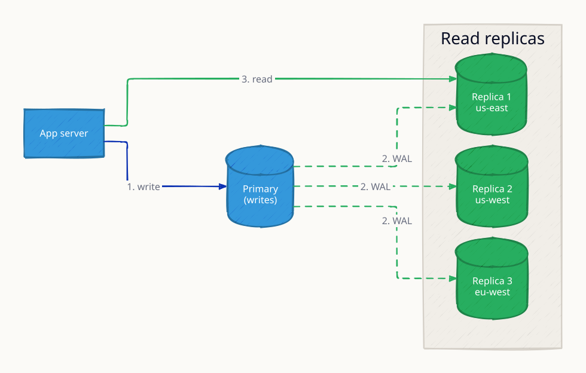

**`primary_failure` scenario:** the primary dies and a replica is promoted; writes resume after election — bounded unavailability instead of data loss.

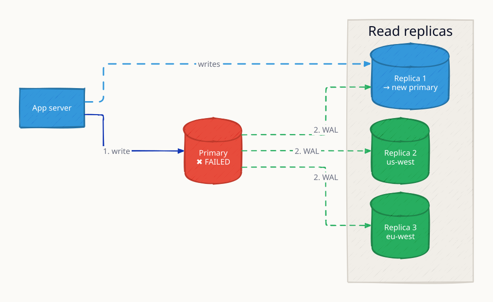

**`replica_lag` scenario:** a replica falls behind the primary's WAL stream and serves stale reads — the price of async replication, measured and monitored as lag.

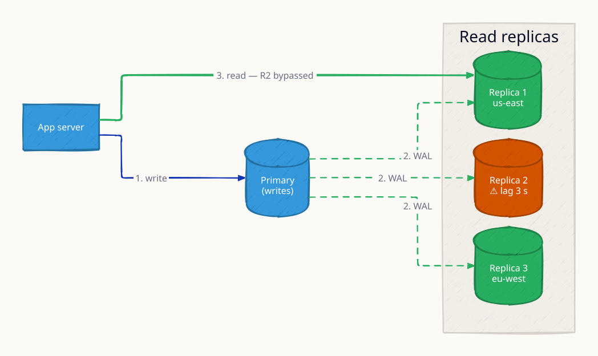

### Request Flow

Automated failover with Patroni: detect primary death, elect the most caught-up replica, repoint clients.

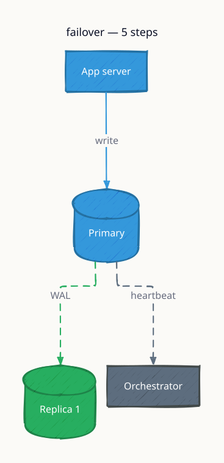

*Animated walkthrough (base → scenario): [`request-flow.gif`](../../../docs/diagrams/gif/3.4_db_replication/request-flow.gif)*


**`split_brain` scenario:** both nodes briefly believe they are primary after a partition; STONITH fences the old primary so only one node can ever accept writes.

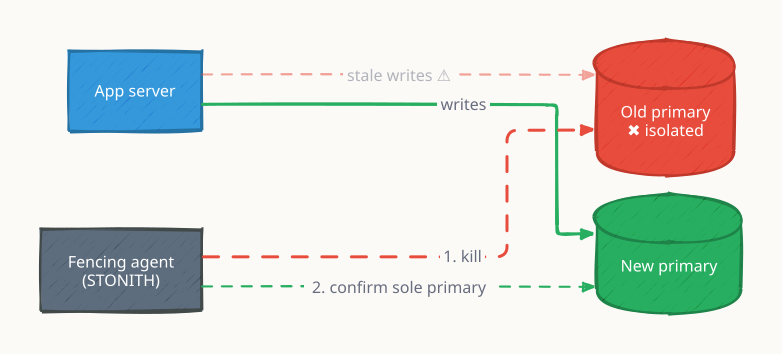
