# OAuth 2.0 and JWT

OAuth 2.0 is the industry-standard authorization framework that lets users grant third-party applications limited access to their resources without handing over credentials. JWT (JSON Web Token) is the stateless token format that makes this work at scale — a resource server can verify a user's identity and permissions by validating the token's cryptographic signature without any database call. Together they underpin every "Login with Google" button, every mobile app that calls an API, and every machine-to-machine service account in a modern backend. Getting the details wrong (wrong grant type, insecure storage, missing claim validation) is a direct path to account takeover.

---

## OAuth 2.0 Roles

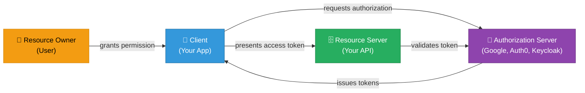

| Role | Responsibility |
|---|---|
| Resource Owner | The user who owns the data and grants access |
| Client | The application requesting access on the user's behalf |
| Authorization Server | Issues access tokens after authenticating the user |
| Resource Server | Hosts the protected resources; validates tokens |

---

## Grant Types

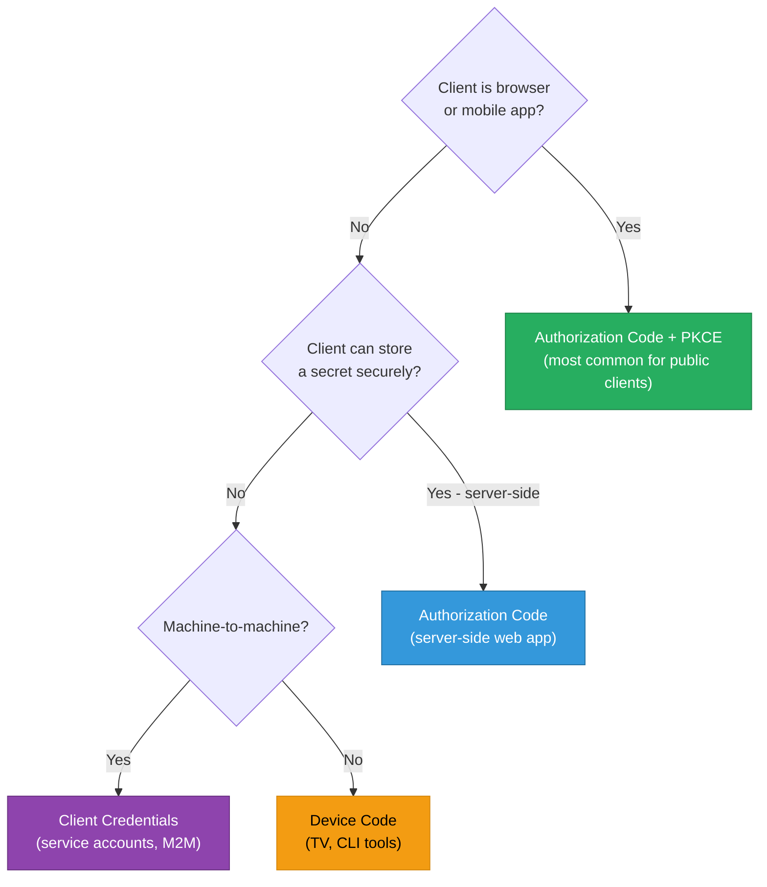

| Grant Type | Use case | Client secret? |
|---|---|---|
| Authorization Code + PKCE | SPA, mobile, public client | No — PKCE replaces secret |
| Authorization Code | Server-side web app | Yes — stored server-side only |
| Client Credentials | Backend → backend, service accounts | Yes — stored server-side only |
| Device Code | TV apps, CLI tools | No |
| Resource Owner Password | Legacy migration only — avoid | Yes — avoid entirely |

---

## Authorization Code + PKCE Flow

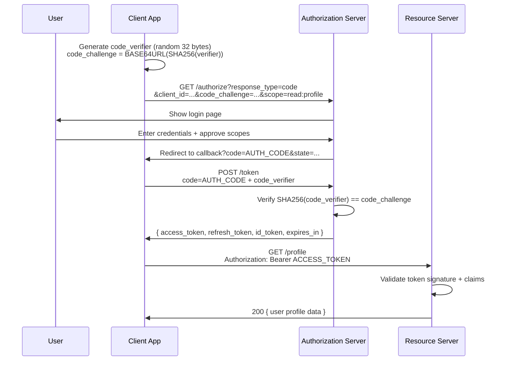

**Why PKCE matters:** Without it, an attacker who intercepts the authorization `code` (e.g., via a malicious app registered to the same redirect URI) can exchange it for tokens. PKCE binds the code to the originating request — only the app that generated `code_verifier` can redeem the code.

---

## JWT Structure

A JWT is three base64url-encoded segments joined by dots: `header.payload.signature`

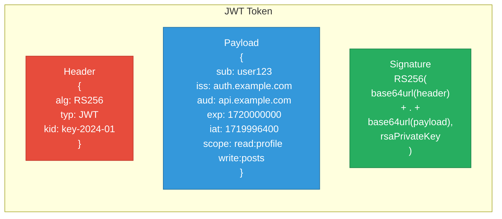

### Standard Claims

| Claim | Meaning | Must validate |
|---|---|---|
| `sub` | Subject — user's unique ID | Present, matches expected user |
| `iss` | Issuer — who issued the token | Matches your auth server URL |
| `aud` | Audience — intended recipient | Includes your service's identifier |
| `exp` | Expiry (Unix epoch seconds) | Must be in the future |
| `iat` | Issued-at timestamp | Sanity check — not suspiciously old |
| `nbf` | Not-before timestamp | Token invalid before this time |
| `jti` | JWT unique ID | Used for revocation blocklist lookup |

---

## Token Validation Flow

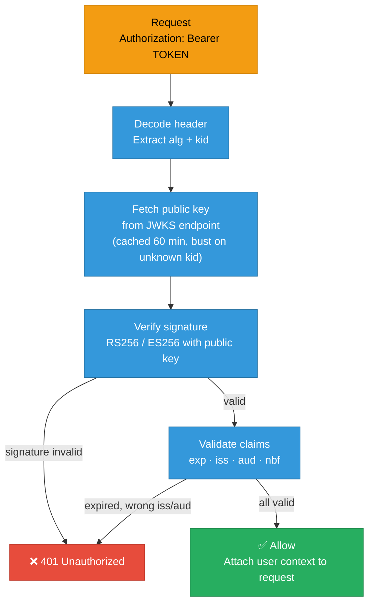

**JWKS caching:** Fetching the public key on every request adds latency and load. Cache the JWKS response keyed by `kid` for 60 minutes; evict and re-fetch on encountering an unknown `kid`.

---

## Access Token vs Refresh Token

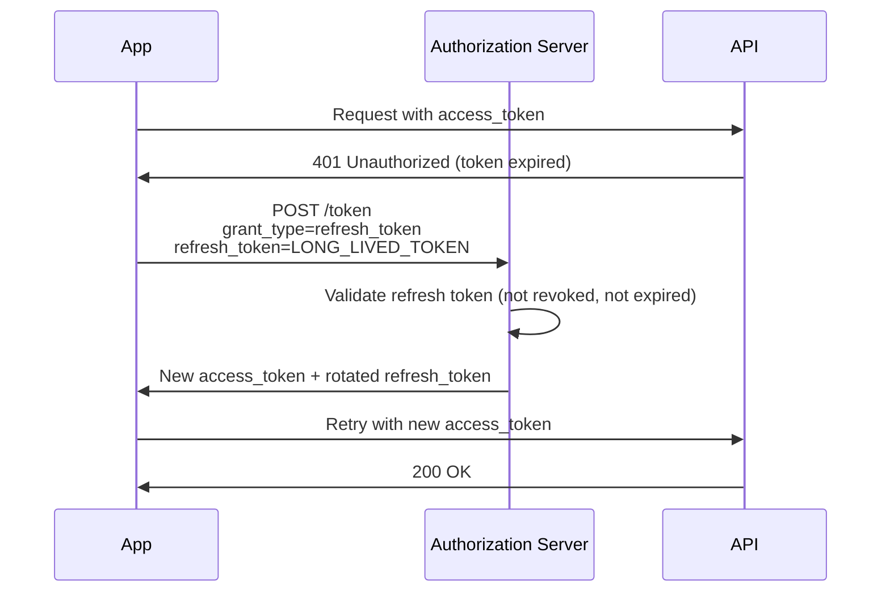

| | Access Token | Refresh Token |
|---|---|---|
| Lifetime | 15 min – 1 hour | Days to months |
| Sent to | Resource Server on every API call | Authorization Server only |
| If compromised | Limited blast radius — expires soon | High risk — rotate immediately |
| Storage | Memory or httpOnly cookie | Secure httpOnly cookie / OS keystore |
| Revocable | Hard (stateless) — rely on short TTL | Yes — stored server-side in DB |

**Refresh token rotation:** Issue a new refresh token with each use and invalidate the old one. If the old token is used again, it signals theft — invalidate the entire token family (all refresh tokens for that user session).

---

## Token Storage Security

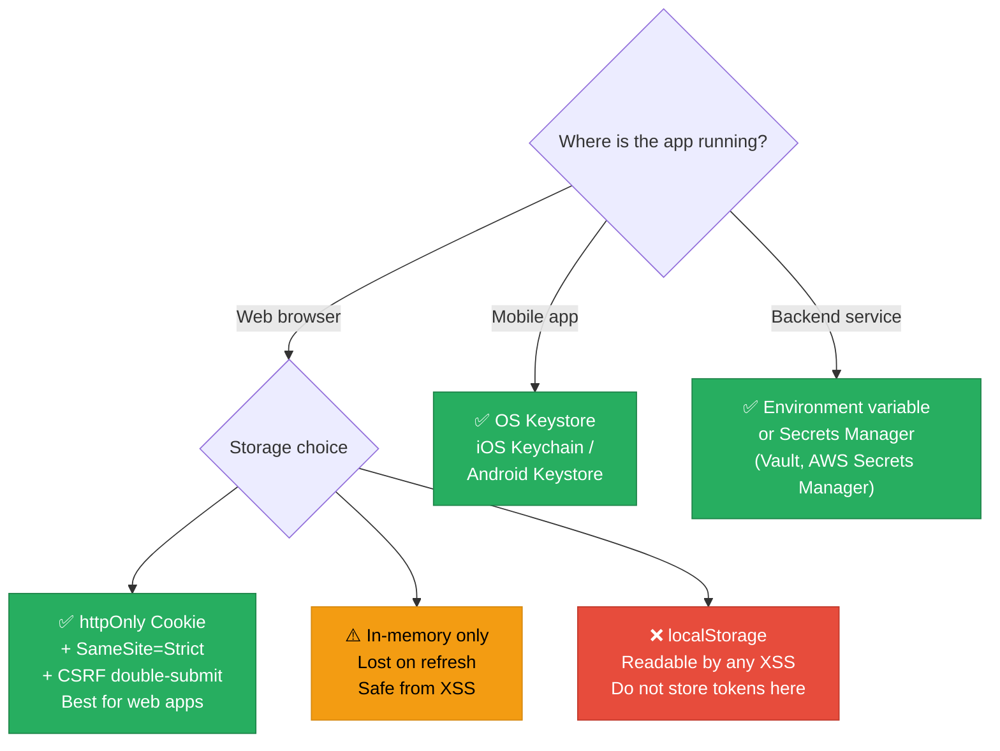

---

## JWT Revocation Options

JWTs are stateless — the resource server validates them without calling the auth server. True instant revocation requires extra infrastructure:

| Strategy | Mechanism | Tradeoff |
|---|---|---|
| Short TTL | 15-minute access tokens | Permissions stay stale up to 15 min |
| Revocation blocklist | Store revoked `jti` in Redis; check on each validation | Extra Redis lookup per request |
| Token introspection | Resource server calls `/introspect` per request | Extra network hop; auth server becomes hot path |
| Refresh token revocation | Revoke refresh token; wait for access token to expire | User can't get new tokens; current access token lingers |

**Practical recommendation:** Short-lived access tokens (15 min) + refresh token rotation covers 95% of cases without infrastructure complexity.

---

## RS256 vs HS256

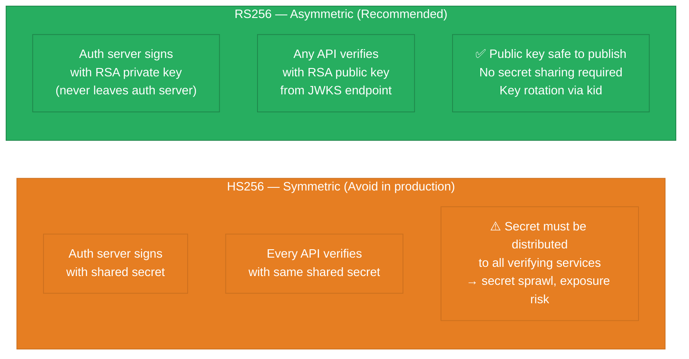

---

## OpenID Connect (OIDC)

OIDC adds an identity layer on top of OAuth 2.0. OAuth answers "what can this app access?" — OIDC adds "who is the user?"

Requesting the `openid` scope causes the token endpoint to return an `id_token` JWT alongside the `access_token`. The `id_token` carries standard identity claims: `sub`, `email`, `name`, `picture`. Validate it like any JWT.

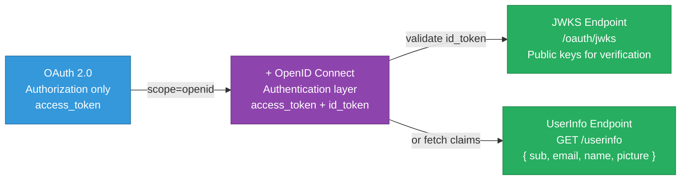

---

## Common Vulnerabilities

| Vulnerability | Description | Fix |
|---|---|---|
| `alg: none` attack | Attacker removes signature, sets `alg: none`; naive validators accept | Always allowlist algorithms; reject `none` |
| Algorithm confusion | RS256 token verified as HS256 with public key as secret | Lock algorithm in verifier; never derive from token header alone |
| Missing `aud` check | Token for service A accepted by service B | Always validate `aud` against your service identifier |
| Expired token accepted | Server skips `exp` validation | Never skip — check every claim |
| Token in URL | `GET /api?token=...` logged in proxies and browser history | Tokens in `Authorization: Bearer` header only |
| Overly broad scopes | Access token grants `admin:*` when only `read:profile` needed | Request minimum required scopes; enforce in resource server |

---

## Run This Implementation

```sh
docker compose up --build -d && sleep 2 && bash test.sh
```

```sh
go test -v ./auth-server/
```

The Go implementation includes: authorization code issuance, token exchange, JWT signing (HS256 for simplicity in the demo), and resource server validation middleware.

---

## Interview Angles

**Q: What is the difference between OAuth 2.0 and OpenID Connect?**
OAuth 2.0 is an authorization framework — it grants a client permission to access resources; it says nothing about who the user is. OIDC builds on OAuth 2.0 and adds authentication — it issues an `id_token` JWT with standardized identity claims (`sub`, `email`, `name`) so the client knows *who* granted access.

**Q: How do you revoke a JWT after issuance?**
JWTs are stateless, so revocation requires either: a Redis blocklist checked per request using the `jti` claim (adds latency), relying on a short TTL (15 min) so expired tokens are self-revoking, or using opaque access tokens with introspection endpoints. Most systems use short TTL + revocable refresh tokens.

**Q: Why use RS256 over HS256 for token signing?**
RS256 uses asymmetric keys — the auth server signs with a private key that never leaves it, and any service can verify using the public key published at the JWKS endpoint. HS256 requires distributing the shared secret to every service that validates tokens, creating secret sprawl and exposure risk.

**Q: What is PKCE and when is it required?**
PKCE (Proof Key for Code Exchange) prevents authorization code interception in public clients (mobile apps, SPAs) that cannot securely store a client secret. The client generates a `code_verifier`, sends its SHA256 hash as `code_challenge` in the authorization request, and proves ownership of the verifier when exchanging the code for tokens — so an intercepted code is useless without the original verifier.

**Q: Which claims must you always validate on a JWT?**
At minimum: `exp` (token has not expired), `iss` (token was issued by your expected auth server), `aud` (token is intended for your service), and the signature itself. Skipping `aud` enables cross-service token replay; skipping `exp` enables indefinite reuse of stolen tokens.

---

## Architecture Diagrams

> Generated from D2 sources in [`docs/diagrams/src/8.1_oauth_jwt/`](../../../docs/diagrams/src/8.1_oauth_jwt/).
> Regenerate: `just diagrams-topic 8.1_oauth_jwt`.

### Overview

The OAuth 2.0 authorization-code flow — the client app never sees the password, only tokens — plus the JWT's header.payload.signature anatomy.

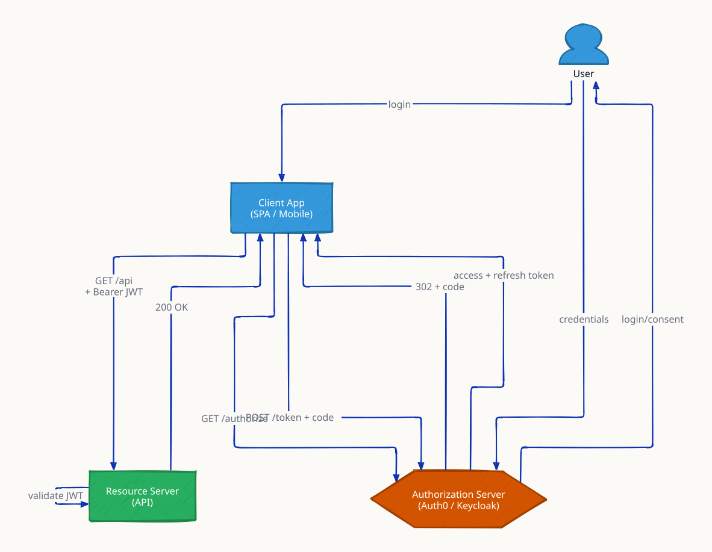

**`invalid_signature` scenario:** a tampered token fails signature verification immediately — integrity is checked with math, not a database.

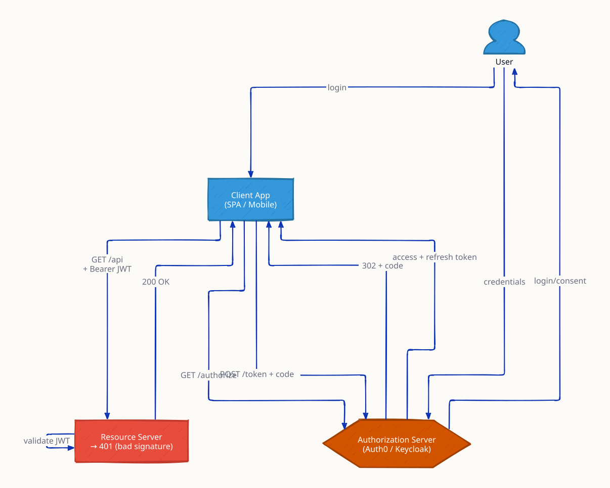

**`token_expired` scenario:** an expired token gets 401; the client redeems its refresh token for a new access token without re-login — short-lived access tokens bound the blast radius of theft.

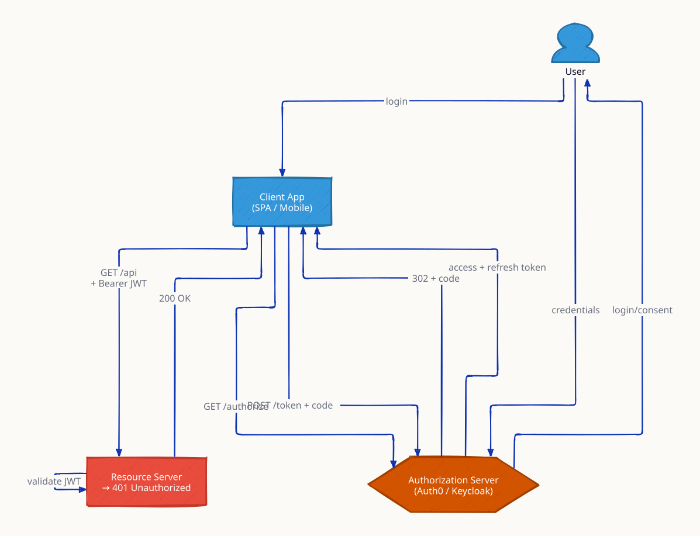

### Request Flow

Stateless validation at the gateway: decode header → fetch the matching JWKS public key (cached) → verify signature → check exp/iss/aud → forward with identity headers. No session store, no auth-DB call.

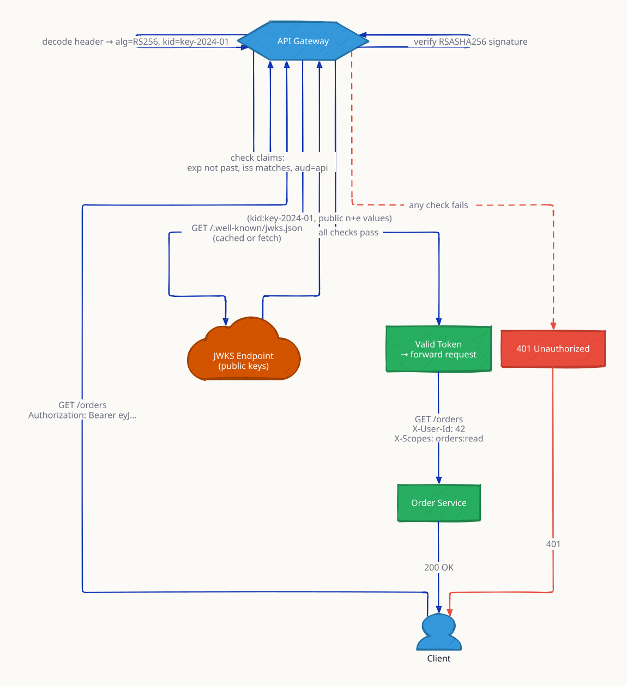

**`key_rotation` scenario:** the JWKS serves old and new keys simultaneously; the token's kid header selects the right one, so rotation is invisible to users.

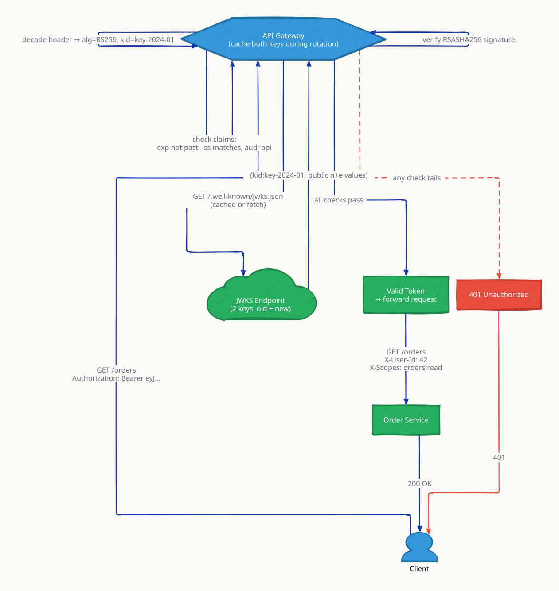
